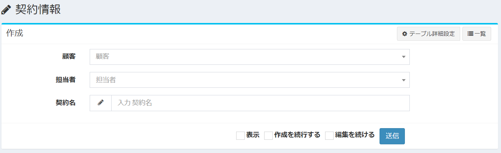

# Form tùy chỉnh
Đây là trang quyết định các mục hiện trên [màn hình form dữ liệu](/vi/data_form.md) của Exment (màn hình nhập dữ liệu) và cách xếp chúng. Bạn đổi được vị trí các mục (bố cục các ô - box), trường ẩn, thiết lập liên kết dữ liệu, v.v.  
Nội dung thiết lập ở đây được áp dụng vào [màn hình form dữ liệu](/vi/data_form.md) của từng bảng.

- Cách mở màn hình: "Hiển thị trang" và "Chỉnh sửa form" ở dưới
- Cách xếp các mục: "Các mục thiết lập của form tùy chỉnh" ở dưới
- Sao chép giá trị của dữ liệu đã chọn từ bảng khác: "Thiết lập liên kết dữ liệu" ở dưới
- Thu hẹp một lựa chọn khác theo giá trị đã chọn: "Thiết lập lọc liên quan" ở dưới
- Chuyển form được dùng theo điều kiện: "Thiết lập thứ tự ưu tiên form" ở dưới

## Hiển thị trang
- Ở danh sách bảng tùy chỉnh, đánh dấu bảng sẽ thiết lập rồi bấm "Cài đặt chi tiết bảng" ở góc trên bên phải.  

> ※ Cũng mở trực tiếp được từ màn hình danh sách dữ liệu hoặc màn hình đăng ký dữ liệu của bảng tùy chỉnh đó. Khi đó, cũng hãy bấm "Cài đặt chi tiết bảng" ở góc trên bên phải.  

- Trên màn hình cài đặt chi tiết bảng hiện ra, bấm biểu tượng thiết lập form thì danh sách form hiện ra.  
※Mỗi bảng có 1 form mặc định được tạo sẵn từ đầu.


## Chỉnh sửa form
Khi sửa form, bấm liên kết [Chỉnh sửa] của form đó.  


## Các mục thiết lập của form tùy chỉnh


### Thiết lập cơ bản của form
Nhập các thông tin cơ bản của form.

- ##### Form display name (Tên hiển thị của form)
Nhập tên của form.  

- ##### Default form (Form mặc định)
Khi muốn form này là form mặc định, hãy đặt YES.  
Khi đã đặt [Thiết lập thứ tự ưu tiên form](/vi/form?id=thiết-lập-thứ-tự-ưu-tiên-form) thì thiết lập đó được ưu tiên.

- ##### Detailed screen display method (Cách hiển thị màn hình chi tiết)
Chọn cách hiện các mục trên [màn hình chi tiết dữ liệu](/vi/data_details): theo bố cục hàng và cột đã đặt trên màn hình này, hoặc 1 cột dọc đơn giản.  


- ##### Heading display method (Cách hiển thị tiêu đề)
Đặt cách hiện tiêu đề của từng mục.  
※Đây là thiết lập của toàn bộ form. Khi muốn đổi theo từng mục, hãy đổi thiết lập của từng mục.

### Thiết lập khối form
Thiết lập các khối (block) của form.  
Khối là một nhóm dữ liệu, thông thường mỗi bảng có 1 khối.  
Tuy nhiên, khi có thiết lập quan hệ 1:n, dữ liệu của bảng con cũng nhập được trên cùng màn hình. Hãy đánh dấu "Sử dụng" của khối bảng con rồi thiết lập.


#### Các mục của khối form
※Tất cả các mục dưới đây là mục thiết lập của bảng con.

- ##### Make the form in table form (Hiển thị form dạng bảng)  
Hiện các ô nhập của bảng con ở dạng bảng.

- ##### Optimize loading of child-table data (Tối ưu tải dữ liệu bảng con)  
Đặt thành YES thì sau khi màn hình chỉnh sửa hiện ra, các dòng của bảng con này được tải tự động. Với dữ liệu có nhiều dòng bảng con, thời gian cho đến khi màn hình chỉnh sửa hiện ra ngắn lại. Giá trị mặc định là NO.  
Dùng được khi chỉnh sửa dữ liệu đã có, ở khối một-nhiều có "Hiển thị biểu mẫu dạng bảng" là YES. Cho đến khi tải xong thì không lưu được.  
Khi đặt "Hiển thị biểu mẫu dạng bảng" thành NO rồi lưu form, thiết lập này cũng thành NO.  
※Dùng được từ v7.1.0.


- ##### Form block name (Tên khối form)  
Tên hiện ở từng khối của form.  

- ##### Display order (Thứ tự hiển thị)  
Khi có nhiều bảng con, bạn đặt được thứ tự hiện.  


#### Mục form
Chọn các mục sẽ hiện trên form nhập rồi xếp chúng.  
Các mục chọn được từ "Danh sách ứng viên mục form" ở dưới.


Trên form đặt được các ô (box) từ 1 đến 4 cột.  
Các mục form được đặt vào trong các ô này.


Với các ô, bạn làm được các thao tác sau.  

- Bấm nút "+" bên cạnh ô thì một cột mới được thêm vào hàng hiện tại.  


- Bấm nút "+" bên dưới ô thì một hàng mới được thêm. (Khi hàng tiếp theo đã có, một cột mới được thêm vào hàng đó)  


- Kéo và thả phần lề bên phải của ô thì đổi được kích thước của ô.  


- Bấm biểu tượng thùng rác ở góc trên bên phải của ô thì ô bị xóa.  


Bằng cách tăng giảm hàng, cột của các ô và đổi chiều rộng, bạn tạo được, ví dụ, các bố cục như sau.  

- 1 cột - 2 cột


- 3 cột - 1 cột


- 1 cột - 2 cột - 1 cột


### Danh sách ứng viên mục form  
Đây là các mục có thể thêm vào form.  
Có 2 loại: "Cột của bảng" và "Khác".  


#### Table column (Cột của bảng)  
Các mục là cột tùy chỉnh đã đặt cho bảng tùy chỉnh.  
Khi kéo và thả vào ô của "Mục form", mục được đặt trên form dữ liệu. Cách hoạt động khác nhau tùy theo loại cột tùy chỉnh và thiết lập ở [Chi tiết mục form](/vi/form?id=chi-tiết-mục-form), nhưng thông thường bạn chỉnh sửa hoặc xem được giá trị của mục.

#### Other (Khác)  
Các mục không gắn với dữ liệu, chỉ để hiện trên form, như tiêu đề, văn bản giải thích, HTML.  
Khi kéo và thả vào ô của "Mục form", mục được đặt trên form dữ liệu.

- ##### Heading (Tiêu đề):
Hiện trên form ở dạng tiêu đề.

- ##### Explanatory text (Văn bản giải thích):
Hiện văn bản giải thích trên form. Không dùng được HTML.

- ##### HTML:
Hiện HTML trên form.  
※Vì an toàn, thẻ `<script>`, `<iframe>` và thuộc tính `id` không được xuất ra (từ v6.2.15 trở đi). Khi muốn chạy script trên màn hình, hãy dùng [plugin script](/vi/plugin_quickstart_script).  

- ##### Extended HTML (HTML mở rộng):
Ngoài HTML, bạn dùng được chuỗi ký tự theo định dạng đặt ở [tham số](/vi/params). Khi vẽ màn hình, chúng được thay bằng giá trị của dữ liệu đã lưu để tạo HTML.  
※Giống như "HTML", thẻ `<script>`, `<iframe>` và thuộc tính `id` không được xuất ra (từ v6.2.15 trở đi).  
Ví dụ:
```
<h4>ID: ${id}, Mã công ty: ${value:company_code}</h4>
```
※Giá trị của cột chỉ được thay khi vẽ màn hình. Xin lưu ý: dù chỉnh sửa giá trị của cột đó trên màn hình chỉnh sửa dữ liệu, giá trị này không đổi theo.  

- ##### Image (Hình ảnh):
Hiện hình ảnh trên form.

- ##### Hairline (Đường kẻ):
Hiện đường kẻ trên form.


#### Chi tiết mục form
Các mục đã thêm vào ô hiện ra bằng nhãn như sau.  
- Mục được đặt bắt buộc trong thiết lập cột tùy chỉnh có dấu màu đỏ bên cạnh tên.  
- Bấm biểu tượng thùng rác ở bên phải nhãn thì mục đó bị xóa khỏi ô.  
- Bấm biểu tượng bánh răng ở bên phải nhãn thì hộp thoại thiết lập chi tiết hiện ra.  


##### Heading display format (Định dạng hiển thị tiêu đề)
Bạn đặt được cách hiện tiêu đề cho từng mục.
(Được ưu tiên hơn thiết lập của toàn bộ form)

##### Field Type (Loại trường)
Đặt cách hiện trên màn hình form dữ liệu. Có 4 loại sau.

| Loại | Trông thế nào trên màn hình | Người dùng đổi giá trị | Dùng từ trường tính toán và thiết lập liên kết dữ liệu |
|---|---|---|---|
| Chỉ đọc | Hiện mờ (màu xám) | Không được | Được |
| Chỉ hiển thị | Hiện dưới dạng văn bản | Không được | Không được |
| Trường ẩn | Không hiện (được thêm vào dưới dạng trường ẩn (hidden)) | - | Được |
| Ẩn | Không hiện (được thêm trong nội bộ hệ thống ngay trước khi lưu) | - | - |

- Chỉ đọc:  
Khi đánh dấu, người dùng không đổi được giá trị. Chỉ hệ thống, trường tính toán và [thiết lập liên kết dữ liệu](/vi/form?id=thiết-lập-liên-kết-dữ-liệu) mới đổi và lấy được giá trị.  
Khi đặt, mục hiện mờ (màu xám) trên form như sau.  
  
- Chỉ hiển thị:  
Khi đánh dấu, người dùng không đổi được giá trị. Hệ thống, trường tính toán và [thiết lập liên kết dữ liệu](/vi/form?id=thiết-lập-liên-kết-dữ-liệu) cũng không đổi và lấy được giá trị.  
Khi đặt, mục hiện dưới dạng văn bản trên form như sau.  
  
- Trường ẩn:  
Khi đánh dấu, mục không hiện trên màn hình mà được thêm vào dưới dạng trường ẩn (hidden).  
Dùng thiết lập này khi muốn dùng mục trong trường tính toán hoặc [thiết lập liên kết dữ liệu](/vi/form?id=thiết-lập-liên-kết-dữ-liệu) nhưng không muốn hiện trên màn hình.  

- Ẩn:  
Khi đánh dấu, mục không được thêm vào màn hình. Nó được thêm trong nội bộ hệ thống ngay trước khi lưu dữ liệu.  
Vì không có trên màn hình nên không dùng được trong trường tính toán và thiết lập liên kết dữ liệu.  
Hãy dùng thiết lập này cho các mục không muốn bị giả mạo hay sửa, như giá trị tham số nội bộ.


##### Data linkage settings (item) (Thiết lập liên kết dữ liệu - mục)  
Vui lòng xem [Thiết lập liên kết dữ liệu](/vi/form?id=thiết-lập-liên-kết-dữ-liệu).  

##### Related refinement settings (item) (Thiết lập lọc liên quan - mục)  
Vui lòng xem [Thiết lập lọc liên quan](/vi/form?id=thiết-lập-lọc-liên-quan).  


## Thiết lập liên kết dữ liệu
Khi trong form có mục chọn dữ liệu của bảng khác, bạn sao chép được nội dung của dữ liệu đã chọn sang một mục khác của form.  
Ví dụ: khi chọn "Khách hàng" trong form "Hợp đồng", giá trị "Tên khách hàng" trong dữ liệu "Khách hàng" được sao chép vào "Tên khách hàng" trong form "Hợp đồng".


Form "Hợp đồng" có lựa chọn "Khách hàng" và ô văn bản một dòng "Tên khách hàng",  
  
 
khi chọn "Khách hàng", 


giá trị được tự động đặt vào ô văn bản "Tên khách hàng"  


<br />  

#### Các bước thực hiện
- Mở màn hình form tùy chỉnh.  
Bấm biểu tượng thiết lập của "Tên khách hàng" trong các mục form.  


- Trong hộp thoại vừa mở có mục "Cài đặt liên kết dữ liệu".  


- Ở "Chọn cột", chọn cột tùy chỉnh sẽ là yếu tố kích hoạt (trigger) việc sao chép.  
**※Chọn được các cột nằm trong cùng form có loại cột là "Lựa chọn (từ bảng khác)", "Người dùng" hoặc "Tổ chức".**
Trong ví dụ này, chọn "Khách hàng".  


- Khi chọn "Chọn cột", các lựa chọn của mục thứ 2 "Chọn cột liên kết" hiện ra.  
Các cột tùy chỉnh của bảng đã chọn ở "Chọn cột" hiện thành danh sách.  
Trong ví dụ này, chọn "Tên khách hàng".  


- Cuối cùng, bấm nút thiết lập.  
Hộp thoại đóng lại và "Đã cài đặt" hiện bên cạnh nút [Cài đặt liên kết dữ liệu].  


- Hãy bấm nút [Gửi] ở cuối trang để lưu thiết lập.


## Thiết lập lọc liên quan
Khi loại cột là "Lựa chọn (từ bảng khác)", "Người dùng" hoặc "Tổ chức", các lựa chọn được thu hẹp theo lựa chọn ở một mục khác trong cùng form. Chỉ đặt được khi cột của bảng cha hoặc bảng được tham chiếu của bảng đối tượng có trong cùng form.  

#### Ví dụ
Bảng "Thông tin khách hàng" và bảng "Thông tin người phụ trách" được thiết lập quan hệ 1:n, đồng thời bảng "Thông tin hợp đồng" có cột "Khách hàng" và cột "Người phụ trách".  
Khi chọn cột "Khách hàng", muốn thu hẹp các lựa chọn của cột "Người phụ trách" chỉ còn những người phụ trách có dữ liệu cha là "Khách hàng" đã chọn.

  

Giả sử có dữ liệu như dưới đây,
  

trên màn hình thông tin hợp đồng,
 

nếu chọn "Công ty A" ở "Khách hàng" thì những người phụ trách thuộc Công ty A sẽ hiện ra làm lựa chọn,
  

nếu chọn "Công ty B" ở "Khách hàng" thì những người phụ trách thuộc Công ty B sẽ hiện ra làm lựa chọn.
  

#### Các bước thực hiện
- Mở màn hình form tùy chỉnh.  
Bấm biểu tượng thiết lập của cột "Người phụ trách" trong các mục form.  


- Trong hộp thoại vừa mở có mục "Cài đặt lọc theo quan hệ".  
Các lựa chọn hiện ra là danh sách các cột, trong cùng form, là cha của cột đã chọn.  
Trong ví dụ này, cột của bảng "Khách hàng", là bảng cha của bảng "Người phụ trách", hiện trong các lựa chọn.  
※Nút "Cài đặt lọc theo quan hệ" hiện ra khi cột tùy chỉnh là "Lựa chọn (từ bảng khác)", "Người dùng" hoặc "Tổ chức".


- Thiết lập xong thì bấm nút thiết lập.  


#### Về đặc tả của các phiên bản trước v3.3.1
<span class="small">Ở các phiên bản trước v3.3.1, màn hình thiết lập này không được hiển thị và việc thu hẹp lựa chọn được thực hiện ở tất cả các trường có quan hệ cha con 1:n hoặc quan hệ tham chiếu.  
Kết quả là đôi khi phát sinh việc thu hẹp không cần thiết hoặc các lỗi không mong muốn, vì vậy từ v3.3.1 đã bổ sung thiết lập cho phép chọn có thực hiện thu hẹp hay không.  
Khi cập nhật từ phiên bản trước v3.3.1 lên v3.3.1 trở lên, để đảm bảo tính tương thích, thiết lập "thu hẹp lựa chọn ở tất cả các trường có quan hệ cha con 1:n hoặc quan hệ tham chiếu" sẽ được kế thừa.  
Chi tiết về đặc tả khi cập nhật vui lòng xem [tại đây](/patch/relation_filter) (tiếng Anh).</span>


## Thiết lập thứ tự ưu tiên form
Khi đặt sẵn điều kiện và độ ưu tiên, form dùng khi tạo dữ liệu và trên màn hình chi tiết dữ liệu được chuyển theo điều kiện.  

### Tạo mới
Tạo từ nút [Tạo mới] ở bên phải của thiết lập thứ tự ưu tiên form.


### Màn hình thiết lập


##### Target Form (Form đối tượng)  
Chọn form muốn dùng khi hợp với điều kiện.

##### Priority (Thứ tự ưu tiên)  
Đặt thứ tự ưu tiên dùng form.
Với dữ liệu hợp với nhiều điều kiện hiển thị form, màn hình được hiện bằng form có thứ tự ưu tiên cao hơn.

##### Condition Item (Mục điều kiện)  
Cột dùng làm điều kiện hiển thị.

##### Search Condition (Điều kiện tìm kiếm)  
Chọn nội dung của điều kiện.
Nội dung chọn được thay đổi theo loại của cột đã chọn ở "Mục điều kiện" ("Ngày", "Người dùng", v.v.).

##### Condition Value (Giá trị điều kiện)  
Nhập giá trị để so với điều kiện tìm kiếm.

##### Nút [Delete]  
Xóa điều kiện hiển thị của form.

##### Nút [New]  
Thêm mới điều kiện hiển thị của form.
