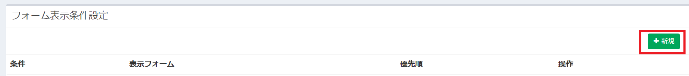

# Form tùy chỉnh
Trang này hướng dẫn cách thay đổi các mục hiển thị trên [màn hình form dữ liệu](/vi/data_form) của Exment, bố cục các ô (box), trường ẩn, thiết lập liên kết dữ liệu, v.v.  
Nội dung thiết lập tại đây sẽ được phản ánh vào [màn hình form dữ liệu](/vi/data_form) của từng bảng.

## Hiển thị trang
- Trên danh sách bảng tùy chỉnh, đánh dấu chọn bảng cần thiết lập, rồi nhấp vào "Detailed table settings" (thiết lập chi tiết bảng) ở phía trên bên phải.  

> ※ Cũng có thể chuyển trực tiếp từ màn hình danh sách dữ liệu hoặc màn hình đăng ký dữ liệu của bảng tùy chỉnh đối tượng. Trong trường hợp đó, cũng vui lòng nhấp vào "Detailed table settings" ở phía trên bên phải.  

- Trên màn hình thiết lập chi tiết bảng vừa hiển thị, nhấp vào biểu tượng thiết lập form, danh sách form sẽ được hiển thị.  
※ Mỗi bảng đều có sẵn một form mặc định được tạo từ đầu.


## Chỉnh sửa form
Nếu muốn chỉnh sửa form, nhấp vào liên kết [Edit] của form đối tượng.  


## Các mục thiết lập của form tùy chỉnh


### Thiết lập cơ bản của form
Nhập các thông tin cơ bản của form.

- ##### Form display name (Tên hiển thị của form)
Nhập tên của form.  

- ##### Default form (Form mặc định)
Nếu muốn đăng ký form này làm form mặc định, vui lòng đặt là YES.  
Nếu đã thiết lập [thứ tự ưu tiên form](/vi/form?id=thiết-lập-thứ-tự-ưu-tiên-form) thì thiết lập đó sẽ được ưu tiên.

- ##### Detailed screen display method (Cách hiển thị màn hình chi tiết)
Chọn cách hiển thị các mục trên [màn hình chi tiết dữ liệu](/vi/data_details): theo bố cục hàng, cột đã thiết lập trên màn hình này, hoặc hiển thị đơn giản theo một cột dọc.  


- ##### Heading display method (Cách hiển thị tiêu đề)
Thiết lập cách hiển thị tiêu đề của từng mục.  
※ Đây là thiết lập cho toàn bộ form. Nếu muốn thiết lập riêng, vui lòng thay đổi thiết lập của từng mục.

### Thiết lập khối form
Thiết lập các khối (block) của form.  
Khối là một nhóm dữ liệu, về cơ bản mỗi bảng có một khối.  
Ngoại lệ, nếu đã thiết lập quan hệ 1:n, có thể nhập đồng thời cả dữ liệu của bảng con. Vui lòng đánh dấu chọn "Use" (sử dụng) của khối bảng con rồi tiến hành thiết lập.


#### Các mục của khối form
※ Tất cả các mục dưới đây đều là mục thiết lập của bảng con.

- ##### Make the form in table form (Hiển thị form dạng bảng)  
Hiển thị các ô nhập của bảng con dưới dạng bảng.

- ##### Form block name (Tên khối form)  
Tên được hiển thị ở từng khối của form.  

- ##### Display order (Thứ tự hiển thị)  
Khi có nhiều bảng con, có thể chỉ định thứ tự hiển thị.  


#### Mục form
Chọn các mục sẽ hiển thị trên form nhập và sắp xếp bố cục.  
Các mục cần thiết lập có thể chọn từ "Danh sách ứng viên mục form" được trình bày ở phần sau.


Trên form có thể thiết lập các ô (box) từ 1 đến 4 cột.  
Các mục form sẽ được bố trí vào các ô này.


Với các ô, có thể thực hiện những thao tác sau.  

- Nhấp vào nút "+" bên cạnh ô để thêm cột mới vào hàng hiện tại.  


- Nhấp vào nút "+" bên dưới ô để thêm hàng mới. (Nếu hàng tiếp theo đã tồn tại thì cột mới sẽ được thêm vào hàng đó)  


- Kéo và thả phần lề bên phải của ô để thay đổi kích thước của ô.  


- Nhấp vào biểu tượng thùng rác ở phía trên bên phải của ô để xóa ô.  


Bằng cách tăng giảm số hàng, số cột của các ô hoặc thay đổi chiều rộng, có thể tạo các bố cục như ví dụ dưới đây.  

- 1 cột - 2 cột


- 3 cột - 1 cột


- 1 cột - 2 cột - 1 cột


### Danh sách ứng viên mục form  
Đây là các mục có thể thêm vào form.  
Có 2 loại là "Table column" (cột của bảng) và "Other" (khác).  


#### Table column (Cột của bảng)  
Là các mục cột tùy chỉnh đã được thiết lập cho bảng tùy chỉnh.  
Khi kéo và thả vào ô của "Mục form", mục sẽ được bố trí trên form dữ liệu. Cách hoạt động khác nhau tùy theo loại cột tùy chỉnh và thiết lập trong [Chi tiết mục form](/vi/form?id=chi-tiết-mục-form), nhưng thông thường có thể chỉnh sửa hoặc hiển thị giá trị của mục.

#### Other (Khác)  
Là các mục không gắn với dữ liệu, được hiển thị trên form như tiêu đề, văn bản giải thích, HTML, v.v.  
Khi kéo và thả vào ô của "Mục form", mục sẽ được bố trí trên form dữ liệu.

- ##### Heading (Tiêu đề):
Được hiển thị trên form dưới dạng tiêu đề.

- ##### Explanatory text (Văn bản giải thích):
Hiển thị văn bản giải thích trên form. Không thể sử dụng HTML.

- ##### HTML:
Hiển thị HTML trên form.  
※ Cũng có thể sử dụng script. <span class="red">(Nếu nhập thẻ script, script sẽ được thực thi khi màn hình được hiển thị, vì vậy vui lòng hết sức lưu ý)</span>

- ##### Extended HTML (HTML mở rộng):
Ngoài HTML, có thể sử dụng chuỗi ký tự theo định dạng được chỉ định trong [tham số](/params). Khi màn hình được hiển thị, các chuỗi này được thay thế bằng giá trị của dữ liệu đã lưu để tạo HTML.  
Ví dụ:
```
<h4>ID: ${id}, Mã công ty: ${value:company_code}</h4>
```
※ Giá trị của cột chỉ được thay thế tại thời điểm màn hình được hiển thị. Vui lòng lưu ý rằng dù chỉnh sửa giá trị của cột đối tượng trên màn hình chỉnh sửa dữ liệu, giá trị này cũng không thay đổi theo.  
※ Cũng có thể sử dụng script. <span class="red">(Nếu nhập thẻ script, script sẽ được thực thi khi màn hình được hiển thị, vì vậy vui lòng hết sức lưu ý)</span>

- ##### Image (Hình ảnh):
Hiển thị hình ảnh trên form.

- ##### Hairline (Đường kẻ):
Hiển thị đường kẻ trên form.


#### Chi tiết mục form
Các mục đã thêm vào ô sẽ được hiển thị dưới dạng nhãn như dưới đây.  
- Những mục được đặt là bắt buộc trong thiết lập cột tùy chỉnh sẽ có dấu màu đỏ bên cạnh tên.  
- Nhấp vào biểu tượng thùng rác ở bên phải nhãn để xóa mục đó khỏi ô.  
- Nhấp vào biểu tượng bánh răng ở bên phải nhãn để hiển thị hộp thoại thiết lập chi tiết.  


##### Heading display format (Định dạng hiển thị tiêu đề)
Có thể thiết lập riêng cách hiển thị tiêu đề cho từng mục.
(Được ưu tiên hơn thiết lập của toàn bộ form)

##### Field Type (Loại trường)
Thiết lập hình thức hiển thị trên màn hình form dữ liệu.

- Read Only (chỉ đọc):  
Nếu đánh dấu chọn, người dùng không thể thay đổi giá trị. Giá trị chỉ có thể được thay đổi hoặc lấy từ hệ thống, trường tính toán và [thiết lập liên kết dữ liệu](/vi/form?id=thiết-lập-liên-kết-dữ-liệu).  
Khi thiết lập, mục sẽ được hiển thị mờ (màu xám) trên form như dưới đây.  
  
- Display Only (chỉ hiển thị):  
Nếu đánh dấu chọn, người dùng không thể thay đổi giá trị. Giá trị cũng không thể được thay đổi hoặc lấy từ hệ thống, trường tính toán hay [thiết lập liên kết dữ liệu](/vi/form?id=thiết-lập-liên-kết-dữ-liệu).  
Khi thiết lập, mục sẽ được hiển thị dưới dạng văn bản trên form như dưới đây.  
  
- Hidden field (trường ẩn):  
Nếu đánh dấu chọn, mục sẽ không được hiển thị trên màn hình mà được thêm vào dưới dạng trường ẩn (hidden).  
Sử dụng thiết lập này khi muốn dùng mục trong trường tính toán hoặc [thiết lập liên kết dữ liệu](/vi/form?id=thiết-lập-liên-kết-dữ-liệu) nhưng không muốn hiển thị trên màn hình.  

- Hide (không hiển thị):  
Nếu đánh dấu chọn, mục sẽ không được thêm vào màn hình. Mục được hệ thống thêm vào trong nội bộ ngay trước khi lưu dữ liệu.  
Vì không tồn tại trên màn hình nên không thể sử dụng trong trường tính toán hoặc thiết lập liên kết dữ liệu.  
Vui lòng sử dụng thiết lập này cho các mục không muốn bị giả mạo hoặc sửa đổi, chẳng hạn như giá trị tham số nội bộ.


##### Data linkage settings (item) (Thiết lập liên kết dữ liệu - mục)  
Vui lòng tham khảo [Thiết lập liên kết dữ liệu](/vi/form?id=thiết-lập-liên-kết-dữ-liệu).  

##### Related refinement settings (item) (Thiết lập lọc liên quan - mục)  
Vui lòng tham khảo [Thiết lập lọc liên quan](/vi/form?id=thiết-lập-lọc-liên-quan).  


## Thiết lập liên kết dữ liệu
Khi trong form có mục dùng để chọn dữ liệu của bảng khác, có thể sao chép nội dung của dữ liệu đã chọn sang một mục khác có liên quan.  
Ví dụ: khi chọn "Khách hàng" trong form "Hợp đồng", giá trị "Tên khách hàng" trong dữ liệu "Khách hàng" sẽ được sao chép vào "Tên khách hàng" trong form "Hợp đồng".


Form "Hợp đồng" có lựa chọn "Khách hàng" và ô văn bản một dòng "Tên khách hàng",  
  
 
khi chọn "Khách hàng", 


giá trị sẽ được tự động đặt vào ô văn bản "Tên khách hàng"  


<br />  

#### Các bước thực hiện
- Mở màn hình form tùy chỉnh.  
Nhấp vào biểu tượng thiết lập của "Tên khách hàng" trong các mục form.  


- Trong hộp thoại vừa mở có mục "Data linkage settings" (thiết lập liên kết dữ liệu).  


- Tại "Select column" (chọn cột), chọn cột tùy chỉnh sẽ là yếu tố kích hoạt việc thay đổi.  
**※ Có thể chọn các cột nằm trong cùng form có loại cột là "Choice (select from a list of values in another table)", "User" hoặc "Organization".**
Lần này chọn "Khách hàng".  


- Sau khi chọn mục "Select column", các lựa chọn của mục thứ hai "Select link column" (chọn cột liên kết) sẽ được hiển thị.  
Danh sách các cột tùy chỉnh của bảng đã chọn ở mục "Select column" sẽ được hiển thị.  
Lần này chọn "Tên khách hàng".  


- Cuối cùng, nhấp vào nút [Set].  
Hộp thoại sẽ đóng lại và dòng chữ "Set" (đã thiết lập) sẽ được hiển thị bên cạnh nút [Data linkage settings].  


- Vui lòng nhấp vào nút [Submit] ở cuối trang để lưu thiết lập.


## Thiết lập lọc liên quan
Khi loại cột là "Choice (select from a list of values in another table)", "User" hoặc "Organization", các lựa chọn sẽ được thu hẹp theo lựa chọn ở một mục khác trong cùng form. Chỉ có thể thiết lập khi cột của bảng cha hoặc bảng được tham chiếu của bảng đối tượng tồn tại trong cùng form.  

#### Ví dụ
Bảng "Thông tin khách hàng" và bảng "Thông tin người phụ trách" được thiết lập quan hệ 1:n, đồng thời bảng "Thông tin hợp đồng" có cột "Khách hàng" và cột "Người phụ trách".  
Khi chọn cột "Khách hàng", muốn thu hẹp các ứng viên lựa chọn của cột "Người phụ trách" chỉ còn những người phụ trách có dữ liệu cha là "Khách hàng" đã chọn.

  

Giả sử có dữ liệu như dưới đây,
  

trên màn hình thông tin hợp đồng,
 

nếu chọn "Công ty A" ở "Khách hàng" thì những người phụ trách thuộc Công ty A sẽ là ứng viên lựa chọn,
  

nếu chọn "Công ty B" ở "Khách hàng" thì những người phụ trách thuộc Công ty B sẽ là ứng viên lựa chọn.
  

#### Các bước thực hiện
- Mở màn hình form tùy chỉnh.  
Nhấp vào biểu tượng thiết lập của cột "Người phụ trách" trong các mục form.  


- Trong hộp thoại vừa mở có mục "Related refinement settings" (thiết lập lọc liên quan).  
Các lựa chọn được hiển thị là danh sách các cột trong cùng form đóng vai trò là cha của cột đã chọn.  
Trong ví dụ này, cột của bảng "Khách hàng", là bảng cha của bảng "Người phụ trách", sẽ được hiển thị trong các lựa chọn.  
※ Nút "Related refinement settings" được hiển thị khi cột tùy chỉnh là "Choice (select from a list of values in another table)", "User" hoặc "Organization".


- Sau khi thiết lập, nhấp vào nút "Set".  


#### Về đặc tả của các phiên bản trước v3.3.1
<span class="small">Ở các phiên bản trước v3.3.1, màn hình thiết lập này không được hiển thị và việc thu hẹp lựa chọn được thực hiện ở tất cả các trường có quan hệ cha con 1:n hoặc quan hệ tham chiếu.  
Kết quả là đôi khi phát sinh việc thu hẹp không cần thiết hoặc các lỗi không mong muốn, vì vậy từ v3.3.1 đã bổ sung thiết lập cho phép chọn có thực hiện thu hẹp hay không.  
Khi cập nhật từ phiên bản trước v3.3.1 lên v3.3.1 trở lên, để đảm bảo tính tương thích, thiết lập "thu hẹp lựa chọn ở tất cả các trường có quan hệ cha con 1:n hoặc quan hệ tham chiếu" sẽ được kế thừa.  
Để biết chi tiết về đặc tả khi cập nhật, vui lòng tham khảo [tại đây](/patch/relation_filter).</span>


## Thiết lập thứ tự ưu tiên form
Bằng cách thiết lập điều kiện và mức độ ưu tiên, có thể chuyển đổi form được sử dụng khi tạo dữ liệu hoặc trên màn hình chi tiết dữ liệu.  

### Tạo mới
Thực hiện tạo từ nút [New] ở bên phải mục thiết lập thứ tự ưu tiên form.


### Màn hình thiết lập


##### Target Form (Form đối tượng)  
Chọn form muốn hiển thị khi khớp với điều kiện.

##### Priority (Thứ tự ưu tiên)  
Thiết lập thứ tự ưu tiên hiển thị của form.
Đối với dữ liệu khớp với nhiều điều kiện hiển thị form, màn hình sẽ được hiển thị bằng form có thứ tự ưu tiên cao hơn.

##### Condition Item (Mục điều kiện)  
Cột được sử dụng làm điều kiện hiển thị.

##### Search Condition (Điều kiện tìm kiếm)  
Chọn nội dung dùng làm điều kiện.
Các mục lựa chọn sẽ thay đổi tùy theo loại nội dung đã chọn ở "Condition Item" ("Date", "User", v.v.).

##### Condition Value (Giá trị điều kiện)  
Nhập điều kiện để khớp với nội dung của điều kiện tìm kiếm.

##### Nút [Delete]  
Xóa điều kiện hiển thị của form.

##### Nút [New]  
Thêm mới điều kiện hiển thị của form.
