# Dựng môi trường bằng Windows Server
Đây là các bước cài Exment trên IIS (máy chủ Web có sẵn trong Windows) của Windows Server.  
Bắt đầu từ việc cài máy chủ Web, dựng từ chỗ chưa có gì.

Trình tự chung như sau.

1. Cài máy chủ Web (IIS)
2. Chuẩn bị PHP
3. Cài MySQL
4. Chuẩn bị IIS
5. Cài Composer
6. Tải Exment và chuẩn bị chạy

## Môi trường
Các bước ở trang này được dựng với môi trường sau.
- Windows Server 2019 Standard bản tiếng Nhật
- IIS 10
- PHP 8.2.X
- MySQL 8.4.X

Những điểm khác khi dùng Windows 10 để kiểm thử được ghi ở từng chỗ.

## Lưu ý

- Tùy theo môi trường và phiên bản bạn dùng, có thể không thiết lập được đúng theo các bước này. Mong bạn thông cảm.

- Trang này chỉ ghi các bước để chạy Exment trên Windows Server.  
Các kiến thức IT chung như quản trị Windows Server, tạo cơ sở dữ liệu, các lệnh không được ghi ở đây. Mong bạn thông cảm.

- **Các bước này cần quyền quản trị. Khi cần, hãy chạy Command Prompt, PowerShell và các tệp thực thi bằng "Run as administrator" (hoặc nâng quyền bằng User Account Control)**.

## Các bước cài đặt trên Windows Server

> Trước khi bắt đầu, nên thiết lập Explorer của Windows Server để hiển thị "File name extensions"

### Cài máy chủ Web (IIS)
Nếu chức năng IIS chưa được bật trên máy chủ, trước tiên hãy cài chức năng IIS.
1. Mở wizard \[Add Roles and Features\] từ \[Manage\] của Server Manager  
   
2. Ở \[Installation Type\], chọn "Role-based or feature-based installation"; ở \[Server Selection\], chọn máy chủ sẽ cài IIS (thường là máy chủ đang thao tác) rồi tiếp tục.
3. Ở \[Server Roles\], chọn "Web Server (IIS)" và thêm cả các chức năng được hiển thị  
   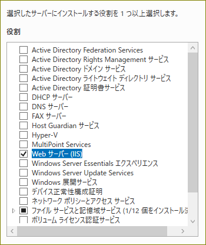
4. Ở các màn hình \[Features\] và \[Web Server Role (IIS)\], cứ để nguyên và tiếp tục
5. Ở \[Role Services\], mở rộng \[Application Development\], đánh dấu "CGI" rồi tiếp tục  
     
   Các role khác (xác thực, nén, v.v.) hãy thêm khi cần (bản thân Exment không cần thêm gì để hoạt động)
6. Ở \[Confirmation\], bấm "Install" và chờ cài đặt hoàn tất
7. Khi cài đặt xong, khởi động trình duyệt (Internet Explorer, v.v.), truy cập http://localhost và kiểm tra rằng trang mặc định của IIS hiển thị được

> Khi cài trên Windows 10, hãy bật "Internet Information Services" ở \[Control Panel\] - \[Programs\] - \[Programs and Features\] - \[Turn Windows features on or off], rồi bật "CGI" ở \[Application Development Features\].

### Chuẩn bị PHP
Tải và cài PHP
1. Truy cập https://windows.php.net/download/
2. Tải tệp ZIP \[VC15 x64 Non Thread Safe\] của \[PHP 8.2\]  
   > Nếu dùng Windows bản 32 bit trong môi trường Windows 10, hãy tải tệp ZIP \[VC15 x86 Non Thread Safe \]
3. Bấm chuột phải vào tệp ZIP đã tải để mở Properties, đánh dấu "Unblock" ở \[Security\] trong tab \[General\] rồi bấm \[OK\]  
   
4. Giải nén nội dung tệp ZIP vào một thư mục thích hợp (ví dụ C:\PHP)
5. Thiết lập biến môi trường để chạy PHP  
   Chạy sysdm.cpl ở \[Run\] để hiển thị \[System Properties\]
6. Mở \[Environment Variables\] ở tab \[Advanced\]  
   
7. Tìm và chọn mục có tên biến "Path" trong danh sách \[System variables\]  
   
8. Bấm \[Edit\] rồi bấm \[New\]  
   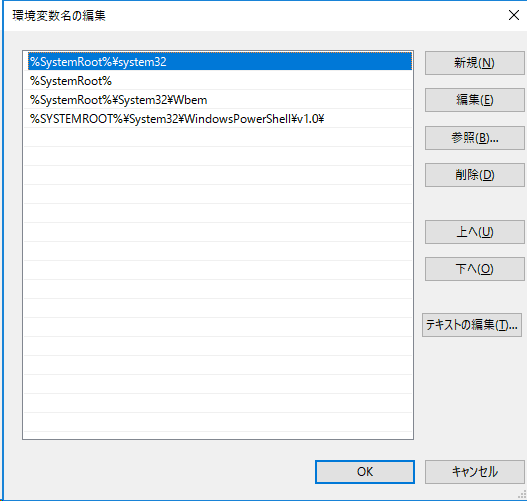
9.  Nhập đường dẫn của thư mục đã giải nén PHP (ví dụ C:\PHP) rồi bấm \[OK\] 3 lần  
    
10. Trong Command Prompt, chạy  
    ```
    set path
    ```
    và kiểm tra rằng đường dẫn đến thư mục PHP đã được thiết lập
11. Tạo tệp thiết lập của PHP  
    Sao chép tệp "php.ini-development" trong thư mục đã giải nén PHP để tạo tệp php.ini
12. Sửa tệp php.ini rồi lưu
    1.  Trong phần "Paths and Directories", đổi  
        ```
        ;extension_dir = "ext"
        ```
        thành
        ```
        extension_dir = "đường dẫn của thư mục đã giải nén PHP\ext" (ví dụ extension_dir = "C:\PHP\ext")
        ```
        (bỏ dấu ; ở đầu dòng để bỏ chú thích)
    2. Trong phần "Dynamic Extension", đổi
        ```
        ;extension=gd
        ;extension=openssl
        ;extension=pdo_mysql
        ```
        thành
        ```
        extension=gd
        extension=openssl
        extension=pdo_mysql
        ```
        (bỏ dấu ; ở đầu dòng để bỏ chú thích)
    3.  Trong phần "File Uploads", đổi  
        ```
        ;upload_tmp_dir=
        ```
        thành
        ```
        upload_tmp_dir = "đường dẫn của một thư mục làm việc tùy ý" (ví dụ upload_tmp_dir = "C:\Temp")
        ```
        (bỏ dấu ; ở đầu dòng để bỏ chú thích)  
        ※Thư mục đã chỉ định sẽ là nơi lưu tạm khi tải tệp lên.
    4. Thêm dòng sau vào cuối tệp.
        ```
        extension=php_fileinfo.dll
        ```

13. Chạy lệnh sau trong Command Prompt và kiểm tra rằng PHP hoạt động  
    ```
    php -v
    ```
    

    Nếu gặp lỗi không tìm thấy runtime Visual C++ 14.0, hãy tải và cài Visual C++ Redistributable Package cho Visual Studio 2015, 2017 và 2019 (vc_redist.x64.exe) từ [The latest supported Visual C++ downloads](https://support.microsoft.com/ja-jp/help/2977003/the-latest-supported-visual-c-downloads)  
    

### Cài MySQL
Cài MySQL dùng cho Exment và cấu hình ban đầu  
Ở đây cài MySQL 8.4.X

1. Truy cập trang [MySQL Community Downloads](https://dev.mysql.com/downloads/mysql/)
2. Bấm \[General Availability (GA) Releases\]  
   
3. Chọn "8.4.X" ở \[Select Version\], chọn "Microsoft Windows" ở \[Select Operating System\], chọn "Windows (x86, 64bit)" ở \[Select OS Version\]
     
   > Nếu dùng Windows bản 32 bit trong môi trường Windows 10, hãy chọn "Windows (x86, 32bit)" ở \[Select OS Version\]
4. Bấm nút \[Download\] ở dòng "ZIP Archive" của \[Other Downloads\] và tải tệp mysql-8.4.xx-winx64.zip
   
5. Khi \[Login Now or Sign Up for a free account.\] hiện ra, bấm \[No thanks, just start my download.\] ở dưới cùng. Việc tải về bắt đầu
6. Bấm chuột phải vào tệp ZIP đã tải để mở Properties, đánh dấu "Unblock" ở \[Security\] trong tab \[General\] rồi bấm \[OK\]  
   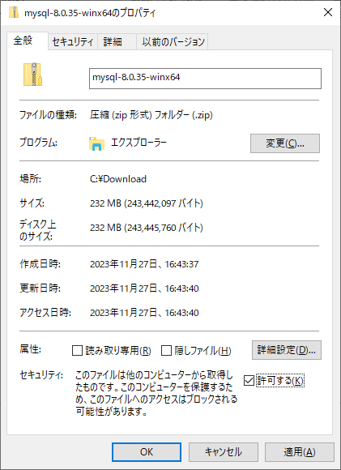
7. Giải nén nội dung tệp ZIP vào một thư mục thích hợp (ví dụ C:\MySQL)
8. Khởi động Command Prompt với quyền quản trị và chuyển đến thư mục mysql-8.4.xx-winx64\bin trong thư mục đã giải nén tệp ZIP
   
9.  Chạy lệnh sau để khởi tạo MySQL
    ```
    mysqld --initialize
    ```
    

    Nếu gặp lỗi không tìm thấy runtime Visual C++ 12.0, hãy xem [The latest supported Visual C++ downloads](https://support.microsoft.com/ja-jp/help/2977003/the-latest-supported-visual-c-downloads), rồi tải và cài bản tiếng Nhật (Japanese) của Microsoft Visual C++ Redistributable Package cho Visual Studio 2013 (vc_redist.x64.exe) từ \[Update for Visual C++ 2013 Redistributable Package\](https://support.microsoft.com/ja-jp/help/4032938/update-for-visual-c-2013-redistributable-package)  
    
10. Chạy lệnh sau để kiểm tra MySQL khởi động. Nếu "mysqld: ready for connections." hiện ra thì đã khởi động đúng
    ```
    mysqld --console
    ```
    
11. Nhấn Ctrl + C để tạm dừng MySQL
12. Cài MySQL thành dịch vụ của Windows. Khi cài thành dịch vụ, MySQL được tự động chạy khi Windows khởi động
    ```
    mysqld --install
    ```
    
13. Để khởi động MySQL ngay, chạy lệnh sau
    ```
    net start mysql
    ```
    
14. Xem giá trị ban đầu của mật khẩu quản trị (root) để dùng MySQL  
    Nếu thư mục đã giải nén MySQL là C:\MySQL, trong C:\MySQL\mysql-8.4.xx-winx64\data có tệp có phần mở rộng .err; hãy mở tệp này bằng trình soạn thảo văn bản như Notepad  
    > Trong hình dưới, tên tệp là ExmentServer2.err  
    
15. Gần đầu tệp có dòng ghi "\[Note\] A temporary password is generated for root@localhost:" (gạch chân đỏ trong hình dưới). Chuỗi ký tự ghi sau đó (trong hình dưới là 1fyr*IXeC2%w) là mật khẩu ban đầu. Hãy ghi lại mật khẩu này
    
16. Quay lại Command Prompt với quyền quản trị, chạy lệnh sau để thiết lập ban đầu cho MySQL
    ```
    mysql_secure_installation
    ```
    1. Khi được hỏi "Enter password for user root:", nhập mật khẩu ban đầu đã ghi lại rồi nhấn Enter
    2. "The existing password for the user account root has expired. Please set a new password." hiện ra  
       Khi được hỏi mật khẩu mới bằng "New password:", nhập mật khẩu mới rồi nhấn Enter; khi được xác nhận bằng "Re-enter new password:", nhập lại mật khẩu mới rồi nhấn Enter
       > Hãy dùng mật khẩu mạnh và khó đoán. Nên đáp ứng các yêu cầu: từ 8 ký tự trở lên; dùng từ 3 loại trở lên trong số chữ hoa / chữ thường / chữ số / ký hiệu; không dùng nguyên các từ có trong từ điển
    3. Bạn được hỏi có dùng VALIDATE PASSWORD PLUGIN không  
       Nếu đã đặt mật khẩu mạnh và khó đoán, hãy nhập một phím khác "y" rồi nhấn Enter
    4. Khi được hỏi "Change the password for root ?", nhập một phím khác "y" rồi nhấn Enter
    5. Với tất cả các câu hỏi xác nhận còn lại, nhập "y" rồi nhấn Enter
    6. Khi "All done!" hiện ra là thiết lập ban đầu đã xong
17. Chạy lệnh sau để đăng nhập MySQL
    ```
    mysql -u root -p
    ```
18. Khi được hỏi mật khẩu bằng "Enter password:", nhập mật khẩu vừa đặt rồi nhấn Enter
    
19. Khi dấu nhắc "MySQL>" hiện ra, chạy lần lượt các lệnh sau
    > Ở đây người dùng MySQL dùng cho Exment là "exment_user", mật khẩu là "M!p3~S$W7fLm"  
      Tên người dùng và mật khẩu thực tế hãy tự quyết định (hãy dùng mật khẩu mạnh và khó đoán)  
      Tên người dùng và mật khẩu này được dùng trong thiết lập ban đầu của Exment
    ```
    CREATE DATABASE exment_database;
    CREATE USER 'exment_user' IDENTIFIED BY 'M!p3~S$W7fLm';
    GRANT ALL ON exment_database.* TO 'exment_user';
    FLUSH PRIVILEGES;
    ```
20. Nhập như sau rồi nhấn Enter để đăng xuất khỏi MySQL
    ```
    \q
    ```

### Chuẩn bị IIS
Chuẩn bị IIS để chạy Exment
1. Cài module URL Rewrite.  
   Truy cập https://www.iis.net/downloads/microsoft/url-rewrite và bấm \[Install this extention\]
2. urlrewrite2.exe được tải về; hãy chạy và cài đặt theo hướng dẫn trên màn hình
   1. Bấm \[Install\]  
      
   2.  Bấm \[I Accept\]  
      
   3.  Việc cài đặt bắt đầu  
      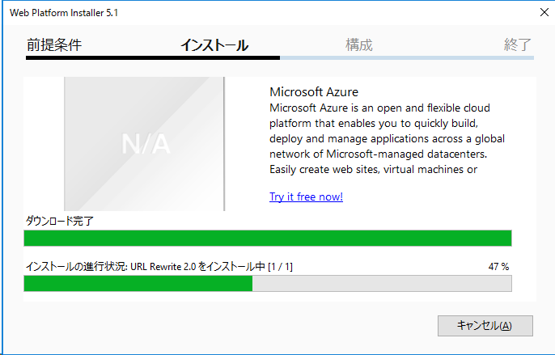
   4.  Bấm \[Finish\]  
      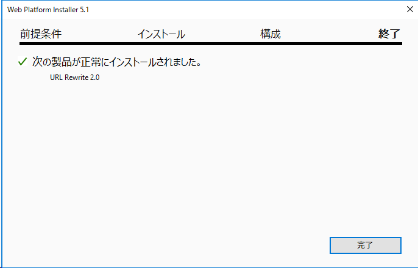
   5.  Bấm \[Exit\]  
      
3. Mở \[Internet Information Services (IIS) Manager\] từ \[Tools\] của Server Manager  
   
4. Ở pane Connections, mở rộng \[(tên máy chủ)\] - \[Sites\] rồi chọn \[Default Web Site\]
5. Ở Features View, bấm đúp \[Handler Mappings\]
6. Ở pane Actions, bấm \[Add Module Mapping\]
7. Nhập như sau vào \[Add Module Mapping\] rồi bấm \[OK\]  
   - Request path: *.php  
   - Module: FastCgiModule  
   - Executable: (đường dẫn của thư mục đã giải nén PHP)\php-cgi.exe (ví dụ C:\PHP\php-cgi.exe)  
   - Name: tùy ý (ví dụ: PHP)  
   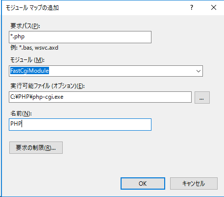
8. Khi thông báo xác nhận hiện ra, bấm \[Yes\]

### Cài Composer
Cài công cụ quản lý thư viện PHP (Composer) mà Exment cần
1. Truy cập [trang tải Composer (https://getcomposer.org/download/)](https://getcomposer.org/download/) và tải Composer-Setup.exe từ phần ghi "Download and run Composer-Setup.exe - it will install the latest composer version whenever it is executed"  
   
2.  Chạy Composer-Setup.exe đã tải
3.  Chọn "Install for all users"  
   
4.  Không đánh dấu "Developer Mode" và tiếp tục  
   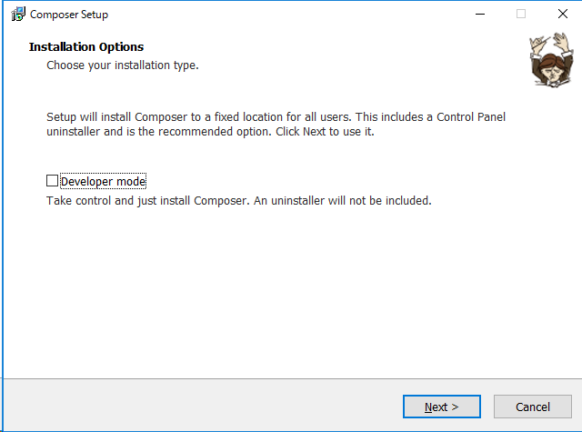
5. Kiểm tra rằng đường dẫn PHP hiển thị ở "Setting Check" là đúng rồi tiếp tục  
   
6. Nếu "PHP Configration Error" hiện ra, đánh dấu \[Create a php,ini file\] hoặc \[Update this php.ini\] rồi tiếp tục  
   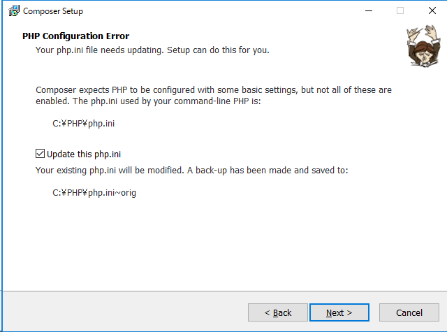
7. Ở "Proxy Settings", chỉ định proxy dùng để kết nối Internet. Nếu không dùng proxy thì cứ tiếp tục  
   
8. Màn hình xác nhận hiện ra, bấm \[Install\]  
   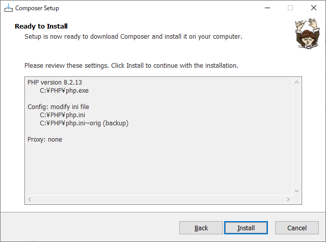
9. Khi "Information" hiện ra, cứ tiếp tục  
    
10. Bấm \[Finish\] để hoàn tất  
    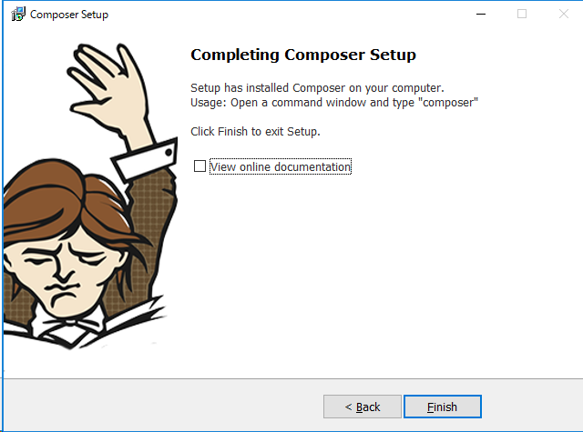

### Tải Exment và chuẩn bị chạy

1. Tải tệp zip của Exment (exment.zip) từ trang các bước cài đặt Exment ([https://exment.net/docs/#/vi/quickstart](https://exment.net/docs/#/vi/quickstart))
2. Bấm chuột phải vào tệp ZIP đã tải để mở Properties, đánh dấu "Unblock" ở \[Security\] trong tab \[General\] rồi bấm \[OK\]  
   
3. Giải nén nội dung thư mục exment trong tệp ZIP vào một thư mục thích hợp (ví dụ C:\exment)  
     
   **Tuyệt đối không giải nén ngay bên dưới thư mục "inetpub\wwwroot". Các tệp thiết lập có ghi giá trị thiết lập cơ sở dữ liệu, mật khẩu email, v.v. sẽ bị nhìn thấy từ bên ngoài, dẫn đến rò rỉ thông tin nghiêm trọng**
4. Tạo virtual directory  
   Mở Internet Information Services (IIS) Manager, ở pane \[Connections\] mở rộng \[(tên máy chủ)\] - \[Sites\], bấm chuột phải vào \[Default Web Site\] rồi chọn \[Add Virtual Directory\]  
   
5. Cấu hình virtual directory như sau  
   Trong ví dụ, alias (đường dẫn của URL để truy cập Exment) là "exment"  
   Ở physical path, đặt đường dẫn của thư mục đã giải nén tệp ZIP của Exment (ví dụ C:\exment)
   - Alias: exment  
   - Physical path: C:\Exment\public  
   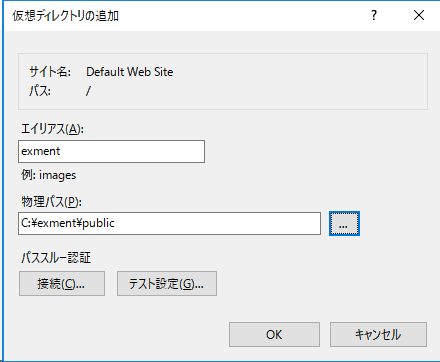
6. Thêm "index.php" vào default document  
   Chọn \[Default Web Site\] rồi bấm đúp để mở \[Default Document\]  
   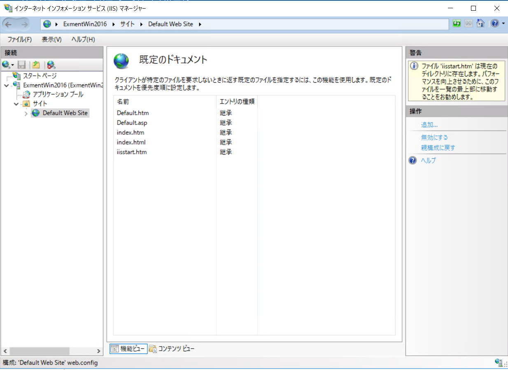
7. Ở pane \[Actions\], bấm \[Add\]
8. Thêm index.php  
   
9.  Thêm quy tắc thay thế URL (Rewrite) vào Web.config  
   Ở pane \[Connections\], chọn virtual directory đã thêm ở "4." (trong ví dụ là exment) rồi bấm đúp để mở \[URL Rewrite\]  
   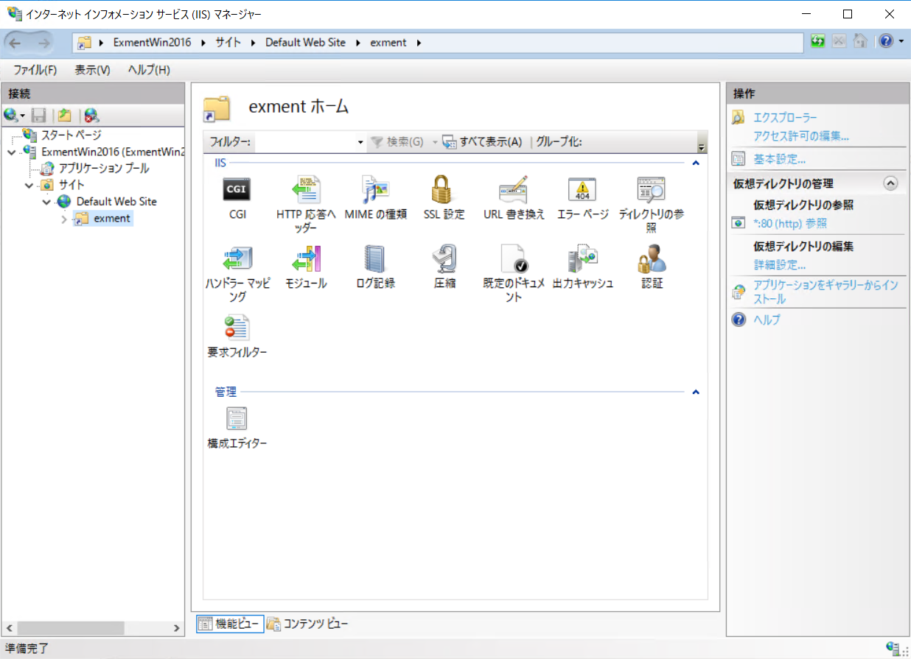
10. Ở pane \[Actions\], bấm \[Add Rule(s)\]  
   
11. Ở \[Add Rule(s)\], chọn \[Blank rule\] của \[Inbound rules\] rồi bấm \[OK\]  
   
12. Ở \[Edit Inbound Rule\], tạo quy tắc như sau  
    
    - Name: tên tùy ý
    - \[Match URL\]
      - Requested URL: Matches the Pattern
      - Using: Regular Expressions
      - Pattern: (.*)$
    - Conditions
      - Logical grouping: Match All
      - Bấm \[Add\] và thêm 2 điều kiện sau
        - Condition input: {REQUEST_FILENAME}  
        Type: Is Not a File
        - Condition input: {REQUEST_FILENAME}  
        Type: Is Not a Directory
    - Action
      - Action type: Rewrite
      - Action Properties
      - Rewrite URL: index.php/{R:1}
      - Append query string: ON
      - Log rewritten URL: OFF
    - Stop processing of subsequent rules: ON
13. Ở pane \[Actions\], bấm \[Apply\]
14. Khi "The changes have been successfully saved" hiện ra, bấm \[Back to Rules\]

<!-- Các bước sau đây cần kiểm tra lại -->

15. Thiết lập quyền truy cập của thư mục để Laravel ghi được
    Cấp quyền ghi cho người dùng chạy IIS (IIS_IUSRS) đối với thư mục đã giải nén ZIP của Exment và đã cấu hình virtual directory  
    > Trong ví dụ là C:\exment
    
    

16. Thêm quyền truy cập ghi vào thư mục exment cho người dùng chạy IIS (IIS_IUSRS)
    1. Bấm chuột phải vào thư mục exment và chọn \[Properties\]
    2. Mở tab \[Security\] và bấm \[Edit\]
    3. Ở \[Permissions for exment\], bấm nút \[Add\] để hiển thị \[Select Users or Groups\]
    4. Nhập IIS_IUSRS vào ô \[Enter the object names to select\] rồi bấm \[Check Names\]
    5. Khi phần hiển thị đổi thành (tên máy tính)\IIS_IUSRS, bấm \[OK\]  
       
    6. Màn hình quay lại \[Permissions for exment\]; bấm IIS_IUSRS ở ô \[Group or user names\], rồi đánh dấu \[Allow\] của \[Write\] ở ô \[Permissions\]  
    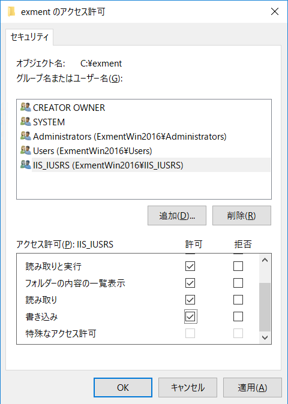
    1. Bấm \[OK\] 2 lần để đóng Properties

<!--
Thực tế, có vẻ quyền ghi của IIS_IUSRS cần không chỉ cho thư mục storage mà cả cho các tệp và thư mục khác trong thư mục exment.
Vì chưa biết tối thiểu tài nguyên nào thực sự cần quyền đến mức nào, nên ở môi trường thử nghiệm, chúng tôi cấp quyền ghi của IIS_IUSRS cho toàn bộ thư mục C:\exment và kiểm tra rằng ứng dụng Web Exment hoạt động.
Khi biết được quyền truy cập tối thiểu, phần này sẽ được sửa lại cho khớp.

14. Thiết lập quyền truy cập của thư mục để Laravel ghi được
    > Cấp quyền ghi cho người dùng chạy IIS (IIS_IUSRS) đối với thư mục đã giải nén ZIP của Exment và đã cấu hình virtual directory (ví dụ C:\exment)
15. Cấu hình quyền truy cập
    1. Bấm chuột phải vào thư mục exment và chọn \[Properties\]
    2. Mở tab \[Security\] và bấm \[Edit\]
    3. Ở \[Permissions for exment\], bấm nút \[Add\] để hiển thị \[Select Users or Groups\]
    4. Nhập IIS_IUSRS vào ô \[Enter the object names to select\] rồi bấm \[Check Names\]
    5. Khi phần hiển thị đổi thành (tên máy tính)\IIS_IUSRS, bấm \[OK\]  
    6. Màn hình quay lại \[Permissions for exment\]; bấm IIS_IUSRS ở ô \[Group or user names\], rồi đánh dấu \[Allow\] của \[Write\] ở ô \[Permissions\]  
    7. Bấm \[OK\] 2 lần để đóng Properties
-->

17.  Khởi động trình duyệt (Chrome hoặc Microsoft Edge) và truy cập http://localhost/(alias của virtual directory) (ví dụ http://localhost/exment. Với site có "admin" ở `ADMIN_ROUTE_PREFIX` thì là http://localhost/exment/admin)  
    Trang cài đặt của Exment hiện ra.
> Exment không hỗ trợ hiển thị trên Internet Explorer. Hãy dùng Chrome hoặc Microsoft Edge để truy cập Exment

   1. Kiểm tra Language và Timezone (trong ví dụ, Language là \[日本語\], Timezone là \[(GMT+09:00)日本\]) rồi bấm \[subumit\]
   

   2. Nhập các thiết lập về cơ sở dữ liệu đã tạo rồi bấm \[Gửi\]
   > Trong ví dụ: <br />Cơ sở dữ liệu \[exment_database\] <br />Tên người dùng \[exment_user\] <br />Mật khẩu \[M!p3~S$W7fLm\] 

   

   3. Bấm \[Thực hiện cài đặt\]  
   
   Nếu cài đặt hoàn tất bình thường, màn hình thiết lập ban đầu của Exment sẽ hiện ra.  
   Về thiết lập ban đầu, vui lòng xem [tại đây](/vi/first_setting?id=màn-hình-thiết-lập-ban-đầu).

18.  Khi cài đặt xong, gỡ quyền truy cập đã đặt cho thư mục exment

   1. Bấm chuột phải vào thư mục exment và chọn \[Properties\]
   > Trong ví dụ là C:\exment  
   2. Mở tab \[Security\] và bấm \[Edit\]
   3. Chọn \[IIS_IUSRS\] ở ô \[Group or user names\]
   4. Bấm \[Check Names\] ở \[Permissions\], rồi bỏ đánh dấu \[Allow\] của \[Write\] ở ô \[Permissions\]
   
   5. Bấm \[OK\] 2 lần để đóng Properties   

19.  Thêm quyền truy cập ghi cho một số thư mục. Các thư mục và tệp cần thêm như sau.

| Loại | Tên tệp / thư mục | Chức năng cần đến |
| ---- | ---- | ---- |
| Thư mục | storage | Tất cả chức năng |
| Thư mục | bootstrap/cache | Tất cả chức năng |
| Tệp | .env | Cài đặt đơn giản, khôi phục |
| Thư mục | config | Cài đặt đơn giản, khôi phục |
| Thư mục | app | Cài đặt đơn giản |
| Thư mục | public | Cài đặt đơn giản |
| Thư mục | resources | Cài đặt đơn giản |

Ví dụ dưới đây là các bước thêm quyền cho thư mục storage.

   1. Bấm chuột phải vào thư mục storage và chọn \[Properties\]
   > Trong ví dụ là C:\exment\storage
   2. Mở tab \[Security\] và bấm \[Edit\]
   3. Ở \[Permissions for storage\], bấm nút \[Add\] để hiển thị \[Select Users or Groups\]
   4. Nhập IIS_IUSRS vào ô \[Enter the object names to select\] rồi bấm \[Check Names\]
   5. Khi phần hiển thị đổi thành (tên máy tính)\IIS_IUSRS, bấm \[OK\]  
       
   6. Màn hình quay lại \[Permissions for storage\]; bấm IIS_IUSRS ở ô \[Group or user names\], rồi đánh dấu \[Allow\] của \[Write\] ở ô \[Permissions\]  
    
   7. Bấm \[OK\] 2 lần để đóng Properties

20.  Để lưu tạm được các tệp tải lên, thêm quyền truy cập ghi cho thư mục đã chỉ định ở upload_tmp_dir của php.ini
   1. Bấm chuột phải vào thư mục đó và chọn \[Properties\]
   > Trong ví dụ là C:\Temp
   2. Mở tab \[Security\] và bấm \[Edit\]
   3. Ở \[Permissions for Temp\], bấm nút \[Add\] để hiển thị \[Select Users or Groups\]
   4. Nhập IIS_IUSRS vào ô \[Enter the object names to select\] rồi bấm \[Check Names\]
   5. Khi phần hiển thị đổi thành (tên máy tính)\IIS_IUSRS, bấm \[OK\]  
       
   6. Màn hình quay lại \[Permissions for Temp\]; bấm IIS_IUSRS ở ô \[Group or user names\], rồi đánh dấu \[Allow\] của \[Write\] ở ô \[Permissions\]  
    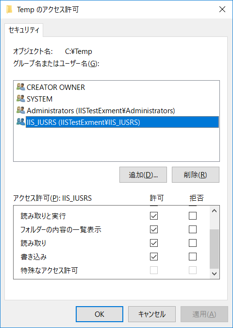
   7. Bấm \[OK\] 2 lần để đóng Properties

   > Về thiết lập ban đầu sau khi cài đặt, vui lòng xem [tại đây](/vi/first_setting?id=màn-hình-thiết-lập-ban-đầu)

   
## Xử lý khi nâng phiên bản PHP
Khi đổi phiên bản PHP, hãy nâng phiên bản theo các bước sau.  
※Trong lúc nâng phiên bản, không truy cập được Exment.  
※Ví dụ dưới đây là các bước nâng từ PHP7.4 lên PHP8.2.  
※Cách nâng phiên bản có thể khác nhau tùy theo môi trường, thời điểm đưa vào, phiên bản và cách cài đặt.  

- Trước tiên, dừng IIS.

- Sao lưu thư mục chạy của PHP đang dùng. Có thể làm theo cách tùy ý, như đổi tên thư mục hoặc sao chép sang nơi khác.

- Tải PHP mới.  

   1. Truy cập https://windows.php.net/download/
   2. Tải tệp ZIP \[VC15 x64 Non Thread Safe\] của \[PHP 8.2\]  
      > Nếu dùng Windows bản 32 bit trong môi trường Windows 10, hãy tải tệp ZIP \[VC15 x86 Non Thread Safe \]
   3. Giải nén nội dung tệp ZIP vào cùng đường dẫn với PHP trước đó.  
   ※ Giả định rằng PATH đã được thiết lập bằng biến môi trường.  

- Sao chép tệp php.ini từ thư mục PHP phiên bản trước đã sao lưu sang thư mục PHP phiên bản mới.

- Nếu cần, hãy sửa tệp php.ini.
   1. Nếu thư viện GD trong phần "Dynamic Extension" đang bị chú thích, hãy bật lên. Đổi
        ```
        ;extension=gd
        ```
        thành
        ```
        extension=gd
        ```
        (bỏ dấu ; ở đầu dòng để bỏ chú thích)

   ※ Tùy theo phiên bản PHP ban đầu, có thể đang là extension=gd2. Hãy đổi thành extension=gd.  

- Khởi động IIS.  

- Trong Command Prompt, v.v., kiểm tra rằng phiên bản PHP là 8.2.X.

~~~
php -v
~~~
