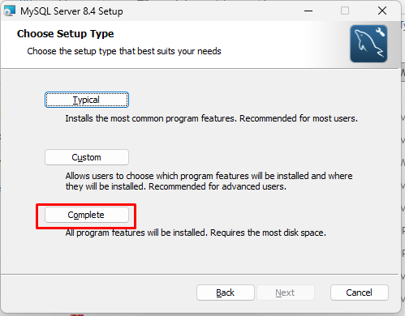

# Các bước cài đặt MySQL
Đây là các bước cài và thiết lập MySQL để dùng MySQL với Exment.  
※Các bước có thể khác nhau tùy theo hệ điều hành, phiên bản, thời điểm cài đặt, v.v.  

Hãy xem một trong hai phần sau, tùy theo máy chủ bạn dùng.

| Máy chủ | Phần cần xem |
| ---- | ---- |
| Windows | "Thiết lập MySQL (Windows)" ở dưới |
| Linux | "Thiết lập MySQL (Linux)" ở dưới (các bước chia theo việc đã có MySQL5.7 hay chưa) |

## Thiết lập MySQL (Windows)

- Khuyến nghị: trước khi nâng cấp, hãy [sao lưu cơ sở dữ liệu](https://dev.mysql.com/doc/refman/8.4/ja/mysqldump-sql-format.html).

- (Khi MySQL đang chạy) Mở Command Prompt với quyền quản trị và dừng MySQL.  
Nhập "Command Prompt" vào "thanh tìm kiếm" bên phải nút Start.  
Bấm chuột phải vào "Command Prompt" hiện ở dòng trên cùng của "Best match".  
Từ menu hiện ra, chọn "Run as administrator".
   

~~~
net stop mysql57
net stop mysql80
~~~

- Mở trang sau và tải MySQL.  
※MySQL Installer chỉ có cho dòng MySQL 8.0. Với MySQL 8.1 trở lên (kể cả 8.4), hãy tải MySQL Server dạng MSI hoặc ZIP.  
[MySQL Community Server Downloads](https://downloads.mysql.com/archives/community/)  

- Chọn "8.4.X" ở Select Version, và chọn hệ điều hành là Windows (x86, 64-bit).  

- Tải một trong các mục sau.
	- MSI Installer

- Chạy tệp MSI đã tải và cài đặt theo hướng dẫn trên màn hình (wizard).
	- Ở màn hình Welcome, bấm "Next".

		
	- Đồng ý với License Agreement và bấm "Next".

		
	- Ở Setup Type, chọn "Complete".

		
	- Bấm "Install".

		
	- Khi cài đặt xong, bấm "Finish".

		

- Khi cài đặt MSI xong, MySQL Server Configurator tự động mở.
	- Ở "Welcome to the MySQL Server Configurator", bấm "Next".

		

- Ở Data Directory, để nguyên giá trị ban đầu và bấm "Next".

	

- Type and Networking:
	- Config Type: Development Computer
	- Connectivity: TCP/IP (cổng mặc định là 3306)
	- Bấm "Next".

		

- Accounts and Roles: đặt mật khẩu của người dùng root rồi bấm "Next".

	

- Windows Service: đặt tên dịch vụ (ví dụ: MySQL84) rồi bấm "Next".

	

- Ở Server File Permissions, để nguyên giá trị ban đầu và bấm "Next".

	

- Bỏ qua Sample Databases và bấm "Next".

	

- Ở Apply Configuration, bấm "Execute"; khi xong, bấm "Next" rồi "Finish".

	

- Sửa my.ini. (C:\ProgramData\MySQL\MySQL Server 8.4\my.ini)

~~~
# Thêm nội dung sau vào cuối tệp

local-infile=1
~~~

- Khởi động lại MySQL. (Tên dịch vụ khác nhau tùy theo môi trường)

~~~
net stop MySQL84
net start MySQL84
~~~

### Thêm biến môi trường 

- Trong Explorer, bấm chuột phải vào "This PC" rồi bấm "Properties".

- Bấm "Advanced system settings".

- Bấm "Environment Variables".  

- Bấm "Path" trong "User variables" rồi bấm "Edit".  

- Nếu có dòng "C:\Program Files\MySQL\MySQL Server 5.7\bin" thì xóa đi.

- Bấm "New" và thêm dòng sau.  
 "C:\Program Files\MySQL\MySQL Server 8.4\bin"   

- Sau khi nhập, đóng tất cả các hộp thoại đang mở bằng "OK".  

## Thiết lập MySQL (Linux)
Đây là các bước cài MySQL trên Linux.  
※Nếu cần, hãy thêm sudo vào đầu lệnh.  
※Khi nơi cài đặt là CentOS8, RHEL8, v.v., hãy dùng lệnh dnf thay cho yum.

Các bước khác nhau tùy theo việc MySQL5.7 đã được cài hay chưa.

| Trạng thái hiện tại | Phần cần xem |
| ---- | ---- |
| Đã cài MySQL5.7 | "Khi đã có MySQL5.7 (cập nhật MySQL5.7 → MySQL8.4)" |
| Chưa cài MySQL5.7 | "Khi chưa có MySQL5.7 (cài mới MySQL8.4)" |

### Khi đã có MySQL5.7 (cập nhật MySQL5.7 → MySQL8.4)
- Xóa các package của MySQL5.7.
~~~
sudo killall mysqld; sudo killall mysqld_safe;
sudo rpm -e --nodeps mysql57-community-release
sudo yum remove mysql mysql-server mysql-client mysql-common mysql-devel mysql-community-client-plugins -y
~~~

- Cài MySQL8.4 và khởi động.

※rpm khác nhau tùy theo phiên bản hệ điều hành.

Ví dụ, với AlmaLinux9.5, nếu là
 

~~~
[root@localhost ~]# uname -a
Linux localhost.localdomain 5.14.0-503.11.1.el9_5.x86_64 #1 SMP PREEMPT_DYNAMIC Tue Nov 12 09:26:13 EST 2024 x86_64 x86_64 x86_64 GNU/Linux
~~~

thì lệnh sẽ là
 

~~~
sudo rpm -ivh https://dev.mysql.com/get/mysql84-community-release-el9-2.noarch.rpm
~~~

như trên.
 

~~~
# Với CENTOS STREAM

rpm -ivh https://dev.mysql.com/get/mysql84-community-release-el9-2.noarch.rpm
rpm --import https://repo.mysql.com/RPM-GPG-KEY-mysql-2023
dnf clean packages
dnf update -y

# Cài mysql-community-server và khởi động
dnf install mysql-community-server -y
systemctl start mysqld
systemctl enable mysqld
~~~

~~~
# Với CENTOS8
sudo rpm -ivh https://dev.mysql.com/get/mysql84-community-release-el8-2.noarch.rpm
sudo rpm --import https://repo.mysql.com/RPM-GPG-KEY-mysql-2023

# Chạy lệnh này để kiểm tra xem có mysql-community-server không
sudo yum search mysql-community-server

# Nếu lệnh trên hiện thông báo không tồn tại như "Error: Unable to find a match: mysql-community-server", hãy chạy lệnh dưới đây trước
sudo yum -y module disable mysql

# Cài mysql-community-server và khởi động
sudo yum -y install mysql-community-server
sudo systemctl enable mysqld.service
~~~

- Sửa my.cnf.

~~~
vi /etc/my.cnf

# Thêm nội dung sau vào cuối tệp

local-infile=1
~~~

- Khởi động MySQL.

~~~
sudo systemctl start mysqld
~~~

### Khi chưa có MySQL5.7 (cài mới MySQL8.4)
- Cài MySQL8.4 và khởi động.

※rpm khác nhau tùy theo phiên bản hệ điều hành.

Ví dụ, với AlmaLinux9.5, nếu là
 

~~~
[root@localhost ~]# uname -a
Linux localhost.localdomain 5.14.0-503.11.1.el9_5.x86_64 #1 SMP PREEMPT_DYNAMIC Tue Nov 12 09:26:13 EST 2024 x86_64 x86_64 x86_64 GNU/Linux
~~~

thì lệnh sẽ là
 

~~~
sudo rpm -ivh https://dev.mysql.com/get/mysql84-community-release-el9-2.noarch.rpm
~~~

như trên.
 

~~~
# Với CENTOSSTREAM

rpm -ivh https://dev.mysql.com/get/mysql84-community-release-el9-2.noarch.rpm
rpm --import https://repo.mysql.com/RPM-GPG-KEY-mysql-2023
dnf clean packages
dnf update -y

# Cài mysql-community-server và khởi động
dnf install mysql-community-server -y
systemctl start mysqld
systemctl enable mysqld
~~~

~~~
# Với CENTOS 8
sudo rpm -ivh https://dev.mysql.com/get/mysql84-community-release-el8-2.noarch.rpm
sudo rpm --import https://repo.mysql.com/RPM-GPG-KEY-mysql-2023

# Chạy lệnh này để kiểm tra xem có mysql-community-server không
sudo yum search mysql-community-server

# Nếu lệnh trên hiện thông báo không tồn tại như "Error: Unable to find a match: mysql-community-server", hãy chạy lệnh dưới đây trước
sudo yum -y module disable mysql

# Cài mysql-community-server và khởi động
sudo yum -y install mysql-community-server
sudo systemctl enable mysqld.service
sudo systemctl start mysqld
~~~

- Xem mật khẩu ban đầu của MySQL.

~~~
cat /var/log/mysqld.log | grep -i 'temporary password'

#Log như sau được xuất ra, hãy xem mật khẩu
2025-03-25T04:35:28.567119Z 6 [Note] [MY-010454] [Server] A temporary password is generated for root@localhost: et5k>Y.b0eJ.
~~~

- (Tùy chọn) Tắt chính sách mật khẩu.

~~~
vi /etc/my.cnf

#Thêm validate_password như sau
[mysqld]
validate_password=OFF
~~~

- Khởi động lại MySQL.

~~~
sudo systemctl restart mysqld
~~~

- Thiết lập ban đầu cho MySQL. Chạy lệnh sau.

~~~
mysql_secure_installation

Enter password for user root: (nhập mật khẩu vừa sao chép)

New password: (nhập mật khẩu mới)
Re-enter new password: (nhập mật khẩu mới)

Change the password for root? : n

Remove anonymous users? : y #Xóa tài khoản người dùng ẩn danh
Disallow root login remotely? : y # Xóa tài khoản root truy cập được từ ngoài localhost
Remove test database and access to it? : y # Xóa cơ sở dữ liệu test
Reload privilege tables now? : y #Đọc lại bảng privilege
~~~

- Đăng nhập MySQL.

~~~
mysql -u root -p(mật khẩu)
~~~
- Sửa my.cnf.

~~~
vi /etc/my.cnf

# Thêm nội dung sau vào cuối tệp

local-infile=1
~~~

- Khởi động lại MySQL.

~~~
sudo systemctl restart mysqld
~~~

- Tạo cơ sở dữ liệu và người dùng cho Exment.  
※Ở đây, tên cơ sở dữ liệu là "exment_database", người dùng là "exment_user".  
Ngoài ra, địa chỉ IP của nơi kết nối là "192.168.137.%".

~~~
CREATE DATABASE exment_database;
CREATE USER 'exment_user'@'192.168.137.%' IDENTIFIED BY '(mật khẩu cho exment_user)';
GRANT ALL ON exment_database.* TO 'exment_user'@'192.168.137.%';
FLUSH PRIVILEGES;
~~~

- Trong thiết lập tường lửa, chỉ cho phép truy cập MySQL từ địa chỉ IP của nơi kết nối.  
※Ở đây, địa chỉ IP của nơi kết nối là "192.168.137.%".

~~~
firewall-cmd --permanent --new-zone=from_webserver
firewall-cmd --reload
firewall-cmd --permanent --zone=from_webserver --add-source="192.168.137.0/24"
firewall-cmd --permanent --zone=from_webserver --add-port=3306/tcp
firewall-cmd --zone=from_webserver --add-service=mysql
firewall-cmd --reload
~~~
