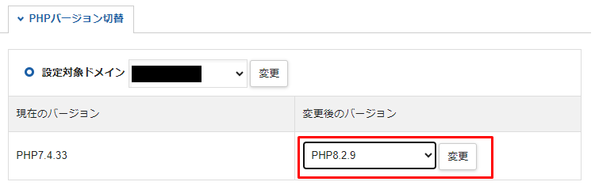

# Xây dựng môi trường trên máy chủ thuê
Đây là các bước cài Exment trên máy chủ thuê (rental server). Đây là một lựa chọn khi bạn muốn tạo môi trường và vận hành một cách đơn giản.  
Trang này giải thích các bước cho Xserver và Sakura Internet.

> Để cài không cần SSH, chỉ bằng cách tải lên một tệp, xem [Cài đặt dễ dàng (máy chủ thuê)](/vi/install_rental_easy).

| Máy chủ bạn dùng | Phần cần xem |
|---|---|
| Xserver | [Trường hợp Xserver](/vi/install_rental?id=trường-hợp-xserver) |
| Sakura Internet | [Trường hợp Sakura Internet](/vi/install_rental?id=trường-hợp-sakura-internet) |

Cả hai đều có trình tự chung giống nhau.

1. Tạo MySQL (cơ sở dữ liệu) cho Exment
2. Kết nối tới máy chủ bằng SSH và cài composer
3. Cài Exment vào thư mục không được công khai trên Web
4. Chỉ công khai thư mục "public" của Exment trên Web
5. Hoàn tất thiết lập theo [các bước cài đặt](/vi/quickstart)

## Lưu ý khi xây dựng trên máy chủ thuê
- Exment cần môi trường sau.
    1. PHP 8.2 trở lên
    1. MySQL 8.0 trở lên (khuyến nghị: 8.4)  
    hoặc MariaDB 10.11 trở lên  
  Đặc biệt, tùy máy chủ thuê mà phiên bản MySQL có thể không đáp ứng điều kiện.  
  Hãy kiểm tra trước xem máy chủ thuê của bạn có đáp ứng điều kiện hay không.

- Máy chủ thuê có sẵn thư mục được công khai trên Web (/home/username/www, /public_html, v.v.).  
Đừng đặt nguyên thư mục đã cài Exment ngay bên dưới thư mục này. Các tệp thiết lập có ghi giá trị thiết lập cơ sở dữ liệu, mật khẩu email, v.v. sẽ bị công khai ra bên ngoài và dẫn đến rò rỉ thông tin nghiêm trọng.  
Các bước trong trang này được viết để chỉ công khai trên Web thư mục cần công khai. Hãy công khai theo đúng các bước này.

- Trên máy chủ thuê, sau khi kết nối bằng SSH, trước tiên cài composer, sau đó mới cài Exment.

- Tùy môi trường của máy chủ thuê, phiên bản phía máy chủ, v.v., có trường hợp không thiết lập được bình thường theo các bước trong trang này.

- Trang này chỉ viết các bước để chạy Exment trên máy chủ thuê.  
Trang này không viết về kiến thức IT chung như SSH, tạo cơ sở dữ liệu, lệnh Linux. Mong bạn thông cảm.

## Các bước cài đặt trên máy chủ thuê

### Trường hợp Xserver
※ Đã kiểm tra hoạt động với gói X10.

<iframe width="560" height="420" src="https://www.youtube.com/embed/RB6i0F2fev0" frameborder="0" allow="accelerometer; autoplay; encrypted-media; gyroscope; picture-in-picture" allowfullscreen></iframe>

**(1) Tạo MySQL**

Tạo trước MySQL cho Exment.

**(2) Đặt PHP dùng trong lệnh về cùng phiên bản với màn hình quản lý**

Trên Xserver, phiên bản PHP thiết lập ở màn hình quản lý và phiên bản PHP khi kết nối SSH rồi chạy lệnh có thể khác nhau.  
Vì vậy, hãy thiết lập phiên bản PHP dùng trong lệnh.

1. Ở màn hình quản lý của Xserver, bấm "PHP Ver.切替" (chuyển phiên bản PHP).  
Sau đó chọn tên miền cần thiết lập.  
  
  

2. Ở "PHPバージョン切替" (chuyển phiên bản PHP) có ghi phiên bản hiện tại, hãy ghi lại.  
  

3. Kết nối tới Xserver bằng SSH.

4. Dùng lệnh sau để tìm các PHP có trên Xserver.  
Trong kết quả, hãy sao chép đường dẫn của PHP có phiên bản bạn đã ghi lại.

~~~ bash
find /opt/php-*/bin -type f -name 'php'

## /opt/php-8.2.9/bin/php ← trong ví dụ này là dòng này
~~~

5. Tạo thư mục, rồi tạo symbolic link tới PHP (symbolic link giống như một lối tắt, trỏ tới tệp nằm ở nơi khác).

~~~
mkdir $HOME/bin
ln -s /opt/php-8.2.9/bin/php $HOME/bin/php
~~~

6. Sửa tệp bashrc để thêm PHP này vào PATH.

~~~ bash
vi ~/.bashrc

## Ghi dòng dưới đây vào dòng cuối cùng, rồi lưu bằng ":wq!"
export PATH=$HOME/bin:$PATH

## Áp dụng thay đổi
source ~/.bashrc
~~~

7. Kiểm tra phiên bản PHP. Nếu là phiên bản ghi ở màn hình quản lý thì đã xong.

~~~ bash
php --version
~~~

**(3) Cài composer**

~~~ bash
cd ~
curl -sS https://getcomposer.org/installer | php -- --install-dir=$HOME/bin/
## Đổi tên
mv $HOME/bin/composer.phar $HOME/bin/composer
## Kiểm tra
composer --version
# Composer version 2.6.5 2023-10-06 10:11:52
~~~

**(4) Cài Exment**

Tuyệt đối không cài ngay bên dưới thư mục "$HOME/(tên miền)/public_html". Các tệp thiết lập có ghi giá trị thiết lập cơ sở dữ liệu, mật khẩu email, v.v. sẽ bị công khai ra bên ngoài và dẫn đến rò rỉ thông tin nghiêm trọng.  
Ở đây, ta tạo thư mục "$HOME/(tên miền)/laravel" và cài Exment vào trong đó.

~~~ bash
cd ~/(tên miền)
mkdir laravel
cd laravel
wget https://exment.net/downloads/ja/exment.zip
unzip exment.zip
rm exment.zip
~~~

**(5) Chỉ công khai thư mục public**

Đổi "$HOME/(tên miền)/public_html" thành symbolic link tới thư mục "$HOME/(tên miền)/laravel/exment/public" vừa tạo.  
Làm như vậy, phần chính của Laravel và các giá trị thiết lập vẫn nằm ngoài thư mục được công khai trên Web, chỉ có thư mục public của laravel nằm ở public_html.

~~~ bash
## Xóa public_html mặc định
rm -r $HOME/(tên miền)/public_html
ln -s $HOME/(tên miền)/laravel/exment/public $HOME/(tên miền)/public_html
~~~

**(6) Tiếp tục cài đặt**

Đến đây đã sẵn sàng để mở Exment.  
Hãy hoàn tất thiết lập theo [các bước cài đặt](/vi/quickstart).  
※ Từ v7.2.1 trở đi, Exment mở ở chính URL này. Với site có "admin" ở `ADMIN_ROUTE_PREFIX` trong `.env` (site đã cài bằng phiên bản trước), hãy thêm "/admin" vào cuối URL.  

#### PHP dùng cho lệnh và cron
Trên Xserver, PHP của Web (PHP đã chọn ở "PHP Ver.切替" trên màn hình quản lý) và PHP khi gõ `php` trong SSH hoặc cron là khác nhau.

- Khi gõ `php` trong SSH, `~/bin/php` (PHP đã liên kết ở trên) sẽ chạy. Nếu chưa liên kết, PHP mặc định của máy chủ (có thể là phiên bản cũ) sẽ chạy.
- cron không đọc `~/.bashrc`. Nếu chỉ ghi `php` thì PHP mặc định của máy chủ (8.0, v.v.) sẽ chạy và Exment không chạy được.

Vì vậy, với các lệnh artisan và cron, hãy chạy **PHP cùng phiên bản với màn hình quản lý, bằng đường dẫn đầy đủ**.

- Ví dụ (khi dùng PHP 8.3): `/usr/bin/php8.3`, hoặc `/opt/php-8.3.x/bin/php` tìm được bằng lệnh `find` ở trên
- Khi đổi phiên bản PHP ở màn hình quản lý, hãy đổi cả liên kết `~/bin/php` và đường dẫn trong cron sang cùng phiên bản.

[Lịch tác vụ](/vi/additional_task_schedule) được thiết lập ở "Cron設定" (thiết lập Cron) trên màn hình quản lý của Xserver như sau (thay `(ID máy chủ)` và `(tên miền)` bằng của bạn).

~~~
* * * * * cd /home/(ID máy chủ)/(tên miền)/laravel/exment && nice -n 15 /usr/bin/php8.3 artisan schedule:run >> /dev/null 2>&1
~~~

Với hàng đợi ([thực thi trễ xử lý thông báo](/vi/additional_queue)), trên máy chủ thuê không thể đặt worker chạy thường trực. Hãy giữ `QUEUE_CONNECTION` trong `.env` là `sync` (giá trị lúc cài đặt). Nếu đặt là `database`, hãy dùng cron để mỗi phút xử lý các job đang tồn.

~~~
* * * * * cd /home/(ID máy chủ)/(tên miền)/laravel/exment && nice -n 15 /usr/bin/php8.3 artisan queue:work --stop-when-empty --max-time=50 >> /dev/null 2>&1
~~~

#### Việc cần làm khi nâng phiên bản PHP
Khi đổi phiên bản PHP, hãy làm theo các bước sau.

- Trong lúc nâng phiên bản, không truy cập được Exment.
- Ví dụ dưới đây là các bước cập nhật từ PHP7.4 lên PHP8.2.
- Tùy môi trường, thời điểm cài, phiên bản và cách cài đặt mà các bước có thể khác.

1. Ở màn hình quản lý của Xserver, bấm "PHP Ver.切替".  
Sau đó chọn tên miền cần thiết lập.

2. Ở "PHPバージョン切替", chuyển sang phiên bản mới rồi bấm "変更" (thay đổi).  
  

3. Kết nối tới Xserver bằng SSH.

4. Dùng lệnh sau để kiểm tra phiên bản PHP hiện tại.  
(Tại thời điểm này, phiên bản cũ được hiển thị.)

~~~ 
php --version
~~~

5. Gỡ symbolic link tới PHP.

~~~
unlink $HOME/bin/php
~~~

6. Tìm đường dẫn của phiên bản đã chọn ở "PHPバージョン切替".

~~~ bash
find /opt/php-*/bin -type f -name 'php'

## /opt/php-8.2.9/bin/php  ← trong ví dụ này là dòng này
~~~

7. Tạo symbolic link tới đường dẫn vừa tìm được.

~~~
ln -s /opt/php-8.2.9/bin/php $HOME/bin/php
~~~

8. Kiểm tra phiên bản PHP. Nếu là phiên bản mới thì đã thành công.

~~~ 
php --version
~~~

### Trường hợp Sakura Internet
※ Đã kiểm tra hoạt động với gói Standard.  
※ Trên Sakura Internet, việc chạy "composer" có thể bị kết thúc giữa chừng.  
Vì vậy, hãy chạy kèm "nice -n 20", ví dụ "nice -n 20 composer".

**(1) Tạo MySQL**

Tạo trước MySQL cho Exment.

**(2) Đổi thư mục công khai**

1. Ở "ドメイン/SSL設定" (thiết lập tên miền/SSL) trong menu quản lý của Sakura Internet, chọn tên miền muốn đổi.  
  

2. Ở "マルチドメインの対象のフォルダ" (thư mục đích của multi-domain), đổi thư mục chỉ định. Ở đây ta đặt là "/exment".  
  

**(3) Kết nối bằng SSH, thiết lập shell và PATH**

1. Kết nối bằng SSH với ID và mật khẩu của bạn.

2. Đổi shell.

~~~
which bash
#  /usr/local/bin/bash

chsh -s /usr/local/bin/bash
# Password:  ## Nhập mật khẩu
# chsh: user information updated
~~~

3. Sửa .bash_profile.

~~~ bash
vi .bash_profile

## Ghi các dòng dưới đây, rồi lưu bằng ":wq!"
PATH=$PATH:$HOME/bin:$HOME/usr/local/bin
export PATH
~~~

4. Ngắt SSH một lần, rồi kết nối lại bằng SSH.

**(4) Cài composer**

~~~ bash
cd ~
mkdir -p usr/local/bin/
curl -sS https://getcomposer.org/installer | php -- --install-dir=usr/local/bin/
## Đổi tên
mv usr/local/bin/composer.phar usr/local/bin/composer
## Kiểm tra
nice -n 20 composer --version
# Composer version 2.6.5 2023-10-06 10:11:52
~~~

**(5) Cài Exment**

Tuyệt đối không cài ngay bên dưới thư mục "$HOME/www/". Các tệp thiết lập có ghi giá trị thiết lập cơ sở dữ liệu, mật khẩu email, v.v. sẽ bị công khai ra bên ngoài và dẫn đến rò rỉ thông tin nghiêm trọng.  
Ở đây, ta tạo thư mục "$HOME/laravel" và cài Exment vào trong đó.

~~~ bash
cd ~
mkdir laravel
cd laravel
wget https://exment.net/downloads/ja/exment.zip
unzip exment.zip
rm exment.zip
~~~

**(6) Chỉ công khai thư mục public**

Tạo "$HOME/www/exment" làm symbolic link tới thư mục "$HOME/laravel/exment/public" vừa tạo.  
Làm như vậy, phần chính của Laravel và các giá trị thiết lập vẫn nằm ngoài thư mục được công khai trên Web, chỉ có thư mục public của laravel nằm trong thư mục www.

~~~
ln -s $HOME/laravel/exment/public $HOME/www/exment
~~~

**(7) Tiếp tục cài đặt**

Đến đây đã sẵn sàng để mở Exment.  
Hãy hoàn tất thiết lập theo [các bước cài đặt](/vi/quickstart).  
※ Từ v7.2.1 trở đi, Exment mở ở chính URL này. Với site có "admin" ở `ADMIN_ROUTE_PREFIX` trong `.env` (site đã cài bằng phiên bản trước), hãy thêm "/admin" vào cuối URL.  

#### Việc cần làm khi nâng phiên bản PHP
Khi đổi phiên bản PHP, hãy làm theo các bước sau.

- Trong lúc nâng phiên bản, không truy cập được Exment.
- Tùy môi trường, thời điểm cài, phiên bản và cách cài đặt mà các bước có thể khác.

1. Ở màn hình quản lý của Sakura Internet, bấm "スクリプト設定" (thiết lập script) → "言語のバージョン設定" (thiết lập phiên bản ngôn ngữ).  
  

2. Ở "PHPのバージョン" (phiên bản PHP), chuyển sang phiên bản mới rồi bấm "保存" (lưu).  
  

3. Kết nối tới Sakura Internet bằng SSH.

4. Kiểm tra phiên bản PHP. Nếu là phiên bản mới thì đã thành công.

~~~ bash
php --version
~~~
