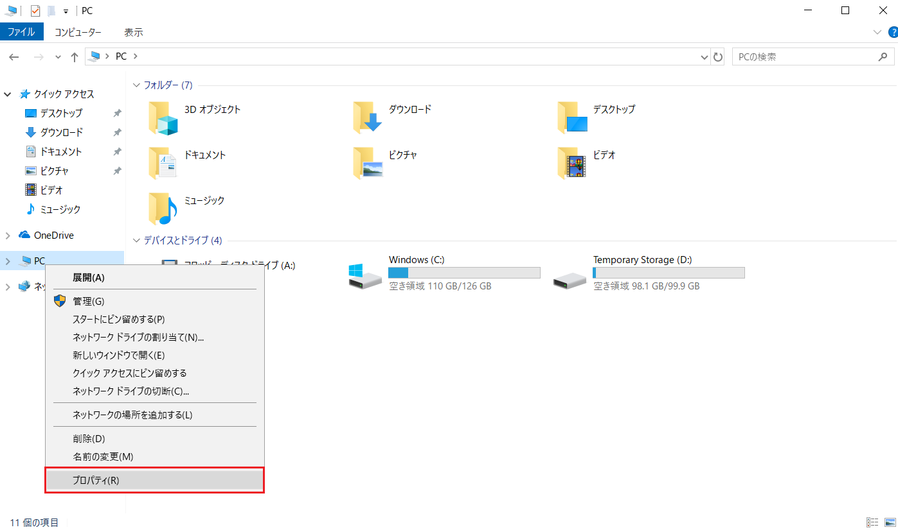

# Xây dựng môi trường bằng XAMPP
Đây là các bước dùng XAMPP để tạo môi trường chạy Exment trên máy tính Windows.  
XAMPP là phần mềm cài được PHP, Apache và MySQL cùng một lúc. Chúng tôi khuyên dùng khi tạo môi trường phát triển từ đầu.

## Lưu ý
- **Việc cài đặt bằng XAMPP chỉ nên dùng cho phát triển và kiểm thử. Khuyến nghị không dùng làm môi trường production.** 

## Các bước cài đặt
Tiến hành theo thứ tự sau.

1. Cài XAMPP, chạy Apache và MySQL
2. Làm cho lệnh mysql dùng được (biến môi trường)
3. Tạo cơ sở dữ liệu
4. Tạo URL cho Exment (thiết lập subdomain)
5. Cài Exment

### Các bước cài đặt XAMPP
1. Tải XAMPP từ trang sau.  
[Tải XAMPP](https://www.apachefriends.org/jp/download.html)

2. Hãy chọn bản "PHP8.2" trở lên và tải về.  

3. Tiến hành cài đặt XAMPP.  

4. Giữa chừng sẽ có màn hình chọn các thành phần của XAMPP. Chọn Apache và MySQL.  
Đánh dấu chọn cả "phpMyAdmin".  
※ Các mục khác thì chọn tùy ý  
Sau đó bấm "Next".  

5. Sau đó làm theo màn hình để hoàn tất cài đặt.

6. Khi cài đặt xong, khởi động XAMPP Control Panel.  

7. Bấm "Start" ở dòng "Apache" và dòng "MySQL" ở trên cùng.  

8. Nếu thiết lập tường lửa xuất hiện, hãy bấm "Allow" (cho phép).  

9. Đến đây Apache đã chạy.  

#### [Lưu ý]
- Khi khởi động lại hệ điều hành, cần khởi động lại XAMPP Control Panel và chạy lại Apache.

### Thêm biến môi trường
Để chạy mysql từ Command Prompt, cần thêm đường dẫn vào "biến môi trường".

1. Trong Explorer, bấm chuột phải vào "This PC" và bấm "Properties".  

2. Bấm "Advanced system settings".  

3. Bấm "Environment Variables".  

4. Bấm "Path" trong "User variables" rồi bấm "Edit".  

5. Bấm "New" và thêm dòng sau.

~~~
C:\xampp\mysql\bin  
~~~

6. Sau khi nhập, đóng tất cả các hộp thoại đang mở bằng "OK".

##### Khi chạy Mysql nằm trong XAMPP
- Khi chạy Mysql nằm trong XAMPP, ở bước [Cài đặt Exment](/vi/install_xampp?id=cài-đặt-exment), hãy thêm đường dẫn tới thư mục chứa tệp thực thi vào tệp .env trong thư mục gốc của Exment.

~~~
#Ví dụ  
EXMENT_MYSQL_BIN_DIR="C:/xampp/mysql/bin"
~~~

#### Tạo cơ sở dữ liệu
1. Khởi động XAMPP Control Panel và bấm "Admin" ở dòng "MySQL".  

2. Bấm "New" (tạo mới) ở menu bên trái.  

3. Ở dòng "Create database" (tạo cơ sở dữ liệu), nhập tên cơ sở dữ liệu tùy ý bằng chữ và số, rồi bấm "Create" (tạo).  

Đến đây, cơ sở dữ liệu đã được tạo.

### Thiết lập subdomain
Với thiết lập thông thường, đặt các tệp dự án của Exment vào trong thư mục "C:\xampp\htdocs" là dùng được Exment.  
Tuy nhiên, nếu để như vậy thì có vấn đề lớn: ví dụ khi mở URL [http://localhost/exment/.env](http://localhost/exment/.env), tệp thiết lập có chứa thông tin cơ sở dữ liệu sẽ hiển thị trên màn hình.  
Vì vậy, chúng tôi đặc biệt khuyến nghị thiết lập để vấn đề này không xảy ra. Hãy thiết lập theo các bước sau.

1. Tạo thư mục "local" trong thư mục "C:\xampp".  

2. Mở "C:\xampp\apache\conf\extra\httpd-vhosts.conf".

3. Thêm nội dung sau vào cuối tệp. **※ Cuối DocumentRoot cần có "/public"**  

~~~
<VirtualHost *:80>
    DocumentRoot "C:/xampp/htdocs"
    ServerName localhost
</VirtualHost>

<VirtualHost *:80>
  DocumentRoot "C:/xampp/local/exment/public"
  ServerName exment.localapp
</VirtualHost>

<Directory "C:\xampp\local\exment\public">
  Allow from all
  AllowOverride All
  Require all granted
</Directory>
~~~

4. Mở "C:\WINDOWS\system32\drivers\etc\hosts" và sửa như sau.  
※ Tệp này không sửa trực tiếp được. Hãy sao chép ra desktop hoặc nơi khác để sửa, rồi ghi đè lại vào vị trí cũ.  

~~~
127.0.0.1       localhost
127.0.0.1       exment.localapp
~~~

5. Khởi động lại Apache trong XAMPP Control Panel. Bấm nút "Stop" ở dòng "Apache", rồi bấm "Start" lần nữa.  

6. Đến đây, có thể mở Exment bằng URL sau.  
http://exment.localapp

### Cài đặt Exment
Cài Exment theo [các bước cài đặt](/vi/quickstart) của Exment.  
Việc cài Exment thường được làm trong thư mục "C:\xampp\local".  
Ở đây coi như đã cài vào trong thư mục "C:\xampp\local\exment".  

- Trong lúc cài đặt có màn hình nhập thiết lập cơ sở dữ liệu. Hãy nhập như sau.
    - Loại cơ sở dữ liệu: MariaDB
    - Tên máy chủ: 127.0.0.1
    - Cổng: 3306
    - Cơ sở dữ liệu: (tên cơ sở dữ liệu đã tạo ở trên)
    - Tên người dùng: root
    - Mật khẩu: (để trống)

## Việc cần làm khi nâng phiên bản PHP
Khi đổi phiên bản PHP, hãy làm theo các bước sau.

- Trong lúc nâng phiên bản, không truy cập được Exment.
- Ví dụ dưới đây là các bước cập nhật từ PHP7.4 lên PHP8.2. Đây là cách chỉ thay PHP mà không cập nhật toàn bộ XAMPP.
- Tùy môi trường, thời điểm cài, phiên bản và cách cài đặt mà các bước có thể khác.

1. Để chuẩn bị, hãy dừng Apache và MySQL, rồi thoát XAMPP Control Panel.

2. Sao lưu thư mục PHP (mặc định là C:\xampp\php) và thư mục Apache (mặc định là C:\xampp\apache) trong XAMPP đang dùng. Có thể dùng cách bạn thích, như đổi tên thư mục hoặc sao chép sang nơi khác.

3. Tải XAMPP mới ở dạng ZIP.  

   1. Truy cập [Tải XAMPP](https://www.apachefriends.org/jp/download.html)
   2. Tải tệp phù hợp với hệ điều hành và phiên bản PHP muốn dùng.  
      > Khi đó, hãy chọn tệp zip chứ không phải installer.exe. (Nếu có môi trường giải nén được thì tệp 7z cũng được)
      

   3. Giải nén tệp ZIP, rồi sao chép thư mục PHP và thư mục Apache nằm ngay trong thư mục đã giải nén vào trong XAMPP.  

4. Nếu cần, hãy sửa tệp php.ini.  
※ Nếu trước đây đã sửa tệp ini cũ thì tệp ini mới cũng cần cùng các thay đổi đó. Hãy so sánh php.ini đã sao lưu với php.ini mới và thêm các giá trị thiết lập, v.v.  

5. Khởi động XAMPP Control Panel.

6. Bấm nút config của Apache và chọn "Apache(httpd-xampp.conf)" trong danh sách thả xuống. 
   

7. Sửa httpd-xampp.conf. 
   1. Trước tiên, thay tất cả "php7_module" bằng "php_module".
   2. Thay tất cả "php7" còn lại bằng "php8".
   

8. Bấm nút Shell để mở màn hình lệnh và kiểm tra rằng phiên bản PHP đã mới.

~~~
php -v
~~~

9. Bấm "Start" ở dòng "Apache" và dòng "MySQL".  

   > Khi "Start" "Apache" có thể xảy ra lỗi.  
   Khi đó, hãy mở "Logs" → "Apache(error.log)" ở bên phải cùng dòng.  
   Nếu dòng mới nhất của log ghi "PHP Warning: 'vcruntime140.dll'...", thì cần cài "Visual C++ Redistributable".  
   Truy cập [trang tải về của Microsoft](https://visualstudio.microsoft.com/ja/downloads/), cuộn xuống dưới cùng → mở "Other Tools, Frameworks, and Redistributables".	  
   Bấm nút tải của "Microsoft Visual C++ Redistributable for Visual Studio 2022" để lấy trình cài đặt → chạy nó.  
