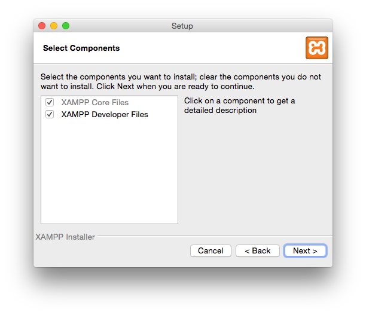

# Xây dựng môi trường bằng XAMPP
Đây là các bước dùng XAMPP để tạo môi trường chạy Exment trên Mac.  
XAMPP là phần mềm cài được PHP, Apache và MySQL cùng một lúc. Chúng tôi khuyên dùng khi tạo môi trường phát triển từ đầu.

## Lưu ý
- **Việc cài đặt bằng XAMPP chỉ nên dùng cho phát triển và kiểm thử. Khuyến nghị không dùng làm môi trường production.** 

## Các bước cài đặt
Tiến hành theo thứ tự sau.

1. Cài XAMPP, chạy Apache và MySQL
2. Làm cho lệnh mysql dùng được (biến môi trường)
3. Tạo cơ sở dữ liệu
4. Tạo URL cho Exment (thiết lập subdomain)
5. Cài Exment

### Các bước cài đặt XAMPP
1. Tải XAMPP từ trang sau.  
[Tải XAMPP](https://www.apachefriends.org/jp/download.html)  

2. Trong mục "XAMPP for OS X", hãy chọn bản "PHP8.2" và tải về.  

3. Tiến hành cài đặt XAMPP.  

4. Ở màn hình chọn các thành phần của XAMPP, đánh dấu chọn cả hai rồi bấm Next.  

5. Sau đó bấm Next theo màn hình để hoàn tất cài đặt.

6. Khi cài đặt xong, trong XAMPP (Other) của LaunchPad có ứng dụng tên manager-osx. Có thể khởi động XAMPP từ đó.  

7. Sau khi khởi động XAMPP, bấm Manage Servers.  

8. Bấm nút Start của MySQL và Apache để Status thành Running.  

#### [Lưu ý]
- Khi khởi động lại hệ điều hành, cần khởi động lại XAMPP Control Panel và chạy lại Apache.  

### Thêm biến môi trường
Để chạy mysql từ Terminal, hãy ghi thêm Path vào tệp thiết lập .bash_profile của Terminal.

1. Mở .bash_profile bằng lệnh sau.

~~~
vi .bash_profile
~~~

2. Ở màn hình vừa mở, bấm phím i trên bàn phím để vào chế độ nhập (phía dưới bên trái hiển thị INSERT). Sau đó nhập Path như sau.

~~~
export PATH="/Applications/XAMPP/xamppfiles/bin:$PATH"
~~~

3. Để lưu và đóng, bấm phím Esc trên bàn phím rồi nhập :wq.  

4. Cuối cùng, dùng lệnh sau để nạp .bash_profile và áp dụng Path.

~~~
source ~/.bash_profile
~~~

#### Tạo cơ sở dữ liệu
1. Sau khi khởi động XAMPP Control Panel, mở URL sau bằng trình duyệt Web để truy cập phpMyadmin.

http://localhost/phpmyadmin/index.php  

2. Bấm "New" (tạo mới) ở menu bên trái.  

3. Ở dòng "Create database" (tạo cơ sở dữ liệu), nhập tên cơ sở dữ liệu tùy ý bằng chữ và số, rồi bấm "Create" (tạo).  

Đến đây, cơ sở dữ liệu đã được tạo.

### Thiết lập subdomain
Với thiết lập thông thường, đặt các tệp dự án của Exment vào trong thư mục "/Applications/XAMPP/htdocs" là dùng được Exment.  
Tuy nhiên, nếu để như vậy thì có vấn đề lớn: ví dụ khi mở URL [http://localhost/exment/.env](http://localhost/exment/.env), tệp thiết lập có chứa thông tin cơ sở dữ liệu sẽ hiển thị trên màn hình.  
Vì vậy, chúng tôi đặc biệt khuyến nghị thiết lập để vấn đề này không xảy ra. Hãy thiết lập theo các bước sau.

1. Tạo thư mục "local" trong thư mục "/Applications/XAMPP".  

2. Mở "/Applications/XAMPP/xamppfiles/etc/extra/httpd-xampp.conf".

3. Thêm nội dung sau vào cuối tệp. **※ Cuối DocumentRoot cần có "/public"**  

~~~
<VirtualHost *:80>
    DocumentRoot "/Applications/XAMPP/xamppfiles/htdocs"
    ServerName localhost
</VirtualHost>

<VirtualHost *:80>
  DocumentRoot "/Applications/XAMPP/local/exment/public"
  ServerName exment.localapp
</VirtualHost>

<Directory "/Applications/XAMPP/local/exment/public">
  Allow from all
  AllowOverride All
  Require all granted
</Directory>  
~~~

4. Mở "/Applications/XAMPP/xamppfiles/etc/httpd.conf" và dùng chức năng tìm chuỗi để tìm nội dung sau.

~~~
User daemon
Group daemon
</IfModule>
~~~

Sửa nội dung này như sau.

~~~
User (tên người dùng đăng nhập của Mac)
Group daemon
</IfModule>
~~~

5. Sửa "/etc/hosts".  
Nhập lệnh sau trong Terminal.  
※ Sẽ được hỏi mật khẩu, hãy nhập mật khẩu của người dùng đăng nhập

~~~
sudo vi /etc/hosts
~~~

Hãy thêm các mục sau vào tệp hosts.

~~~
127.0.0.1       localhost
127.0.0.1       exment.localapp
~~~

6. Khởi động lại Apache trong XAMPP Control Panel.  

### Cài đặt Exment
Cài Exment theo [các bước cài đặt](/vi/quickstart) của Exment.  
Việc cài Exment thường được làm trong thư mục "/Applications/XAMPP/local".  
Ở đây coi như đã cài vào trong thư mục "/Applications/XAMPP/local/exment".  

- Trong lúc cài đặt có màn hình nhập thiết lập cơ sở dữ liệu. Hãy nhập như sau.
    - Loại cơ sở dữ liệu: MariaDB
    - Tên máy chủ: 127.0.0.1
    - Cổng: 3306
    - Cơ sở dữ liệu: (tên cơ sở dữ liệu đã tạo ở trên)
    - Tên người dùng: root
    - Mật khẩu: (để trống)

