# Liên kết LINE
Đây là tính năng nối Exment với LINE Official Account của công ty.  
Bạn có thể nhận thông báo của Exment trên LINE. Từ nút trên thẻ thông báo gửi tới LINE, bạn cũng thực thi được hành động của quy trình làm việc (phê duyệt, v.v.).  
Trang này giải thích các thiết lập để kết nối và cách tạo thông báo.

- Về tính năng xác nhận an toàn của nhân viên bằng LINE và email, vui lòng xem [Xác nhận an toàn](/vi/safety_check).
- Liên kết LINE dùng được từ v7.0.0.

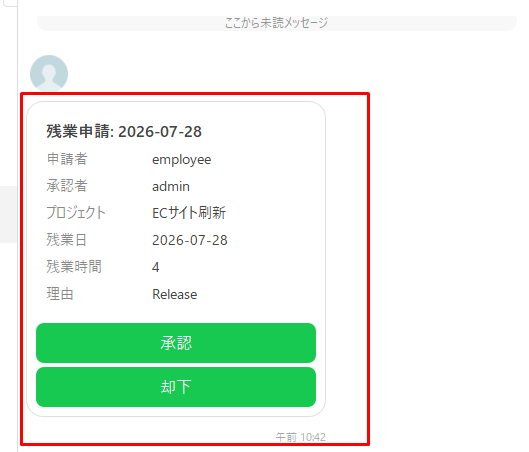

## Những việc làm được với liên kết LINE
- **Liên kết tài khoản LINE**: mỗi người dùng liên kết tài khoản LINE của mình với người dùng Exment. Cần liên kết này để nhận thông báo trên LINE.
- **Thông báo LINE**: khi chọn "LINE" ở hành động thực hiện của [Thông báo](/vi/notify), Exment gửi tin nhắn tới LINE. Ngoài văn bản, cũng gửi được dưới dạng thẻ (Flex Message).
- **Thực thi quy trình làm việc từ LINE**: thẻ thông báo hiển thị nút của các hành động như "Phê duyệt", "Từ chối". Bấm nút là thực thi hành động ngay từ LINE.
- **Lịch sử gửi LINE**: các tin nhắn đã gửi bằng thông báo LINE và xác nhận an toàn đều được ghi lại, dù thành công hay thất bại.

## Trình tự thiết lập
Thiết lập theo thứ tự sau. Riêng bước 5 do từng người dùng nhận thông báo tự làm.

| Bước | Nội dung | Người làm |
| --- | --- | --- |
| 1 | [Chuẩn bị LINE Official Account](/vi/line?id=chuẩn-bị-line-official-account) | Quản trị viên |
| 2 | [Nhập thông tin của channel vào cài đặt hệ thống của Exment](/vi/line?id=cài-đặt-hệ-thống) | Quản trị viên |
| 3 | [Đăng ký Webhook URL với LINE](/vi/line?id=thiết-lập-webhook) | Quản trị viên |
| 4 | [Thiết lập task schedule](/vi/additional_task_schedule) (khi dùng thông báo "Theo thời gian trôi qua") | Quản trị viên máy chủ |
| 5 | [Liên kết tài khoản LINE](/vi/line?id=liên-kết-tài-khoản-line) | Từng người dùng |
| 6 | [Tạo mẫu LINE Flex](/vi/line?id=mẫu-line-flex) (khi gửi dưới dạng thẻ) | Quản trị viên |
| 7 | [Thiết lập thông báo](/vi/line?id=thiết-lập-thông-báo-line) | Quản trị viên |

## Yêu cầu hoạt động
- Cần có LINE Official Account đã bật Messaging API (cơ chế để chương trình gửi và nhận tin nhắn LINE). Tin nhắn từ Exment được gửi từ tài khoản này.
- Máy chủ của LINE phải truy cập được Webhook URL của Exment. Hãy công khai Exment bằng URL "https://" truy cập được từ Internet và có chứng chỉ SSL hợp lệ.
- Khi dùng thông báo với trigger "Theo thời gian trôi qua", cần thiết lập [task schedule](/vi/additional_task_schedule).

> LINE Official Account có giới hạn số tin nhắn gửi được mỗi tháng, tùy theo gói cước.  
Thông báo gửi từ Exment được tính là 1 tin cho mỗi người nhận. Các câu trả lời cho thao tác của người dùng (như "Đã liên kết tài khoản LINE thành công!") không được tính.  
Chi tiết vui lòng xem gói cước của LINE Official Account.

## Chuẩn bị LINE Official Account

### Bật Messaging API
1. Tạo LINE Official Account ở [LINE Official Account Manager](https://manager.line.biz). Cũng có thể dùng tài khoản đã có.
2. Bật Messaging API ở "Settings" (cài đặt) → "Messaging API". Khi chọn (hoặc tạo) provider, một channel của Messaging API được tạo cho LINE Official Account.

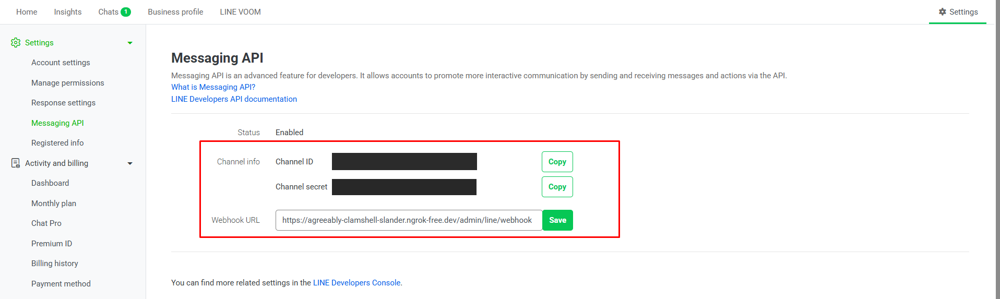

### Kiểm tra thông tin của channel
Hãy kiểm tra và ghi lại 3 giá trị sau để thiết lập cho Exment.

| Giá trị | Nơi kiểm tra | Dùng để |
| --- | --- | --- |
| Channel secret | "Settings" (cài đặt) → "Messaging API" của LINE Official Account Manager, hoặc tab "Basic settings" của [LINE Developers Console](https://developers.line.biz/console/) | Kiểm tra chữ ký của dữ liệu đến từ LINE (Webhook) |
| Channel access token (long-lived) | Chọn channel ở LINE Developers Console, rồi bấm [Issue] ở "Channel access token" của tab "Messaging API" | Gửi tin nhắn |
| Basic ID | Bên cạnh tên tài khoản ở LINE Official Account Manager, hoặc "Bot basic ID" ở tab "Messaging API" của LINE Developers Console. Là ID bắt đầu bằng "@" | Tạo mã QR để liên kết tài khoản |

※Hãy quản lý channel secret và channel access token sao cho người ngoài không biết được.

### Thiết lập trả lời
- Bật "Webhook" ở "Settings" (cài đặt) → "Response settings" (thiết lập trả lời) của LINE Official Account Manager.
- Nếu đang thiết lập tin nhắn trả lời tự động, nên tắt đi. Exment trả lời các tin nhắn văn bản do người dùng gửi tới. Nếu tin nhắn trả lời tự động vẫn bật, nó cũng được gửi, tách riêng với câu trả lời của Exment.

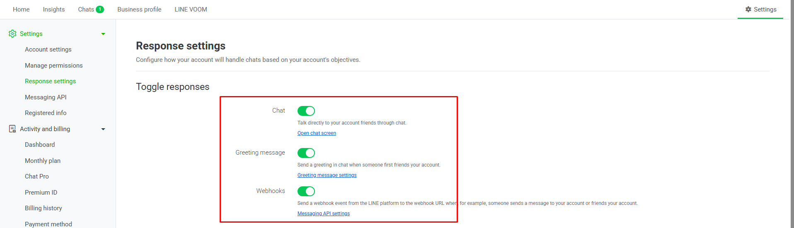

## Cài đặt hệ thống
Nhập 3 giá trị đã kiểm tra vào Exment.

**(1) Mở cài đặt chi tiết của cài đặt hệ thống**

Bấm "Cài đặt quản trị" → "Cài đặt hệ thống" ở menu bên trái, rồi chuyển sang [Cài đặt chi tiết] bằng nút ở góc trên bên phải.  
Cũng có thể mở bằng URL sau.

~~~
http(s)://(URL của Exment)/system?advanced=1
~~~

> ※URL trên là của thiết lập chuẩn không có "/admin" (site mới cài từ v7.2.1). Nếu `ADMIN_ROUTE_PREFIX` trong `.env` có giá trị (site cài bằng phiên bản trước là "admin"), hãy thêm giá trị đó vào sau URL của site (ví dụ: `http(s)://(URL của Exment)/admin/system?advanced=1`). Chi tiết vui lòng xem [Đổi hoặc bỏ "admin" trong URL](/vi/additional_prefix).

**(2) Nhập vào "Cài đặt LINE"**

Nhập các mục sau vào "Cài đặt LINE" rồi bấm [Lưu].

| Mục | Nội dung |
| --- | --- |
| Channel access token | Nhập channel access token (long-lived) đã phát hành ở LINE Developers Console. |
| Channel secret | Nhập channel secret. |
| Basic ID của tài khoản LINE Official Account | Nhập Basic ID, bắt đầu từ "@". |
| Webhook URL | Hiển thị Webhook URL để đăng ký với LINE. Không nhập được. |

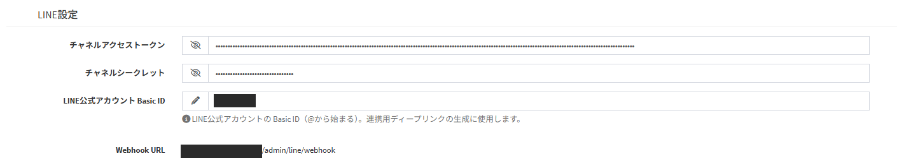

- Sau khi lưu, channel access token và channel secret được hiển thị dưới dạng che ký tự.
- Các giá trị này cũng thiết lập được trong tệp ".env". Nếu có ở cả hai nơi, giá trị đã lưu trên màn hình cài đặt hệ thống được ưu tiên. Chi tiết vui lòng xem [Giá trị thiết lập](/vi/line?id=giá-trị-thiết-lập).

## Thiết lập Webhook
Webhook là cơ chế để LINE báo cho Exment những việc xảy ra trên LINE. Khi người dùng gửi mã liên kết hoặc bấm nút trên thẻ thông báo, nội dung đó được gửi tới Exment.

1. Chọn channel ở LINE Developers Console và mở tab "Messaging API".
2. Bấm [Edit] ở "Webhook URL", dán Webhook URL hiển thị ở "Cài đặt LINE" của cài đặt hệ thống, rồi bấm [Update].
3. Bật "Use webhook".
4. Bấm [Verify] và kiểm tra có hiển thị "Success".

Webhook URL có dạng sau.

~~~
https://(URL của Exment)/line/webhook
~~~

- Webhook URL cũng thiết lập được ở "Settings" (cài đặt) → "Messaging API" của LINE Official Account Manager.
- Webhook URL chỉ đăng ký được URL bắt đầu bằng "https://" và có chứng chỉ SSL hợp lệ.
- [Thiết lập lọc IP](/vi/additional_ip_filter) của Exment không áp dụng cho Webhook URL. Nếu đang giới hạn truy cập bằng firewall, v.v., hãy thiết lập để máy chủ của LINE truy cập được.

## Liên kết tài khoản LINE
Người dùng nhận thông báo trên LINE tự liên kết tài khoản LINE của mình với người dùng Exment.  
**Thông báo LINE không được gửi cho người dùng chưa liên kết tài khoản LINE.** Trước khi dùng thông báo LINE, hãy nhờ người dùng liên kết.

### Liên kết
**(1) Mở màn hình "Liên kết LINE"**

Đăng nhập Exment, mở menu người dùng ở góc trên bên phải (tên của bạn) rồi bấm [Liên kết LINE].

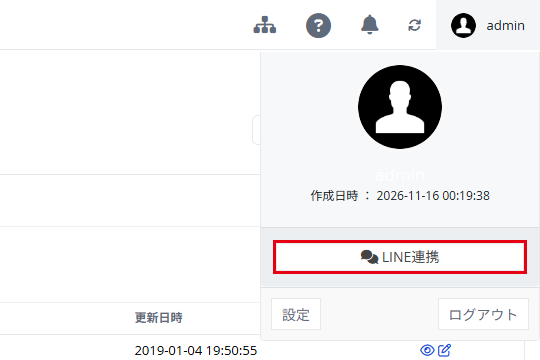

Cũng có thể mở bằng URL sau.

~~~
http(s)://(URL của Exment)/line/link
~~~

- Từ v7.1.0, "Liên kết LINE" hiển thị ở menu người dùng góc trên bên phải, không phải ở menu bên trái. Mục này chỉ hiển thị khi đã thiết lập Basic ID của LINE Official Account ở [Cài đặt hệ thống](/vi/line?id=cài-đặt-hệ-thống).
- Ở v7.0, mở từ "Liên kết LINE" ở trên cùng của menu bên trái (khi cập nhật lên v7.1.0, mục menu ở trên cùng này bị xóa. Mục menu mà bạn đã tự di chuyển thì vẫn giữ nguyên).

**(2) Hiển thị mã QR**

Bấm [Tạo mã QR]. Mã QR để liên kết được hiển thị.

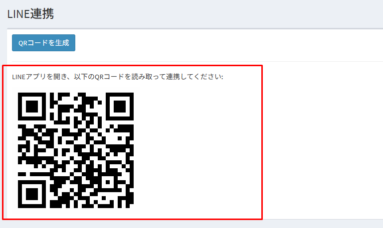

**(3) Quét bằng ứng dụng LINE rồi gửi**

- Quét mã QR bằng ứng dụng LINE trên điện thoại.  
Màn hình trò chuyện với LINE Official Account mở ra, và "LINK (mã liên kết)" đã được nhập sẵn.  
※Nếu chưa thêm LINE Official Account làm bạn, hãy thêm bạn theo hướng dẫn trên màn hình.

- Gửi tin nhắn đó nguyên như vậy. Khi nhận được câu trả lời "Đã liên kết tài khoản LINE thành công!" là đã liên kết xong.

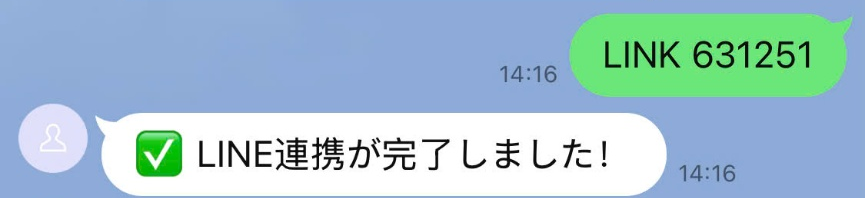

**(4) Kiểm tra đã liên kết được**

Mở lại màn hình "Liên kết LINE", sẽ thấy "Đã liên kết tài khoản LINE".

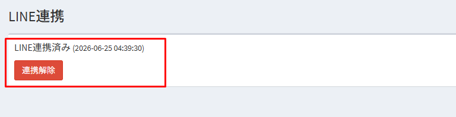

**Khi không liên kết được**

- **Thời hạn của mã liên kết**: mặc định, mã liên kết có hiệu lực 10 phút. Nếu đã hết hạn, hãy bấm [Tạo mã QR] lần nữa.
- **Một tài khoản LINE chỉ liên kết được với một người dùng**. Khi gửi mã liên kết từ tài khoản LINE đã liên kết, câu trả lời là "Tài khoản LINE này đã được liên kết với một tài khoản khác. Nếu muốn thay đổi, vui lòng hủy liên kết trên web trước.". Tuy nhiên, nếu người dùng được liên kết đã bị xóa, liên kết cũ tự động được hủy và có thể liên kết với người dùng khác.
- **Số lần gửi sai mã**: mặc định, chỉ được gửi sai mã liên kết tối đa 5 lần. Nếu sai 5 lần trong vòng 10 phút (mặc định) kể từ lần gửi sai đầu tiên, sẽ không liên kết được cho đến khi hết 10 phút đó. Trong thời gian này, dù gửi mã đúng, câu trả lời vẫn là "Mã liên kết không đúng hoặc đã hết hạn. Vui lòng kiểm tra và thử lại.".

### Hủy liên kết
Bấm [Hủy liên kết] ở màn hình "Liên kết LINE".  
Khi đổi điện thoại hoặc tài khoản LINE, hãy hủy liên kết rồi liên kết lại.

## Mẫu LINE Flex
Đây là mẫu quyết định nội dung của thẻ khi gửi thông báo LINE dưới dạng thẻ (Flex Message).  
Nếu không chọn mẫu trong thiết lập thông báo, tin nhắn văn bản được gửi (không cần mẫu).

### Tạo mẫu
**(1) Mở màn hình danh sách**

Truy cập URL sau để mở màn hình danh sách dữ liệu của "LINE Flexテンプレート" (mẫu LINE Flex).  
Để thêm vào menu bên trái, hãy thêm ở [Menu](/vi/menu) với loại menu "Dữ liệu bảng".

~~~
http(s)://(URL của Exment)/data/line_flex_template
~~~

**(2) Tạo mẫu**

Bấm [Mới], nhập các mục sau rồi lưu.

| Mục | Nội dung |
| --- | --- |
| Flexキー (khóa Flex) | Khóa để nhận biết mẫu (ví dụ: ot_request). Đừng dùng "safety_check", vì nó được dùng cho [Xác nhận an toàn](/vi/safety_check). |
| テンプレート名 (tên mẫu) | Tên của mẫu. Hiển thị trong các lựa chọn của "Mẫu LINE Flex" ở thiết lập thông báo. |
| タイトル (tiêu đề) | Đầu đề của thẻ. Dùng được biến. Nếu để trống, hiển thị nhãn của dữ liệu. |
| 本文項目 (các mục nội dung) | Các mục hiển thị trong phần nội dung của thẻ. Mỗi dòng nhập 1 mục theo dạng "tên hiển thị = giá trị". |
| 説明 (mô tả) | Mô tả của mẫu. Không hiển thị trên LINE. |

- Khi tạo mới, "タイトル" và "本文項目" có sẵn giá trị ban đầu dành cho thông báo thực hiện quy trình làm việc (trạng thái, tên hành động, v.v.). Khi dùng cho thông báo tạo/cập nhật dữ liệu, v.v., hãy sửa nội dung.
- Mẫu "Xác nhận an toàn" (khóa Flex "safety_check") được tạo tự động khi cài [Xác nhận an toàn](/vi/safety_check). Đừng chọn mẫu này ở "Mẫu LINE Flex" của thiết lập thông báo. Cũng đừng sửa hoặc xóa nó.

### Cách viết các mục nội dung
Mỗi dòng viết 1 mục. Nhập tên hiển thị ở bên trái dấu "=", giá trị ở bên phải. Giá trị dùng được biến.  
Dưới đây là ví dụ thẻ của đơn xin làm thêm giờ.

~~~
Người xin = ${created_user}
Người duyệt = ${value:approver}
Dự án = ${value:project}
Ngày làm thêm = ${value:ot_date}
Số giờ làm thêm = ${value:ot_hours}
Lý do = ${value:reason}
~~~

- Dòng có giá trị trống không hiển thị trên thẻ.
- Nếu "本文項目" để trống, thông báo thực hiện quy trình làm việc sẽ hiển thị các mục chuẩn như trạng thái, tên hành động.

### Các biến dùng được
Dùng được [biến tham số](/vi/params). Các biến chính như sau.

| Biến | Nội dung |
| --- | --- |
| ${value} | Nhãn của dữ liệu |
| ${value:(tên cột)} | Giá trị của cột trong dữ liệu (ví dụ: ${value:approver}) |
| ${created_user} | Tên người dùng đã tạo dữ liệu |
| ${table_view_name} | Tên hiển thị của bảng |
| ${workflow:status_name} | Tên trạng thái sau khi thực thi hành động ※1 |
| ${workflow:status_from_name} | Tên trạng thái trước khi thực thi hành động ※1 |
| ${workflow:action_name} | Tên hành động đã được thực thi ※1 |
| ${workflow:action_user} | Người dùng đã thực thi hành động ※1 |
| ${workflow:comment} | Bình luận đã nhập khi thực thi hành động ※1 |
| ${notify_target_column_key} | Tên cột của "Cột ngày đối tượng" ※2 |
| ${notify_target_column_value} | Giá trị của "Cột ngày đối tượng" ※2 |

※1 Chỉ dùng được trong thông báo có trigger "Thực hiện quy trình làm việc".  
※2 Chỉ dùng được trong thông báo có trigger "Theo thời gian trôi qua".

### Nút trên thẻ
Nút trên thẻ được thêm tự động, không cần thiết lập trong mẫu.

| Nút | Điều kiện hiển thị |
| --- | --- |
| Hành động của quy trình làm việc ("Phê duyệt", "Từ chối", v.v.) | Hiển thị khi thỏa mãn tất cả các điều kiện sau. • Dữ liệu có quy trình làm việc, và có hành động mà người nhận thực thi được • Người nhận chưa thực thi hành động đó • "Bình luận" của hành động không phải là "Bắt buộc" • Sau khi thực thi hành động, không cần chọn người xử lý tiếp theo (ở trạng thái tiếp theo không có hành động nào có người dùng có thể thực thi là "Do người thực thi hành động trước chọn") ※Chỉ xét với hành động có "Điều kiện chuyển sang trạng thái tiếp theo" là "1 người trở lên thực thi". Với các hành động khác, vui lòng xem [Thiết lập quy trình làm việc](/vi/line?id=thiết-lập-quy-trình-làm-việc). |
| Xem chi tiết | Hiển thị khi URL của Exment là "https://". Bấm vào sẽ mở màn hình chi tiết của dữ liệu. |

Chi tiết vui lòng xem [Thực thi hành động của quy trình làm việc từ LINE](/vi/line?id=thực-thi-hành-động-của-quy-trình-làm-việc-từ-line).

## Thiết lập thông báo LINE
Thiết lập các mục sau ở "Cài đặt hành động thông báo" trên màn hình thiết lập của [Thông báo](/vi/notify).  
Cách mở màn hình thiết lập thông báo, vui lòng xem [Thông báo](/vi/notify).

| Mục | Nội dung |
| --- | --- |
| Hành động thực hiện | Chọn "LINE". |
| Đối tượng nhận thông báo | Chọn người dùng sẽ nhận thông báo (bắt buộc). Chọn được cột "Người dùng" (hiển thị là "Cột tùy chỉnh: (tên cột)"), "Người dùng chỉ định", "Tổ chức chỉ định", "Người tạo", v.v. |
| Mẫu LINE Flex | Khi gửi dưới dạng thẻ, chọn [mẫu LINE Flex](/vi/line?id=mẫu-line-flex). Nếu để trống, gửi bằng văn bản. |

- Khi gửi bằng văn bản, tin nhắn được tạo từ tiêu đề và nội dung của "Mẫu thông báo".
- Khi chọn "Tổ chức chỉ định", thông báo được gửi cho mọi người dùng thuộc tổ chức.
- Trong các đối tượng nhận thông báo, người dùng chưa liên kết tài khoản LINE không được gửi. Trường hợp này không thành lỗi, và cũng không được ghi vào [Lịch sử gửi LINE](/vi/line?id=lịch-sử-gửi-line).
- Thông báo LINE được gửi ngay sau khi xử lý như lưu dữ liệu kết thúc. Không dùng [thực thi trễ việc thông báo](/vi/additional_queue) (queue).
- Dù gửi thất bại cũng không tự động gửi lại. Kết quả gửi xem được ở [Lịch sử gửi LINE](/vi/line?id=lịch-sử-gửi-line).

### Ví dụ 1: Thông báo khi tạo/cập nhật dữ liệu
- Trigger thực hiện: "Tạo mới/cập nhật/chia sẻ/bình luận dữ liệu"
- Cài đặt điều kiện thông báo: đánh dấu "Tạo" và "Cập nhật"
- Hành động thực hiện: "LINE"
- Đối tượng nhận thông báo: "Cột tùy chỉnh: Người phụ trách"
- Mẫu LINE Flex: mẫu đã tạo

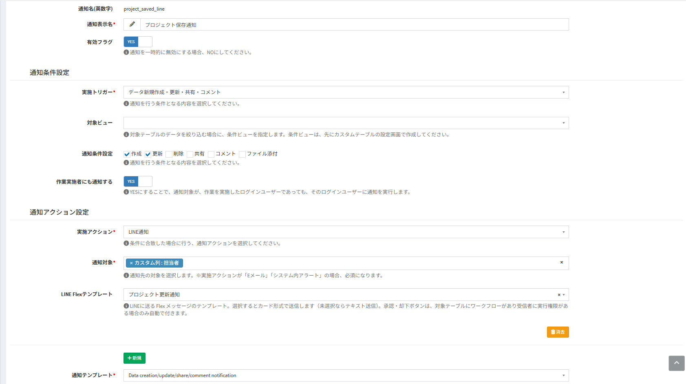

Khi dữ liệu được lưu, một thẻ như sau được gửi tới LINE.

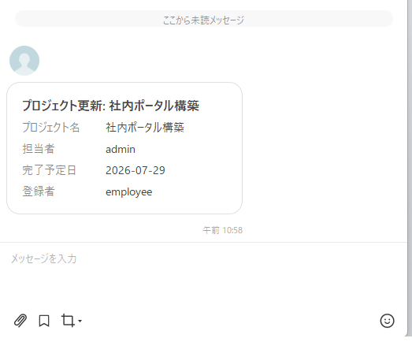

※Mặc định, chính người dùng đã lưu dữ liệu không được thông báo. Để thông báo cho cả bản thân, hãy đặt "Thông báo cả cho người thực hiện" thành YES.

### Ví dụ 2: Thông báo cho thành viên của tổ chức
Chọn "Tổ chức chỉ định" ở "Đối tượng nhận thông báo", rồi chọn tổ chức ở "Tổ chức nhận".  
Trong các người dùng thuộc tổ chức, những người đã liên kết tài khoản LINE sẽ được gửi.

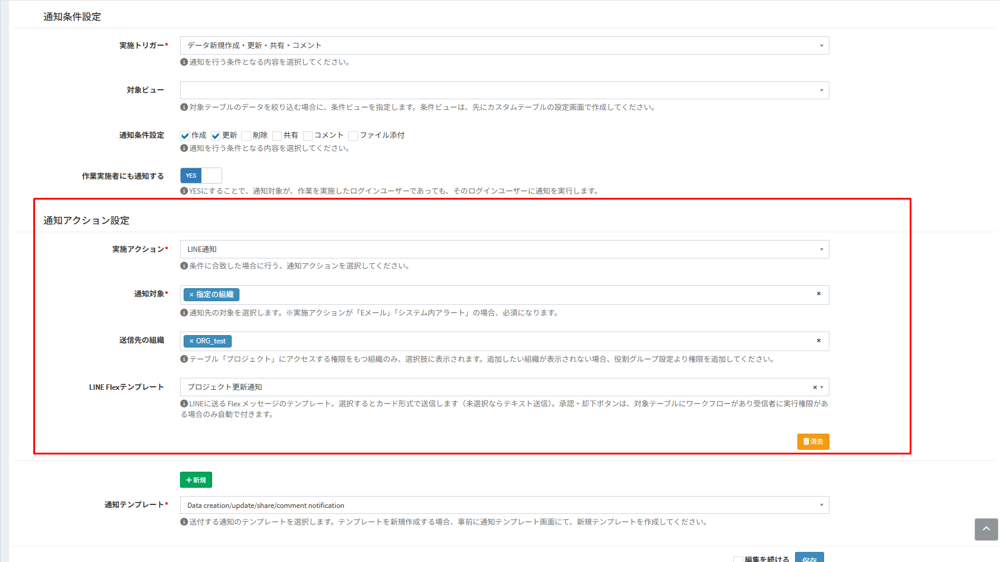

※Các lựa chọn chỉ hiển thị những tổ chức có quyền truy cập bảng đó.

### Ví dụ 3: Nhắc vào ngày trước hạn
- Trigger thực hiện: "Theo thời gian trôi qua"
- Cột ngày đối tượng: cột ngày dùng làm mốc (ví dụ: ngày dự kiến hoàn thành)
- Ngày thông báo: "1"
- Trước/sau khi thông báo: "Trước"
- Giờ thông báo: giờ gửi thông báo (0–23)
- Hành động thực hiện: "LINE"

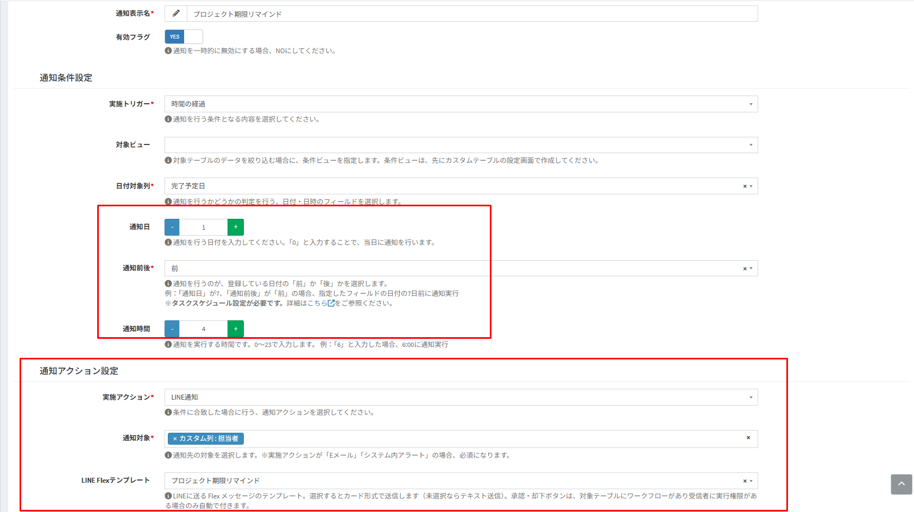

Vào giờ đã chỉ định, một thẻ như sau được gửi tới.

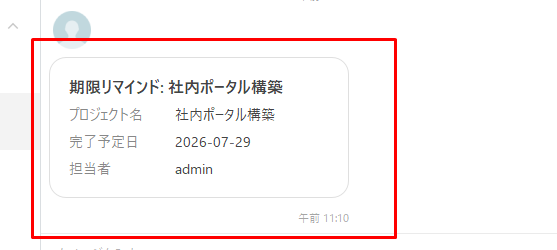

- Để chạy thông báo "Theo thời gian trôi qua", cần thiết lập [task schedule](/vi/additional_task_schedule). Thông báo được chạy vào phút 00 của giờ đã chỉ định ở "Giờ thông báo".
- Nếu muốn chạy ngay để kiểm tra thiết lập, hãy chạy lệnh sau. Thông báo được chạy, không phụ thuộc thiết lập "Giờ thông báo".

~~~
php artisan exment:notify --name=(tên thông báo (chữ và số))
~~~

- Để cùng một lời nhắc không bị gửi trùng, ví dụ khi chạy lệnh nhiều lần, hãy thiết lập giá trị "LINE_DEDUPE_MINUTES". Chi tiết vui lòng xem [Giá trị thiết lập](/vi/line?id=giá-trị-thiết-lập).

## Thực thi hành động của quy trình làm việc từ LINE
Từ nút trên thẻ thông báo gửi tới LINE, bạn thực thi được hành động của quy trình làm việc.  
Phần này giải thích bằng ví dụ người duyệt phê duyệt đơn xin làm thêm giờ trên LINE. Cách thiết lập quy trình làm việc, vui lòng xem [Thiết lập quy trình làm việc](/vi/workflow_setting).

Có 3 việc cần làm.

1. Thiết lập để hành động của quy trình làm việc thực thi được từ LINE ([Thiết lập quy trình làm việc](/vi/line?id=thiết-lập-quy-trình-làm-việc))
2. Thiết lập gửi thông báo LINE cho người duyệt ("Thiết lập thông báo" ở dưới)
3. Bấm nút trên thẻ nhận được ("Phê duyệt từ LINE" ở dưới)

### Thiết lập quy trình làm việc
Ở "Cài đặt hành động" của thiết lập quy trình làm việc, thiết lập hành động sẽ thực thi từ LINE như sau.

- Người dùng có thể thực thi: người dùng thực thi hành động (ví dụ: cột "Người duyệt" của bảng, bằng "Thiết lập trước")
- Bình luận: "Tùy chọn" hoặc "Không sử dụng"

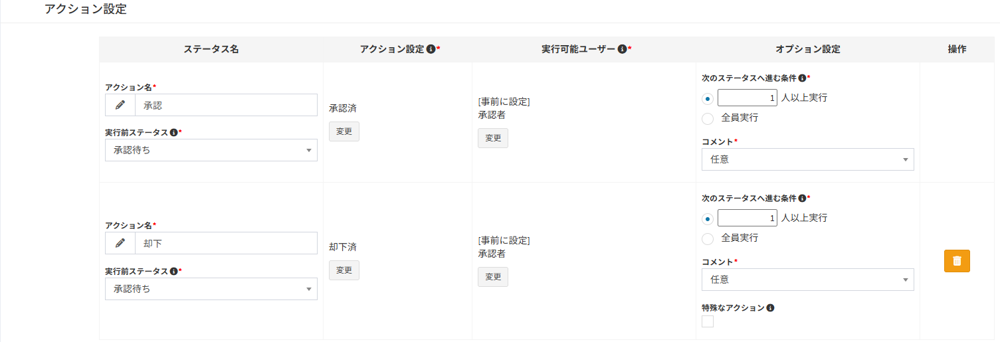

**Hành động không thực thi được từ LINE**

Các hành động sau, hãy thực thi từ màn hình của Exment.

- **Hành động có "Bình luận" là "Bắt buộc"**: nút không hiển thị trên thẻ của LINE, vì cần nhập bình luận.
- **Hành động mà sau khi thực thi cần chọn người xử lý tiếp theo** (khi ở trạng thái tiếp theo có hành động có người dùng có thể thực thi là "Do người thực thi hành động trước chọn"): tùy theo "Điều kiện chuyển sang trạng thái tiếp theo" mà như sau.

| "Điều kiện chuyển sang trạng thái tiếp theo" | Thẻ của LINE |
| --- | --- |
| "1 người trở lên thực thi" | Nút không hiển thị. |
| Từ 2 người trở lên, hoặc "Tất cả thực thi" | Nút hiển thị. Lần thực thi không làm trạng thái chuyển tiếp (ví dụ: người thứ 1 và thứ 2 khi cần 3 người phê duyệt) thực thi được từ LINE. Khi bấm nút ở lần thực thi làm trạng thái chuyển tiếp (ví dụ: người thứ 3), hành động không được thực thi và câu trả lời là "Thao tác này cần chọn người xử lý tiếp theo. Vui lòng xử lý trên web.". |

### Thiết lập thông báo
Thiết lập thông báo để gửi thông báo LINE cho người duyệt. **Nhất định phải chọn "Mẫu LINE Flex"**. Nếu gửi bằng văn bản, nút không hiển thị.

- **Khi thông báo lúc tạo dữ liệu**: trong thiết lập thông báo của bảng, đặt trigger thực hiện "Tạo mới/cập nhật/chia sẻ/bình luận dữ liệu", cài đặt điều kiện thông báo "Tạo", đối tượng nhận thông báo "Cột tùy chỉnh: Người duyệt", hành động thực hiện "LINE".
- **Khi thông báo cho người xử lý tiếp theo lúc thực thi hành động**: trong thiết lập thông báo của quy trình làm việc, đặt hành động thực hiện "LINE", đối tượng nhận thông báo "Người xử lý tiếp theo".

### Phê duyệt từ LINE
**(1)** Người xin chọn người duyệt và tạo dữ liệu đơn xin làm thêm giờ.

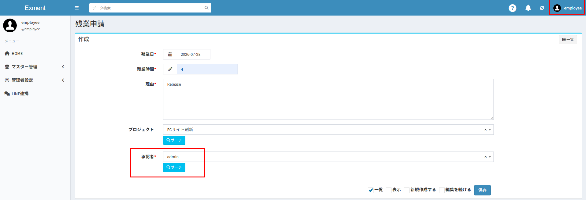

**(2)** LINE của người duyệt nhận được thẻ có nút "Phê duyệt" và "Từ chối".  
Bấm nút thì hành động được thực thi, và nhận được câu trả lời "Đã xử lý: Phê duyệt".

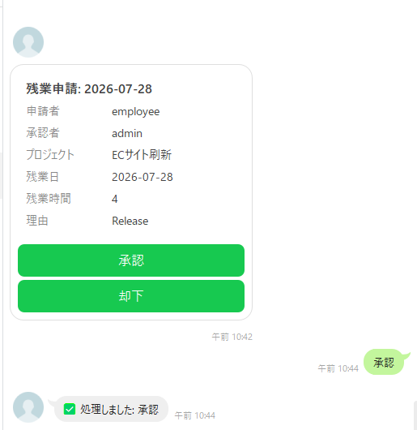

**(3)** Trạng thái của dữ liệu trên Exment được cập nhật.

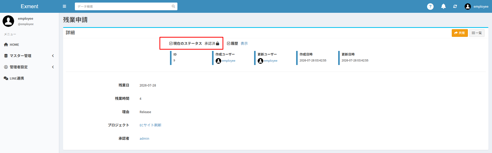

Hành động được thực thi với tư cách người dùng đã liên kết tài khoản LINE. Tại thời điểm bấm nút, Exment kiểm tra lại xem người dùng đó có thực thi được hành động không.

Khi không thực thi được, câu trả lời như sau.

| Câu trả lời | Lý do |
| --- | --- |
| "Thao tác này không khả dụng hoặc đã được xử lý." | Hành động không thực thi được, ví dụ người dùng khác đã xử lý rồi, hoặc đã thực thi cùng hành động đó. |
| "Thao tác này cần chọn người xử lý tiếp theo. Vui lòng xử lý trên web." | Cần chọn người xử lý tiếp theo. Hãy thực thi từ màn hình của Exment. |
| "Thao tác này cần nhập bình luận. Vui lòng xử lý trên web." | Sau khi thẻ được gửi, "Bình luận" của hành động đã được đổi thành "Bắt buộc". |
| "Tài khoản này chưa được kích hoạt đăng nhập." | Người dùng chưa được thiết lập là người dùng đăng nhập thì không thực thi được hành động từ LINE. |

## Lịch sử gửi LINE
Các tin nhắn đã gửi bằng thông báo LINE và [Xác nhận an toàn](/vi/safety_check) được ghi vào bảng "LINE送信履歴" (lịch sử gửi LINE), dù thành công hay thất bại.  
Các câu trả lời cho thao tác của người dùng (như "Đã liên kết tài khoản LINE thành công!", "Đã xử lý: Phê duyệt") không được ghi.  
Truy cập URL sau để xem danh sách.

~~~
http(s)://(URL của Exment)/data/line_send_log
~~~

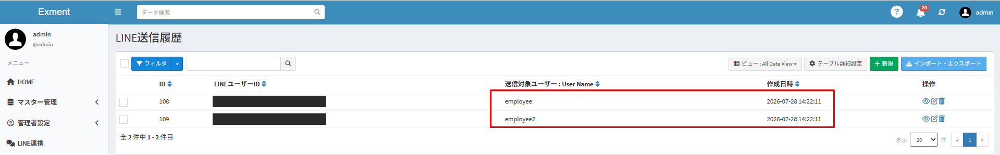

| Cột | Nội dung |
| --- | --- |
| LINEユーザーID (ID người dùng LINE) | ID người dùng LINE của nơi nhận. |
| メッセージ種別 (loại tin nhắn) | "text" (văn bản) hoặc "flex" (thẻ). |
| 送信Flexテンプレート (mẫu Flex đã gửi) | Mẫu LINE Flex đã dùng để gửi thẻ. |
| 件名 (tiêu đề) | Tiêu đề của tin nhắn. Với thẻ là tiêu đề của thẻ. |
| 本文 (nội dung) | Dữ liệu của tin nhắn đã gửi tới LINE (dạng JSON). Với thẻ, toàn bộ nội dung Flex Message được ghi lại. |
| 送信対象ユーザー (người dùng nhận) | Người dùng Exment là nơi nhận. |
| 送信日時 (ngày giờ gửi) | Ngày giờ đã gửi tin nhắn. |
| 送信結果 (kết quả gửi) | "success" (thành công) hoặc "failed" (thất bại). |
| エラー内容 (nội dung lỗi) | Lý do khi gửi thất bại (ví dụ: "HTTP 400 …"). |

- Vì không gửi cho người dùng chưa liên kết tài khoản LINE, nên lịch sử cũng không được ghi. Khi thông báo không đến, trước tiên hãy kiểm tra việc liên kết tài khoản LINE.
- Các cột hiển thị trong danh sách đổi được bằng [view tùy chỉnh](/vi/view).

## Giá trị thiết lập
Các thiết lập sau đổi được trong tệp ".env". Chi tiết vui lòng xem [danh sách giá trị thiết lập](/vi/config).

| Khóa thiết lập | Mặc định | Nội dung |
| --- | --- | --- |
| LINE_CHANNEL_ACCESS_TOKEN | (không có) | Channel access token. Giá trị đã lưu trên màn hình cài đặt hệ thống được ưu tiên. |
| LINE_CHANNEL_SECRET | (không có) | Channel secret. Giá trị đã lưu trên màn hình cài đặt hệ thống được ưu tiên. |
| LINE_OA_BASIC_ID | (không có) | Basic ID. Giá trị đã lưu trên màn hình cài đặt hệ thống được ưu tiên. |
| LINE_DEDUPE_MINUTES | 0 | Với thông báo LINE "Theo thời gian trôi qua": sau khi gửi tin nhắn LINE về cùng một dữ liệu cho cùng một người dùng, trong khoảng thời gian này (phút) sẽ không gửi lại. Tin nhắn gửi bằng thiết lập thông báo khác và tin nhắn gửi thất bại cũng được tính. Nếu là 0, tính năng này tắt. |
| LINE_LINK_CODE_TTL_MINUTES | 10 | Thời hạn hiệu lực của mã liên kết (phút). |
| LINE_LINK_MAX_ATTEMPTS | 5 | Số lần được gửi sai mã liên kết. Vượt quá số lần này thì không liên kết được trong một khoảng thời gian. |
| LINE_LINK_ATTEMPT_DECAY_MINUTES | 10 | Khoảng thời gian (phút) để đếm số lần gửi sai mã liên kết. Nếu sai đủ số lần "LINE_LINK_MAX_ATTEMPTS" trong khoảng thời gian này kể từ lần gửi sai đầu tiên, sẽ không liên kết được cho đến khi hết khoảng thời gian này. |
| LINE_HTTP_TIMEOUT | 10 | Thời gian timeout (giây) khi giao tiếp với máy chủ của LINE. |
| LINE_API_BASE | https://api.line.me | URL của LINE Messaging API. Thông thường đừng thay đổi. |

※Thông báo không được gửi do "LINE_DEDUPE_MINUTES" không được ghi vào Lịch sử gửi LINE. Trong "storage/logs/laravel.log" sẽ có dòng "LINE reminder skipped by dedupe".

## Khi không hoạt động đúng
| Hiện tượng | Nguyên nhân chính | Cách xử lý |
| --- | --- | --- |
| [Verify] của Webhook không thành công | • Webhook URL không phải "https://", hoặc chứng chỉ SSL không hợp lệ • Không truy cập được Exment từ Internet • Channel secret không đúng | Hãy kiểm tra Webhook URL, thiết lập công khai của máy chủ và "Channel secret" trong cài đặt hệ thống. |
| Gửi mã liên kết nhưng không nhận được câu trả lời | • "Use webhook" đang tắt • Webhook URL không đúng | Hãy kiểm tra [Thiết lập Webhook](/vi/line?id=thiết-lập-webhook). |
| Bấm [Tạo mã QR] thì hiển thị "Chưa cài đặt Basic ID của LINE Official Account. Vui lòng cài đặt tại "Cài đặt: Hệ thống" > "Cài đặt hệ thống"." | Chưa thiết lập Basic ID | Hãy nhập "Basic ID của tài khoản LINE Official Account" trong cài đặt hệ thống. |
| Câu trả lời là "Mã liên kết không đúng hoặc đã hết hạn. Vui lòng kiểm tra và thử lại." | • Mã liên kết đã hết hạn, hoặc mã sai • Đã gửi sai mã liên kết liên tiếp nên tạm thời không liên kết được | Bấm [Tạo mã QR] và quét mã QR mới. Nếu đang tạm thời không liên kết được, hãy chờ một lúc (mặc định 10 phút) rồi gửi. |
| Câu trả lời là "Tài khoản LINE này đã được liên kết với một tài khoản khác. Nếu muốn thay đổi, vui lòng hủy liên kết trên web trước." | Tài khoản LINE đó đã liên kết với một người dùng Exment | Đăng nhập Exment bằng người dùng đang liên kết, bấm [Hủy liên kết] ở màn hình "Liên kết LINE", rồi liên kết lại. |
| Câu trả lời là "Để liên kết tài khoản, vui lòng gửi theo định dạng: LINK &lt;code&gt;." | Người dùng chưa liên kết tài khoản LINE đã gửi tin nhắn không phải mã liên kết | Hãy quét mã QR và liên kết theo các bước ở [Liên kết tài khoản LINE](/vi/line?id=liên-kết-tài-khoản-line). |
| Câu trả lời là "Lệnh không hợp lệ." | Người dùng đã liên kết tài khoản LINE gửi tin nhắn không phải mã liên kết | Không phải bất thường. Exment không phản hồi các tin nhắn không phải mã liên kết. Về trả lời bổ sung của xác nhận an toàn, vui lòng xem [Xác nhận an toàn](/vi/safety_check?id=trả-lời-bằng-line). |
| Thông báo LINE không đến, và Lịch sử gửi LINE cũng không có bản ghi | Người dùng là đối tượng nhận thông báo chưa liên kết tài khoản LINE | Hãy nhờ người dùng [liên kết tài khoản LINE](/vi/line?id=liên-kết-tài-khoản-line). |
| Kết quả gửi trong Lịch sử gửi LINE là "failed" | • Channel access token không đúng hoặc không còn hiệu lực • Người dùng đang chặn LINE Official Account • Đã đạt giới hạn số tin gửi trong tháng | Hãy xem "エラー内容" (nội dung lỗi). Nếu đã phát hành lại channel access token, hãy nhập lại vào cài đặt hệ thống. |
| Thẻ không hiển thị nút "Phê duyệt", "Từ chối" | • "Bình luận" của hành động là "Bắt buộc" • Hành động có "Điều kiện chuyển sang trạng thái tiếp theo" là "1 người trở lên thực thi", và sau khi thực thi cần chọn người xử lý tiếp theo (ở trạng thái tiếp theo có hành động "Do người thực thi hành động trước chọn") • Người nhận không thực thi được hành động đó, hoặc đã thực thi rồi • Dữ liệu đã được xử lý • Chưa chọn mẫu LINE Flex | Hãy kiểm tra [Thực thi hành động của quy trình làm việc từ LINE](/vi/line?id=thực-thi-hành-động-của-quy-trình-làm-việc-từ-line). |
| Thông báo LINE "Theo thời gian trôi qua" không được gửi | • Task schedule không chạy • "Giờ thông báo" không khớp với giờ của máy chủ • Không được gửi do "LINE_DEDUPE_MINUTES" | Hãy kiểm tra [task schedule](/vi/additional_task_schedule). Cũng có thể chạy thông báo bằng "php artisan exment:notify" để kiểm tra. |
| Nút "Xem chi tiết" không hiển thị | URL của Exment không phải "https://" | Hãy vận hành Exment bằng URL "https://". |
