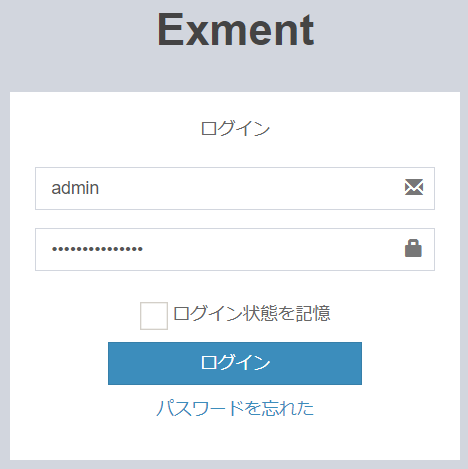
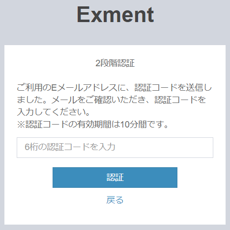

# Xác thực hai yếu tố
Trang này trình bày cách đăng nhập vào Exment bằng xác thực hai yếu tố.  
Thiết lập ban đầu của hệ thống cho xác thực hai yếu tố do quản trị viên thực hiện. Vui lòng xem [tại đây](/vi/login_2factor_setting).

## Các phương thức xác thực hai yếu tố
Hiện tại, Exment hỗ trợ 2 phương thức xác thực hai yếu tố sau đây.  
Vui lòng hỏi quản trị viên để biết hệ thống đang sử dụng phương thức nào.

##### Email
Sau khi đăng nhập bằng ID/mật khẩu, một email chứa mã xác thực sẽ được gửi đến địa chỉ email đã đăng ký.  
Nhập mã xác thực đó vào form để hoàn tất đăng nhập.

##### Google Authenticator
Sau khi đăng nhập bằng ID/mật khẩu, thực hiện xác thực hai yếu tố bằng Google Authenticator.

### Quy trình xác thực hai yếu tố (Email)

- Trên màn hình đăng nhập, nhập ID/mật khẩu rồi nhấp vào nút [Login].
  

- Màn hình xác thực hai yếu tố xuất hiện cùng với ô nhập mã xác thực.
  

- Đồng thời, mã xác thực được gửi đến địa chỉ email của người dùng vừa đăng nhập; hãy kiểm tra email này.
  

### Quy trình xác thực hai yếu tố (Google Authenticator)

- Trên màn hình đăng nhập, nhập ID/mật khẩu rồi nhấp vào nút [Login].
  

- Màn hình xác thực hai yếu tố xuất hiện cùng với ô nhập mã xác thực.
  

- Khi đăng nhập lần đầu tiên, trước hết cần thiết lập Google Authenticator.  
Nhấp vào nút [Send] để gửi email dùng cho việc đăng ký Google Authenticator đến địa chỉ email đã đăng ký.
  

- URL dùng để đăng ký Google Authenticator được gửi đến địa chỉ email của người dùng vừa đăng nhập; hãy nhấp vào URL đó.  
  

- Khi nhấp vào URL được gửi đến, hệ thống chuyển sang màn hình cài đặt ứng dụng xác thực hai yếu tố. Hãy thực hiện các bước step 1 đến step 3.  
Khi nhập đúng mã xác thực và gửi đi, việc đăng nhập bằng xác thực hai yếu tố sẽ hoàn tất.

  

> Trong xác thực hai yếu tố, nếu nhập sai mã xác thực quá một số lần nhất định, việc đăng nhập từ kết nối đã thực hiện xác thực đó sẽ bị chặn. Xin lưu ý.
