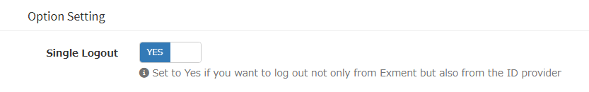

# Đăng nhập một lần (OAuth)
Đây là cách thiết lập đăng nhập một lần (SSO) dùng OAuth. Bạn sẽ đăng nhập được vào Exment bằng tài khoản Google, Microsoft, v.v.  
Trong Exment, có thể thêm đăng nhập một lần ở [Cài đặt đăng nhập](/vi/login_setting). Khi đã thêm, bạn có thể đăng nhập bằng ID và mật khẩu của nhà cung cấp (provider, tức dịch vụ đảm nhận việc đăng nhập như Google) mà không cần quản lý mật khẩu đăng nhập riêng cho Exment.

Việc thiết lập được làm theo 2 bước sau.

1. **Chuẩn bị máy chủ và nhà cung cấp** (tạo ứng dụng ở phía nhà cung cấp, cài thư viện nếu cần) … "Thiết lập máy chủ và từng nhà cung cấp"
2. **Thiết lập trên màn hình** (thêm nhà cung cấp ở màn hình cài đặt đăng nhập) … "Thiết lập trên màn hình"

Các bước của mục 1 thay đổi tùy theo nhà cung cấp bạn dùng.

| Nhà cung cấp bạn dùng | Phần cần xem |
|---|---|
| Google, Facebook, Twitter, GitHub, LinkedIn, Bitbucket | (1) Trường hợp nhà cung cấp có sẵn trong Socialite |
| Office365, Microsoft Graph | (2) Trường hợp nhà cung cấp có trong phần mở rộng của Exment |
| Các nhà cung cấp khác | (3) Trường hợp tự chuẩn bị nhà cung cấp |

#### Lưu ý
- Exment thực hiện xử lý đăng nhập một lần bằng [Socialite](https://github.com/laravel/socialite).
- **Tài liệu này viết các bước dành cho người đã hiểu rõ OAuth. Về cách tạo Client ID, Client Secret của từng nhà cung cấp, v.v., vui lòng tham khảo tài liệu của từng nơi.**
- <span class="red">Nếu bạn dùng v3.0.16 trở xuống và không đăng nhập được bằng Google, hãy xử lý theo [các bước này](/patch/sso_google).</span>

#### Liên kết tham khảo
- [Hỗ trợ SSO bằng tài khoản Google trên cơ sở dữ liệu Web mã nguồn mở "Exment"](https://qiita.com/hirossyi73/items/70dcc35305a96abace08)


## Thiết lập máy chủ và từng nhà cung cấp
Trước khi thêm nhà cung cấp ở màn hình cài đặt đăng nhập, cần chạy lệnh trên máy chủ để cài phần mở rộng.

### (1) Trường hợp nhà cung cấp có sẵn trong Socialite
- Các nhà cung cấp mà Socialite có sẵn theo tiêu chuẩn như sau. (Chuỗi trong ngoặc sẽ dùng sau này khi chỉ định service)
    - Google (google)
    - Facebook (facebook)
    - Twitter (twitter)
    - GitHub (github)
    - LinkedIn (linkedin)
    - Bitbucket (bitbucket)

- Tạo ứng dụng dùng cho Exment ở từng nhà cung cấp.  
※ callback URL như sau.  
http(s)://(URL của Exment)/auth/login/(tên provider của socialite)/callback  

    - Ví dụ 1, trường hợp GitHub: http(s)://(URL của Exment)/auth/login/github/callback  
    - Ví dụ 2, trường hợp Facebook: http(s)://(URL của Exment)/auth/login/facebook/callback  
    - Ví dụ 3, trường hợp Google: http(s)://(URL của Exment)/auth/login/google/callback  

> ※ Các URL trên là với thiết lập tiêu chuẩn không có "/admin" (site cài mới từ v7.2.1 trở đi). Nếu `ADMIN_ROUTE_PREFIX` trong `.env` có giá trị (site đã cài bằng phiên bản trước thì là "admin"), hãy thêm giá trị đó vào sau URL của site (ví dụ: `http(s)://(URL của Exment)/admin/auth/login/google/callback`). Chi tiết vui lòng xem [Thay đổi, xóa "admin" trong URL](/vi/additional_prefix).

- Chạy lệnh sau trong thư mục gốc của Exment.

~~~
composer require laravel/socialite=~5.1
~~~
※ Từ Exment v7.0.0 trở đi, "laravel/socialite" được cài tự động như một thư viện phụ thuộc của Exment, nên không cần chạy lệnh này.

- Thực hiện [Thiết lập trên màn hình](/vi/login_oauth?id=thiết-lập-trên-màn-hình).


### (2) Trường hợp nhà cung cấp có trong phần mở rộng của Exment
- Một số nhà cung cấp được chuẩn bị dưới dạng phần mở rộng của Exment. (Chuỗi trong ngoặc sẽ dùng sau này khi chỉ định service)
    - Office365, Microsoft Graph (graph)

- Tạo ứng dụng dùng cho Exment ở từng nhà cung cấp.  
※ callback URL như sau.  
http(s)://(URL của Exment)/auth/login/(tên provider của socialite)/callback  

    - Ví dụ, trường hợp Office365: http(s)://(URL của Exment)/auth/login/graph/callback

- Chạy lệnh sau trong thư mục gốc của Exment.

~~~
composer require exceedone/microsoft-graph
~~~

- Thực hiện [Thiết lập trên màn hình](/vi/login_oauth?id=thiết-lập-trên-màn-hình).


### (3) Trường hợp tự chuẩn bị nhà cung cấp
Với nhà cung cấp không có ở (1)(2), hãy thêm provider không chính thức bằng [Socialite Providers](https://socialiteproviders.github.io/).  
Provider không chính thức cũng không có sẵn xử lý lấy avatar (ảnh của người dùng). Nếu muốn lấy avatar, hãy thêm xử lý. (Tùy chọn)  
  
※ Có một số bước. Chi tiết vui lòng xem [Cách tạo provider riêng](/vi/login_oauth?id=cách-tạo-provider-riêng).

- Khi làm xong các bước, hãy thực hiện [Thiết lập trên màn hình](/vi/login_oauth?id=thiết-lập-trên-màn-hình).


## Thiết lập trên màn hình
Sau khi thiết lập máy chủ xong, hãy thêm nhà cung cấp ở [màn hình cài đặt đăng nhập](/vi/login_setting).

1. Mở màn hình cài đặt hệ thống bằng tài khoản quản trị.  
Từ nút "Cài đặt đăng nhập" ở góc trên bên phải của trang, mở màn hình cài đặt đăng nhập.  
  

2. Bấm nút tạo mới để tạo cài đặt đăng nhập. Các mục cần nhập như dưới đây.

### Loại nhà cung cấp
  

- Nếu ở "Thiết lập máy chủ và từng nhà cung cấp" bạn chọn nhà cung cấp của (1), hãy chọn tên nhà cung cấp đó.  

- Nếu ở "Thiết lập máy chủ và từng nhà cung cấp" bạn chọn nhà cung cấp của (2)(3), hãy chọn "Khác".  
Ở "Tên nhà cung cấp (chữ và số)" hiển thị khi chọn "Khác", hãy nhập loại nhà cung cấp bằng chữ và số như được chỉ định trong Socialite.  
Ví dụ, trường hợp Microsoft Graph: "graph"

  


### Client ID, Client Secret
Hãy nhập chuỗi do nhà cung cấp cung cấp.

### Phạm vi (scope)
Nếu chỉ đăng nhập thì về cơ bản không có mục đích sử dụng rõ ràng. Nếu lấy access token ở [Lấy access token](/vi/login_oauth?id=lấy-access-token), khuyến nghị nên thiết lập.

### Cài đặt tùy chọn
Thực hiện các thiết lập tùy chọn phù hợp với loại nhà cung cấp đã chọn.
(Nếu chọn loại nhà cung cấp không có cài đặt tùy chọn thì mục này không hiển thị.)

#### Khi loại nhà cung cấp là "Khác"
 

##### Đăng xuất một lần (Single Logout)
Khi đăng xuất khỏi Exment, cũng đăng xuất khỏi nhà cung cấp đã đăng nhập bằng SSO. <span class="red">※ Hiện tại chưa hỗ trợ Okta.</span>

<!---
  Nội dung giống nhau cho OAuth và Saml
-->
### Cài đặt người dùng
Thiết lập cách xử lý người dùng đã đăng nhập.

  

#### Cột tìm kiếm tài khoản
Thiết lập dùng cột nào của tài khoản lấy được qua SSO để tìm tài khoản Exment.

#### Tạo người dùng mới
- Khi là YES: nếu người dùng đã đăng nhập chưa có trong Exment, người dùng Exment mới sẽ được tạo từ thông tin đăng nhập.
- Khi là NO: cần tạo trước người dùng trong Exment. Nếu người dùng đã đăng nhập chưa có trong Exment, lỗi sẽ hiển thị.

#### Cài đặt nhóm vai trò
Khi là YES, có thể gắn người dùng với nhóm vai trò khi tạo mới người dùng Exment.  

#### Cập nhật thông tin người dùng
Khi là YES, thông tin người dùng như tên người dùng sẽ được cập nhật khi đăng nhập lần nữa.


- Sau khi lưu dữ liệu ít nhất 1 lần, nút "Kích hoạt" và nút "Kiểm tra đăng nhập" sẽ hiển thị.

- Khi đặt cờ kích hoạt là YES, nút xác thực SSO sẽ hiển thị ở màn hình đăng nhập.  
※ Thông thường, form đăng nhập mặc định để nhập ID người dùng và mật khẩu cũng được hiển thị cùng. Ở [Cài đặt SSO](/vi/system_setting?id=thiết-lập-sso), cũng có thể không hiển thị form đó, như trong hình.  


### Cài đặt nút đăng nhập
Thiết lập nút đăng nhập hiển thị ở màn hình đăng nhập.  
※ Dù không thiết lập mục này, các nhà cung cấp ở "(1) Trường hợp nhà cung cấp có sẵn trong Socialite" ở trên vẫn được hiển thị theo định dạng riêng của từng nơi.

  


### Kích hoạt và kiểm tra đăng nhập
- Sau khi lưu dữ liệu ít nhất 1 lần, nút "Kích hoạt" và nút "Kiểm tra đăng nhập" sẽ hiển thị.

  

#### Kích hoạt
- Khi thực hiện kích hoạt, nút xác thực SSO sẽ hiển thị ở màn hình đăng nhập.  
  

#### Kiểm tra đăng nhập
- Khi bấm nút "Kiểm tra đăng nhập", có thể kiểm tra đăng nhập bằng thông tin đăng nhập đã thiết lập. Có thể kiểm tra ngay cả khi chưa kích hoạt cài đặt đăng nhập.  
**Khi đó, hãy tạm thời thêm URL hiển thị ở "URL chuyển hướng để kiểm tra" vào callback URL trong thiết lập xác thực OAuth của nhà cung cấp, hoặc đổi callback URL thành URL đó.**

  


- Khi bấm nút "Đăng nhập", có thể kiểm tra xem thiết lập có đúng không.  
Kết quả được hiển thị ở mục "Kết quả thực hiện".


### Lấy access token

- Nếu muốn lấy access token và refresh token sau khi đăng nhập, hãy lấy bằng cách sau.

~~~ php
use Exceedone\Exment\Services\Login\LoginService;

$access_token = LoginService::getAccessToken();
$refresh_token = LoginService::getRefreshToken();
~~~


## Cách tạo provider riêng
Đây là các bước chi tiết khi làm theo (3). Thêm package được chỉ định ở [Socialite Providers](https://socialiteproviders.github.io/).  
Ngoài ra, tạo provider riêng để lấy avatar. (Tùy chọn)

| Bước | Có cần hay không |
|---|---|
| Thiết lập và thêm nhà cung cấp | Bắt buộc |
| Phát triển để lấy avatar | Tùy chọn |
| Thêm service provider | Bắt buộc |
| Thêm cài đặt tùy chọn | Bắt buộc tùy nhà cung cấp |
| Thực hiện thiết lập trên màn hình | Bắt buộc |

### (Bắt buộc) Thiết lập và thêm nhà cung cấp
- Tạo ứng dụng dùng cho Exment ở từng nhà cung cấp.  
※ callback URL như sau.  
http(s)://(URL của Exment)/auth/login/(tên provider của socialite)/callback  

    - Ví dụ, trường hợp Microsoft Graph: http(s)://(URL của Exment)/auth/login/graph/callback

- Chạy lệnh sau trong thư mục gốc của Exment.

~~~
composer require laravel/socialite=~5.1
~~~
※ Từ Exment v7.0.0 trở đi, "laravel/socialite" được cài tự động như một thư viện phụ thuộc của Exment, nên không cần chạy lệnh này.

- Thêm package được chỉ định ở [Socialite Providers](https://socialiteproviders.github.io/).  

    - Ví dụ: trường hợp Microsoft Graph

~~~
composer require socialiteproviders/microsoft-graph
~~~

### (Tùy chọn) Phát triển để lấy avatar
※ Việc tạo provider riêng này là bước tùy chọn, dùng để lấy avatar. Nếu không cần lấy avatar thì không cần tạo.

- Để lấy avatar, tạo 2 class kế thừa provider có sẵn trong thư mục "app/Socialite". ※ Nếu chưa có thư mục "app/Socialite", hãy tạo.  
Class thứ nhất là MicrosoftGraphProvider.php. Class này implements interface ProviderAvatar và cài đặt getAvatar.  
Trong phương thức getAvatar, hãy viết xử lý gọi API để lấy avatar. URL và endpoint để lấy, vui lòng kiểm tra ở từng nhà cung cấp OAuth.  
Ví dụ dưới đây là các bước với Microsoft Graph.

~~~ php
<?php

namespace App\Socialite;

use Exceedone\Exment\Auth\ProviderAvatar;
use SocialiteProviders\Graph\Provider;

class MicrosoftGraphProvider extends Provider implements ProviderAvatar
{
    /**
     * Get avatar stream
     * @param mixed $token
     * @return string
     */
    public function getAvatar($token = null){
        try
        {
            $client = $this->getHttpClient();
            $response = $client->get('https://graph.microsoft.com/v1.0/me/photo/$value', [
                'headers' => [
                    'Authorization' => 'Bearer '.$token,
                    'Content-Type' => 'application/json;odata.metadata=minimal;odata.streaming=true'
                ],
                'http_errors' => false,
            ]);

            if($response->getStatusCode() == 404){
                return null;
            }

            return $response->getBody()->getContents();

        }
        catch (Exception $exception)
        {
            return null;
        }
        return null;
    }
}

~~~ 

- Class thứ hai là GraphExtendSocialite.php. Chỉ định MicrosoftGraphProvider vừa tạo.

~~~ php
<?php

namespace App\Socialite;

use SocialiteProviders\Manager\SocialiteWasCalled;

class GraphExtendSocialite
{
    /**
     * Execute the provider.
     */
    public function handle(SocialiteWasCalled $socialiteWasCalled)
    {
        $socialiteWasCalled->extendSocialite(
            'graph', __NAMESPACE__.'\MicrosoftGraphProvider'
        );
    }
}

~~~ 

### (Bắt buộc) Thêm service provider
- Ghi provider đã thêm vào tệp app/Providers/EventServiceProvider.php để thêm service provider.  
※ Nội dung cần ghi thay đổi tùy theo việc bạn có tự phát triển để lấy avatar hay không.  
Ngoài ra, tên class ghi ở "@handle" thường được ghi trong tài liệu của provider đã thêm ở [Socialite Providers](https://socialiteproviders.github.io/). Vui lòng kiểm tra.

~~~ php

// Ví dụ: trường hợp Microsoft Graph

protected $listen = [
    ///// Trường hợp đã tự phát triển để lấy avatar
    'App\Events\Event' => [
        'App\Listeners\EventListener',
    ],
    
    /// Thêm
    \SocialiteProviders\Manager\SocialiteWasCalled::class => [
        '\App\Socialite\GraphExtendSocialite@handle', ///// Trường hợp đã tự phát triển để lấy avatar
        // 'SocialiteProviders\\Graph\\GraphExtendSocialite@handle', ///// Trường hợp lấy thông thường thì bỏ comment dòng này để dùng
    ],
];

~~~
~~~php

// Ví dụ: trường hợp EntraID

protected $listen = [
    // ... other listeners
    \SocialiteProviders\Manager\SocialiteWasCalled::class => [
        // ... other providers
        \SocialiteProviders\Microsoft\MicrosoftExtendSocialite::class.'@handle',
    ],
];

~~~

※ Nếu cài mới từ Exment v7.0.0 trở đi (dự án tạo bằng Laravel12), tệp "app/Providers/EventServiceProvider.php" không tồn tại. Khi đó, hãy ghi như sau vào phương thức boot của "app/Providers/AppServiceProvider.php".

~~~php

// Ví dụ: trường hợp EntraID

public function boot(): void
{
    \Illuminate\Support\Facades\Event::listen(
        \SocialiteProviders\Manager\SocialiteWasCalled::class,
        [\SocialiteProviders\Microsoft\MicrosoftExtendSocialite::class, 'handle']
    );
}

~~~


### (Bắt buộc tùy nhà cung cấp) Thêm cài đặt tùy chọn
Tùy nhà cung cấp đăng nhập OAuth mà cần thiết lập bổ sung.  

  
Ví dụ: trường hợp [OKTA](https://github.com/SocialiteProviders/Okta)
- Mở config/services.php và thêm nội dung sau.

``` php
'okta' => [    
  'base_url' => env('OKTA_BASE_URL'), 
],
```

- Mở tệp .env và thêm nội dung sau.

```
OKTA_BASE_URL='https://<tên miền của OKTA>'
```

> Vốn dĩ Socialite bắt buộc phải có các giá trị thiết lập "client_id", "client_secret", "redirect" trong config/services.php; trong xác thực OAuth của Exment, các giá trị đã thiết lập trên màn hình được tự động gán vào.  
Nếu muốn nhập giá trị thiết lập riêng của nhà cung cấp, hãy thêm giá trị vào config/services.php như trên.


### (Bắt buộc) Thực hiện thiết lập trên màn hình

- Khi mọi thiết lập phía máy chủ đã xong, hãy thực hiện [Thiết lập trên màn hình](/vi/login_oauth?id=thiết-lập-trên-màn-hình).

  
  
[←Quay lại Cài đặt đăng nhập](/vi/login_setting)
