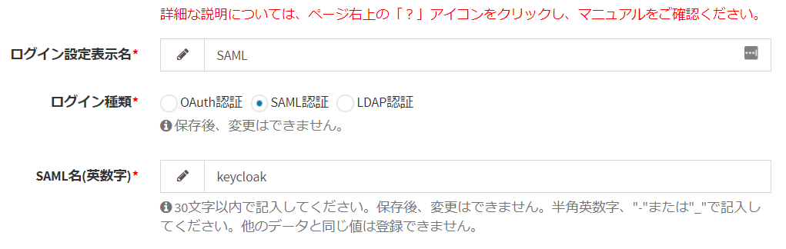
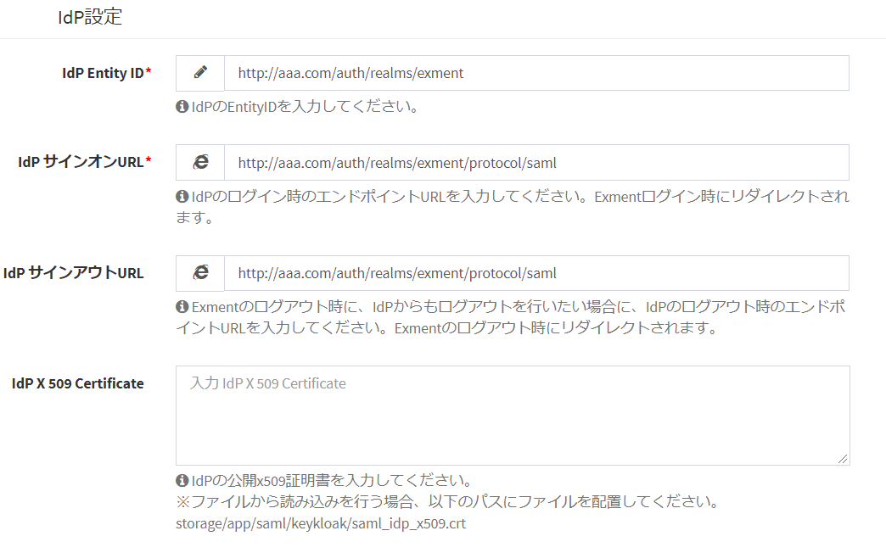
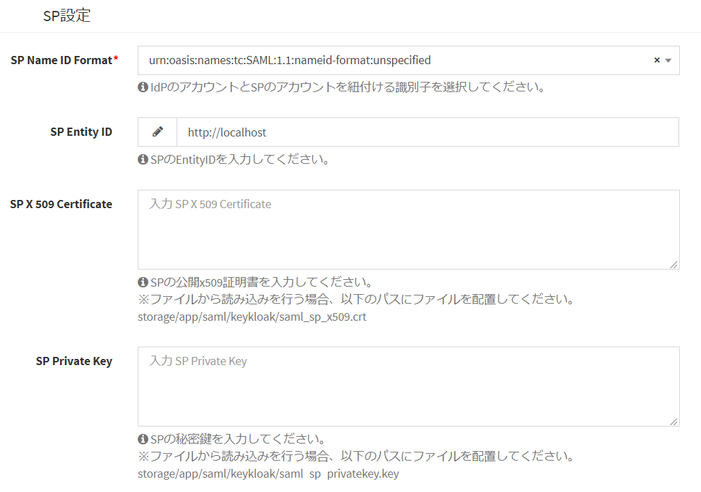
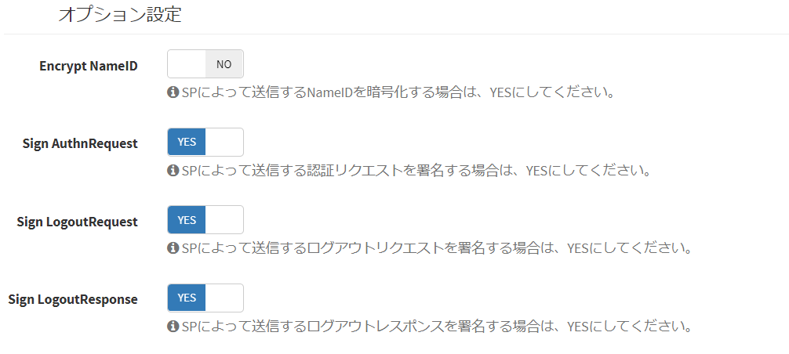
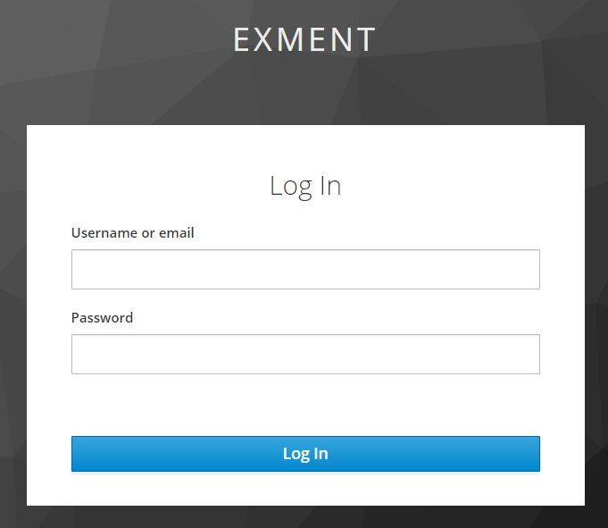
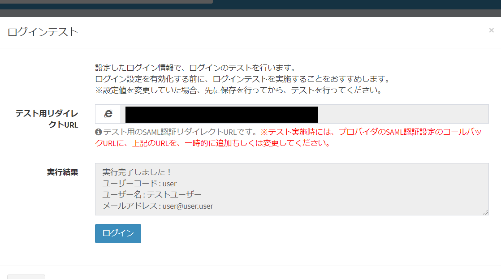

# Đăng nhập một lần (SAML)
Đây là cách thiết lập đăng nhập một lần (SSO) dùng SAML.  
Trong Exment, có thể thêm đăng nhập một lần ở [Cài đặt đăng nhập](/vi/login_setting). Khi đã thêm, bạn có thể đăng nhập bằng ID và mật khẩu của nhà cung cấp (provider, tức dịch vụ đảm nhận việc đăng nhập) mà không cần quản lý mật khẩu đăng nhập riêng cho Exment.

Việc thiết lập được làm theo 2 bước sau.

1. **Chuẩn bị máy chủ và nhà cung cấp** (cài thư viện, tạo ứng dụng ở phía nhà cung cấp) … "Thiết lập máy chủ và nhà cung cấp"
2. **Thiết lập trên màn hình** (thêm nhà cung cấp ở màn hình cài đặt đăng nhập) … "Thiết lập trên màn hình"

#### Lưu ý
- **Tài liệu này viết các bước dành cho người đã hiểu rõ SAML. Về cách thiết lập của từng nhà cung cấp, vui lòng tham khảo tài liệu của từng nơi.**
- Tài liệu này và các trang của Exment ghi là "SAML", nhưng thực tế dùng SAML2.

## Thiết lập máy chủ và nhà cung cấp
Trước khi thêm nhà cung cấp ở màn hình cài đặt đăng nhập, cần chạy lệnh trên máy chủ để cài phần mở rộng.

1. Chạy lệnh sau trong thư mục gốc của Exment.

~~~
composer require aacotroneo/laravel-saml2
~~~

2. Tạo ứng dụng dùng cho Exment ở từng nhà cung cấp SAML.  
※ callback URL như sau.  
http(s)://(URL của Exment)/saml/login/(tên SAML sẽ thêm sau)/acs  

> ※ URL trên là với thiết lập tiêu chuẩn không có "/admin" (site cài mới từ v7.2.1 trở đi). Nếu `ADMIN_ROUTE_PREFIX` trong `.env` có giá trị (site đã cài bằng phiên bản trước thì là "admin"), hãy thêm giá trị đó vào sau URL của site (ví dụ: `http(s)://(URL của Exment)/admin/saml/login/(tên SAML sẽ thêm sau)/acs`). Chi tiết vui lòng xem [Thay đổi, xóa "admin" trong URL](/vi/additional_prefix).

3. Thực hiện [Thiết lập trên màn hình](/vi/login_saml?id=thiết-lập-trên-màn-hình).

## Thiết lập trên màn hình
Sau khi thiết lập máy chủ xong, hãy thêm nhà cung cấp ở [màn hình cài đặt đăng nhập](/vi/login_setting).

1. Mở màn hình cài đặt hệ thống bằng tài khoản quản trị.  
Từ nút "Cài đặt đăng nhập" ở góc trên bên phải của trang, mở màn hình cài đặt đăng nhập.  
  

2. Bấm nút tạo mới để tạo cài đặt đăng nhập. Các mục cần nhập như dưới đây.

- **Tên SAML (chữ và số)** : Đây là tên nhà cung cấp dùng trong callback URL, v.v. Hãy nhập bằng chữ và số, không trùng với cái khác.

  

### Cài đặt IdP
Hãy nhập các thiết lập của IdP.
  

### Cài đặt SP
Hãy nhập các thiết lập của SP.
  

### Cài đặt tùy chọn
Hãy nhập các thiết lập tùy chọn.
  

### Cài đặt ánh xạ
Cần cho tên trường do nhà cung cấp trả về tương ứng với tên trường của bảng "Người dùng" trong Exment.  

  

Hãy nhập tên trường do nhà cung cấp trả về.

  

Có 3 cách ghi.

| Cách ghi | Khi nào dùng | Ví dụ |
|---|---|---|
| Ghi nguyên tên trường | Dùng nguyên một trường | |
| Ghi nhiều tên, cách nhau bằng dấu phẩy | Có vài ứng viên, dùng trường có giá trị theo thứ tự từ đầu | seimei,username |
| Ghi nhiều tên theo dạng ${tên trường} | Dùng kết hợp nhiều trường | ${last_name} ${first_name} |

#### Ghi nguyên tên trường
Ghi nguyên tên trường do nhà cung cấp trả về.
  

#### Ghi nhiều tên trường, cách nhau bằng dấu phẩy
Khi có vài ứng viên cho trường muốn dùng, hãy ghi các tên trường do nhà cung cấp trả về, cách nhau bằng dấu phẩy.  
Giá trị được tìm theo thứ tự từ đầu của danh sách; nếu có giá trị thì dùng giá trị đó.  
(Ví dụ: muốn dùng trường họ tên "seimei" nếu được, nhưng phía nhà cung cấp đây không phải mục bắt buộc; vì vậy nếu "seimei" có giá trị thì dùng giá trị đó, nếu không thì dùng "username" làm tên người dùng → ghi seimei,username)
  

#### Ghi nhiều tên trường theo dạng ${tên trường}
Đây là cách ghi khi muốn kết hợp nhiều thông tin người dùng do nhà cung cấp trả về để dùng làm thông tin người dùng của Exment. Hãy ghi nhiều trường theo dạng ${tên trường}.  
(Ví dụ: nhà cung cấp không có trường "họ tên" nhưng có riêng trường "họ (last_name)" và "tên (first_name)"; vì vậy kết hợp thành "họ tên" để dùng → ghi ${last_name} ${first_name})
  

### Cài đặt người dùng
Thiết lập cách xử lý người dùng đã đăng nhập.

  

#### Cột tìm kiếm tài khoản
Thiết lập dùng cột nào của tài khoản lấy được qua SSO để tìm tài khoản Exment.

#### Tạo người dùng mới
- Khi là YES: nếu người dùng đã đăng nhập chưa có trong Exment, người dùng Exment mới sẽ được tạo từ thông tin đăng nhập.
- Khi là NO: cần tạo trước người dùng trong Exment. Nếu người dùng đã đăng nhập chưa có trong Exment, lỗi sẽ hiển thị.

#### Cài đặt nhóm vai trò
Khi là YES, có thể gắn người dùng với nhóm vai trò khi tạo mới người dùng Exment.  

#### Cập nhật thông tin người dùng
Khi là YES, thông tin người dùng như tên người dùng sẽ được cập nhật khi đăng nhập lần nữa.

- Sau khi lưu dữ liệu ít nhất 1 lần, nút "Kích hoạt" và nút "Kiểm tra đăng nhập" sẽ hiển thị.

- Khi đặt cờ kích hoạt là YES, nút xác thực SSO sẽ hiển thị ở màn hình đăng nhập.  
※ Thông thường, form đăng nhập mặc định để nhập ID người dùng và mật khẩu cũng được hiển thị cùng. Ở [Cài đặt SSO](/vi/system_setting?id=thiết-lập-sso), cũng có thể không hiển thị form đó, như trong hình.  

### Cài đặt nút đăng nhập
Thiết lập nút đăng nhập hiển thị ở màn hình đăng nhập.  

  

### Kích hoạt và kiểm tra đăng nhập
- Sau khi lưu dữ liệu ít nhất 1 lần, nút "Kích hoạt" và nút "Kiểm tra đăng nhập" sẽ hiển thị.

  

#### Kích hoạt
- Khi thực hiện kích hoạt, nút xác thực SSO sẽ hiển thị ở màn hình đăng nhập.  
  

#### Kiểm tra đăng nhập
- Khi bấm nút "Kiểm tra đăng nhập", có thể kiểm tra đăng nhập bằng thông tin đăng nhập đã thiết lập. Có thể kiểm tra ngay cả khi chưa kích hoạt cài đặt đăng nhập.  
**Khi đó, hãy tạm thời thêm URL hiển thị ở "URL chuyển hướng để kiểm tra" vào callback URL trong thiết lập xác thực SAML của nhà cung cấp, hoặc đổi callback URL thành URL đó.**

  

- Khi bấm nút "Đăng nhập", có thể kiểm tra xem thiết lập có đúng không.  
Kết quả được hiển thị ở mục "Kết quả thực hiện".

  

  
  
  
[←Quay lại Cài đặt đăng nhập](/vi/login_setting)
