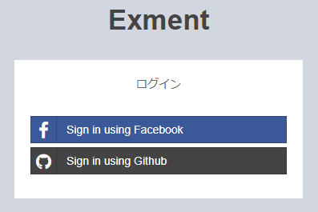

# Đăng nhập một lần (SSO)
Trang này hướng dẫn các thiết lập liên quan đến việc đăng nhập vào Exment.  
Đặc biệt, trang này trình bày các nội dung về đăng nhập một lần (SSO).

## Phương thức đăng nhập
Ngoài cách đăng nhập tiêu chuẩn, Exment còn cung cấp nhiều phương thức đăng nhập khác.  
Dưới đây là mô tả về các phương thức đăng nhập đó.

### Tiêu chuẩn
Đây là phương thức đăng ký người dùng và đặt mật khẩu trong cơ sở dữ liệu do Exment tạo, rồi đăng nhập dựa trên cơ sở dữ liệu của Exment.  

### OAuth
Đây là phương thức đăng nhập bằng đăng nhập một lần theo chuẩn OAuth.  
Khi nhấp vào nút đăng nhập, người dùng được chuyển hướng đến màn hình đăng nhập của provider đã đăng ký trước để thực hiện đăng nhập.  

- [Đăng nhập một lần (OAuth)](/login_oauth)
  
※ Ví dụ về provider:  

- Google
- Facebook
- Office365

### SAML
Đây là phương thức đăng nhập bằng đăng nhập một lần theo chuẩn SAML.  
Khi nhấp vào nút đăng nhập, người dùng được chuyển hướng đến màn hình đăng nhập của provider đã đăng ký trước để thực hiện đăng nhập.  
  
- [Đăng nhập một lần (SAML)](/ja/login_saml) (tiếng Nhật)
  
※ Ví dụ về provider:  

- OpenAM
- Keycloak
- ADFS

### LDAP
Đây là phương thức đăng nhập theo chuẩn LDAP.  
Trên trang đăng nhập của Exment, nhập thông tin người dùng vào ô ID và mật khẩu rồi nhấp vào nút đăng nhập; hệ thống sẽ thực hiện xác thực LDAP và liên kết thông tin người dùng.  
  
- [Thiết lập đăng nhập (LDAP)](/ja/login_ldap) (tiếng Nhật)
  
※ Ví dụ về provider:  

- Active Directory

## Cách quản lý thiết lập đăng nhập

- Quản trị viên hệ thống nhập URL sau.  
http(s)://(URL của Exment)/admin/log_setting  
※ Có thể truy cập sau khi thực hiện "thay đổi thiết lập hệ thống" đã nêu ở trên.

- Hoặc thêm "Login Setting" (thiết lập đăng nhập) vào menu.  
Mở trang "Admin Settings" > "Menu", chọn loại menu "System Menu", khi đó mục "Login Setting" sẽ được hiển thị; hãy chọn mục này rồi lưu lại.  
※ Theo thiết lập mặc định, "Login Setting" không được hiển thị trên menu.

  

- Để thêm provider SSO mới, nhấp vào nút "+ New" ở góc trên bên phải.  
    - [Đăng nhập một lần (OAuth)](/login_oauth)
    - [Đăng nhập một lần (SAML)](/ja/login_saml) (tiếng Nhật)
    - [Thiết lập đăng nhập (LDAP)](/ja/login_ldap) (tiếng Nhật)
  

### Thiết lập SSO
Quản lý các thiết lập chung cho toàn bộ SSO.  
※ Chỉ được hiển thị khi có ít nhất 1 SSO đang được bật.

#### Hiển thị đăng nhập mặc định
Khi đặt là YES, form đăng nhập bằng ID và mật khẩu của Exment cùng nút đăng nhập sẽ được hiển thị.  
※ Nếu chỉ cho phép đăng nhập bằng SAML hoặc OAuth, hãy đặt thiết lập này là NO; khi đó form đăng nhập mặc định dùng để nhập ID người dùng và mật khẩu sẽ được ẩn đi.

#### Chuyển hướng đến đăng nhập SSO
Khi đặt là YES, lúc người dùng chuyển đến màn hình đăng nhập, hệ thống không hiển thị trang đăng nhập của Exment mà chuyển hướng trực tiếp đến trang đăng nhập SSO.  
※ Thiết lập này có hiệu lực khi tổng số provider SAML và OAuth chỉ là 1.

#### Tên miền được phép đăng nhập
Hãy nhập nếu muốn chỉ định các tên miền được phép đăng nhập. Nếu có nhiều tên miền, hãy nhập mỗi tên miền trên một dòng.  
Nếu người dùng thuộc tên miền khác với các tên miền đã nhập thực hiện đăng nhập, hệ thống sẽ hiển thị lỗi.  

### Vô hiệu hóa thiết lập đăng nhập SSO
Nếu vì lý do nào đó muốn buộc vô hiệu hóa thiết lập đăng nhập SSO, hãy thực hiện thiết lập sau.

- Tại thư mục của dự án, mở tệp ".env" và thêm dòng sau.  
※ Về cách chỉnh sửa tệp thiết lập, vui lòng xem chi tiết [tại đây](/config).

~~~
EXMENT_CUSTOM_LOGIN_DISABLED=true
~~~

Khi thực hiện thiết lập này, form đăng nhập thông thường bằng ID và mật khẩu sẽ được hiển thị trên màn hình đăng nhập.

### Về việc kiểm tra dữ liệu (validation) khi đăng nhập SSO
Khi đăng nhập SSO, hệ thống thực hiện kiểm tra dữ liệu (validation) dựa trên thông tin người dùng nhận được từ provider (sau đây gọi là "người dùng provider").  
Việc kiểm tra được thực hiện theo các quy tắc sau.  

- Trong các cột của bảng người dùng, nếu thông tin của cột được thiết lập là "bắt buộc" không có trong người dùng provider thì sẽ xảy ra lỗi.
- Trong thiết lập SSO, nếu "Create new user" (tạo mới người dùng) là YES và người dùng đăng nhập vào Exment lần đầu tiên, hệ thống sẽ kiểm tra dựa trên các thiết lập người dùng đã thiết lập trong Exment (thiết lập ký tự được phép sử dụng, độ dài chuỗi ký tự, v.v.).
- Trong thiết lập SSO, nếu "Update user information" (cập nhật thông tin người dùng) là YES và người dùng đã được đăng ký trong Exment thực hiện đăng nhập, hệ thống sẽ kiểm tra dựa trên các thiết lập người dùng đã thiết lập trong Exment (thiết lập ký tự được phép sử dụng, độ dài chuỗi ký tự, v.v.).

Nếu xảy ra lỗi kiểm tra dữ liệu, nguyên nhân gây lỗi sẽ được hiển thị trên màn hình. Nguyên nhân gây lỗi cũng được ghi vào tệp log.

### Khác
- Trường hợp cập nhật từ phiên bản thấp hơn v3.3.0 lên v3.3.0 trở lên, khi đăng nhập bằng provider có mã người dùng (user code) chứa "dấu chấm (.)", có thể xảy ra lỗi.  
Khi đó, hãy xử lý như sau.
    - Tại "Custom Column Settings" (thiết lập cột tùy chỉnh) của bảng "User", chuyển đến màn hình chỉnh sửa cột "User Code".
    - Tại tùy chọn "Available characters" (ký tự được phép sử dụng), đánh dấu chọn "Dot" (dấu chấm) rồi lưu.

- Theo mặc định, ngay cả khi đóng trình duyệt trong trạng thái đang đăng nhập, trạng thái đăng nhập vẫn được duy trì cho đến khi hết một khoảng thời gian nhất định (120 phút).  
Từ v3.6.0 trở đi, nếu muốn tự động đăng xuất khi đóng trình duyệt trong trạng thái đang đăng nhập, hãy mở tệp ".env" và thêm dòng sau.  
※ Về cách chỉnh sửa tệp thiết lập, vui lòng xem chi tiết [tại đây](/config).

~~~
EXMENT_SESSION_EXPIRE_ON_CLOSE=true
~~~
