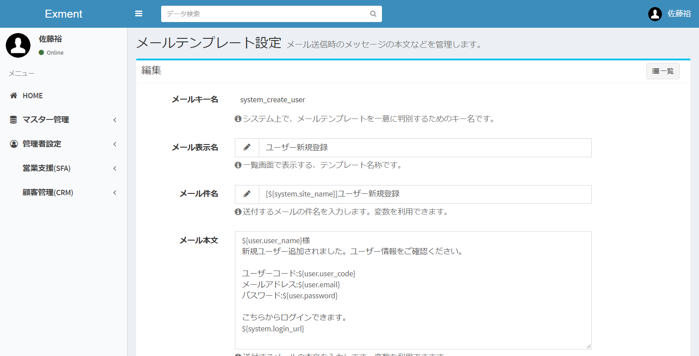

# Mẫu thông báo
Trang này dùng để thiết lập khuôn mẫu (mẫu thông báo) của tiêu đề, nội dung, v.v. của email và thông báo mà Exment gửi.  
Mẫu đã tạo được chọn để dùng ở [thiết lập thông báo](/vi/notify), v.v.  

> Từ v3.6.0, tên gọi được đổi từ "Mẫu email" thành "Mẫu thông báo".  
Ở các phiên bản cài trước v3.6.0, tên trên một số màn hình vẫn là "Mẫu email".

## Cách quản lý
### Hiển thị trang
- Chọn "Mẫu thông báo" từ menu bên trái.  
Hoặc truy cập URL dưới đây.  
http(s)://(URL của Exment)/data/mail_template  
Khi đó, màn hình mẫu thông báo sẽ được hiển thị.  
  

> ※ URL là theo thiết lập chuẩn không có "/admin" (site cài mới từ v7.2.1 trở đi). Nếu `ADMIN_ROUTE_PREFIX` trong `.env` có giá trị (site cài từ phiên bản trước là "admin"), hãy thêm giá trị đó sau URL của site (ví dụ: `http(s)://(URL của Exment)/admin/data/mail_template`). Chi tiết vui lòng xem [Thay đổi hoặc xóa "admin" trong URL](/vi/additional_prefix).

### Thêm mới mẫu
1. Trên màn hình "Mẫu thông báo", nhấp nút [Mới] ở phía trên bên phải trang.

2. Màn hình thêm mới mẫu thông báo được hiển thị.

3. Nhập các mục cần thiết.  

### Lưu
Sau khi điền các thiết lập, hãy nhấp [Lưu].

### Chỉnh sửa
Khi muốn chỉnh sửa mẫu, hãy nhấp liên kết [Chỉnh sửa] ở dòng đó.  

### Xóa
Khi muốn xóa mẫu, hãy nhấp liên kết [Xóa] ở dòng tương ứng.  

**※ Tuy nhiên, mẫu đã được thiết lập ở màn hình thông báo thì không xóa được.**

## Tệp đính kèm, tệp đính kèm tùy chỉnh
Khi thông báo bằng email, có thể đính kèm và gửi các tệp đã thiết lập sẵn trong mẫu thông báo.  
※ Hiện tại chỉ có hiệu lực với thông báo bằng email.  
  

#### Tệp đính kèm
Tệp đăng ký ở đây được gửi làm tệp đính kèm cố định mỗi lần thông báo bằng email.

#### Tệp đính kèm tùy chỉnh
Khi thiết lập tham số ở đây, các loại tệp sau đã đăng ký trong từng dữ liệu sẽ được gửi trong thông báo bằng email.  

■ Loại cột tùy chỉnh: "Tệp", "Hình ảnh"  
Thiết lập tham số: ${file:tên cột tùy chỉnh}  

■ Cột "Tệp", "Hình ảnh" của dữ liệu đang được chọn ở cột tùy chỉnh "Lựa chọn (từ bảng khác)"  
Thiết lập tham số: ${file:select_table:tên cột tùy chỉnh của lựa chọn.tên cột tệp của bảng được tham chiếu}  
Ví dụ: khi đính kèm tệp ở cột "contract_file" của khách hàng đang được chọn ở cột "customer" (tham chiếu bảng khách hàng)  
${file:select_table:customer.contract_file}  
※ Khi chưa chọn dữ liệu, hoặc khi cột không tồn tại, không có gì được đính kèm.
  
■ Tệp đính kèm đã đăng ký cho màn hình chi tiết dữ liệu (chỗ tương ứng trong hình dưới đây)  
Thiết lập tham số: ${documents}  
  

## Quy tắc của biến
Ở "tiêu đề email", "nội dung email" và "người gửi email - tên hiển thị", có thể dùng biến.  
Khi dùng biến, có thể đưa dữ liệu đã đăng ký, tên hệ thống, v.v. vào tiêu đề, nội dung.  

### Danh sách biến
Về các biến tham số, vui lòng xem trang sau.  
[Biến tham số](/vi/params)
