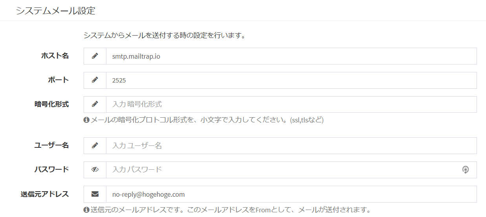

# Thiết lập gửi email
Trang này hướng dẫn cách thiết lập để gửi email từ Exment.  
Ngoài ra, trang cũng trình bày cách gửi email thử nghiệm sau khi thiết lập.  

> ※ Các vấn đề về chức năng gửi email như "email không đến nơi" hoặc "email bị phân loại là thư rác" phụ thuộc phần lớn vào từng máy chủ và môi trường, vì vậy chúng tôi xin phép không tiếp nhận các yêu cầu hỗ trợ về những vấn đề này.  

## Tổng quan
- Trong Exment, hệ thống có thể gửi email trong một số trường hợp.  
Ví dụ:
    - Thông báo cập nhật dữ liệu
    - Xác thực hai yếu tố

- Để gửi được email, cần thực hiện các thiết lập như thiết lập SMTP.  
Phần này trình bày quy trình thiết lập để gửi email.

- Có 2 cách thiết lập gửi email.
    - [Thiết lập từ màn hình (mặc định)](/vi/mailsend_setting?id=cách-thiết-lập-thiết-lập-từ-màn-hình) :   
    Thiết lập gửi email bằng cách nhập thiết lập SMTP trên màn hình thiết lập hệ thống. Có thể sử dụng cách này khi gửi email bằng thiết lập SMTP đơn giản.
    
    - [Thiết lập bằng tệp config hoặc tệp env](/vi/mailsend_setting?id=cách-thiết-lập-thiết-lập-bằng-tệp-config-hoặc-tệp-env)：  
    Khi thiết lập email bằng phương thức không phải SMTP, chẳng hạn như Amazon SES, cần chỉnh sửa tệp thiết lập trên máy chủ hoặc sử dụng composer, v.v. để thiết lập. ※ Dành cho người dùng nâng cao.

### Cách thiết lập-Thiết lập từ màn hình
- Quản trị viên hệ thống truy cập màn hình thiết lập hệ thống.

- Nhập các thiết lập dưới đây.
  

※ Ví dụ thiết lập SMTP (trường hợp Xserver) ： [tại đây](https://www.xserver.ne.jp/manual/man_mail_setting.php)  

※ Ví dụ thiết lập SMTP (trường hợp Sakura Internet) ： [tại đây](https://help.sakura.ad.jp/hc/ja/articles/206054132--%E3%83%A9%E3%82%A4%E3%83%88-%E3%82%B9%E3%82%BF%E3%83%B3%E3%83%80%E3%83%BC%E3%83%89-%E3%83%97%E3%83%AC%E3%83%9F%E3%82%A2%E3%83%A0-%E3%83%A1%E3%83%BC%E3%83%AB%E3%83%9C%E3%83%83%E3%82%AF%E3%82%B9-%E3%83%A1%E3%83%BC%E3%83%AB%E3%82%BD%E3%83%95%E3%83%88%E3%81%AE%E4%B8%80%E8%88%AC%E7%9A%84%E3%81%AA%E8%A8%AD%E5%AE%9A%E6%96%B9%E6%B3%95)  

### Cách thiết lập-Thiết lập bằng tệp config hoặc tệp env
Theo mặc định, Exment sử dụng các giá trị đã đăng ký tại "System Setting" (thiết lập hệ thống) trên màn hình để làm thiết lập email.  
Tuy nhiên, cũng có trường hợp bạn muốn thiết lập email bằng phương thức không phải SMTP, chẳng hạn như Amazon SES.  
Khi đó, có thể sử dụng cách thiết lập tiêu chuẩn của Laravel là ghi thiết lập vào tệp ".env".  
Nếu sử dụng cách thiết lập này, vui lòng thực hiện các thiết lập dưới đây. ※ Dành cho người dùng nâng cao.

- Mở tệp .env và nhập giá trị thiết lập sau.

~~~
EXMENT_MAIL_SETTING_ENV_FORCE=true
~~~

- Sau đó, hãy thiết lập driver gửi email của Laravel mà bạn muốn sử dụng.

- Ngoài ra, nên nhập các thiết lập sau vào .env.

~~~
MAIL_FROM_ADDRESS=(địa chỉ người gửi)
MAIL_FROM_NAME=(tên hiển thị của người gửi)
~~~

## Thiết lập bản ghi SPF
- Khi email gửi đi bị coi là thư rác, nguyên nhân phần lớn là do thiết lập "bản ghi SPF" (SPF record) của tên miền chưa đầy đủ. Vui lòng đăng ký bản ghi SPF trong phần thiết lập tên miền.  
[Tham khảo 1](https://sendgrid.kke.co.jp/blog/?p=3509)  
[Tham khảo 2](https://salt.iajapan.org/wpmu/anti_spam/admin/operation/information/spf_i01/)  

## Gửi email thử nghiệm
- Có thể gửi email thử nghiệm bằng thiết lập gửi email ở trên.  
Có thể thực hiện từ màn hình hoặc bằng lệnh.

### Thực hiện từ màn hình
- Quản trị viên hệ thống truy cập màn hình thiết lập hệ thống.

- Tại mục "Send test email" (gửi email thử nghiệm), nhập địa chỉ nhận email rồi nhấp vào [Send test email].

  

※ Do cách hệ thống xử lý, cần lưu phần "System Mail Settings" (thiết lập email hệ thống) ở phía trên của trang trước. Hãy lưu một lần rồi mới gửi email thử nghiệm.

### Thực hiện bằng lệnh
- Tại thư mục gốc của dự án, hãy nhập lệnh sau.

~~~
php artisan exment:notifytest --to=(địa chỉ nhận email)
~~~

### Khi gửi bị lỗi
- Log lỗi được ghi ra tại đường dẫn "storage/logs/laravel.log", vui lòng kiểm tra tệp này.
