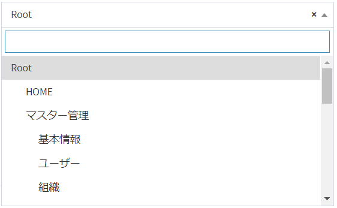

# Menu
Trang này dùng để thêm, sắp xếp lại, chỉnh sửa và xóa menu hiển thị ở bên trái màn hình.

| Việc muốn làm | Xem ở đâu |
|---|---|
| Thêm mục vào menu | Thêm mới menu |
| Đổi thứ tự của menu | Sắp xếp lại thứ tự |
| Chỉ cho người thuộc nhóm vai trò đã định thấy cấp cha | Nhóm vai trò được xem |
| Sau khi cập nhật, đưa menu về thứ tự chuẩn từ v7.2.1 | Sắp xếp theo thứ tự chuẩn |

## Tổng quan
Khi đăng nhập, menu được hiển thị ở bên trái màn hình.  
Có thể thêm vào menu các mục mở "trang do hệ thống chuẩn bị", "trang của plugin", "trang đến từng bảng", "URL tùy ý".  
※ Các mục menu chỉ hiển thị trong phạm vi những trang mà người dùng đã đăng nhập xem được.


※ Từ v7.1.0 trở đi, "Quản lý xác nhận an toàn", "Cài đặt đăng nhập", "Cài đặt ứng dụng API", "Nhật ký hiệu năng hệ thống" mà quản trị viên hệ thống dùng được hiển thị bên trong "Cài đặt quản trị". "Liên kết LINE" được hiển thị ở menu người dùng phía trên bên phải, không phải ở menu bên trái ([Liên kết LINE](/vi/line)). Khi cập nhật từ v7.0, menu chỉ được chuyển khi đang nằm ở trên cùng. Menu do bạn tự chuyển thì giữ nguyên.


### Thứ tự menu từ v7.2.1
Từ v7.2.1, menu bên trái được gom theo từng phân loại công việc (cấp cha). Thứ tự giống với [bản đồ chức năng](https://exment.net/feature-map/).

```
Bảng điều khiển
Groupware ▸ Chia sẻ tệp, Email (Groupware)
Đề xuất & phê duyệt ▸ Công việc chờ xử lý, Tờ trình phê duyệt, Thanh toán chi phí … (mẫu đi kèm "Gói yêu cầu")
Dự án ▸ Quản lý dự án (plugin chính thức)
Support Desk ▸ Support Desk (plugin chính thức)
Dữ liệu chủ ▸ Thông tin cơ bản, Tổ chức, Người dùng, Thông báo chung
Cài đặt: Dữ liệu và màn hình ▸ Bảng tùy chỉnh, Studio, Menu, Quy trình làm việc, Mẫu thông báo, Thông báo, Mẫu hiển thị thiết lập sẵn, Mẫu
Cài đặt: Người dùng và quyền ▸ Người dùng đăng nhập, Nhóm vai trò, Cài đặt đăng nhập, Cài đặt ứng dụng API, Nhật ký thao tác
Cài đặt: Hệ thống ▸ Cài đặt hệ thống, Quản lý tính năng, Plugin, Sao lưu, Tinh chỉnh hiệu năng, Chế độ bảo trì
```

- Site cài mới sẽ có dạng này.
- Với site cập nhật từ v7.1 trở về trước, chỉ những menu vẫn ở nguyên chỗ Exment đặt mới được chuyển (khi bên trong Cài đặt quản trị vẫn theo thứ tự của Exment, khi "Quản lý dữ liệu chủ" vẫn ở vị trí thứ 3 từ trên xuống, khi Chia sẻ tệp vẫn ở trên cùng). Menu do bạn tự chuyển, tên bạn đã đặt, menu của plugin thì giữ nguyên. Site có menu khác nằm trong Cài đặt quản trị thì không tách Cài đặt quản trị.
- Plugin chính thức (Quản lý dự án, Support Desk, Groupware) và mẫu đi kèm đặt menu dưới phân loại của mình (nếu chưa có phân loại thì tạo). Chỉ menu đang ở trên cùng mới được chuyển.
- Phân loại không có menu nào hiển thị được ở bên trong thì không hiển thị (menu của tính năng đã tắt ở [Quản lý tính năng](/vi/feature) không hiển thị).

#### Sắp xếp theo thứ tự chuẩn
Site mà thứ tự không đổi dù đã cập nhật (site đã sắp xếp lại menu, site có menu khác trong Cài đặt quản trị) có thể đưa về dạng trên bằng [Sắp xếp theo thứ tự chuẩn] trên màn hình "Menu".
- Khi bấm, danh sách cho biết menu nào chuyển đến đâu sẽ hiện ra. Kiểm tra rồi bấm [Sắp xếp].
- Chỉ menu của Exment và plugin chính thức được chuyển. Menu tự tạo, menu của bảng, các menu khác vẫn ở chỗ cũ theo thứ tự cũ (những cái từng ở trong Cài đặt quản trị thì ở cuối "Cài đặt: Hệ thống"). Không có menu nào bị xóa.
- Tên "HOME", "Quản lý dữ liệu chủ", "Cài đặt quản trị" chỉ được đổi thành "Bảng điều khiển", "Dữ liệu chủ", "Cài đặt: Hệ thống" khi vẫn là tên do Exment đặt.
- Menu trước khi sắp xếp được giữ lại, nên có thể đưa về bằng [Hoàn tác] trên cùng màn hình.
- Chỉ quản trị viên hệ thống dùng được.


## Quản lý menu
Cách thêm, sắp xếp lại, chỉnh sửa và xóa menu.  

### Hiển thị màn hình danh sách
Nhấp "Menu" từ menu bên trái.  
Hoặc truy cập URL dưới đây.  
Khi đó, màn hình thiết lập menu sẽ được hiển thị.  
http(s)://(URL của Exment)/auth/menu  
Danh sách các menu hiện đang được đăng ký trong hệ thống sẽ được hiển thị.


> ※ URL là theo thiết lập chuẩn không có "/admin" (site cài mới từ v7.2.1 trở đi). Nếu `ADMIN_ROUTE_PREFIX` trong `.env` có giá trị (site cài từ phiên bản trước là "admin"), hãy thêm giá trị đó sau URL của site (ví dụ: `http(s)://(URL của Exment)/admin/auth/menu`). Chi tiết vui lòng xem [Thay đổi hoặc xóa "admin" trong URL](/vi/additional_prefix).

### Thêm mới menu
Trên màn hình danh sách "Menu", nhập các mục cần thiết vào khung "Mới" ở bên phải trang.  


#### ID cha
Chọn mục làm cha của menu sẽ thêm. Khi thêm menu vào tầng trên cùng, hãy chọn "ROOT".


#### Loại menu
Chọn loại của menu sẽ thêm trong các loại sau.
- <span class="heading_smaller_than_h5">Menu hệ thống</span>  
Chọn khi muốn thêm mục menu do Exment chuẩn bị sẵn.  

- <span class="heading_smaller_than_h5">Plugin</span>  
Chọn khi muốn hiển thị trên menu plugin do người dùng tải lên.  

- <span class="heading_smaller_than_h5">Dữ liệu bảng</span>  
Chọn khi muốn hiển thị trên menu màn hình danh sách dữ liệu của bảng tùy chỉnh.  

- <span class="heading_smaller_than_h5">Cấp cha</span>  
Chọn khi muốn hiển thị danh sách cấp con dưới menu đó.  

- <span class="heading_smaller_than_h5">URL tùy chỉnh</span>  
Chọn khi thêm URL tùy ý vào menu.


#### Đối tượng
Chọn mục của menu sẽ thêm. Các mục hiển thị thay đổi theo "Loại menu".
- Khi loại menu là "Menu hệ thống": danh sách các trang do Exment chuẩn bị sẵn được hiển thị.


- Khi loại menu là "Plugin": danh sách plugin do người dùng tải lên được hiển thị.
- Khi loại menu là "Dữ liệu bảng": danh sách bảng tùy chỉnh được hiển thị.


- Khi loại menu là "Cấp cha", "URL tùy chỉnh": không chọn được.


#### URI
Là URI được mở khi nhấp.
- Khi loại menu là "Menu hệ thống", "Plugin", "Dữ liệu bảng", "Cấp cha": chỉ hiển thị. Không cần điền.  


- Khi loại menu là "URL tùy chỉnh": hãy điền URI được mở khi nhấp.  
※ URL của trang thực tế được mở sẽ như sau.
http(s)://(URL của Exment)/(URI đã điền)


> Ở site cài đặt lần đầu với phiên bản trước v3.0.2, giới hạn số ký tự đăng ký được cho URI được đặt dưới 50 ký tự. Khi đăng ký URI dài hơn, hãy xử lý theo [Sửa lỗi: URL của menu chỉ tối đa 50 ký tự](/patch/menu_uri_length).


#### Tên menu
Điền tên của menu bằng chữ và số nửa cỡ (half-width). Không dùng được tên trùng với menu khác.  
Đây là mục không hiển thị trên màn hình.
- Khi loại menu là "Menu hệ thống", "Plugin", "Dữ liệu bảng": khi chọn "Đối tượng", tên được tự động điền.  
※ Khi cùng mục menu đã được đăng ký rồi, tên bị trùng nên không lưu được. Hãy đổi giá trị.


- Khi loại menu là "Cấp cha", "URL tùy chỉnh": hãy điền bằng chữ và số nửa cỡ tùy thích, sao cho không trùng với giá trị khác.  


#### Tên hiển thị menu
Điền tên hiển thị ở menu bên trái.  
※ Khi loại menu là "Menu hệ thống", "Plugin", "Dữ liệu bảng", khi chọn "Đối tượng", tên được tự động điền.  

#### Biểu tượng
Điền biểu tượng hiển thị ở menu bên trái.  
※ Khi loại menu là "Menu hệ thống", "Plugin", "Dữ liệu bảng", khi chọn "Đối tượng", biểu tượng được tự động điền.  

#### Nhóm vai trò được xem
(Từ v7.2.1. Chỉ khi loại menu là "Cấp cha")  
Chỉ hiển thị cấp cha này, cùng các menu bên trong, cho người thuộc nhóm vai trò đã chọn. Khi để trống, hiển thị cho mọi người như từ trước đến nay (các menu bên trong được hiển thị theo quyền của từng cái). Với quản trị viên hệ thống thì luôn hiển thị.  
Ví dụ, có thể hiển thị "Đề xuất & phê duyệt" chỉ cho người yêu cầu và người phê duyệt, phân loại "Kế toán" chỉ cho người phụ trách kế toán.  
※ Chỉ là chia việc hiển thị, quyền không thay đổi. Các bảng, màn hình bên trong mở được theo quyền của từng cái.  
※ Khi xuất ra mẫu, nhóm vai trò được ghi bằng tên. Nếu site nhập vào có nhóm vai trò cùng tên thì sẽ nối với nhóm đó.

### Lưu
Sau khi điền các thiết lập, hãy nhấp [Gửi].  
※ Sau khi lưu, tải lại trình duyệt hoặc truy cập Exment lần nữa thì mục sẽ được phản ánh ở menu bên trái.

### Sắp xếp lại thứ tự
Thứ tự của các mục menu đã lưu có thể đổi trên màn hình danh sách.

1. Kéo và thả các mục để sắp xếp lại thứ tự.
2. Khi xong, hãy nhấp [Lưu].
  


### Chỉnh sửa
Khi chỉnh sửa menu, hãy nhấp liên kết [Chỉnh sửa] ở dòng đó.  


### Xóa
Khi xóa menu, hãy nhấp liên kết [Xóa] ở dòng đó.  


> Ở site cài trước v7.2.1, **danh sách nhật ký thao tác** không hiển thị trong các mục menu. Khi cần, hãy thiết lập từ danh sách. Ở site cài mới từ v7.2.1 trở đi, nó được hiển thị ở "Cài đặt: Người dùng và quyền".
