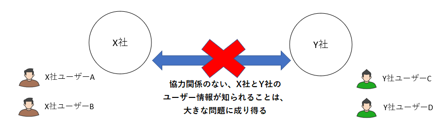
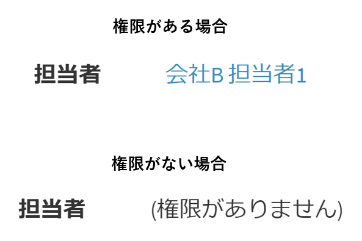

# Thiết lập cho site cổng thông tin bên ngoài (khi xây dựng hệ thống có người dùng của nhiều tổ chức đăng nhập)
Đây là thiết lập để ở những nơi chọn hoặc hiển thị người dùng, tổ chức, **"chỉ hiển thị tổ chức mà người dùng đăng nhập trực thuộc và những người dùng thuộc tổ chức đó"**.  
Khuyến nghị dùng khi người của các công ty khác nhau cùng đăng nhập vào một Exment (ví dụ site cổng thông tin cho bên ngoài).

Bản thân việc thiết lập chỉ là đổi 1 mục trong Cài đặt hệ thống. Nếu muốn biết các bước trước, vui lòng xem "[Cách thiết lập](/vi/multiuser?id=cách-thiết-lập)" ở dưới.

## Bối cảnh
Ban đầu, Exment chủ yếu được nghĩ đến cho các mục đích sau.  

- Chia sẻ thông tin trong doanh nghiệp, trong tổ chức  
- Chia sẻ thông tin giữa các công ty trong cùng tập đoàn
- Công khai REST API và giữ dữ liệu như một cơ sở dữ liệu Web

Với các mục đích này, việc nhìn thấy ai đang dùng, tổ chức hay công ty nào đã được đăng ký không phải là vấn đề lớn. Trái lại, nhìn thấy được thì tự nhiên hơn.  

Tuy nhiên, với các mục đích như sau, việc **"lấy được thông tin của người dùng khác"** có thể trở thành vấn đề.  

- Cấp tài khoản Exment cho từng doanh nghiệp hoàn toàn khác nhau, không cùng tập đoàn, và quản lý dữ liệu trong một cơ sở dữ liệu Web.
- Cấp tài khoản Exment cho từng cá nhân và xây dựng hệ thống như một site cổng thông tin.

Với các mục đích như vậy, **việc xem và lấy được thông tin người dùng, thông tin công ty, tổ chức ngoài công ty của mình đôi khi là vấn đề.**  
  

Ví dụ, giả sử Exment được cấu hình như sau.  

- Trong một môi trường Exment, người phụ trách của các công ty nhà cung cấp A, B, C đều đăng nhập được.
- Người phụ trách của mỗi nhà cung cấp có quyền "Chỉnh sửa dữ liệu phụ trách" đối với bảng "Thông tin sản phẩm" và nhập thông tin sản phẩm do công ty mình phụ trách.
- Bảng "Thông tin sản phẩm" có cột tùy chỉnh "Người phụ trách". Cột "Người phụ trách" được đặt là người phụ trách sản phẩm đó của công ty mình.

Nếu để thiết lập thông thường, **danh sách lựa chọn của cột tùy chỉnh "Người phụ trách" trong bảng "Thông tin sản phẩm" sẽ hiển thị người phụ trách của cả các công ty nhà cung cấp A, B, C.**    
Lý do là cột "Người dùng" của Exment, với thiết lập thông thường, đưa mọi người dùng có quyền vào danh sách lựa chọn.  
  
  
  
Vì vậy, có trường hợp bạn muốn **"với người dùng đăng nhập của từng tổ chức, chỉ hiển thị tổ chức và người dùng mà người đó trực thuộc"**.  
  
Trang này giải thích các bước để làm 2 việc sau.
- Không hiển thị các tổ chức ngoài tổ chức mà người dùng đăng nhập trực thuộc.
- Đồng thời không hiển thị những người dùng không thuộc các tổ chức đó.

## Cách thiết lập
1. Chuyển đến màn hình Cài đặt hệ thống, nhấp vào nút "Cài đặt chi tiết" ở phía trên bên phải màn hình.
2. Đổi mục "Bộ lọc người dùng/tổ chức" trong "Cài đặt tổ chức" sang thiết lập phù hợp.

  

Các thiết lập chọn được thay đổi tùy theo việc thiết lập "Sử dụng quản lý tổ chức" của Exment đó có là YES hay không.

### Giá trị thiết lập (khi thiết lập là có dùng tổ chức)
Với thiết lập nào cũng vậy, người dùng đăng nhập chỉ lấy được "các tổ chức lấy được" và "người dùng thuộc các tổ chức đó" (trừ "Không lọc").

#### Không lọc
- Là giá trị mặc định. Không lọc tổ chức và người dùng theo người dùng đăng nhập.

#### Tổ chức mà người dùng đăng nhập trực thuộc và các tổ chức cấp cha, cấp con, cùng với người dùng thuộc các tổ chức đó
- Người dùng đăng nhập chỉ lấy được thông tin của tổ chức mình trực thuộc và các tổ chức cấp cha, cấp con của nó.
- Chỉ lấy được thông tin của người dùng thuộc các tổ chức đó.

#### Tổ chức mà người dùng đăng nhập trực thuộc và các tổ chức cấp cha, cùng với người dùng thuộc các tổ chức đó
- Người dùng đăng nhập chỉ lấy được thông tin của tổ chức mình trực thuộc và các tổ chức cấp cha của nó.
- Chỉ lấy được thông tin của người dùng thuộc các tổ chức đó.

#### Tổ chức mà người dùng đăng nhập trực thuộc và các tổ chức cấp con, cùng với người dùng thuộc các tổ chức đó
- Người dùng đăng nhập chỉ lấy được thông tin của tổ chức mình trực thuộc và các tổ chức cấp con của nó.
- Chỉ lấy được thông tin của người dùng thuộc các tổ chức đó.

#### Tổ chức mà người dùng đăng nhập trực thuộc, cùng với người dùng thuộc tổ chức đó
- Người dùng đăng nhập chỉ lấy được thông tin của tổ chức mình trực thuộc.
- Chỉ lấy được thông tin của người dùng thuộc các tổ chức đó.

### Giá trị thiết lập (khi thiết lập là không dùng tổ chức)
#### Không lọc
- Là giá trị mặc định. Không lọc người dùng theo người dùng đăng nhập.

#### Chỉ người dùng đăng nhập
- Không lấy được thông tin của người dùng nào khác ngoài người dùng đăng nhập.

## Cách hoạt động khi đã thiết lập
Khi thiết lập này được bật, màn hình thay đổi như sau.  

- **Màn hình chỉnh sửa dữ liệu**: danh sách lựa chọn của cột tùy chỉnh "Tổ chức" chỉ còn các tổ chức mà người dùng đăng nhập lấy được.  
Danh sách lựa chọn của cột tùy chỉnh "Người dùng" cũng chỉ còn những người dùng mà người dùng đăng nhập lấy được.

  

- **Xem dữ liệu**: khi trong cột có người dùng, tổ chức mà người dùng đăng nhập không lấy được, thay cho liên kết của người dùng, tổ chức sẽ hiển thị "(Không có quyền hiển thị)".  
※ Đây không phải chức năng làm cho bản thân dữ liệu đó không xem được. Đây là chức năng chỉ làm cho người dùng, tổ chức không được hiển thị.  
Khi dòng chữ này hiện ra, có thể dữ liệu đang được chia sẻ cho cả những người dùng, tổ chức vốn không phải là đối tượng. Vui lòng kiểm tra [thiết lập quyền của dữ liệu](/vi/permission).

  

- **Màn hình chia sẻ dữ liệu**: danh sách lựa chọn chỉ còn các tổ chức, người dùng mà người dùng đăng nhập lấy được.

  

- Chỉ những người dùng sau lấy được tất cả tổ chức, người dùng, bất kể tổ chức mình trực thuộc.
    - Quản trị viên hệ thống
    - Người dùng đăng nhập có quyền "Lấy tất cả người dùng/tổ chức" trong [thiết lập nhóm vai trò](/vi/role_group)

  
