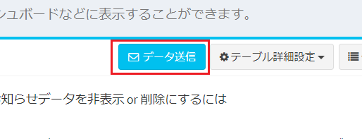
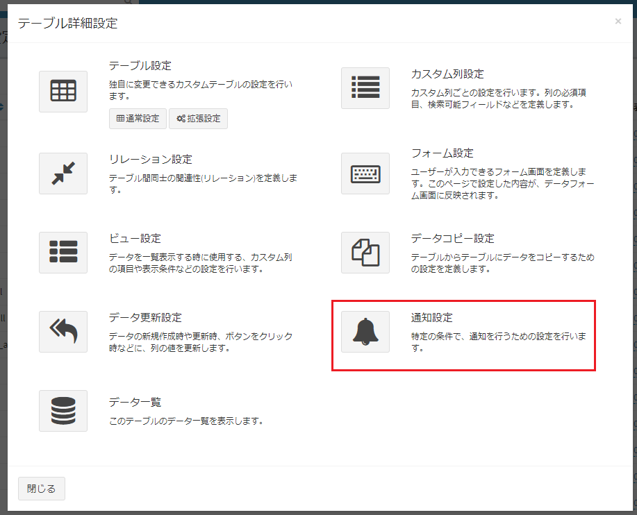
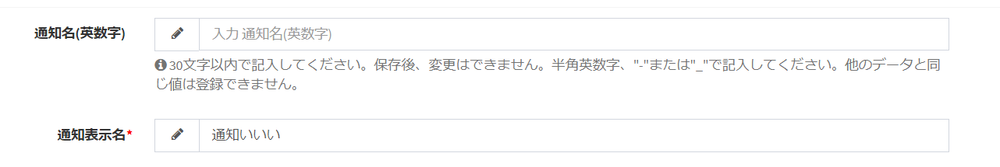

# Thiết lập thông báo / gửi email
Trang này dùng để thiết lập "thông báo": khi đạt điều kiện đã định, báo cho người dùng hoặc địa chỉ email đã chỉ định bằng email, v.v.

Thông báo được tạo bằng cách quyết định 3 điều sau.

| Điều cần quyết định | Nội dung | Xem ở đâu |
|---|---|---|
| Điều kiện kích hoạt thông báo | Báo khi nào (khi tạo dữ liệu, khi ngày đến gần, v.v.) | Các loại điều kiện kích hoạt thông báo |
| Hành động thông báo | Báo bằng gì (Email, Cảnh báo trong hệ thống, Slack, v.v.) và báo cho ai (đối tượng nhận thông báo) | Các loại hành động thông báo |
| Mẫu thông báo | Tiêu đề, nội dung | [Mẫu thông báo](/vi/mail) |

**※ Khi gửi email bằng chức năng này, cần thực hiện [thiết lập email](/vi/system_setting).**

## Các loại điều kiện kích hoạt thông báo
Điều kiện kích hoạt thông báo là thời điểm "thông báo khi nào". Hiện có các loại sau.

### Theo thời gian trôi qua
Khi đến ngày trước (hoặc sau) ngày đã đăng ký trong dữ liệu đúng số ngày đã định, thông báo được thực hiện.  
Ví dụ: ngày gia hạn hợp đồng là "31/7" và đã thiết lập "thông báo trước 10 ngày" thì email được gửi vào "21/7".    
**※ Khi dùng chức năng này, cần thiết lập [lịch tác vụ](/vi/additional_task_schedule) từ trước.**

### Tạo mới/cập nhật/chia sẻ/bình luận dữ liệu
Thông báo được thực hiện vào những lúc sau. Hãy dùng khi muốn sớm biết thay đổi của dữ liệu.  

- Khi tạo mới dữ liệu
- Khi cập nhật dữ liệu
- Khi có bình luận cho dữ liệu
- Khi có tệp được đính kèm vào dữ liệu
- Khi dữ liệu được chia sẻ  
  
※ Theo thiết lập ban đầu, chính người dùng đăng nhập đã cập nhật dữ liệu, v.v. không được thông báo. Khi muốn đổi, hãy thiết lập "bỏ qua thông báo khi đối tượng nhận thông báo là người dùng đăng nhập" ở [thay đổi giá trị thiết lập](/vi/config).  
※ Khi nhập (import) dữ liệu thì không thông báo. Lý do là có nguy cơ gửi đi số lượng lớn thông báo, email.

### Nút
Nút dùng để thông báo được hiển thị trên màn hình chi tiết dữ liệu.  
Bấm nút để gửi tin nhắn đến người dùng hoặc địa chỉ email đã chỉ định.  
Cũng có thể đính kèm tệp đã lưu.

  
  

### Thực hiện quy trình làm việc
Khi quy trình làm việc được thực hiện, có thể thông báo cho người tạo dữ liệu hoặc người thực hiện tiếp theo.

### Biểu mẫu công khai: khi đăng ký dữ liệu xong, khi có lỗi
Với biểu mẫu công khai, khi người dùng thông thường nhập dữ liệu và khi xảy ra lỗi, có thể gửi thông báo cho người dùng thông thường hoặc quản trị viên.  
※ Về biểu mẫu công khai, vui lòng xem [Cài đặt biểu mẫu công khai](/vi/publicform).

## Các loại hành động thông báo
Hành động thông báo là "thông báo bằng gì". Hiện có các loại sau.  
Trên màn hình thiết lập thông báo, cũng thiết lập "Đối tượng nhận thông báo", tức là thông báo cho ai.

### Email
Gửi email đến địa chỉ email nhất định.

#### Đối tượng nhận thông báo (bắt buộc)

- ##### Quản trị viên hệ thống
Gửi email cho quản trị viên hệ thống.

- ##### Người dùng có quyền
Gửi email cho những người dùng có quyền với dữ liệu đối tượng.

- ##### Người tạo
Gửi email cho người dùng đã tạo dữ liệu đối tượng.

- ##### Địa chỉ email chỉ định
Gửi email đến địa chỉ email đã nhập. Có thể chỉ định nhiều địa chỉ email.

- ##### Cột email
Khi dữ liệu của đối tượng thông báo có cột tùy chỉnh "địa chỉ email", gửi email đến địa chỉ email đó.

- ##### Cột người dùng
Khi dữ liệu của đối tượng thông báo có cột tùy chỉnh "Người dùng", gửi email cho người dùng được đặt ở cột người dùng đó.

- ##### Cột địa chỉ email trong Lựa chọn (từ bảng khác)
Khi bảng tùy chỉnh của dữ liệu có cột tùy chỉnh "Lựa chọn (từ bảng khác)" và bảng được tham chiếu có cột địa chỉ email, gửi email đến địa chỉ email đó.

- ##### Người dùng chỉ định
Gửi thông báo cho người dùng đã chọn.  
※ Chỉ những người dùng có quyền với bảng đó mới hiển thị trong danh sách lựa chọn. Không thể thông báo cho người dùng không có quyền.

- ##### Tổ chức chỉ định
Gửi thông báo cho tổ chức đã chọn.  
※ Chỉ những tổ chức có quyền với bảng đó mới hiển thị trong danh sách lựa chọn. Không thể thông báo cho tổ chức không có quyền.

### Cảnh báo trong hệ thống
Khi người dùng đối tượng đăng nhập, cảnh báo thông báo được hiển thị ở biểu tượng thông báo phía trên bên phải trang. 
  

#### Đối tượng nhận thông báo (bắt buộc)

- ##### Quản trị viên hệ thống
Gửi thông báo cho quản trị viên hệ thống.

- ##### Người dùng có quyền
Gửi thông báo cho những người dùng có quyền với dữ liệu đối tượng.

- ##### Người tạo
Gửi thông báo cho người dùng đã tạo dữ liệu đối tượng.

- ##### Cột người dùng
Khi dữ liệu của đối tượng thông báo có chứa cột tùy chỉnh "Người dùng", gửi thông báo cho người dùng đó.

- ##### Người dùng chỉ định
Gửi thông báo cho người dùng đã chọn.  
※ Chỉ những người dùng có quyền với bảng đó mới hiển thị trong danh sách lựa chọn. Không thể thông báo cho người dùng không có quyền.

- ##### Tổ chức chỉ định
Gửi thông báo cho tổ chức đã chọn.  
※ Chỉ những tổ chức có quyền với bảng đó mới hiển thị trong danh sách lựa chọn. Không thể thông báo cho tổ chức không có quyền.

### Slack
Gửi thông báo đến Slack.  
※ Để thông báo, cần URL của Webhook. Về cách lấy URL, vui lòng xem [Thiết lập khi thông báo đến Webhook](/vi/notify_webhook).

#### Thiết lập mention
Có thể gắn mention (cách viết gọi đích danh người nhận) vào thông báo Slack. Mention có các thiết lập sau.

- ##### Mention toàn bộ
Thêm "@here", tức mention toàn bộ, vào thông báo Slack.

- ##### Mention riêng
Thêm mention riêng từng người vào thông báo Slack.  
ID người dùng Slack dùng cho mention cần được thiết lập riêng từ trước.  
Về cách thiết lập Slack ID, vui lòng xem [Cách thiết lập Slack ID](/vi/notify_webhook).

#### Đối tượng mention

- ##### Quản trị viên hệ thống
Gửi thông báo cho quản trị viên hệ thống.

- ##### Người dùng có quyền
Gửi thông báo cho những người dùng có quyền với dữ liệu đối tượng.

- ##### Người tạo
Gửi thông báo cho người dùng đã tạo dữ liệu đối tượng.

- ##### Cột người dùng
Khi dữ liệu của đối tượng thông báo có cột tùy chỉnh "Người dùng", gửi mention đến Slack ID được đặt ở cột người dùng đó.

### Microsoft Teams
Gửi thông báo đến Microsoft Teams.  
※ Để thông báo, cần URL của Webhook. Về cách lấy URL, vui lòng xem [Thiết lập khi thông báo đến Webhook](/vi/notify_webhook).  
※ Với Microsoft Teams, không thể thêm mention.

### LINE
Gửi thông báo từ LINE Official Account đến LINE của người dùng. Cũng có thể gửi ở dạng thẻ (Flex Message).  
※ Người dùng nhận thông báo cần liên kết tài khoản LINE từ trước. Về việc chuẩn bị LINE Official Account và cách liên kết tài khoản, vui lòng xem [Liên kết LINE](/vi/line).

#### Đối tượng nhận thông báo (bắt buộc)
Giống như "Cảnh báo trong hệ thống", chọn trong số quản trị viên hệ thống, người dùng có quyền, người tạo, cột người dùng, người dùng chỉ định, tổ chức chỉ định, v.v.  
※ Thông báo không được gửi cho người dùng chưa liên kết tài khoản LINE.

## Hiển thị màn hình danh sách
Từ v4.2.0, vị trí của màn hình thiết lập thông báo đã thay đổi. Tùy loại điều kiện kích hoạt thông báo mà mở từ các nơi sau.

- Theo thời gian trôi qua, Tạo mới/cập nhật/chia sẻ/bình luận dữ liệu, Nút  
→ Hãy nhấp nút Cài đặt thông báo từ hộp thoại cài đặt chi tiết bảng của bảng tùy chỉnh.
  

- Quy trình làm việc  
→ Hãy thiết lập ở Step3 của thiết lập quy trình làm việc.
  

## Tạo mới 
1. Nhấp nút [Mới] ở phía trên bên phải màn hình danh sách.

2. Màn hình tạo mới thông báo hiển thị, hãy nhập các mục cần thiết.  
※ Về nội dung cần nhập, vui lòng xem "Chi tiết các mục thiết lập" ở dưới.

3. Nhấp nút [Gửi]. Thiết lập thông báo được tạo.

## Chỉnh sửa
- Hãy nhấp liên kết [Chỉnh sửa] ở dòng muốn chỉnh sửa.  
Màn hình chỉnh sửa mở ra và có thể đổi thiết lập.  

  

## Sao chép
- Hãy nhấp liên kết [Sao chép] ở dòng muốn sao chép.  
Màn hình tạo mới mở ra với các giá trị thiết lập của dòng đó đã được điền sẵn.

  

## Xóa
Khi muốn xóa thông báo, hãy nhấp liên kết [Xóa] ở dòng tương ứng.  

  

## Chi tiết các mục thiết lập
Thiết lập "tên thông báo", "Cài đặt điều kiện thông báo" (thông báo khi nào) và "Cài đặt hành động thông báo" (thông báo bằng gì).  

### Thiết lập tên thông báo

#### Tên thông báo (chữ và số)
- Là tên của thông báo dùng trong hệ thống.  
Được dùng, ví dụ, khi thiết lập ngay trước khi thực hiện thông báo hoặc sau khi thực hiện thông báo trong điều kiện kích hoạt của plugin (trigger).
- Dùng được chữ và số nửa cỡ (half-width) cùng các ký hiệu "-" và "_".
- Số ký tự trong vòng 30, và không dùng được tên thông báo mà thông báo khác đang dùng.

#### Tên hiển thị thông báo
- Là tên gọi của thông báo.

### Cài đặt điều kiện thông báo

  

#### Điều kiện kích hoạt
Chọn thời điểm kích hoạt thông báo. Chi tiết vui lòng xem [Các loại điều kiện kích hoạt thông báo](/vi/notify?id=các-loại-điều-kiện-kích-hoạt-thông-báo) ở trên.

#### Chế độ xem đối tượng
Chọn [chế độ xem điều kiện](/vi/view) để giới hạn dữ liệu được thông báo.

### Cài đặt điều kiện thông báo (theo thời gian trôi qua)

#### Cột ngày đối tượng
Chọn cột tùy chỉnh kiểu ngày làm căn cứ để quyết định có thông báo hay không.  
Loại cột tùy chỉnh chọn được là "Ngày", "Ngày giờ".  
※ Khi bảng tùy chỉnh đã chọn không có "Ngày", "Ngày giờ", danh sách lựa chọn không hiển thị.

#### Ngày thông báo
Hãy nhập ngày thực hiện thông báo. Nhập "0" thì thông báo ngay trong ngày.

#### Trước/sau khi thông báo
Chọn việc thông báo là "Trước" hay "Sau" ngày đã đăng ký.  
Ví dụ: khi "Ngày thông báo" là 7 và "Trước/sau khi thông báo" là "Trước", thông báo được thực hiện 7 ngày trước ngày của trường đã chỉ định

#### Giờ thông báo
Là giờ thực hiện thông báo. Nhập từ 0 đến 23.  
Ví dụ: khi nhập "6", thông báo được thực hiện lúc 6:00

### Cài đặt điều kiện thông báo (tạo mới/cập nhật/chia sẻ/bình luận dữ liệu)

#### Cài đặt điều kiện thông báo
Thiết lập điều kiện thực hiện thông báo.
  

### Cài đặt điều kiện thông báo (nút)

#### Tên hiển thị của nút
Điền tên của nút hiển thị trên màn hình.

### Cài đặt điều kiện thông báo (quy trình làm việc)

#### Trạng thái sau khi thực hiện
Vui lòng chọn trạng thái sẽ gửi thông báo. Trạng thái được tham chiếu là trạng thái sau khi thực hiện hành động. ※ Nếu để trống, tất cả đều là đối tượng.

#### Hành động thực hiện
Vui lòng chọn hành động sẽ gửi thông báo. ※ Nếu để trống, tất cả đều là đối tượng.

### Cài đặt hành động thông báo

Chọn hành động của thông báo. Có thể chọn nhiều.  
Về chi tiết của hành động, vui lòng xem [Các loại hành động thông báo](/vi/notify?id=các-loại-hành-động-thông-báo).

  

### Mẫu LINE Flex
Khi hành động thực hiện là "LINE", chọn mẫu của thẻ gửi đến LINE. Khi không chọn, gửi bằng văn bản.  
Về cách tạo mẫu, vui lòng xem [Liên kết LINE](/vi/line).

### Mẫu thông báo
Chọn mẫu của thông báo sẽ gửi. Khi dùng mẫu mới, hãy tạo trước ở màn hình mẫu thông báo.  
Về mẫu thông báo, chi tiết vui lòng xem [Mẫu thông báo](/vi/mail).  
  
  
>  **Khi thông báo có đính kèm tệp, nếu thực hiện thiết lập [mã hóa tệp đính kèm khi thông báo](/vi/notify_encript), tệp đính kèm sẽ được mã hóa.**

## Khi thông báo mất nhiều thời gian
Xử lý thông báo, dù là email hay WebHook, đều mất rất nhiều thời gian.  
Tuy là chức năng dành cho người dùng nâng cao, nhưng khi dùng [thực hiện trễ thông báo](/vi/additional_queue), hệ thống sẽ chuyển sang xử lý tiếp theo mà không chờ thông báo xong.

## Thực hiện thông báo (theo thời gian trôi qua) bằng lệnh
Thông báo có điều kiện kích hoạt "Theo thời gian trôi qua" có thể thực hiện thủ công bằng lệnh vào lúc bạn muốn, không phụ thuộc thiết lập "Giờ thông báo".  
Hãy chạy một trong các lệnh sau.  

~~~
# Chỉ định ID thông báo
php artisan exment:notify 1

# Chỉ định notify_name (tên thông báo (chữ và số))
php artisan exment:notify --name=task_limit_date_notify
~~~

  
