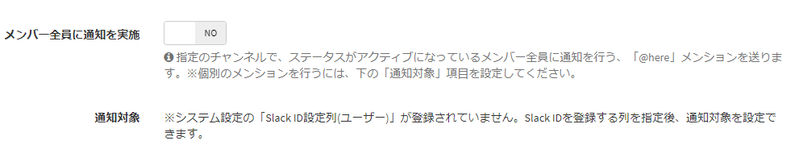

# Thiết lập khi gửi thông báo tới Webhook
Để gửi thông báo tới Slack hoặc Microsoft Teams, cần có "Webhook URL". Webhook URL là URL chuyên dùng để nhận thông báo.  
Trang này giải thích cách lấy Webhook URL và thiết lập để gắn mention cho một người cụ thể trên Slack.

| Việc muốn làm | Phần cần xem |
|---|---|
| Thông báo tới Slack | [Cách lấy Webhook URL của Slack](/vi/notify_webhook?id=cách-lấy-webhook-url-của-slack) |
| Thông báo tới Microsoft Teams | [Cách lấy Webhook URL của Microsoft Teams](/vi/notify_webhook?id=cách-lấy-webhook-url-của-microsoft-teams) |
| Gắn mention cho người dùng trong thông báo Slack | [Cách thiết lập Slack ID](/vi/notify_webhook?id=cách-thiết-lập-slack-id) |

## Cách lấy Webhook URL của Slack
1. Mở URL sau.  
https://slack.com/services/new/incoming-webhook  

2. Chọn kênh (channel) nhận thông báo.  
Sau đó bấm "Add Incoming Webhook Integration".  
  

3. Webhook URL được tạo, hãy sao chép.  
  

4. Dán Webhook URL đã sao chép vào cài đặt thông báo của Exment.

## Cách lấy Webhook URL của Microsoft Teams
1. Mở Teams và bấm "Manage team" (quản lý nhóm) của nhóm muốn nhận thông báo.  
  

2. Bấm tab "Apps".  

3. Bấm tab "Other apps" (ứng dụng khác).  

4. Bấm "Incoming Webhook".  

5. Bấm "Install" (cài đặt).  

6. Chọn kênh (channel) nhận thông báo. Sau đó bấm "Settings" (thiết lập).  

7. Nhập tên dùng cho thông báo và bấm "Create" (tạo).  

8. URL của Webhook được tạo; hãy sao chép URL và bấm "Done" (hoàn tất).  

9. Dán Webhook URL đã sao chép vào cài đặt thông báo của Exment.

## Cách thiết lập Slack ID
Đây là thiết lập khi muốn gắn mention (lời gọi gửi tới người đó) cho một người cụ thể trên Slack.  
Tạo cột để nhập Slack ID của từng người dùng, rồi chọn cột đó ở cài đặt hệ thống. Chỉ cần làm 1 lần lúc đầu.

1. Ở cài đặt [bảng tùy chỉnh](/vi/table), bấm liên kết "Cài đặt cột tùy chỉnh" của bảng "Người dùng".  
 

2. Ở cài đặt [cột tùy chỉnh](/vi/column) của bảng Người dùng, thêm cột tùy chỉnh sau.
    - Tên cột (chữ và số), Tên hiển thị cột: tên tùy ý
    - Loại cột: "Văn bản một dòng"

     

3. Ở "Cài đặt chi tiết" của màn hình [Cài đặt hệ thống](/vi/system_setting), chọn cột Slack ID vừa thêm cho "Cột thiết lập Slack ID (người dùng)".  
 

4. Ở màn hình chỉnh sửa dữ liệu người dùng, nhập Slack ID của từng người dùng. Khi thông báo tới người dùng đó, mention sẽ được gắn.  
※ Cách kiểm tra ID người dùng trên màn hình Slack, vui lòng xem [tại đây](https://auto-worker.com/blog/?p=27).  
 

Đến đây, từ màn hình cài đặt thông báo, có thể gắn mention tới Slack ID đã nhập trong dữ liệu người dùng.  
Ở màn hình cài đặt thông báo, phần hiển thị đối tượng thông báo thay đổi như sau. (Trên: khi chưa thiết lập Slack ID; dưới: khi đã thiết lập)

 
 

