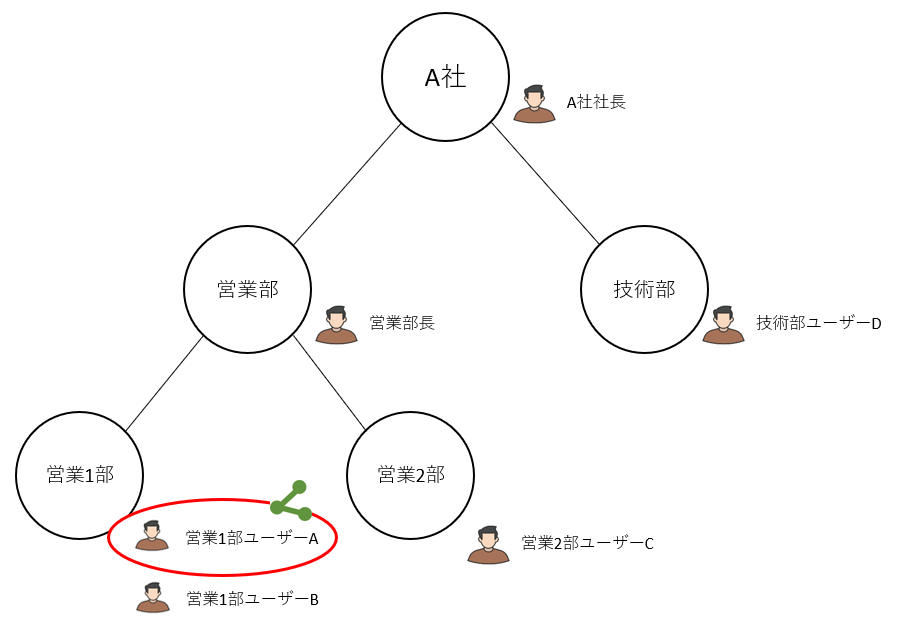

# Tổ chức
Trang này dùng để đăng ký và quản lý các "tổ chức" như phòng, ban của công ty trong Exment.  
Khi đã đăng ký tổ chức, bạn có thể quyết định quyền, biểu mẫu, quy trình làm việc và việc chia sẻ dữ liệu theo từng tổ chức.

> Trước khi thiết lập tổ chức, chúng tôi khuyến nghị bạn xem trang [Tổng quan về vai trò và quyền trong Exment](/vi/permission).

Nội dung của trang này như sau.

| Điều muốn biết | Xem ở đâu |
|---|---|
| Đăng ký, sửa, xóa tổ chức | Quản lý tổ chức |
| Tổ chức đã đăng ký được dùng ở đâu | Những nơi sử dụng tổ chức |
| Bao gồm tổ chức cha, tổ chức con đến mức nào | Về phân cấp tổ chức |

## Quản lý tổ chức
Cách đăng ký, chỉnh sửa và xóa tổ chức.

### Hiển thị màn hình danh sách
Nhấp vào "Tổ chức" ở menu bên trái.  
Hoặc truy cập URL dưới đây.  
Khi đó, màn hình quản lý tổ chức sẽ được hiển thị.  
http(s)://(URL của Exment)/data/organization  
Danh sách các tổ chức hiện đang được đăng ký trong hệ thống sẽ được hiển thị.
  

> Lưu ý: URL là theo thiết lập chuẩn không có "/admin" (site cài mới từ v7.2.1 trở đi). Nếu `ADMIN_ROUTE_PREFIX` trong `.env` có giá trị (site cài từ phiên bản trước là "admin"), hãy thêm giá trị đó sau URL của site (ví dụ: `http(s)://(URL của Exment)/admin/data/organization`). Chi tiết vui lòng xem [Thay đổi hoặc xóa "admin" trong URL](/vi/additional_prefix).
  
※ Nếu đặt "EXMENT_SHOW_ORGANIZATION_TREE=true" trong [giá trị thiết lập](/vi/config), cấu trúc phân cấp sẽ được hiển thị.

### Thêm mới tổ chức
1. Trên màn hình danh sách "Tổ chức", nhấp vào nút [Mới] ở phía trên bên phải trang.
2. Màn hình thêm mới sẽ được hiển thị, hãy nhập các mục cần thiết.  
※ Ở mục "Parent organization" (tổ chức cha), hãy chọn cấp cha của tổ chức đó.

### Lưu
Sau khi nhập xong, hãy nhấp vào [Gửi].

### Chỉnh sửa
Khi muốn sửa tổ chức, hãy nhấp vào liên kết [Chỉnh sửa] ở dòng tương ứng.  

### Xóa
Khi muốn xóa tổ chức, hãy nhấp vào liên kết [Xóa] ở dòng tương ứng.  

## Những nơi sử dụng tổ chức
Tổ chức đã đăng ký có thể dùng ở các nơi sau.

| Nơi dùng | Làm được gì |
|---|---|
| Nhóm vai trò | Quyết định người dùng thuộc tổ chức có truy cập được trang hay không |
| Chuyển đổi giữa nhiều form | Cho người dùng thuộc tổ chức dùng biểu mẫu đã định |
| Workflow | Người dùng thuộc tổ chức có thể thực hiện hành động của quy trình làm việc |
| Chia sẻ dữ liệu tùy chỉnh | Người dùng thuộc tổ chức có thể chỉnh sửa, xem dữ liệu đã chia sẻ |

#### Nhóm vai trò 
Có thể thiết lập tổ chức cho nhóm vai trò.

- Thiết lập này kiểm soát việc người dùng thuộc tổ chức có thể hay không thể truy cập trang.  
Trong hình dưới đây, phía trên là trường hợp người dùng có thể truy cập, phía dưới là trường hợp người dùng không thể truy cập.

#### Chuyển đổi giữa nhiều form 
Có thể thiết lập tổ chức làm điều kiện chuyển đổi giữa nhiều form.  
Nếu người dùng đăng nhập thuộc tổ chức đó, form sẽ được sử dụng.

#### Workflow 
Có thể thiết lập tổ chức trong thiết lập người dùng thực hiện của quy trình làm việc.  
Nếu người dùng đăng nhập thuộc tổ chức đó, họ có thể thực hiện hành động của quy trình làm việc.

#### Chia sẻ dữ liệu tùy chỉnh 
Có thể thiết lập tổ chức làm đối tượng được chia sẻ dữ liệu tùy chỉnh.  
Nếu người dùng đăng nhập thuộc tổ chức đó, quyền đối với dữ liệu tùy chỉnh sẽ được gán và họ có thể chỉnh sửa hoặc xem dữ liệu.

## Về phân cấp tổ chức
Trong Exment, có thể đặt phân cấp cha và con cho tổ chức như hình dưới đây.

### (Dành cho người dùng nâng cao) Các loại phân cấp
Khi tổ chức có nhiều cấp, phạm vi của "người dùng thuộc tổ chức đó" được chọn từ 4 loại sau.  
Ở đây, để làm ví dụ, chúng tôi lấy "**Phòng Kinh doanh**" làm chuẩn.

| Loại | Tổ chức được bao gồm | Ví dụ (khi lấy Phòng Kinh doanh làm chuẩn) |
|---|---|---|
| Tổ chức mà người dùng trực thuộc | Chỉ tổ chức đối tượng | Trưởng phòng Kinh doanh |
| Bao gồm tổ chức cấp cha | Tổ chức đối tượng và các tổ chức cấp cha của nó | Trưởng phòng Kinh doanh, Giám đốc công ty A |
| Bao gồm tổ chức cấp con | Tổ chức đối tượng và các tổ chức cấp con của nó | Trưởng phòng Kinh doanh, Người dùng A Phòng Kinh doanh 1, Người dùng B Phòng Kinh doanh 2 |
| Bao gồm tổ chức cấp cha và cấp con | Tổ chức đối tượng và các tổ chức cấp cha, cấp con của nó | Trưởng phòng Kinh doanh, Giám đốc công ty A, Người dùng A Phòng Kinh doanh 1, Người dùng B Phòng Kinh doanh 2 |

#### Tổ chức mà người dùng trực thuộc

Chỉ gồm những người dùng trực thuộc chính tổ chức đối tượng.  
Trong ví dụ, người trực thuộc Phòng Kinh doanh chỉ có "Trưởng phòng Kinh doanh".

#### Bao gồm tổ chức cấp cha

Gồm tổ chức đối tượng và các tổ chức cấp cha của nó.  
Trong ví dụ, đó là "Trưởng phòng Kinh doanh" trực thuộc Phòng Kinh doanh và "Giám đốc công ty A" trực thuộc "Công ty A" ở cấp cha.

#### Bao gồm tổ chức cấp con

Gồm tổ chức đối tượng và các tổ chức cấp con của nó.  
Trong ví dụ, đó là "Trưởng phòng Kinh doanh" trực thuộc Phòng Kinh doanh, cùng "Người dùng A Phòng Kinh doanh 1" và "Người dùng B Phòng Kinh doanh 2" trực thuộc "Phòng Kinh doanh 1" và "Phòng Kinh doanh 2" ở cấp con.

#### Bao gồm tổ chức cấp cha và cấp con

Gồm tổ chức đối tượng và các tổ chức cấp cha, cấp con của nó.  
Trong ví dụ, đó là "Trưởng phòng Kinh doanh" trực thuộc Phòng Kinh doanh, "Giám đốc công ty A" trực thuộc "Công ty A" ở cấp cha, cùng "Người dùng A Phòng Kinh doanh 1" và "Người dùng B Phòng Kinh doanh 2" trực thuộc "Phòng Kinh doanh 1" và "Phòng Kinh doanh 2" ở cấp con.

<h4 id="kaisou_syurui">(Dành cho người dùng nâng cao) Thiết lập loại phân cấp</h4>

Việc bao gồm phân cấp đến mức nào được thiết lập tại "Cài đặt hệ thống" > "Cài đặt tổ chức".

- Chỉ có thể thiết lập phân cấp cho "nhóm vai trò" và "chia sẻ dữ liệu tùy chỉnh".
- Với "thiết lập độ ưu tiên của form" và "quy trình làm việc", chỉ tổ chức mà người dùng trực thuộc là đối tượng.

### Thiết lập chia sẻ dữ liệu
Khi dùng [thiết lập chia sẻ dữ liệu của dữ liệu tùy chỉnh](/vi/data_details), các tổ chức khác cũng có thể truy cập dữ liệu đó.

#### Phạm vi có hiệu lực khi chia sẻ dữ liệu tùy chỉnh
- Khi chia sẻ dữ liệu cho một tổ chức, những người dùng thuộc tổ chức đó có thể truy cập.
- Việc người dùng thuộc tổ chức cha, tổ chức con có thể truy cập hay không được quyết định bởi mục "Thiết lập loại phân cấp > Cài đặt phân cấp tổ chức (dữ liệu)" nêu trên.
- Các tổ chức thuộc nhánh khác không thể truy cập.

<h4 id="kyouyu_jidou">(Dành cho người dùng nâng cao) Tự động chia sẻ khi lưu dữ liệu</h4>

Khi tạo mới dữ liệu tùy chỉnh, thiết lập chia sẻ sẽ tự động được gán cho dữ liệu vừa tạo.

- Theo chuẩn, thiết lập chia sẻ chỉ được gán cho "người dùng đăng nhập".
- Nếu đổi thiết lập, thiết lập chia sẻ cũng được gán cho tổ chức mà người dùng đăng nhập trực thuộc.
- Thiết lập này thực hiện tại "Cài đặt hệ thống" > "Cài đặt tổ chức".

Nội dung của từng thiết lập như sau.

##### (1) Chỉ người dùng đăng nhập
Khi tạo mới dữ liệu tùy chỉnh, dữ liệu chỉ được chia sẻ cho người dùng đăng nhập.  
- **Ví dụ**: Khi "Người dùng A Phòng Kinh doanh 1" tạo mới dữ liệu, chỉ người dùng "Người dùng A Phòng Kinh doanh 1" có thể truy cập.  

##### (2) Người dùng đăng nhập và tổ chức trực thuộc
Khi tạo mới dữ liệu tùy chỉnh, dữ liệu được chia sẻ cho người dùng đăng nhập và **tổ chức trực thuộc**.  
- **Ví dụ**: Khi "Người dùng A Phòng Kinh doanh 1" tạo mới dữ liệu, dữ liệu được chia sẻ cho người dùng "Người dùng A Phòng Kinh doanh 1" và tổ chức "Phòng Kinh doanh 1".  
→ Kết quả là người dùng "Người dùng B Phòng Kinh doanh 1" thuộc tổ chức "Phòng Kinh doanh 1" cũng có thể truy cập

