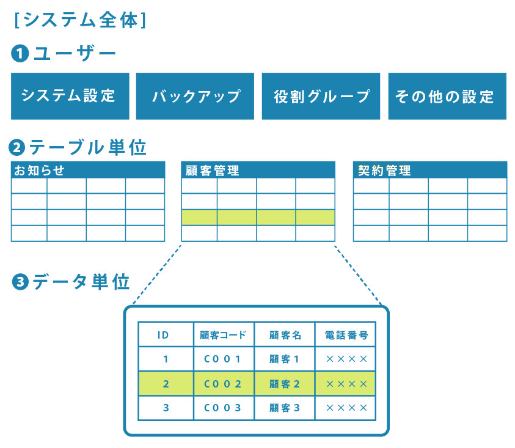

# Tổng quan về vai trò và quyền
Trang này giải thích khái quát về vai trò và quyền của Exment.  
Quyền là khái niệm quan trọng để chỉ những người dùng đã định mới thao tác (action) được với dữ liệu hoặc trang nhất định.

- Với thiết lập ban đầu, người dùng mới thêm dù đăng nhập cũng hầu như không dùng được chức năng nào.  
- Quản trị viên hệ thống cần thiết lập vai trò và quyền phù hợp cho người dùng đã thêm.

Quyền được quản lý theo 3 đơn vị sau. Chi tiết vui lòng xem "Đơn vị quản lý quyền" ở dưới.

| Đơn vị | Những gì quyết định được (ví dụ) | Nơi thiết lập |
|---|---|---|
| (1) Toàn hệ thống | Đổi tên site, quản lý người dùng đăng nhập | "Quản trị viên hệ thống" của [thiết lập hệ thống](/vi/system_setting), "quyền hệ thống" của [nhóm vai trò](/vi/role_group) |
| (2) Đơn vị bảng | Đổi thiết lập của bảng đó, chỉnh sửa và xem dữ liệu của bảng | [Thiết lập bảng](/vi/table), "quyền bảng" của [nhóm vai trò](/vi/role_group) |
| (3) Đơn vị dữ liệu | Chỉ chỉnh sửa và xem dữ liệu nhất định | "Chia sẻ" của [màn hình chi tiết dữ liệu](/vi/data_details), v.v. |  

## Có dùng quyền hay không
Khi không dùng thiết lập quyền, hãy đổi "Sử dụng quản lý quyền" thành No ở [thiết lập hệ thống](/vi/system_setting).  
Khi không dùng, tất cả người dùng làm được tất cả các thao tác.  

## Khác biệt khi có và không có quyền (một ví dụ)
Tùy theo có quyền hay không, thao tác mà người dùng làm được và hiển thị của màn hình sẽ thay đổi.

##### ■Chỉ hiển thị các menu có quyền
→Menu của người dùng đăng nhập chỉ hiển thị các mục có quyền.  

##### ■Lỗi truy cập  
→Khi định mở trang không có quyền, lỗi truy cập xảy ra.

##### ■Mục không hiển thị trong lựa chọn của form dữ liệu  
→Khi cột là "Lựa chọn (từ bảng khác)", nếu không có quyền với bảng tham chiếu thì lựa chọn không hiển thị.  

## Đơn vị quản lý quyền
Ở Exment, quyền được quản lý chủ yếu theo 3 đơn vị sau.

- Toàn hệ thống
- Đơn vị bảng
- Đơn vị dữ liệu

### Sơ đồ tổng thể

### (1) Toàn hệ thống

Đây là quyền thao tác với thiết lập hệ thống của Exment.  
Ví dụ như các thao tác sau.  

- Đổi tên site.
- Quản lý người dùng đăng nhập.
- Tạo, chỉnh sửa, xem, v.v. tất cả các bảng.

#### Cách thiết lập quyền

##### Thiết lập quản trị viên hệ thống
Ở [thiết lập hệ thống](/vi/system_setting), có thể thêm và đổi "Quản trị viên hệ thống". "Quản trị viên hệ thống" làm được tất cả các thao tác của hệ thống.

##### Các thiết lập hệ thống khác
Người dùng không phải quản trị viên hệ thống cũng thao tác được với toàn hệ thống nếu được gán [nhóm vai trò](/vi/role_group).  
Về quyền thao tác hệ thống, hãy thêm và đổi "quyền hệ thống" ở [nhóm vai trò](/vi/role_group).

### (2) Đơn vị bảng

Đây là quyền đối với các bảng tạo trong Exment.  
Quyền được thiết lập cho từng bảng. Tùy theo nội dung đã thiết lập, thao tác mà mỗi người dùng làm được sẽ thay đổi.  
Người dùng hoàn toàn không có quyền với bảng thì không mở được trang nào của bảng đó.  
  
Ví dụ như các thao tác sau.  

- Đổi thiết lập của bảng đó, như thêm cột.
- Chỉnh sửa được tất cả dữ liệu trong bảng.
- Xem được tất cả dữ liệu trong bảng, và chỉnh sửa được dữ liệu mình phụ trách.
- Xem được dữ liệu mình phụ trách trong bảng.

#### Cách thiết lập quyền

##### Thiết lập chung cho tất cả người dùng
Gán quyền chỉnh sửa, xem, v.v. cho tất cả người dùng, không phụ thuộc vào vai trò hay tổ chức. Đối tượng là tất cả dữ liệu trong bảng. Đổi được ở [thiết lập bảng](/vi/table).

##### Các thiết lập bảng khác
Khi gán quyền khác nhau cho từng người dùng, hãy dùng [nhóm vai trò](/vi/role_group).  
Về quyền thao tác bảng, hãy thêm và đổi "quyền bảng" ở [nhóm vai trò](/vi/role_group).

### (3) Đơn vị dữ liệu

Đây là quyền đối với từng dữ liệu.  
Khi gán quyền theo đơn vị dữ liệu, có thể dùng chi tiết hơn, ví dụ "không cho xem tất cả dữ liệu mà chỉ cho xem dữ liệu nhất định".  
Ví dụ như các thao tác sau.

- Chỉnh sửa dữ liệu nhất định.
- Xem dữ liệu nhất định.

#### Cách thiết lập quyền

##### Hoạt động cơ bản khi tạo dữ liệu mới
Khi người dùng lưu dữ liệu, quyền chỉnh sửa dữ liệu đó được tự động gán cho chính người dùng đó. (Người dùng không cần làm gì)

##### Khi tạo dữ liệu mới, thêm quyền cho cả tổ chức mà người tạo dữ liệu trực thuộc
Có thể tự động chia sẻ không chỉ với người dùng đã tạo dữ liệu mà cả với tổ chức mà người dùng đó trực thuộc.  

- Ví dụ: dữ liệu do người dùng của phòng kinh doanh tạo được tự động chia sẻ với tất cả mọi người trong phòng kinh doanh

Về cách thiết lập, vui lòng xem [thiết lập tổ chức](/vi/organization).

##### Thêm quyền bằng tay về sau (chia sẻ)
Có thể chia sẻ dữ liệu đã tạo với người dùng khác. Quyền chọn được là xem hoặc chỉnh sửa.  
Hãy chọn "Chia sẻ" ở [màn hình chi tiết dữ liệu](/vi/data_details).

  

##### Khi tạo mới hoặc cập nhật dữ liệu, thêm quyền cho cả người dùng và tổ chức được đặt trong cột
Ở Exment, có thể thêm cột "Người dùng" và "Tổ chức" làm cột tùy chỉnh.  
Khi tạo mới hoặc cập nhật dữ liệu bằng màn hình hoặc API, có thể tự động chia sẻ dữ liệu với người dùng và tổ chức có trong cột "Người dùng" và "Tổ chức" này.  

- Ví dụ: người dùng được nhập vào cột "Người phụ trách" của bảng "Quản lý công việc" được tự động gán quyền chỉnh sửa dữ liệu đó khi lưu dữ liệu

Về cách thiết lập, vui lòng xem [Cài đặt tự động chia sẻ dữ liệu](/vi/table?id=thiết-lập-tự-động-chia-sẻ-dữ-liệu).

#### Tốc độ hiển thị ở bảng có nhiều dữ liệu
Với người dùng xem được dữ liệu bằng quyền theo đơn vị dữ liệu (chia sẻ dữ liệu), mỗi lần mở màn hình danh sách, hệ thống kiểm tra từng dữ liệu một xem "được xem dữ liệu nào". Vì vậy, khi **dữ liệu xem được bằng chia sẻ dữ liệu rất nhiều** (ví dụ: vài chục nghìn dữ liệu), việc hiển thị mất thời gian, nhất là với **danh sách không lọc**.  
(Ví dụ đo ở v7.1.0: với bảng 90 nghìn dữ liệu, người dùng xem được cả 90 nghìn dữ liệu bằng chia sẻ dữ liệu mất khoảng 1,3 giây để hiển thị danh sách không lọc. Người dùng có quyền xem tất cả dữ liệu mất khoảng 0,4 giây)

Với người dùng cần cho xem **tất cả** dữ liệu của bảng, hãy gán "Xem tất cả dữ liệu" (hoặc "Chỉnh sửa tất cả dữ liệu") ở "quyền bảng" của [nhóm vai trò](/vi/role_group), không dùng chia sẻ dữ liệu. Khi đó không cần kiểm tra từng dữ liệu một, và hiển thị nhanh hơn.

※Khi gán "Xem tất cả dữ liệu", người dùng xem được **tất cả dữ liệu của bảng đó, gồm cả dữ liệu sẽ được thêm sau này**. Khi chỉ muốn cho xem một phần dữ liệu, hãy dùng chia sẻ dữ liệu như trước.

## Thiết lập tổ chức và người dùng
Đây là khái quát về thiết lập tổ chức và người dùng của Exment.  

#### Có dùng tổ chức hay không
Khi không dùng thiết lập tổ chức, hãy đổi "Sử dụng quản lý tổ chức" thành No ở [thiết lập hệ thống](/vi/system_setting).

#### Thiết lập phân cấp của tổ chức
Ở Exment, tổ chức có thể quản lý theo phân cấp.  

Khi thực hiện [thiết lập nhóm vai trò](/vi/role_group) hoặc chia sẻ dữ liệu cho tổ chức, có thể chỉ định có bao gồm "cha và con", "cha", "con" trong phân cấp của tổ chức hay không.  
Về cách thiết lập, vui lòng xem [thiết lập tổ chức](/vi/organization).

#### Về phạm vi lấy thông tin người dùng và tổ chức của tổ chức khác
Khi dùng Exment như site cổng thông tin nội bộ, việc người dùng khác thấy được "người dùng nào đang dùng", "tổ chức nào, công ty nào đã đăng ký" không phải là vấn đề lớn.

Tuy nhiên, khi cho cả người dùng ngoài công ty dùng Exment, việc lấy và xem được thông tin người dùng của công ty khác có thể trở thành vấn đề.

  
Khi thực hiện [thiết lập dành cho site cổng thông tin bên ngoài](/vi/multiuser), có thể giới hạn việc lấy và xem thông tin người dùng của công ty khác.

## Trang liên quan
- [Thiết lập hệ thống](/vi/system_setting)
- [Thiết lập nhóm vai trò](/vi/role_group)
- [Màn hình chi tiết dữ liệu](/vi/data_details)
- [Thiết lập tổ chức](/vi/organization)
- [Thiết lập dành cho site cổng thông tin bên ngoài](/vi/multiuser)
