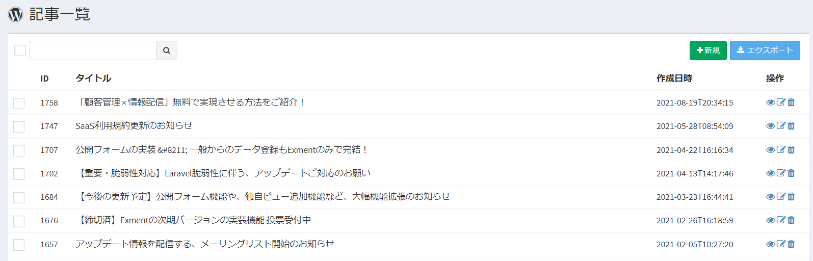
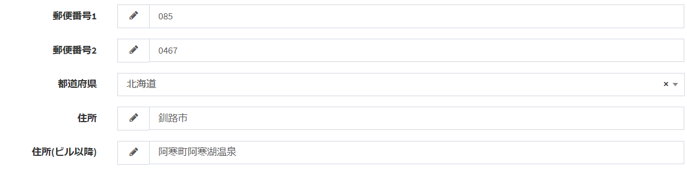
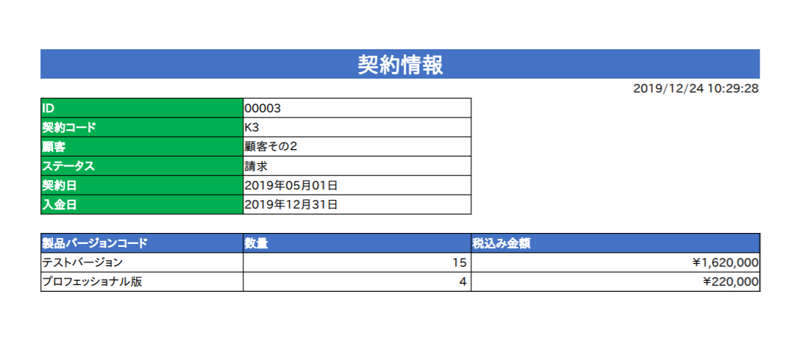

# Plugin
Plugin là chương trình để thêm chức năng cho Exment.
Trang này giải thích các loại plugin và cách tải lên, thiết lập, xóa, phân quyền.

- Nếu muốn biết ngay cách cài, vui lòng xem "[Cách quản lý](/vi/plugin?id=cách-quản-lý)".
- Về plugin chính thức do Exceed One làm, vui lòng xem [Plugin chính thức](/vi/plugin_official).
- Nếu tự làm plugin, vui lòng xem [Cách phát triển plugin](/vi/plugin_quickstart).

## Plugin là gì
Khi chỉ chức năng chuẩn của Exment là chưa đủ cho nghiệp vụ, bạn có thể tải chương trình (tệp zip) lên từ màn hình để thêm chức năng. Đó là "plugin".  
Hiện nay plugin có các loại sau.    

- [Nút](/vi/plugin?id=nút)
- [Sự kiện](/vi/plugin?id=sự-kiện)
- [Trang](/vi/plugin?id=trang)
- [Bảng điều khiển](/vi/plugin?id=bảng-điều-khiển)
- [Chế độ xem](/vi/plugin?id=chế-độ-xem)
- [Trang CRUD](/vi/plugin?id=trang-crud)
- [Batch](/vi/plugin?id=batch)
- [API](/vi/plugin?id=api)
- [Kiểm tra hợp lệ](/vi/plugin?id=kiểm-tra-hợp-lệ)
- [Script](/vi/plugin?id=script)
- [Style](/vi/plugin?id=style)
- [Nhập](/vi/plugin?id=nhập)
- [Xuất](/vi/plugin?id=xuất)
- [Xuất tài liệu](/vi/plugin?id=xuất-tài-liệu)
- [Docurain (xuất PDF)](/vi/plugin?id=docurain)
- [Trigger ※không khuyến nghị](/vi/plugin?id=trigger)

#### Nút
Thêm nút vào màn hình danh sách hoặc màn hình biểu mẫu của Exment, và xử lý khi nút được bấm.  
※Cách cài đặt vui lòng xem [tại đây](/vi/plugin_quickstart_button).  
  
Nút đặt được ở 4 nơi sau.    
##### Nút menu trên màn hình danh sách
Thêm nút ở phía trên màn hình danh sách dữ liệu, và phát sinh sự kiện khi bấm.

##### Nút menu trên màn hình chi tiết dữ liệu
Thêm nút ở phía trên màn hình chi tiết dữ liệu, và phát sinh sự kiện khi bấm.

##### Nút menu trên biểu mẫu (khi tạo mới)
Thêm nút ở phía trên màn hình tạo mới dữ liệu, và phát sinh sự kiện khi bấm.

##### Nút menu trên biểu mẫu (khi cập nhật)
Thêm nút ở phía trên màn hình cập nhật dữ liệu, và phát sinh sự kiện khi bấm.

   

#### Sự kiện
Được chạy khi làm một thao tác nhất định trên màn hình Exment, và làm được các xử lý như cập nhật giá trị.  
※Cách cài đặt vui lòng xem [tại đây](/vi/plugin_quickstart_event).  
  
Các thao tác nhất định là những thao tác sau.    

- ##### Trước khi tải màn hình  
Xử lý được khởi động ở đầu quá trình tải trang. (Không phải là trước mọi xử lý khác)  

- ##### Ngay trước khi lưu  
Xử lý được khởi động ngay trước khi lưu dữ liệu.  

- ##### Sau khi lưu  
Xử lý được khởi động sau khi lưu dữ liệu.  

- ##### Sau khi xóa  
Xử lý được khởi động sau khi xóa dữ liệu.  

- ##### Trước khi thực hiện quy trình làm việc  
Xử lý được khởi động ngay trước khi thực hiện quy trình làm việc.  

- ##### Sau khi thực hiện quy trình làm việc  
Xử lý được khởi động sau khi thực hiện quy trình làm việc.  

- ##### Trước khi thông báo  
Xử lý được khởi động ngay trước khi chạy thông báo.  

- ##### Sau khi thông báo  
Xử lý được khởi động sau khi chạy thông báo.  

#### Trang
Tạo được màn hình mới trong Exment.  
Hãy dùng khi muốn có trang hoàn toàn khác với chức năng chuẩn.  
※Cách cài đặt vui lòng xem [tại đây](/vi/plugin_quickstart_page).    

   

#### Bảng điều khiển
Tạo được màn hình mới trên bảng điều khiển của Exment.  
Hãy dùng khi muốn có trang riêng làm một mục của bảng điều khiển. 
※Cách cài đặt vui lòng xem [tại đây](/vi/plugin_quickstart_dashboard).

   

#### Chế độ xem
Tạo và thêm được thiết kế mới hoặc chức năng riêng cho màn hình danh sách dữ liệu tùy chỉnh của Exment.  
Hãy dùng khi muốn có chức năng hoàn toàn khác với các view có sẵn là view danh sách, tổng hợp và lịch.  
※Cách cài đặt vui lòng xem [tại đây](/vi/plugin_quickstart_view).  

   

#### Trang CRUD
Tạo trang mới có bố cục màn hình gần giống hệt danh sách, chi tiết, tạo mới, cập nhật, xóa của Exment.  
Quản lý được dữ liệu bên ngoài trên màn hình Exment mà không cần đưa vào Exment. Cũng hỗ trợ nhiều endpoint.    
※Cách cài đặt vui lòng xem [tại đây](/vi/plugin_quickstart_crud).  

   

#### Batch
Dùng được khi muốn tự động chạy xử lý định kỳ.  
Cũng dùng được khi muốn chạy một xử lý nhất định trong một lần, như cập nhật trạng thái hàng loạt.    
※Cách cài đặt vui lòng xem [tại đây](/vi/plugin_quickstart_batch).

#### API
Tạo được API mới trong Exment.  
Hãy dùng khi thêm chức năng không có trong [API reference](https://exment.net/reference/ja/webapi.html).  
※Cách cài đặt vui lòng xem [tại đây](/vi/plugin_quickstart_api).

#### Script
Chạy được script (javascript) riêng.  
Hiện hỗ trợ: khi hiển thị màn hình danh sách dữ liệu, khi hiển thị màn hình chi tiết dữ liệu, khi hiển thị màn hình tạo mới và màn hình cập nhật dữ liệu.  
※Cách cài đặt vui lòng xem [tại đây](/vi/plugin_quickstart_script).

   

#### Style
Thiết lập được style (stylesheet, css) riêng và đổi thiết kế.  
※Cách cài đặt vui lòng xem [tại đây](/vi/plugin_quickstart_style).

   

#### Kiểm tra hợp lệ
Dùng được khi muốn tự cài đặt validation (kiểm tra giá trị nhập) của bảng tùy chỉnh.  
Hãy dùng khi cài đặt kiểm tra phức tạp, hoặc kiểm tra quan hệ giữa các mục.    
※Cách cài đặt vui lòng xem [tại đây](/vi/plugin_quickstart_validate).

   

#### Nhập
Dùng được khi muốn tự cài đặt xử lý nhập (import) dữ liệu tùy chỉnh.  
Hãy dùng khi nhập tệp có định dạng riêng, hoặc cài đặt xử lý chuyển đổi đặc biệt.  
※Cách cài đặt vui lòng xem [tại đây](/vi/plugin_quickstart_import).

   

#### Xuất
Dùng được khi muốn tự cài đặt việc xuất (export) danh sách dữ liệu tùy chỉnh.  
Hãy dùng khi xuất tệp có định dạng riêng, hoặc cài đặt xử lý chuyển đổi đặc biệt.  
Ngoài Excel, cũng xuất được bằng định dạng khác.  
※Cách cài đặt vui lòng xem [tại đây](/vi/plugin_quickstart_export).

   

#### Xuất tài liệu
Tạo được tài liệu riêng như báo giá, biểu mẫu chứng từ.  
Mẫu gốc là định dạng Excel, và đầu ra cũng là định dạng Excel.    
※Cách cài đặt vui lòng xem [tại đây](/vi/plugin_quickstart_document).
※Để xuất bằng định dạng PDF, hãy cân nhắc [plugin Docurain](/vi/plugin_quickstart_docurain).  

   

<h4 id="docurain"><a href="#/vi/plugin?id=docurain" data-id="Docurain (xuất PDF)" class="anchor">Docurain (xuất PDF)</a></h4>

Xuất PDF bằng **Docurain**, engine tạo chứng từ trên cloud cho phép phát triển chứng từ chỉ với Excel và json.  
Mẫu gốc là định dạng Excel, và đầu ra là định dạng PDF.    
※Cách cài đặt vui lòng xem [tại đây](/vi/plugin_quickstart_docurain).

#### Trigger
※Từ v3.2.0, loại này không còn được khuyến nghị.  
Từ nay, hãy cài đặt bằng "Nút" hoặc "Sự kiện".

## Plugin chính thức
Đây là các plugin chính thức do Exceed One làm và hỗ trợ. Tải được từ [exceedone/exment-plugins](https://github.com/exceedone/exment-plugins) trên GitHub.  
Cách cài vui lòng xem [Plugin chính thức](/vi/plugin_official).

| Plugin | Chức năng |
| --- | --- |
| [Quản lý dự án](/vi/plugin_pm) | Quản lý dự án và công việc (ticket). Hiển thị công việc dạng cây, milestone, bảng, biểu đồ Gantt, wiki, bình luận, thông báo, v.v. |
| [Bộ phận hỗ trợ](/vi/plugin_support_desk) | Help desk: quản lý yêu cầu qua email, biểu mẫu tiếp nhận, điện thoại bằng ticket và chia sẻ tiến độ với khách hàng không cần đăng nhập |
| [Groupware](/vi/plugin_groupware) | Web mail, và mở/sửa tệp Office của chia sẻ tệp trên trình duyệt |

## Cách quản lý
### Hiển thị trang
- Chọn "Plugin" ở menu bên trái.  
Hoặc truy cập URL sau.  
http(s)://(URL của Exment)/plugin  
Màn hình plugin được hiển thị.    
  

> ※URL trên là của thiết lập chuẩn không có "/admin" (site mới cài từ v7.2.1). Nếu `ADMIN_ROUTE_PREFIX` trong `.env` có giá trị (site cài bằng phiên bản trước là "admin"), hãy thêm giá trị đó vào sau URL của site (ví dụ: `http(s)://(URL của Exment)/admin/plugin`). Chi tiết vui lòng xem [Đổi hoặc bỏ "admin" trong URL](/vi/additional_prefix).

### Tải lên plugin
1. Bấm [Chọn tệp] và chọn tệp zip của plugin.
2. Bấm [Tải lên].
3. Khi xong, thông tin của plugin hiển thị ở danh sách phía dưới trang.

    

### Quản lý plugin
Đổi các thông tin như bật/tắt plugin, trigger của plugin, URI của trang.  
Ở danh sách, hãy bấm liên kết [Chỉnh sửa] ở dòng của plugin muốn đổi.  
  

Trang quản lý plugin được hiển thị.    
  

### Các mục quản lý

##### Kích hoạt
Chuyển việc có dùng plugin đó trong hệ thống hay không.  
Đặt YES thì bật. Đặt NO thì tắt, và plugin không được chạy trong hệ thống.    
※Khi tải plugin lên, mặc định là YES. Tuy nhiên, nếu loại plugin là "Batch" thì khi tải lên mặc định là NO.

##### Bảng mục tiêu
Chỉ định bảng tùy chỉnh là đối tượng để chạy plugin.  
Plugin được chạy khi hiển thị trang của bảng đã thiết lập.  

##### Thời điểm kích hoạt
Thiết lập plugin được chạy khi làm thao tác nào.
Plugin được chạy khi làm thao tác đã thiết lập.    

##### Nhãn nút
Thiết lập nhãn hiển thị trên nút khi hiển thị "Nút menu trên màn hình danh sách" hoặc "nút menu trên biểu mẫu".

##### Biểu tượng của nút
Thiết lập biểu tượng hiển thị trên nút khi hiển thị "Nút menu trên màn hình danh sách" hoặc "nút menu trên biểu mẫu".

##### Class HTML của nút
Thiết lập class thêm vào HTML của nút khi hiển thị "Nút menu trên màn hình danh sách" hoặc "nút menu trên biểu mẫu".

## Xóa plugin
Để xóa plugin, ở màn hình danh sách, hãy bấm liên kết [Xóa] ở dòng của plugin đó.  
  
※Khi [Xóa], chính các tệp của plugin bị xóa.  
Nếu chỉ muốn tạm dừng, đừng xóa mà hãy đặt "Kích hoạt" thành NO.    

## Quản lý quyền theo vai trò

Bạn có thể dùng quyền để tách người dùng/tổ chức đổi được thiết lập của plugin và người dùng/tổ chức dùng được plugin.  
Ví dụ, thiết lập được như sau.

- Chỉ một bộ phận hoặc cấp trên nhất định mới truy cập được trang của plugin
- Chỉ một bộ phận hoặc cấp trên nhất định mới xuất được tài liệu

### Cách quản lý quyền

#### Quản lý bằng nhóm vai trò
- Truy cập trang [nhóm vai trò](/vi/role_group).  
- Ở mục "Cài đặt quyền plugin", thiết lập quyền của plugin muốn quản lý.  

  

##### Danh sách quyền
- **Thay đổi cài đặt** : với plugin có thiết lập đổi được, người dùng đổi được thiết lập của plugin này.  
※Không xóa và không tải lên plugin được. Để xóa, hãy thêm "Quản lý toàn bộ plugin".
- **Sử dụng/truy cập** : dùng plugin thực tế, hoặc truy cập trang. Nội dung được kiểm soát khác nhau tùy loại plugin.    
    - **Nút, Xuất tài liệu** : kiểm soát việc hiện/ẩn nút hiển thị trên màn hình.
    - **Trang, Bảng điều khiển** : chuyển việc có truy cập được trang hay không.
    - **API** : chuyển việc có thực thi được API hay không. (Nếu không được truy cập, xảy ra lỗi 403.)
    - **Nhập, Xuất** : kiểm soát việc có nhập/xuất được dữ liệu hay không.
    - **Các loại khác** : không kiểm soát được bằng nhóm vai trò. Plugin được chạy với mọi người dùng.
    
#### Quản lý riêng từng plugin
Đây là cách cho mọi người dùng dùng plugin đó mà không dùng nhóm vai trò.

- Mở màn hình chỉnh sửa của plugin.

- Đặt "Tất cả người dùng đều có thể sử dụng" thành YES rồi lưu.    
(Mục này chỉ hiển thị khi loại plugin là Nút, Xuất tài liệu, Trang, Bảng điều khiển, API, Nhập, Xuất.)

  

- Bất kể thiết lập nhóm vai trò, mọi người dùng đều dùng và truy cập được plugin đó.  

> Để tương thích ngược, plugin tải lên ở phiên bản trước v3.2.0 có "Tất cả người dùng đều có thể sử dụng" là YES.  
Với plugin tải lên từ v3.2.0, mặc định là NO.

## Khác
Về cách phát triển plugin, vui lòng xem [Cách phát triển plugin](/vi/plugin_quickstart).
