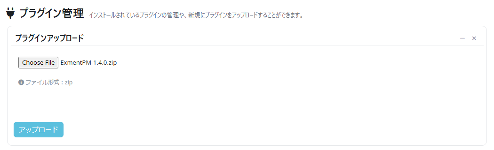
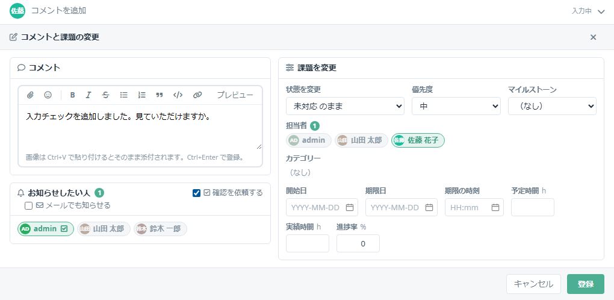
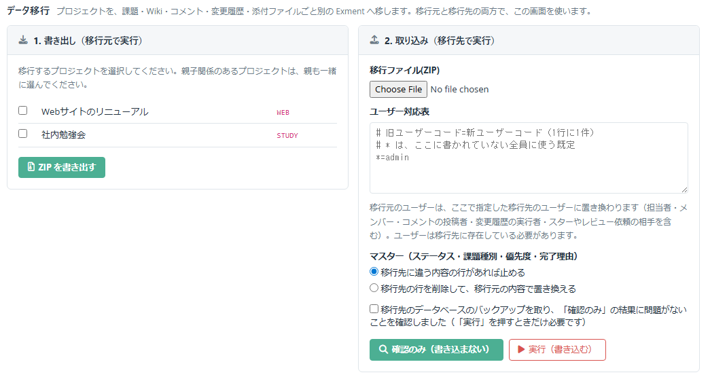

# Quản lý dự án (plugin chính thức)

"Quản lý dự án" (「プロジェクト管理」) là **plugin chính thức** của Exment do Exceed One phát triển, kiểm thử và hỗ trợ.  
Plugin quản lý dự án và ticket (công việc) trên chính các bảng của Exment. Miễn phí.

- Mã nguồn và tài liệu: [exceedone/exment-plugins (project-management)](https://github.com/exceedone/exment-plugins/tree/main/project-management)
- Giấy phép: GPL-3.0 (giống Exment)
- Trang giới thiệu: [Quản lý dự án (exment.net)](https://exment.net/vi/project-management/)
- Tên trong danh sách plugin: Exment Plugin PM（プロジェクト管理）. Tên tệp zip và tên nội bộ là `ExmentPM` (`PmPortal` đến 1.2.0, `ExmentPluginPM` ở 1.3.0).


?> Màn hình của plugin này chỉ có tiếng Nhật. Trên trang này, nhãn màn hình được ghi bằng tiếng Nhật kèm nghĩa tiếng Việt, ví dụ 「設定」 (cài đặt).

## Chức năng

| Chức năng | Nội dung |
| --- | --- |
| Dự án | Mỗi dự án có công việc, bảng, biểu đồ Gantt, wiki và tệp riêng. Thành viên có 3 loại: quản lý dự án, thành viên và người xem (dùng nhóm vai trò của Exment). |
| Công việc | Danh sách có lọc và lọc nhanh, cây cha/con, sửa trực tiếp trên danh sách, cập nhật hàng loạt, tệp đính kèm. Nội dung viết bằng Markdown và dán được ảnh. Sau khi lưu, danh sách và chi tiết được vẽ lại ngay tại chỗ, không tải lại cả trang (từ 1.6.5). Công việc cha và con có thể lồng đến 5 cấp (từ 1.7.18 / cần Exment 7.2.6). |
| Vai trò trên công việc | Ngoài người phụ trách: người phụ trách phụ, người quản lý, người review, và độ khó (dễ, bình thường, khó). Chi tiết công việc cũng hiện người tạo. Người phụ trách phụ, người quản lý và người review cũng nhận thông báo cập nhật như người phụ trách (từ 1.6.0). |
| Mốc (milestone) | Công việc theo từng mốc và biểu đồ burndown. |
| Bảng và biểu đồ Gantt | Hiển thị công việc trên bảng theo trạng thái, hoặc trên biểu đồ Gantt. |
| Wiki và tệp | Chia sẻ tài liệu của dự án bằng wiki và tệp. Tab 「ファイル」 có thể hiển thị không gian làm việc của máy chủ tệp Exment (từ 1.7.18 / cần Exment 7.2.6). |
| Word, Excel và PowerPoint | 「表示」 (xem) trên tệp của công việc, bình luận, wiki và dự án mở tệp ngay trên màn hình mà không cần tải về. Người có quyền sửa có thể sửa và lưu tại đó (từ 1.7.0 / 1.7.1; cần [Groupware](https://github.com/exceedone/exment-plugins/tree/main/groupware) 0.4.0 trở lên và trình duyệt hỗ trợ WebGPU). Nếu không có, tệp được tải về như trước. |
| Bình luận | Bình luận trên công việc. Chỉ định người cần báo (mention) hoặc nhờ xác nhận (review). |
| Đã đọc / chưa đọc | Biết ai đã đọc công việc. Công việc bạn chưa xem được tô màu trong danh sách. |
| Thông báo | Chuông trên màn hình, và email khi có công việc mới, bình luận, hoặc khi bấm nút "gửi email về công việc này" (gửi bằng thiết lập email của Exment). Mỗi người còn có thể nhận qua email, qua Teams hoặc cả hai (từ 1.7.18 / cần Exment 7.2.6). |
| Cài đặt | Trong ⚙ 設定 (cài đặt): cài đặt cổng và cập nhật cấu trúc dữ liệu. Quản trị viên hệ thống dùng được "Di chuyển dữ liệu": xuất dự án kèm bình luận, lịch sử và tệp đính kèm ra ZIP rồi nhập vào Exment khác (kiểm tra trước, rồi mới ghi). Công việc được nhập cũng hiện mã, URL và người tạo ở nơi gốc, cùng các thuộc tính tùy chỉnh (từ 1.5.0). |

## Yêu cầu
- Exment 7.0 trở lên (PHP 8.2 trở lên)
- Để gửi email, thiết lập email của Exment phải hoạt động ([Thiết lập gửi email](/vi/mailsend_setting)). Thông báo chuông không cần thiết lập.
- Màn hình chỉ có tiếng Nhật.

## Cài đặt
※Từ Exment v7.2.1, Quản lý dự án đi kèm Exment. Không cần tải xuống hay tải lên: bấm "Sử dụng (cài đặt)" ở "Plugin chính thức miễn phí" của "Cài đặt quản trị" → "Quản lý tính năng", rồi chuyển sang "[3. Thiết lập lần đầu](/vi/plugin_pm?id=_3-thiết-lập-lần-đầu)". Ngay sau khi cài từ Quản lý tính năng, menu bên trái chưa có 「プロジェクト管理」 (sẽ hiện sau khi thiết lập lần đầu). Chi tiết vui lòng xem [Plugin chính thức](/vi/plugin_official).


### 1. Tải xuống
Tải tệp zip mới nhất từ [Releases](https://github.com/exceedone/exment-plugins/releases) trên GitHub. Không giải nén.

- Bản mới nhất là `ExmentPM-(phiên bản).zip` trong "ExmentPM-v(phiên bản)" ở [Releases](https://github.com/exceedone/exment-plugins/releases).

※Không dùng nút xanh "Code → Download ZIP": đó là toàn bộ repository, Exment không đọc được.

※Trên Exment SaaS (`*.exments.com`) không cần tải gì. Xem [Trên Exment SaaS](/vi/plugin_pm?id=trên-exment-saas).

### 2. Tải lên
- Đăng nhập Exment bằng quản trị viên hệ thống.
- Mở "Cài đặt quản trị" → "Plugin", chọn tệp zip đã tải ở "Tải lên plugin" và bấm "Tải lên". Chi tiết vui lòng xem [Plugin](/vi/plugin?id=tải-lên-plugin).



- Khi "ExmentPM" hiện trong danh sách bên dưới là đã tải lên xong. Lúc này chưa có bảng hay menu nào.

### 3. Thiết lập lần đầu
- Bằng quản trị viên hệ thống, mở `/plugins/exment_pm` (với site có "/admin" trong URL là `/admin/plugins/exment_pm`).
- Màn hình 「初期セットアップ」 (thiết lập lần đầu) mở ra. Kiểm tra danh sách bảng sẽ tạo và bấm 「テーブルを作成する」 (tạo bảng).


- Nếu đã có bảng trùng tên, bảng đó hiện màu đỏ. Nhập 「テーブル名の接頭辞」 (tiền tố tên bảng, ví dụ `pm2_`) để tạo bảng với tên khác. Tên hiển thị trên màn hình vẫn giữ nguyên.
- Khi xong, dashboard của Quản lý dự án mở ra. Menu bên trái có thêm một mục 「プロジェクト管理」 (từ 1.4.1). Thường mở từ đó.
- Thiết lập cũng tạo:
    - Nhóm vai trò: プロジェクト管理者グループ (quản trị dự án), プロジェクトメンバーグループ (thành viên dự án), プロジェクト閲覧者グループ (người xem dự án)
    - Thông báo: 課題の登録・更新通知 (công việc được tạo / cập nhật, chuông)
    - Mức ưu tiên (至急 khẩn, 高 cao, 中 vừa, 低 thấp) và lý do hoàn thành (対応済み đã xử lý, 対応しない không xử lý, 無効 không hợp lệ, 重複 trùng, 再現しない không tái hiện, 保留 tạm hoãn)

※Chỉ quản trị viên hệ thống mới chạy được thiết lập.  
※Không tạo dự án hay công việc mẫu.

## Bắt đầu sử dụng

Lần đầu, hãy thiết lập theo thứ tự sau:

1. Đưa người dùng vào nhóm vai trò
2. Tạo dự án
3. Thêm thành viên vào dự án
4. Đổi trạng thái, loại… cho hợp với dự án (dùng nguyên cũng được)
5. Kiểm tra thông báo

### 1. Đưa người dùng vào nhóm vai trò
Mọi người dùng Quản lý dự án phải thuộc một trong các nhóm vai trò của nó. Người không thuộc nhóm nào sẽ không thấy menu 「プロジェクト管理」, và khi mở sẽ hiện 「権限がありません。」 (không có quyền). Quản trị viên hệ thống không cần bước này.

Ở "Cài đặt quản trị" → "Nhóm vai trò", thêm người dùng hoặc tổ chức vào các nhóm mà thiết lập đã tạo. Chi tiết xem [Nhóm vai trò](/vi/role_group).

| Nhóm vai trò | Tên (chữ và số) | Quyền |
| --- | --- | --- |
| プロジェクト管理者グループ (quản trị dự án) | `pm_admin_group` | Xem và sửa mọi dự án và công việc. Sửa được cả danh sách trạng thái, loại, mức ưu tiên… |
| プロジェクトメンバーグループ (thành viên dự án) | `pm_member_group` | Thêm và sửa công việc trong các dự án mình tham gia. |
| プロジェクト閲覧者グループ (người xem dự án) | `pm_viewer_group` | Chỉ xem các dự án mình tham gia. |


※Chỉ thuộc nhóm vai trò thì chưa thấy dự án nào. Hãy làm cả "3. Thêm thành viên vào dự án".

### 2. Tạo dự án
- Trên dashboard của Quản lý dự án, bấm 「＋プロジェクトの追加」 (thêm dự án). Nút này cũng có trong menu 「プロジェクト」 (dự án) ở trên.
- Nhập 「プロジェクト名」 (tên dự án) và 「プロジェクトキー」 (khóa dự án), rồi bấm 「作成する」 (tạo).
    - Khóa dự án đứng trước số công việc (ví dụ `WEB` thành `WEB-1`). Bắt đầu bằng chữ hoa, chỉ gồm chữ hoa, chữ số và `_`, tối đa 32 ký tự.
    - Chọn 「親プロジェクト」 (dự án cha) để xếp dự án thành cây.


- Sau đó, tab 「設定」 (cài đặt) của dự án mở ra. Người tạo dự án trở thành quản lý dự án.

※Ai thêm được dữ liệu vào bảng dự án thì tạo được dự án (quản trị viên hệ thống, nhóm quản trị dự án…).

### 3. Thêm thành viên vào dự án
Ở tab 「設定」 (cài đặt) của dự án → 「参加ユーザー」 (thành viên), chọn người tham gia và bấm 「保存する」 (lưu).

| Trường | Nội dung |
| --- | --- |
| プロジェクトマネージャ (quản lý dự án) | Người phụ trách. Thêm và sửa công việc, đổi cài đặt dự án. |
| メンバー（編集） (thành viên, sửa) | Thêm và sửa công việc. |
| 参照メンバー（閲覧） (người xem) | Chỉ xem. |
| メンバー組織（編集）・参照組織（閲覧） (tổ chức thành viên / tổ chức xem) | Mọi người trong tổ chức (nhóm) tham gia với cùng quyền. |


- Người bị bỏ khỏi danh sách sẽ không mở được dự án (kể cả công việc và wiki) ngay từ lúc lưu.
- Quản trị viên hệ thống và nhóm quản trị dự án mở được mọi dự án, kể cả khi không có trong danh sách.
- Cài đặt dự án do quản lý dự án và nhóm quản trị dự án (và quản trị viên hệ thống) thay đổi.

### 4. Danh sách trạng thái, loại… (dữ liệu chủ)
Các danh sách dùng cho công việc dùng được ngay. Có thể đổi tên, màu và thứ tự cho hợp với dự án.

| Danh sách | Theo | Đổi ở đâu | Giá trị ban đầu |
| --- | --- | --- | --- |
| 状態 (trạng thái) | dự án | 「設定」 của dự án → 「状態」 | 未対応 mới, 処理中 đang xử lý, レビュー中 đang review, 処理済み đã xử lý, 完了 hoàn thành |
| 種別 (loại) | dự án | 「設定」 của dự án → 「種別」 | タスク nhiệm vụ, バグ lỗi, 要望 yêu cầu, 改善 cải tiến, その他 khác |
| カテゴリー (danh mục) | dự án | 「設定」 của dự án → 「カテゴリー」 | (không có) |
| マイルストーン (mốc) | dự án | 「設定」 của dự án → 「マイルストーン」 | (không có) |
| 優先度 (mức ưu tiên) | mọi dự án | ⚙ プロジェクト管理の設定 → 「課題の選択肢」 | 至急, 高, 中, 低 |
| 完了理由 (lý do hoàn thành) | mọi dự án | ⚙ プロジェクト管理の設定 → 「課題の選択肢」 | 対応済み, 対応しない, 無効, 重複, 再現しない, 保留 |

- Trạng thái có đánh dấu 「完了扱い」 (tính là xong) được tính là xong trong burndown và khi kiểm tra quá hạn.
- Dòng đang được dùng thì không xóa được.


**⚙ プロジェクト管理の設定** (cài đặt Quản lý dự án) mở từ 「⚙ 設定」 ở góc trên bên phải của màn hình Quản lý dự án. Đây là cài đặt chung cho mọi dự án, chỉ quản trị viên hệ thống mở được (người khác không thấy 「⚙ 設定」).


### 5. Thông báo
Có 2 loại: chuông ở góc trên bên phải màn hình, và email.

**Chuông (tự đến, không cần làm gì)**
- Khi công việc được tạo, cập nhật hoặc có bình luận, chuông được gửi cho người phụ trách, người trong 「お知らせ先」 (người nhận thông báo) và người tạo công việc. Người thực hiện thay đổi thì không nhận.
- Chuông cũng đến người được chọn ở 「お知らせしたい人」 (người muốn báo) khi viết bình luận, và mọi người đang theo dõi công việc (「ウォッチ」).
- Viết `@` và tên thành viên trong bình luận để báo cho người đó (mention).
- Đánh dấu 「確認を依頼する」 (nhờ xác nhận) để gửi chuông 「【確認依頼】」 (nhờ xác nhận) cho người được chọn. Khi một người bấm 「確認しました」 (đã xác nhận), người viết bình luận nhận chuông.
- Người không xem được công việc thì không nhận gì.




**Email (chọn khi gửi)**  
Email không bao giờ tự gửi. Gửi bằng một trong các cách sau:
- Đánh dấu 「メールでも知らせる」 (báo cả qua email) khi đăng ký công việc hoặc bình luận. Người nhận chuông cũng nhận cùng nội dung qua email.
- Trên màn hình công việc, mở 「…その他」 (khác) → 「メールで知らせる」 (gửi email về công việc này), chọn người ở 「送る相手」 (người nhận) và bấm 「送信」 (gửi). Chỉ gửi đến người xem được công việc, kèm một phần nội dung và liên kết đến công việc.


- Email được gửi bằng thiết lập email của Exment. Hãy thiết lập [Thiết lập gửi email](/vi/mailsend_setting) trước.
- Người dùng không có địa chỉ email thì không nhận email.
- Thông báo chuông 「課題の登録・更新通知」 xem được ở màn hình [thiết lập thông báo](/vi/notify) của Exment.

### 6. AI và Git (chỉ khi dùng)
Cả hai ban đầu đều tắt. Quản lý dự án vẫn hoạt động tốt khi không dùng.

**AI tự điền**  
Biểu mẫu công việc có nút 「AI で自動入力」 (điền bằng AI). Nút này điền 「種別」 (loại), 「カテゴリー」 (danh mục) và 「優先度」 (mức ưu tiên) đang trống bằng AI. Người dùng kiểm tra và sửa được trước khi lưu.
- AI là TypeSafe, một dịch vụ bên ngoài. Tiêu đề và nội dung công việc được gửi đến máy chủ của TypeSafe. Địa chỉ email và số điện thoại được che trước khi gửi.
- Quản trị viên hệ thống nhập API key ở "Cài đặt quản trị" → "Plugin" → màn hình cài đặt của "Exment Plugin PM", mục 「AI 自動入力（TypeSafe）」 (nếu có biến môi trường máy chủ `TYPESAFE_KEY` thì dùng biến đó trước).
- Ở 「設定」 của dự án → 「AI 自動入力」, đánh dấu 「AI 自動入力を使う」 (dùng AI tự điền) và lưu. 「接続テスト」 (thử kết nối) để kiểm tra.
- Bật 「担当者も自動入力する」 (điền cả người phụ trách) thì người phụ trách đang trống cũng được điền. Người phụ trách được chọn theo quy tắc, không phải AI: người phụ trách mặc định của danh mục, nếu không thì thành viên đang có ít công việc mở nhất.


**Repository Git**  
Mỗi dự án có thể yêu cầu một repository Git (Gitea hoặc Forgejo).
- Quản trị viên máy chủ đặt máy chủ Git bằng biến môi trường (`PMPORTAL_GIT_PROVIDER`, `PMPORTAL_GIT_API_URL`, `PMPORTAL_GIT_API_TOKEN`…). Không đặt được trên màn hình.
- Ở 「設定」 của dự án → 「Git リポジトリ」, bấm 「Git を有効にする」 (bật Git). Quản lý dự án nhập 「リポジトリ名」 (tên repository) và bấm 「リポジトリの作成をリクエスト」 (yêu cầu tạo repository). Nếu không có máy chủ Git, yêu cầu ở trạng thái 「作成待ち」 (chờ tạo).
- Khi repository được tạo, mỗi người bấm 「HTTP クローン用パスワードを発行」 (cấp mật khẩu để clone qua HTTP). Mật khẩu chỉ hiện một lần.


## Cách sử dụng
Phần này viết theo màn hình của 1.7.18. Khi mở dự án, có các tab 「ホーム」 (trang chủ), 「ボード」 (bảng), 「課題」 (công việc), 「ガントチャート」 (biểu đồ Gantt), 「バーンダウン」 (burndown), 「Wiki」, 「ファイル」 (tệp) và 「設定」 (cài đặt). Wiki, tệp, biểu đồ (biểu đồ Gantt và burndown) và công việc cha/con có thể tắt ở 「設定」 của dự án → 「利用する機能」 (chức năng sử dụng). Tắt thì chỉ ẩn tab, dữ liệu không bị xóa.

### Công việc
**Danh sách (tab 「課題」)**
- Hàng trên cùng lọc theo trạng thái: 「すべて」 (tất cả), 「完了以外」 (chưa xong) và từng trạng thái của dự án, kèm số lượng.
- Lọc nhanh bên dưới thu hẹp danh sách thành 期限切れ (quá hạn), 今日・明日 (hôm nay và ngày mai), 自分が作成 (do tôi tạo), ウォッチ中 (đang theo dõi), 未読 (chưa đọc) và 確認待ち (chờ xác nhận).
- Cũng lọc được theo từ khóa, người phụ trách, loại, mốc, danh mục, đã đọc / chưa đọc, mức ưu tiên và 「自分の課題」 (công việc của tôi). 「検索条件を保存」 (lưu điều kiện tìm kiếm) thì lần sau mở với cùng điều kiện. 「保存した条件」 (điều kiện đã lưu) giữ được các điều kiện có đặt tên.
- 「CSV」 tải về mọi công việc đã lọc.
- Chọn các dòng để đổi cùng lúc (「一括更新」 cập nhật hàng loạt). Cũng sửa trực tiếp được trên danh sách.
- Công việc đã xong từ 30 ngày trở lên bị ẩn khỏi danh sách (lưu trữ). 「表示する」 (hiển thị) để hiện lại.

**Tạo công việc**
- Tạo từ 「課題の追加」 (thêm công việc) ở phía trên. Số công việc là khóa dự án và số (ví dụ `WEB-1`).

**Nội dung, bình luận và tệp đính kèm**
- Nội dung và bình luận viết theo 「テキスト整形のルール」 (quy tắc định dạng văn bản) của dự án: Markdown (mặc định) hoặc Backlog記法 (cú pháp Backlog). Có các nút tiêu đề, chữ đậm, danh sách, danh sách kiểm, bảng, liên kết…, và 「プレビュー」 (xem trước).
- Ảnh dán bằng `Ctrl+V` được đính kèm luôn. Tệp thì kéo thả hoặc dùng 「ファイルを添付」 (đính kèm tệp).
- Viết bình luận từ 「コメントを追加」 (thêm bình luận) ở cuối màn hình công việc. Cùng với bình luận, đổi được các trường bằng 「状態を変更」 (đổi trạng thái) và 「課題を変更」 (đổi công việc). `Ctrl+Enter` để đăng.
- Gõ `@` để chọn thành viên, `#` để chọn công việc, `~` để chọn tệp đính kèm.
- 「コメント・変更履歴」 (bình luận và lịch sử) chuyển được sang 「コメントのみ」 (chỉ bình luận).

**Đã đọc và chưa đọc**
- Công việc bạn chưa đọc được hiển thị là chưa đọc (chữ đậm) trong danh sách. Mở công việc thì nó thành đã đọc. Nhấp chuột phải vào một dòng để tự đánh dấu đã đọc hoặc chưa đọc. Trên màn hình công việc, bạn xem được ai đã đọc.
- Từ 1.7.18: công việc bạn mở từ danh sách vẫn ở trạng thái đã đọc khi quay lại danh sách. Dấu bạn vừa đặt (mở, hoặc tự đánh dấu) được giữ trong một phút dù danh sách được làm mới. Sau đó, câu trả lời của máy chủ được dùng trở lại.

### Công việc cha và công việc con
- Trong màn hình sửa công việc, bấm 「親課題を設定」 (đặt công việc cha), tìm theo khóa hoặc tiêu đề rồi chọn. Cũng tạo được từ 「子課題を追加」 (thêm công việc con) trên màn hình công việc.
- Màn hình của công việc cha có ô 「子課題」 (công việc con), cho biết đã xong bao nhiêu. 「ツリー」 (cây) của danh sách cũng xếp theo cha và con.
- Công việc cha phải thuộc cùng dự án.
- Công việc cha và con có thể lồng đến **5 cấp** (một công việc, con của nó, con của con đó ...) (từ 1.7.18 / cần Exment 7.2.6). Trước đây chỉ có 1 cấp.
- Số cấp là một thiết lập của plugin: trong thiết lập plugin, 「課題」 (công việc) > 「課題の階層の数」 (số cấp), từ 2 đến 10. Giá trị ban đầu là 5.
- Công việc cha chỉ bị từ chối trong hai trường hợp: tạo ra vòng lặp (đặt công việc dưới chính con của nó), hoặc làm công việc đó (hay công việc sâu nhất bên dưới) vượt quá số cấp. Thông báo cho biết là trường hợp nào. Màn hình chọn công việc cha chỉ hiển thị các công việc có thể chọn.
- Công việc có con có thể được chuyển xuống dưới công việc khác của cùng dự án. Các công việc con đi cùng, miễn là còn nằm trong số cấp. Chuyển sang dự án khác vẫn bị từ chối.
- Nếu giảm số cấp, các công việc đã sâu hơn vẫn giữ nguyên. Chỉ công việc cha mới được kiểm tra.
- 「ツリー」 (cây) của danh sách hiển thị mọi cấp (thụt lề, thu gọn/mở rộng). Công việc có con hiển thị 「子の進捗」 (tiến độ của con) N% bên cạnh tiến độ của chính nó: trung bình của các công việc bên dưới không có con, công việc đã xong tính là 100%. Chỉ để hiển thị, không được lưu.
- Biểu đồ Gantt hiển thị các cấp sâu hơn có thụt lề với Exment 7.2.6. Bảng (board) không đổi (thẻ hiển thị công việc cha).
- Công việc có con không xóa được, cũng không chuyển sang dự án khác được. Hãy bỏ cha của các công việc con trước.
- Khi dự án tắt 「親子課題」 (công việc cha/con), không đặt cha được.

### Bảng, biểu đồ Gantt, mốc và burndown
- **Bảng**: xếp công việc thành cột theo trạng thái. Kéo thẻ thì trạng thái đổi. Các cột lấy từ danh sách trạng thái của dự án. Dùng [chế độ xem Kanban](/vi/view_kanban) của Exment.
- **Biểu đồ Gantt**: thanh từ ngày bắt đầu đến ngày hạn. Màu theo trạng thái, tiến độ theo tỷ lệ tiến độ, gom theo mốc. Dùng [chế độ xem biểu đồ Gantt](/vi/view_gantt) của Exment.
- Bảng và biểu đồ Gantt dùng các chế độ xem của bảng công việc do thiết lập lần đầu tạo (「カンバン（状態別）」 và 「ガントチャート」). Nếu xóa chế độ xem, tab sẽ hiện hướng dẫn cách tạo.
- **Mốc**: tạo ở 「設定」 của dự án → 「マイルストーン」 và gắn vào công việc. 「ホーム」 hiện số ngày còn lại của từng mốc.
- **Burndown**: chọn mốc để xem số công việc còn lại bằng đường kế hoạch, đường thực tế và dự báo. Cũng cho biết với tốc độ hiện tại có kịp hạn không. Không hiện nếu không có công việc nào gắn mốc. Công việc ở trạng thái có 「完了扱い」 (tính là xong) được tính là xong.

### Thông báo
- Về chuông và email, xem "5. Thông báo" ở trên. Chuông tự đến, không cần làm gì; email gửi bằng 「メールでも知らせる」 hoặc 「メールで知らせる」.
- **Qua email hoặc Teams, cho từng người** (từ 1.7.18; Teams cần Exment 7.2.6): mỗi người chọn trong 「通知」 (Thông báo) ở thanh trên của cổng thông tin cách nhận thông báo về công việc (công việc mới, thay đổi, bình luận), ngoài chuông: qua email, qua Teams hoặc cả hai. Với người chưa chọn, thiết lập plugin 「受け取り方の初めの値」 (cách nhận ban đầu) sẽ quyết định (ban đầu chỉ có chuông).
- Email và tin nhắn Teams có cùng dạng: tiêu đề có khóa công việc in đậm (課題が更新されました（KEY）), liên kết đến công việc, tiêu đề công việc và nội dung thay đổi dưới dạng danh sách đánh số. Email là HTML (kèm phần văn bản) hoặc văn bản thuần, tùy thiết lập email của Exment. 「メールでも知らせる」 (gửi cả email) vẫn gửi email cho mọi người nhận chuông, cùng dạng.
- Teams cần Exment 7.2.6 trở lên. Bật "Thông báo Teams (trò chuyện cá nhân)" trong [Quản lý chức năng](/vi/feature) và nhập địa chỉ của workflow Teams trong thiết lập hệ thống (xem "[Thông báo đến trò chuyện cá nhân Teams](/vi/notify_teams)"). Với Exment cũ hơn, chỉ có email.

### Tệp và wiki
- **Tệp**: xem tệp đính kèm của công việc, wiki và dự án trong 1 danh sách (tên, người cập nhật, ngày cập nhật, vị trí). Tệp kéo thả vào đây được lưu thành tệp đính kèm của dự án.
- **Không gian làm việc của máy chủ tệp** (từ 1.7.18 / cần Exment 7.2.6): tab 「ファイル」 có thể hiển thị không gian làm việc của dự án trong [máy chủ tệp](/vi/file_server) của Exment (thư mục, tải lên, liên kết chia sẻ, phiên bản, tìm kiếm, sao chép liên kết, mở bằng Office) thay vì chỉ danh sách tệp đính kèm. Đây là một chức năng trong [Quản lý chức năng](/vi/feature), 「プロジェクト管理のファイル（ファイルサーバー）」, và tắt cho đến khi quản trị viên hệ thống bật. Chức năng máy chủ tệp phải dùng được.
- Quản lý dự án tạo không gian làm việc trong 「設定」 (thiết lập) của dự án > 「ファイルサーバー」 (máy chủ tệp), hoặc chọn một không gian mà họ quản lý. Mỗi dự án có một không gian làm việc. Ở site mà chỉ quản trị viên hệ thống được tạo không gian làm việc, quản trị viên tạo một cái và cấp quyền quản lý cho quản lý dự án; người này sau đó chọn nó.
- Quyền cấp cao nhất theo dự án: quản lý có quyền quản lý, thành viên và tổ chức thành viên được sửa, người xem và tổ chức xem chỉ được xem. Quyền được đặt lại mỗi khi người trong dự án thay đổi, và bằng nút 「権限をプロジェクトに合わせ直す」 (đặt lại quyền theo dự án). Thư mục có quyền riêng trong máy chủ tệp giữ nguyên quyền đó.
- Tab hiển thị chính các trang của máy chủ tệp. 「ファイルサーバーで開く」 (mở trong máy chủ tệp) mở ở kích thước đầy đủ. Tệp đính kèm của công việc, wiki và dự án vẫn được liệt kê bên dưới và không bị chuyển. Hủy liên kết thì không gian làm việc và tệp vẫn còn.
- Word, Excel và PowerPoint mở được bằng 「表示」 (xem) khi đã cài [Groupware](https://github.com/exceedone/exment-plugins/tree/main/groupware) (xem bảng ở "Chức năng").
- **Wiki**: tạo trang của dự án bằng 「追加」 (thêm). Trang có trang cha được xếp dưới trang cha theo hình cây trong danh sách bên trái. Có 「編集」 (sửa), 「履歴」 (lịch sử) và 「添付」 (đính kèm), và gắn được thẻ.

### Nhập từ Backlog (ExmentPMBacklog)
Plugin riêng "Exment Plugin PM Backlog 連携" (`ExmentPMBacklog`, 0.2.0) nhập công việc của một dự án Backlog vào một dự án của Quản lý dự án theo khoảng thời gian cố định. Backlog là bản gốc, và chỉ một chiều từ Backlog sang Exment (nội dung sửa trong Exment bị ghi đè bằng nội dung của Backlog).

- Yêu cầu: Quản lý dự án (ExmentPM) 1.7.7 trở lên. Để chạy theo khoảng thời gian cố định, cần [task schedule](/vi/additional_task_schedule).
- Cài đặt: tải lên tệp zip trong "ExmentPMBacklog-v(phiên bản)" ở [Releases](https://github.com/exceedone/exment-plugins/releases) tại "Cài đặt quản trị" → "Plugin".
- Nơi bắt đầu: `/plugins/exment_pm_backlog` (「Backlog 連携」). Chỉ quản trị viên hệ thống dùng được.
    1. Ở 「つながりを追加」 (thêm kết nối), nhập URL của space Backlog, API key, khóa dự án, dự án Exment để nhập vào và khoảng thời gian (từ 5 phút trở lên, ban đầu là 30 phút). API key được mã hóa khi lưu và không hiện trên màn hình.
    2. Ở 「割り付け」 (ánh xạ), khớp trạng thái, loại, mức ưu tiên, danh mục, mốc, lý do hoàn thành và người dùng của Backlog với của Exment. Cũng dùng được 「読み直して、足りない状態・種別・カテゴリー・マイルストーンを作る」 (đọc lại và tạo trạng thái, loại, danh mục, mốc còn thiếu). Người dùng được khớp theo địa chỉ email; người không khớp thì chọn trên màn hình.
    3. Thử bằng 「今すぐ同期」 (đồng bộ ngay; mỗi lần tối đa 100 công việc), nếu ổn thì bật 「決まった間隔で自動に取り込む」 (tự nhập theo khoảng thời gian cố định).
- Những gì được nhập: công việc (tiêu đề, chi tiết, trạng thái, loại, mức ưu tiên, danh mục, mốc, người phụ trách, ngày bắt đầu, ngày hạn, thời gian dự kiến và thực tế, lý do hoàn thành, công việc cha, thuộc tính tùy chỉnh), bình luận và tệp đính kèm (đến 20MB). Thời gian tạo, thời gian cập nhật và người tạo lấy theo Backlog. Người tạo… của Backlog cũng được giữ ở 「移行元」 (nơi gốc) của công việc.
- Khi nhập, không gửi thông báo.
- Người phụ trách không có trong Exment, hoặc không phải thành viên của dự án, được để trống, và tên được giữ ở 「移行元の担当者」 (người phụ trách ở nơi gốc).
- Công việc bị xóa trong Backlog không bị xóa khỏi Exment; một bình luận được để lại.
- Khi đồng bộ bắt đầu thất bại và khi hoạt động lại, quản trị viên hệ thống được báo bằng chuông.

## Cập nhật
- Tải tệp zip phiên bản mới và tải lên giống như khi cài. Plugin được thay thế; dữ liệu vẫn giữ nguyên.
- Bằng quản trị viên hệ thống, mở 「⚙ 設定」 của Quản lý dự án và xem 「データ構造の更新」 (cập nhật cấu trúc dữ liệu). Khi cần cập nhật, chỉ riêng quản trị viên thấy 「データ構造の更新があります」 (có cập nhật cấu trúc dữ liệu) ở phía trên màn hình (từ 1.6.4). Bấm vào thì màn hình cài đặt mở ra.
    - 「すでに最新の構造です。」 (đã mới nhất): không cần làm gì.
    - 「データ構造の更新が必要です。」 (cần cập nhật): sao lưu cơ sở dữ liệu, rồi bấm 「更新を実行する」 (chạy cập nhật). Cập nhật này không hoàn tác được.


※Trên Exment SaaS, xem thêm [Trên Exment SaaS](/vi/plugin_pm?id=trên-exment-saas).

### Chuyển lên 1.4.0 (nếu đang có PmPortal hoặc ExmentPluginPM)
Ở 1.4.0, tên nội bộ thành `ExmentPM` và địa chỉ thành `/plugins/exment_pm`. Với Exment đã có PmPortal (1.2.0 trở về trước) hoặc ExmentPluginPM (1.3.0), tải nguyên tệp zip lên sẽ dừng với thông báo "UUID đã tồn tại nhưng tên plugin không đúng". Hãy làm đúng 1 lần các bước trong ["Chuyển sang ExmentPM" (Moving to ExmentPM) của README](https://github.com/exceedone/exment-plugins/blob/main/project-management/README.md#moving-to-exmentpm-from-pmportal-or-exmentpluginpm--exmentpm-への移行). Liên kết và dấu trang đến địa chỉ cũ (`/plugins/pm_portal/...`) sẽ không mở được nữa.

※Trên Exment SaaS, bên vận hành làm cho tất cả các trang, nên bạn không cần làm gì.

※Từ v1.2.0, chức năng di chuyển dữ liệu nằm trong plugin này. Nếu trước đây đã cài riêng plugin di chuyển dữ liệu, có thể xóa nó ở "Cài đặt quản trị" → "Plugin" sau khi cập nhật.

## Di chuyển từ Exment khác
Có thể chuyển dự án kèm công việc, wiki, bình luận, lịch sử và tệp đính kèm sang Exment khác.  
Dùng 「データ移行」 (di chuyển dữ liệu) trong 「⚙ プロジェクト管理の設定」 ở cả nơi chuyển đi và nơi chuyển đến. **Chỉ quản trị viên hệ thống** dùng được.



### Trước khi bắt đầu
- Cài plugin này ở cả nơi chuyển đi và nơi chuyển đến, và làm xong thiết lập lần đầu. Nên dùng cùng phiên bản ở hai nơi.
- Ở nơi chuyển đến, các bảng dự án, công việc, wiki, mốc, danh mục và các bảng liên quan phải **trống** (số được giữ nguyên). Chức năng này dành cho việc chuyển vào một Exment mới chuẩn bị.
- Tạo người dùng ở nơi chuyển đến trước.
- Chỉ hỗ trợ MySQL và MariaDB.
- Sao lưu cơ sở dữ liệu của nơi chuyển đến.

### 1. Xuất (ở nơi chuyển đi)
- Đánh dấu các dự án cần chuyển. Với dự án cha và con, chọn cả dự án cha.
- Bấm 「ZIP を書き出す」 (xuất ZIP). Tệp `pm-migrate-ngày-giờ.zip` được tải về.
- Mật khẩu Git và nhật ký AI không được xuất.

### 2. Nhập (ở nơi chuyển đến)
1. Chọn tệp ZIP đã xuất ở 「移行ファイル(ZIP)」 (tệp di chuyển).
2. Ở 「ユーザー対応表」 (bảng ánh xạ người dùng), ghi mỗi người dùng nơi đi thành người dùng nào ở nơi đến: mỗi dòng một người, `mã người dùng cũ=mã người dùng mới`. Dòng `*=mã người dùng` dùng cho mọi người không có trong danh sách.
    ```
    yamada=t.yamada
    sato=h.sato
    *=admin
    ```
    Người phụ trách, thành viên, người viết bình luận, người trong lịch sử… được thay theo cách này. Mã người dùng không có ở nơi đến sẽ báo lỗi.
3. Ở 「マスター（ステータス・課題種別・優先度・完了理由）」 (dữ liệu chủ), chọn cách xử lý khi nơi đến có dòng khác nội dung:
    - 「移行先に違う内容の行があれば止める」 dừng lại (mặc định)
    - 「移行先の行を削除して、移行元の内容で置き換える」 xóa dòng ở nơi đến và dùng nội dung của nơi đi
4. Bấm 「確認のみ（書き込まない）」 (chỉ kiểm tra). Số dòng sẽ ghi, lỗi và cảnh báo được hiển thị.
5. Nếu ổn, đánh dấu 「移行先のデータベースのバックアップを取り、…確認しました」 (đã sao lưu cơ sở dữ liệu nơi đến và kiểm tra kết quả) và bấm 「実行（書き込む）」 (chạy).
    - Nếu có lỗi, không ghi gì cả.
    - Nếu lỗi giữa chừng, mọi thứ được hoàn tác.

※`@tên người dùng` viết trong bình luận không được đổi.  
※Quyền theo tổ chức không được chuyển. Hãy kiểm tra 「参加ユーザー」 (thành viên) của dự án ở nơi đến.

## Trên Exment SaaS
Trên Exment SaaS (`*.exments.com`), không cần tải xuống hay tải lên tệp zip.

1. Quản trị viên hệ thống của tenant bấm "Sử dụng (cài đặt)" của Quản lý dự án ở "Plugin chính thức miễn phí" của "Cài đặt quản trị" → "[Quản lý tính năng](/vi/feature)". Việc cài đặt và thiết lập lần đầu (tạo bảng) được làm tự động.
2. Mở 「プロジェクト管理」 trên menu bên trái (`/plugins/exment_pm`). Sau đó làm theo [Bắt đầu sử dụng](/vi/plugin_pm?id=bắt-đầu-sử-dụng).

- Địa chỉ là `https://(tên tenant).exments.com/plugins/exment_pm` (không có `/admin`).
- Bên vận hành cập nhật plugin lên phiên bản mới, và chạy luôn cập nhật cấu trúc dữ liệu. Quản trị viên tenant không cần bấm 「更新を実行する」.

## Câu hỏi thường gặp và lỗi hay gặp

### Menu không có 「プロジェクト管理」, hoặc hiện 「権限がありません。」 (không có quyền)
Người dùng chưa thuộc nhóm vai trò của Quản lý dự án. Quản trị viên hệ thống hãy thêm người dùng vào nhóm quản trị dự án, thành viên dự án hoặc người xem dự án ở "Cài đặt quản trị" → "Nhóm vai trò" ([Đưa người dùng vào nhóm vai trò](/vi/plugin_pm?id=_1-đưa-người-dùng-vào-nhóm-vai-trò)).

### Mở được màn hình nhưng không thấy dự án
Người dùng chưa có trong 「参加ユーザー」 (thành viên) của dự án. Quản lý dự án hoặc quản trị viên hệ thống hãy thêm ở 「設定」 → 「参加ユーザー」 và lưu.

### Menu có hai mục 「プロジェクト管理」
Bản cài mới từ 1.4.0 trở về trước tạo thêm một thư mục 「プロジェクト管理」 để mở các bảng bên trong (dự án, công việc, mốc, danh mục). Sau khi cập nhật lên 1.4.1 và bấm 「データ構造の更新」, thư mục này và các menu do plugin tạo sẽ bị xóa (menu do quản trị viên thêm vẫn giữ). Màn hình và dữ liệu của các bảng vẫn giữ nguyên.

### Không thấy 「⚙ 設定」
「⚙ 設定」 (cài đặt Quản lý dự án) chỉ hiện với quản trị viên hệ thống. Cài đặt của từng dự án nằm ở tab 「設定」 của dự án.

### Sau khi cập nhật, màn hình hiển thị sai hoặc không thấy chức năng mới
Kiểm tra 「⚙ 設定」 → 「データ構造の更新」. Nếu hiện 「データ構造の更新が必要です。」, hãy sao lưu cơ sở dữ liệu và bấm 「更新を実行する」. Từ 1.6.4, khi cần cập nhật, quản trị viên cũng thấy 「データ構造の更新があります」 ở phía trên màn hình.

### Không nhận được email
- Email không bao giờ tự gửi. Hãy đánh dấu 「メールでも知らせる」, hoặc dùng 「メールで知らせる」.
- Kiểm tra [Thiết lập gửi email](/vi/mailsend_setting) của Exment có hoạt động và người dùng có địa chỉ email.

### Bảng hiện màu đỏ khi thiết lập lần đầu
Đã có bảng trùng tên. Nhập 「テーブル名の接頭辞」 (tiền tố tên bảng) để tạo với tên khác.

### Liên kết cũ không mở được sau 1.4.0
Ở 1.4.0, địa chỉ đổi từ `/plugins/pm_portal` thành `/plugins/exment_pm` (với site có "/admin" trong URL, từ `/admin/plugins/pm_portal` thành `/admin/plugins/exment_pm`). Liên kết và dấu trang đến địa chỉ cũ sẽ báo "404 not found". Menu, chuông và email gửi mới dùng địa chỉ mới. Liên kết đã viết trong nội dung công việc, bình luận và wiki có thể viết lại bằng `tools/rewrite-old-links.php` trong [README](https://github.com/exceedone/exment-plugins/blob/main/project-management/README.md).

### Plugin có tên khác (PmPortal, ExmentPluginPM)
Đó là cùng một plugin. Tên đã đổi từ PmPortal (đến 1.2.0) sang ExmentPluginPM (1.3.0) và ExmentPM (từ 1.4.0). Để đưa Exment còn tên cũ lên 1.4.0, xem [Chuyển lên 1.4.0](/vi/plugin_pm?id=Chuyển-lên-1.4.0-nếu-đang-có-PmPortal-hoặc-ExmentPluginPM).

## Xem thêm
- [Plugin](/vi/plugin)
- [Nhóm vai trò](/vi/role_group)
- [Thiết lập gửi email](/vi/mailsend_setting)
- [Thông báo](/vi/notify)
- [README (GitHub)](https://github.com/exceedone/exment-plugins/blob/main/project-management/README.md)
