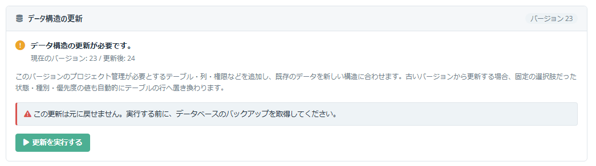

# Quản lý dự án (plugin chính thức)

"Quản lý dự án" (「プロジェクト管理」) là **plugin chính thức** của Exment do Exceed One phát triển, kiểm thử và hỗ trợ.  
Plugin quản lý dự án và ticket (công việc) trên chính các bảng của Exment. Miễn phí.

- Mã nguồn và tài liệu: [exceedone/exment-plugins (project-management)](https://github.com/exceedone/exment-plugins/tree/main/project-management)
- Giấy phép: GPL-3.0 (giống Exment)
- Trang giới thiệu: [Quản lý dự án (exment.net)](https://exment.net/vi/project-management/)
- Tên trong danh sách plugin: Exment Plugin PM（プロジェクト管理）. Tên tệp zip và tên nội bộ là `ExmentPM` (`PmPortal` đến 1.2.0, `ExmentPluginPM` ở 1.3.0).


?> Màn hình của plugin này chỉ có tiếng Nhật. Trên trang này, nhãn màn hình được ghi bằng tiếng Nhật kèm nghĩa tiếng Việt, ví dụ 「設定」 (cài đặt).

## Chức năng

| Chức năng | Nội dung |
| --- | --- |
| Dự án | Mỗi dự án có công việc, bảng, biểu đồ Gantt, wiki và tệp riêng. Thành viên gồm quản lý dự án, thành viên và người xem (dùng nhóm vai trò của Exment). |
| Công việc | Danh sách có lọc và lọc nhanh, cây cha/con, sửa trực tiếp trên danh sách, cập nhật hàng loạt, tệp đính kèm. Nội dung viết bằng Markdown và dán được ảnh. |
| Mốc (milestone) | Công việc theo từng mốc và biểu đồ burndown. |
| Bảng và biểu đồ Gantt | Hiển thị công việc trên bảng theo trạng thái, hoặc trên biểu đồ Gantt. |
| Wiki và tệp | Chia sẻ tài liệu của dự án bằng wiki và tệp. |
| Bình luận | Bình luận trên công việc. Chỉ định người cần báo (mention) hoặc nhờ xác nhận (review). |
| Đã đọc / chưa đọc | Biết ai đã đọc công việc. Công việc bạn chưa xem được tô màu trong danh sách. |
| Thông báo | Chuông trên màn hình, và email khi có công việc mới, bình luận, hoặc khi bấm nút "gửi email về công việc này" (gửi bằng thiết lập email của Exment). |
| Cài đặt | Trong ⚙ 設定 (cài đặt): cài đặt cổng và cập nhật cấu trúc dữ liệu. Quản trị viên hệ thống dùng được "Di chuyển dữ liệu": xuất dự án kèm bình luận, lịch sử và tệp đính kèm ra ZIP rồi nhập vào Exment khác (kiểm tra trước, rồi mới ghi). |

## Yêu cầu
- Exment 7.0 trở lên (PHP 8.2 trở lên)
- Để gửi email, thiết lập email của Exment phải hoạt động ([Thiết lập gửi email](/vi/mailsend_setting)). Thông báo chuông không cần thiết lập.
- Màn hình chỉ có tiếng Nhật.

## Cài đặt
※Từ Exment v7.2.0, Quản lý dự án đi kèm Exment. Không cần tải xuống hay tải lên: bấm "Use (install)" (dùng / cài đặt) ở "Free official plugins" của "Admin Setting" → "Feature Management", rồi chuyển sang "[3. Thiết lập lần đầu](/vi/plugin_pm?id=_3-thiết-lập-lần-đầu)" bên dưới. Ngay sau khi cài từ Feature Management, menu bên trái chưa có "Quản lý dự án" (sẽ hiện sau khi thiết lập lần đầu). Xem [Plugin chính thức](/vi/plugin_official). <!-- TODO: kiểm tra khi exment PR #1867 được đưa vào -->

### 1. Tải xuống
Tải tệp zip mới nhất từ [Releases](https://github.com/exceedone/exment-plugins/releases) trên GitHub. Không giải nén.

- Bản mới nhất là `ExmentPM-(phiên bản).zip` trong "ExmentPM-v(phiên bản)" ở [Releases](https://github.com/exceedone/exment-plugins/releases).

※Không dùng nút xanh "Code → Download ZIP": đó là toàn bộ repository, Exment không đọc được.

※Trên Exment SaaS (`*.exments.com`) không cần tải gì. Xem [Trên Exment SaaS](/vi/plugin_pm?id=trên-exment-saas).

### 2. Tải lên
- Đăng nhập Exment bằng quản trị viên hệ thống.
- Mở "Admin Setting" → "Plugin", chọn tệp zip đã tải ở "Plugin upload" (tải plugin lên) và bấm "Upload". Chi tiết xem [Plugin (English)](/plugin?id=plugin-upload).


- Khi "ExmentPM" hiện trong danh sách bên dưới là đã tải lên xong. Lúc này chưa có bảng hay menu nào.

### 3. Thiết lập lần đầu
- Bằng quản trị viên hệ thống, mở `/admin/plugins/exment_pm` (trên Exment SaaS là `/plugins/exment_pm`).
- Màn hình 「初期セットアップ」 (thiết lập lần đầu) mở ra. Kiểm tra danh sách bảng sẽ tạo và bấm 「テーブルを作成する」 (tạo bảng).


- Nếu đã có bảng trùng tên, bảng đó hiện màu đỏ. Nhập 「テーブル名の接頭辞」 (tiền tố tên bảng, ví dụ `pm2_`) để tạo bảng với tên khác. Tên hiển thị trên màn hình vẫn giữ nguyên.
- Khi xong, dashboard của Quản lý dự án mở ra. Menu bên trái có thêm một mục 「プロジェクト管理」 (từ 1.4.1). Thường mở từ đó.
- Thiết lập cũng tạo:
    - Nhóm vai trò: プロジェクト管理者グループ (quản trị dự án), プロジェクトメンバーグループ (thành viên dự án), プロジェクト閲覧者グループ (người xem dự án)
    - Thông báo: 課題の登録・更新通知 (công việc được tạo / cập nhật, chuông)
    - Mức ưu tiên (至急 khẩn, 高 cao, 中 vừa, 低 thấp) và lý do hoàn thành (対応済み đã xử lý, 対応しない không xử lý, 無効 không hợp lệ, 重複 trùng, 再現しない không tái hiện, 保留 tạm hoãn)

※Chỉ quản trị viên hệ thống mới chạy được thiết lập.  
※Không tạo dự án hay công việc mẫu.

## Bắt đầu sử dụng

Lần đầu, hãy thiết lập theo thứ tự sau:

1. Đưa người dùng vào nhóm vai trò
2. Tạo dự án
3. Thêm thành viên vào dự án
4. Đổi trạng thái, loại… cho hợp với dự án (dùng nguyên cũng được)
5. Kiểm tra thông báo

### 1. Đưa người dùng vào nhóm vai trò
Mọi người dùng Quản lý dự án phải thuộc một trong các nhóm vai trò của nó. Người không thuộc nhóm nào sẽ không thấy menu 「プロジェクト管理」, và khi mở sẽ hiện 「権限がありません。」 (không có quyền). Quản trị viên hệ thống không cần bước này.

Ở "Admin Setting" → "Role group", thêm người dùng hoặc tổ chức vào các nhóm mà thiết lập đã tạo. Chi tiết xem [Nhóm vai trò](/vi/role_group).

| Nhóm vai trò | Tên | Quyền |
| --- | --- | --- |
| プロジェクト管理者グループ (quản trị dự án) | `pm_admin_group` | Xem và sửa mọi dự án và công việc. Sửa được cả danh sách trạng thái, loại, mức ưu tiên… |
| プロジェクトメンバーグループ (thành viên dự án) | `pm_member_group` | Thêm và sửa công việc trong các dự án mình tham gia. |
| プロジェクト閲覧者グループ (người xem dự án) | `pm_viewer_group` | Chỉ xem các dự án mình tham gia. |


※Chỉ thuộc nhóm vai trò thì chưa thấy dự án nào. Hãy làm cả "3. Thêm thành viên vào dự án".

### 2. Tạo dự án
- Trên dashboard của Quản lý dự án, bấm 「＋プロジェクトの追加」 (thêm dự án). Nút này cũng có trong menu 「プロジェクト」 (dự án) ở trên.
- Nhập 「プロジェクト名」 (tên dự án) và 「プロジェクトキー」 (khóa dự án), rồi bấm 「作成する」 (tạo).
    - Khóa dự án đứng trước số công việc (ví dụ `WEB` thành `WEB-1`). Bắt đầu bằng chữ hoa, chỉ gồm chữ hoa, chữ số và `_`, tối đa 32 ký tự.
    - Chọn 「親プロジェクト」 (dự án cha) để xếp dự án thành cây.


- Sau đó, tab 「設定」 (cài đặt) của dự án mở ra. Người tạo dự án trở thành quản lý dự án.

※Ai thêm được dữ liệu vào bảng dự án thì tạo được dự án (quản trị viên hệ thống, nhóm quản trị dự án…).

### 3. Thêm thành viên vào dự án
Ở tab 「設定」 (cài đặt) của dự án → 「参加ユーザー」 (thành viên), chọn người tham gia và bấm 「保存する」 (lưu).

| Trường | Nội dung |
| --- | --- |
| プロジェクトマネージャ (quản lý dự án) | Người phụ trách. Thêm và sửa công việc, đổi cài đặt dự án. |
| メンバー（編集） (thành viên, sửa) | Thêm và sửa công việc. |
| 参照メンバー（閲覧） (người xem) | Chỉ xem. |
| メンバー組織（編集）・参照組織（閲覧） (tổ chức thành viên / tổ chức xem) | Mọi người trong tổ chức (nhóm) tham gia với cùng quyền. |


- Người bị bỏ khỏi danh sách sẽ không mở được dự án (kể cả công việc và wiki) ngay từ lúc lưu.
- Quản trị viên hệ thống và nhóm quản trị dự án mở được mọi dự án, kể cả khi không có trong danh sách.
- Cài đặt dự án do quản lý dự án và nhóm quản trị dự án (và quản trị viên hệ thống) thay đổi.

### 4. Danh sách trạng thái, loại… (dữ liệu chủ)
Các danh sách dùng cho công việc dùng được ngay. Có thể đổi tên, màu và thứ tự cho hợp với dự án.

| Danh sách | Theo | Đổi ở đâu | Giá trị ban đầu |
| --- | --- | --- | --- |
| 状態 (trạng thái) | dự án | 「設定」 của dự án → 「状態」 | 未対応 mới, 処理中 đang xử lý, レビュー中 đang review, 処理済み đã xử lý, 完了 hoàn thành |
| 種別 (loại) | dự án | 「設定」 của dự án → 「種別」 | タスク nhiệm vụ, バグ lỗi, 要望 yêu cầu, 改善 cải tiến, その他 khác |
| カテゴリー (danh mục) | dự án | 「設定」 của dự án → 「カテゴリー」 | (không có) |
| マイルストーン (mốc) | dự án | 「設定」 của dự án → 「マイルストーン」 | (không có) |
| 優先度 (mức ưu tiên) | mọi dự án | ⚙ プロジェクト管理の設定 → 「課題の選択肢」 | 至急, 高, 中, 低 |
| 完了理由 (lý do hoàn thành) | mọi dự án | ⚙ プロジェクト管理の設定 → 「課題の選択肢」 | 対応済み, 対応しない, 無効, 重複, 再現しない, 保留 |

- Trạng thái có đánh dấu 「完了扱い」 (tính là xong) được tính là xong trong burndown và khi kiểm tra quá hạn.
- Dòng đang được dùng thì không xóa được.


**⚙ プロジェクト管理の設定** (cài đặt Quản lý dự án) mở từ 「⚙ 設定」 ở góc trên bên phải của màn hình Quản lý dự án. Đây là cài đặt chung cho mọi dự án, chỉ quản trị viên hệ thống mở được (người khác không thấy 「⚙ 設定」).


### 5. Thông báo
Có 2 loại: chuông ở góc trên bên phải màn hình, và email.

**Chuông (tự đến, không cần làm gì)**
- Khi công việc được tạo, cập nhật hoặc có bình luận, chuông được gửi cho người phụ trách, người trong 「お知らせ先」 (người nhận thông báo) và người tạo công việc. Người thực hiện thay đổi thì không nhận.
- Chuông cũng đến người được chọn ở 「お知らせしたい人」 (người muốn báo) khi viết bình luận, và mọi người đang theo dõi công việc (「ウォッチ」).
- Viết `@` và tên thành viên trong bình luận để báo cho người đó (mention).
- Đánh dấu 「確認を依頼する」 (nhờ xác nhận) để gửi chuông 「【確認依頼】」 (nhờ xác nhận) cho người được chọn. Khi một người bấm 「確認しました」 (đã xác nhận), người viết bình luận nhận chuông.
- Người không xem được công việc thì không nhận gì.


**Email (chọn khi gửi)**  
Email không bao giờ tự gửi. Gửi bằng một trong các cách sau:
- Đánh dấu 「メールでも知らせる」 (báo cả qua email) khi đăng ký công việc hoặc bình luận. Người nhận chuông cũng nhận cùng nội dung qua email.
- Trên màn hình công việc, mở 「…その他」 (khác) → 「メールで知らせる」 (gửi email về công việc này), chọn người ở 「送る相手」 (người nhận) và bấm 「送信」 (gửi). Chỉ gửi đến người xem được công việc, kèm một phần nội dung và liên kết đến công việc.


- Email được gửi bằng thiết lập email của Exment. Hãy thiết lập [Thiết lập gửi email](/vi/mailsend_setting) trước.
- Người dùng không có địa chỉ email thì không nhận email.
- Thông báo chuông 「課題の登録・更新通知」 xem được ở màn hình [thông báo (English)](/notify) của Exment.

### 6. AI và Git (chỉ khi dùng)
Cả hai ban đầu đều tắt. Quản lý dự án vẫn hoạt động tốt khi không dùng.

**AI tự điền**  
Biểu mẫu công việc có nút 「AI で自動入力」 (điền bằng AI). Nút này điền 「種別」 (loại), 「カテゴリー」 (danh mục) và 「優先度」 (mức ưu tiên) đang trống bằng AI. Người dùng kiểm tra và sửa được trước khi lưu.
- AI là TypeSafe, một dịch vụ bên ngoài. Tiêu đề và nội dung công việc được gửi đến máy chủ của TypeSafe. Địa chỉ email và số điện thoại được che trước khi gửi.
- Quản trị viên hệ thống nhập API key ở "Admin Setting" → "Plugin" → cài đặt của "Exment Plugin PM", mục 「AI 自動入力（TypeSafe）」 (nếu có biến môi trường máy chủ `TYPESAFE_KEY` thì dùng biến đó trước).
- Ở 「設定」 của dự án → 「AI 自動入力」, đánh dấu 「AI 自動入力を使う」 (dùng AI tự điền) và lưu. 「接続テスト」 (thử kết nối) để kiểm tra.
- Bật 「担当者も自動入力する」 (điền cả người phụ trách) thì người phụ trách đang trống cũng được điền. Người phụ trách được chọn theo quy tắc, không phải AI: người phụ trách mặc định của danh mục, nếu không thì thành viên đang có ít công việc mở nhất.


**Repository Git**  
Mỗi dự án có thể yêu cầu một repository Git (Gitea hoặc Forgejo).
- Quản trị viên máy chủ đặt máy chủ Git bằng biến môi trường (`PMPORTAL_GIT_PROVIDER`, `PMPORTAL_GIT_API_URL`, `PMPORTAL_GIT_API_TOKEN`…). Không đặt được trên màn hình.
- Ở 「設定」 của dự án → 「Git リポジトリ」, bấm 「Git を有効にする」 (bật Git). Quản lý dự án nhập 「リポジトリ名」 (tên repository) và bấm 「リポジトリの作成をリクエスト」 (yêu cầu tạo repository). Nếu không có máy chủ Git, yêu cầu ở trạng thái 「作成待ち」 (chờ tạo).
- Khi repository được tạo, mỗi người bấm 「HTTP クローン用パスワードを発行」 (cấp mật khẩu để clone qua HTTP). Mật khẩu chỉ hiện một lần.


## Cập nhật
- Tải tệp zip phiên bản mới và tải lên giống như khi cài. Plugin được thay thế; dữ liệu vẫn giữ nguyên.
- Bằng quản trị viên hệ thống, mở 「⚙ 設定」 của Quản lý dự án và xem 「データ構造の更新」 (cập nhật cấu trúc dữ liệu).
    - 「すでに最新の構造です。」 (đã mới nhất): không cần làm gì.
    - 「データ構造の更新が必要です。」 (cần cập nhật): sao lưu cơ sở dữ liệu, rồi bấm 「更新を実行する」 (chạy cập nhật). Cập nhật này không hoàn tác được.



※Trên Exment SaaS, xem thêm [Trên Exment SaaS](/vi/plugin_pm?id=trên-exment-saas).

### Chuyển lên 1.4.0 (nếu đang có PmPortal hoặc ExmentPluginPM)
Ở 1.4.0, tên nội bộ thành `ExmentPM` và địa chỉ thành `/admin/plugins/exment_pm`. Với Exment đã có PmPortal (1.2.0 trở về trước) hoặc ExmentPluginPM (1.3.0), tải nguyên tệp zip lên sẽ dừng với lỗi "UUID tồn tại nhưng tên plugin không đúng". Hãy làm một lần các bước trong ["Moving to ExmentPM" của README](https://github.com/exceedone/exment-plugins/blob/main/project-management/README.md#moving-to-exmentpm-from-pmportal-or-exmentpluginpm--exmentpm-への移行). Liên kết và dấu trang đến địa chỉ cũ (`/admin/plugins/pm_portal/...`) sẽ không mở được nữa.

※Trên Exment SaaS, bên vận hành làm cho tất cả các trang, nên bạn không cần làm gì.

※Từ v1.2.0, chức năng di chuyển dữ liệu nằm trong plugin này. Nếu trước đây đã cài riêng plugin di chuyển dữ liệu, có thể xóa nó ở "Admin Setting" → "Plugin" sau khi cập nhật.

## Di chuyển từ Exment khác
Có thể chuyển dự án kèm công việc, wiki, bình luận, lịch sử và tệp đính kèm sang Exment khác.  
Dùng 「データ移行」 (di chuyển dữ liệu) trong 「⚙ プロジェクト管理の設定」 ở cả nơi chuyển đi và nơi chuyển đến. **Chỉ quản trị viên hệ thống** dùng được.


### Trước khi bắt đầu
- Cài plugin này ở cả nơi chuyển đi và nơi chuyển đến, và làm xong thiết lập lần đầu. Nên dùng cùng phiên bản ở hai nơi.
- Ở nơi chuyển đến, các bảng dự án, công việc, wiki, mốc, danh mục và các bảng liên quan phải **trống** (số được giữ nguyên). Chức năng này dành cho việc chuyển vào một Exment mới chuẩn bị.
- Tạo người dùng ở nơi chuyển đến trước.
- Chỉ hỗ trợ MySQL và MariaDB.
- Sao lưu cơ sở dữ liệu của nơi chuyển đến.

### 1. Xuất (ở nơi chuyển đi)
- Đánh dấu các dự án cần chuyển. Với dự án cha và con, chọn cả dự án cha.
- Bấm 「ZIP を書き出す」 (xuất ZIP). Tệp `pm-migrate-ngày-giờ.zip` được tải về.
- Mật khẩu Git và nhật ký AI không được xuất.

### 2. Nhập (ở nơi chuyển đến)
1. Chọn tệp ZIP đã xuất ở 「移行ファイル(ZIP)」 (tệp di chuyển).
2. Ở 「ユーザー対応表」 (bảng ánh xạ người dùng), ghi mỗi người dùng nơi đi thành người dùng nào ở nơi đến: mỗi dòng một người, `mã người dùng cũ=mã người dùng mới`. Dòng `*=mã người dùng` dùng cho mọi người không có trong danh sách.
    ```
    yamada=t.yamada
    sato=h.sato
    *=admin
    ```
    Người phụ trách, thành viên, người viết bình luận, người trong lịch sử… được thay theo cách này. Mã người dùng không có ở nơi đến sẽ báo lỗi.
3. Ở 「マスター（ステータス・課題種別・優先度・完了理由）」 (dữ liệu chủ), chọn cách xử lý khi nơi đến có dòng khác nội dung:
    - 「移行先に違う内容の行があれば止める」 dừng lại (mặc định)
    - 「移行先の行を削除して、移行元の内容で置き換える」 xóa dòng ở nơi đến và dùng nội dung của nơi đi
4. Bấm 「確認のみ（書き込まない）」 (chỉ kiểm tra). Số dòng sẽ ghi, lỗi và cảnh báo được hiển thị.
5. Nếu ổn, đánh dấu 「移行先のデータベースのバックアップを取り、…確認しました」 (đã sao lưu cơ sở dữ liệu nơi đến và kiểm tra kết quả) và bấm 「実行（書き込む）」 (chạy).
    - Nếu có lỗi, không ghi gì cả.
    - Nếu lỗi giữa chừng, mọi thứ được hoàn tác.

※`@tên người dùng` viết trong bình luận không được đổi.  
※Quyền theo tổ chức không được chuyển. Hãy kiểm tra 「参加ユーザー」 (thành viên) của dự án ở nơi đến.

## Trên Exment SaaS
Trên Exment SaaS (`*.exments.com`), bên vận hành cài và cập nhật plugin cho tất cả các trang. Người dùng không cần tải xuống, cài đặt hay cập nhật.

1. Đăng nhập bằng quản trị viên hệ thống và mở `/plugins/exment_pm`.
2. Nếu màn hình 「初期セットアップ」 (thiết lập lần đầu) hiện ra, hãy làm [thiết lập lần đầu](/vi/plugin_pm?id=_3-thiết-lập-lần-đầu). Sau đó làm theo [Bắt đầu sử dụng](/vi/plugin_pm?id=bắt-đầu-sử-dụng).

- Địa chỉ là `https://(tên tenant).exments.com/plugins/exment_pm` (không có `/admin`).
- Sau khi có phiên bản mới, nếu 「⚙ 設定」 hiện 「データ構造の更新が必要です。」 (cần cập nhật), hãy bấm 「更新を実行する」 (chạy cập nhật) như ở [Cập nhật](/vi/plugin_pm?id=cập-nhật). <!-- TODO: nhờ 10 kiểm tra -->

## Câu hỏi thường gặp và lỗi hay gặp

### Menu không có 「プロジェクト管理」, hoặc hiện 「権限がありません。」 (không có quyền)
Người dùng chưa thuộc nhóm vai trò của Quản lý dự án. Quản trị viên hệ thống hãy thêm người dùng vào nhóm quản trị dự án, thành viên dự án hoặc người xem dự án ở "Admin Setting" → "Role group" ([Đưa người dùng vào nhóm vai trò](/vi/plugin_pm?id=_1-Đưa-người-dùng-vào-nhóm-vai-trò)).

### Mở được màn hình nhưng không thấy dự án
Người dùng chưa có trong 「参加ユーザー」 (thành viên) của dự án. Quản lý dự án hoặc quản trị viên hệ thống hãy thêm ở 「設定」 → 「参加ユーザー」 và lưu.

### Menu có hai mục 「プロジェクト管理」
Bản cài mới từ 1.4.0 trở về trước tạo thêm một thư mục 「プロジェクト管理」 để mở các bảng bên trong (dự án, công việc, mốc, danh mục). Sau khi cập nhật lên 1.4.1 và bấm 「データ構造の更新」, thư mục này và các menu do plugin tạo sẽ bị xóa (menu do quản trị viên thêm vẫn giữ). Màn hình và dữ liệu của các bảng vẫn giữ nguyên.

### Không thấy 「⚙ 設定」
「⚙ 設定」 (cài đặt Quản lý dự án) chỉ hiện với quản trị viên hệ thống. Cài đặt của từng dự án nằm ở tab 「設定」 của dự án.

### Sau khi cập nhật, màn hình hiển thị sai hoặc không thấy chức năng mới
Kiểm tra 「⚙ 設定」 → 「データ構造の更新」. Nếu hiện 「データ構造の更新が必要です。」, hãy sao lưu cơ sở dữ liệu và bấm 「更新を実行する」. Các màn hình khác như dashboard không báo việc này.

### Không nhận được email
- Email không bao giờ tự gửi. Hãy đánh dấu 「メールでも知らせる」, hoặc dùng 「メールで知らせる」.
- Kiểm tra [Thiết lập gửi email](/vi/mailsend_setting) của Exment có hoạt động và người dùng có địa chỉ email.

### Bảng hiện màu đỏ khi thiết lập lần đầu
Đã có bảng trùng tên. Nhập 「テーブル名の接頭辞」 (tiền tố tên bảng) để tạo với tên khác.

### Liên kết cũ không mở được sau 1.4.0
Ở 1.4.0, địa chỉ đổi từ `/admin/plugins/pm_portal` thành `/admin/plugins/exment_pm` (trên Exment SaaS, từ `/plugins/pm_portal` thành `/plugins/exment_pm`). Liên kết và dấu trang đến địa chỉ cũ sẽ báo "404 not found". Menu, chuông và email gửi mới dùng địa chỉ mới. Liên kết đã viết trong nội dung công việc, bình luận và wiki có thể viết lại bằng `tools/rewrite-old-links.php` trong [README](https://github.com/exceedone/exment-plugins/blob/main/project-management/README.md).

### Plugin có tên khác (PmPortal, ExmentPluginPM)
Đó là cùng một plugin. Tên đã đổi từ PmPortal (đến 1.2.0) sang ExmentPluginPM (1.3.0) và ExmentPM (từ 1.4.0). Để đưa Exment còn tên cũ lên 1.4.0, xem [Chuyển lên 1.4.0](/vi/plugin_pm?id=chuyển-lên-140-nếu-đang-có-pmportal-hoặc-exmentpluginpm).

## Xem thêm
- [Plugin chính thức](/vi/plugin_official)
- [Plugin (English)](/plugin)
- [Nhóm vai trò](/vi/role_group)
- [Thiết lập gửi email](/vi/mailsend_setting)
- [Thông báo (English)](/notify)
- [README (GitHub)](https://github.com/exceedone/exment-plugins/blob/main/project-management/README.md)
