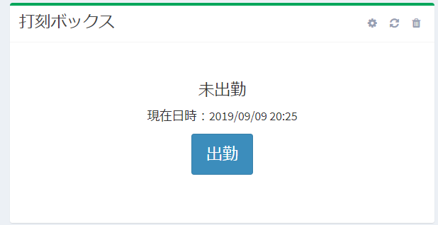

## Plugin (Bảng điều khiển)
Tạo được màn hình mới trên bảng điều khiển của Exment.  
Hãy dùng khi muốn có trang riêng làm một mục của bảng điều khiển.  
Trang này giải thích cách làm plugin (Bảng điều khiển), lấy ví dụ là các nút chấm công giờ vào ca và tan ca.  

## Mở đầu
Trang plugin của Exment được phát triển bằng framework PHP [Laravel](http://laravel.jp/) và thư viện màn hình quản trị [exment-admin-core](https://github.com/exceedone/exment-admin-core) (thư viện dựa trên laravel-admin / open-admin; ở v6.x trở về trước là laravel-admin).  
Khi phát triển trang, nên để người có kiến thức về Laravel phát triển.

## Cách tạo

### Mẫu
Ở đây, ta tạo trang sau làm mẫu.
- Tạo bảng để quản lý giờ vào ca và tan ca của người dùng.    
- Hiển thị các nút vào ca/tan ca, bắt đầu nghỉ, kết thúc nghỉ trên bảng điều khiển.   
- Khi bấm nút, giờ bấm được ghi vào dữ liệu.
  
   

※Hãy nhập trước mẫu (template) [tại đây](https://exment.net/downloads/sample/template/dakoku.zip).

- Plugin mẫu [tại đây](https://github.com/exment-git/plugin-sample/tree/main/dashboard/Dakoku)  

### Tạo config.json
- Tạo tệp config.json sau.  

~~~ json

{
    "plugin_name": "Dakoku",
    "plugin_view_name" : "Chấm công",
    "description": "Plugin để chấm công trên bảng điều khiển.",
    "uuid":  "691a24f2-2c7a-42c5-8cff-23c5277f6f22",
    "author":  "Kajitori",
    "version": "1.0.0",
    "plugin_type": "dashboard",
    "route": [
        {
            "uri": "post",
            "method": [
                "post"
            ],
            "function": "post"
        }
    ]
}

~~~

- plugin_name hãy ghi bằng chữ và số nửa độ rộng (half-width).
- uuid là chuỗi 32 ký tự cộng dấu gạch nối, tổng cộng 36 ký tự. Dùng để plugin là duy nhất.  
Hãy tạo từ URL sau, v.v.  
https://www.famkruithof.net/uuid/uuidgen
- plugin_type hãy ghi là dashboard.  
- route định nghĩa thành danh sách các endpoint của URL sẽ chạy, HTTP method của chúng và phương thức trong Controller.
    - uri: uri để hiển thị trang. URL thực tế là "http(s)://(URL của Exment)/dashboardbox/plugin/(URL đã thiết lập trên màn hình quản lý plugin)/(ID của mục trên bảng điều khiển)/(uri đã chỉ định)".  
    - method: HTTP method. Hãy ghi bằng get, post, put, delete.
    - function: phương thức trong Controller sẽ chạy
- Trong route nhất định phải có một mục có uri rỗng (""). Khi chuyển từ menu sang trang của plugin, endpoint này được truy cập.

> ※URL trên là của thiết lập chuẩn không có "/admin" (site mới cài từ v7.2.1). Nếu `ADMIN_ROUTE_PREFIX` trong `.env` có giá trị (site cài bằng phiên bản trước là "admin"), hãy thêm giá trị đó vào sau URL của site (ví dụ: `http(s)://(URL của Exment)/admin/dashboardbox/plugin/(URL đã thiết lập trên màn hình quản lý plugin)/(ID của mục trên bảng điều khiển)/(uri đã chỉ định)`). Chi tiết vui lòng xem [Đổi hoặc bỏ "admin" trong URL](/vi/additional_prefix).

### Tạo tệp Plugin

#### Tạo logic chính
Tạo tệp PHP như sau. Tên tệp là "Plugin.php".

~~~ php
<?php

//(1)
namespace App\Plugins\Dakoku;

use Exceedone\Exment\Services\Plugin\PluginDashboardBase;
use Exceedone\Exment\Model\CustomTable;

class Plugin extends PluginDashboardBase
{
    /**
     *
     * @return Content|\Illuminate\Http\Response
     */
    public function body()
    {
        if(is_null(CustomTable::getEloquent('dakoku'))){
            return 'Bảng chấm công chưa được cài đặt.';
        }
        
        $dakoku = $this->getDakoku();
        $status = $this->getStatus($dakoku);
        $params = $this->getStatusParams($status);

        // (3)
        return view('exment_dakoku::dakoku', [
            'dakoku' => $dakoku,
            'params' => $params,
            'action' => $this->getDashboardUri('post'),
        ]);
    }

    /**
     * Gửi
     *
     * @return void
     */
    public function post()
    {
        $dakoku = $this->getDakoku();
        
        $now = \Carbon\Carbon::now();

        if(!isset($dakoku)){
            $dakoku = CustomTable::getEloquent('dakoku')->getValueModel();
            $dakoku->setValue('target_date', $now->toDateString());
        }

        $status = null;
        switch(request()->get('action')){
            // Vào ca
            case 'syukkin':
                $dakoku->setValue('syukkin_time', $now);
                $status = 1;
                break;
            // Bắt đầu nghỉ
            case 'kyuukei_start':
                $dakoku->setValue('kyuukei_start_time', $now);
                $status = 11;
                break;
            // Kết thúc nghỉ
            case 'kyuukei_end':
                $dakoku->setValue('kyuukei_end_time', $now);
                $status = 21;
                break;
            // Tan ca
            case 'taikin':
                $dakoku->setValue('taikin_time', $now);
                $status = 99;
                break;
        }
        if(isset($status)){
            $dakoku->setValue('status', $status);
        }
        $dakoku->save();

        admin_toastr(trans('admin.save_succeeded'));
        return back();
    }

    /**
     * Lấy tình trạng chấm công hiện tại
     *
     * @return void
     */
    protected function getDakoku(){
        $table = CustomTable::getEloquent('dakoku');
        if(!isset($table)){
            return null;
        }
        
        
        // Lấy giờ hiện tại
        $now = \Carbon\Carbon::now();

        // Nếu trước giờ mốc thì coi là ngày hôm trước
        if($now->hour <= 4){
            $now = $now->addDay(-1);
        }

        // Lấy bản ghi chấm công tương ứng
        $query = getModelName('dakoku')::query();
        $query->where('value->target_date', $now->toDateString())
            ->where('created_user_id', \Exment::user()->base_user_id);

        $dakoku = $query->first();

        return $dakoku;
    }

    /**
     * Lấy trạng thái
     *
     * @param [type] $dakoku
     * @return int
     */
    protected function getStatus($dakoku){
        if(!isset($dakoku) || is_null($dakoku->getValue('syukkin_time'))){
            return 0;
        }

        return $dakoku->getValue('status');
    }

    protected function getStatusParams($status){
        switch($status){
            case 0:
                return 
                [
                    'status_text' => 'Chưa vào ca',
                    'buttons' => [
                        [
                        'button_text' => 'Vào ca',
                        'action_name' => 'syukkin',
                        ]
                    ]
                ];
            // Vào ca
            case 1:
                return  
                [
                    'status_text' => 'Đang làm việc',
                    'buttons' => [
                        [
                            'button_text' => 'Nghỉ giải lao',
                            'action_name' => 'kyuukei_start',
                        ], 
                        [
                            'button_text' => 'Tan ca',
                            'action_name' => 'taikin',
                        ], 
                    ]
                ];
        
            case 11:
                return 
                [
                    'status_text' => 'Đang nghỉ',
                    'buttons' => [
                        [
                            'button_text' => 'Kết thúc nghỉ',
                            'action_name' => 'kyuukei_end',
                        ], 
                    ]
                ];
            case 21:
                return 
                [
                    'status_text' => 'Đang làm việc',
                    'buttons' => [
                        [
                            'button_text' => 'Kết thúc nghỉ',
                            'action_name' => 'kyuukei_syuryo',
                        ], 
                    ]
                ]; 
                
            case 99:
                return 
                [
                    'status_text' => 'Tan ca',
                    'buttons' => [
                    ]
                ];
        }
    }
}
~~~
- (1) Namespace là **App\Plugins\\(tên plugin viết theo PascalCase)**. [Chi tiết xem tại đây](/vi/plugin_quickstart?id=namespace-của-tên-plugin)  
Ngoài ra, tên class là "Plugin" và kế thừa PluginDashboardBase.

- (2) Tên các phương thức public trong class là tên đã ghi ở function của config.json.  

- (3) Khi dùng view, hãy thêm tiền tố "exment_(tên plugin viết theo snake_case)::" vào tên view.  

- (4) Khi muốn lấy endpoint của plugin, hãy dùng hàm "$this->getDashboardUri('tên endpoint')".  
※Khi muốn lấy đường dẫn URL đầy đủ, hãy dùng admin_url($this->getDashboardUri('tên endpoint')).

#### (Tùy chọn) Về view
Khi tách view, hãy lưu tệp blade dưới thư mục "resources/views".  

#### (Tùy chọn) Về css, js và các tệp tĩnh khác
- Tệp css hãy đặt ở thư mục "public/css".  
- Tệp js hãy đặt ở thư mục "public/js".  
- Các tệp khác (tệp ảnh, v.v.) hãy đặt ở thư mục "public/assets".  

### Nén thành zip
Lấy 2 tệp trên làm cấu hình tối thiểu và nén thành zip.  
Tên tệp zip hãy đặt là "(plugin_name).zip".  
- Dakoku.zip
    - config.json
    - Plugin.php
    - (các tệp PHP, tệp ảnh cần thiết khác, v.v.)

### Khác
- Khi muốn hiển thị chi tiết dữ liệu của một giá trị ID cụ thể, hãy thêm nội dung như sau vào route của config.json.  
Có thể chỉ định uri như "{id}".  

~~~ json

{
    "route": [
        {
            "uri": "show_details/{id}",
            "method": [
                "get"
            ],
            "function": "show_details"
        }
    ]
}

~~~

## Đưa lên bảng điều khiển
Để hiển thị plugin đã tải lên trên bảng điều khiển, hãy làm các bước sau.  

1. Bấm "Mới" trên bảng điều khiển.  
Nếu đã tải lên plugin có loại "Bảng điều khiển", lựa chọn "Plugin" sẽ hiển thị.    
   

2. Nhập tên hiển thị và plugin đối tượng rồi gửi.
   

3. Mục đã chọn hiển thị trên bảng điều khiển.  
   

### Plugin mẫu
[Quản lý chấm công](https://github.com/exment-git/plugin-sample/tree/main/dashboard/Dakoku)  
※Hãy nhập [mẫu (template) này](https://exment.net/downloads/sample/template/dakoku.zip).
