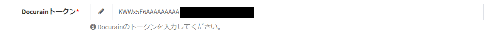

# Xuất tài liệu (Docurain)
Đây là cách xuất biểu mẫu chứng từ ra PDF bằng engine biểu mẫu trên cloud **Docurain**. Với Docurain, có thể phát triển biểu mẫu chỉ bằng Excel và json.

> Về xuất ở định dạng Excel, vui lòng xem [Plugin (xuất tài liệu)](/vi/plugin_quickstart_document).

## Docurain là gì
Docurain là engine biểu mẫu trên cloud, cho phép phát triển biểu mẫu chỉ bằng Excel và json.  
Có thể tạo biểu mẫu với nhiều kiểu bố cục từ template là tệp Excel. Cũng hỗ trợ xuất ở định dạng PDF.
[Site của Docurain tại đây](https://docurain.jp/)

> Docurain là dịch vụ do Root42 Inc. phát triển và vận hành.
Để sử dụng cần có license token. Phí được tính theo số lần xuất biểu mẫu. (Có thể phát hành token dùng thử.)
Kajitori Co., Ltd., công ty phát triển và vận hành Exment, là đại lý của Docurain. Yêu cầu dùng thử, đăng ký và câu hỏi, vui lòng gửi [tại đây](https://exment.net/docurain).

## Cách thực hiện
1. Tải [plugin Docurain](https://github.com/exment-git/plugin-sample/tree/main/docurain/Docurain).

2. Tải lên làm plugin của Exment.
Các bước vui lòng xem [tải plugin lên](/vi/plugin?id=tải-lên-plugin).

3. Sau khi tải lên, bấm vào dòng của plugin Docurain để vào màn hình cài đặt plugin.

  

4. Nhập các nội dung sau.

- Bảng mục tiêu: bảng là đối tượng chạy Docurain

  

- Token: token để chạy Docurain. Về việc phát hành token, vui lòng hỏi qua [trang liên hệ](https://exment.net/inquiry)

  

- Danh sách tên bảng và tên tệp biểu mẫu: hãy nhập tên bảng sẽ xuất biểu mẫu, tên tệp template, tên tệp biểu mẫu xuất ra và nhãn của nút, cách nhau bằng dấu phẩy. Nếu có nhiều, hãy ngăn cách bằng xuống dòng.
Lưu ý: không dùng được tiếng Nhật trong tên tệp template. (Dùng được trong tên tệp biểu mẫu và nhãn của nút)  
Lưu ý: nếu bỏ qua tên tệp biểu mẫu thì sẽ là tên tệp template.  
Lưu ý: nếu bỏ qua nhãn của nút thì sẽ là nhãn đã đặt chung cho plugin.  
Lưu ý: tên tệp biểu mẫu có thể chứa [tham số](/vi/params) như ngày tháng, v.v.

  

5. Đặt tệp Excel làm gốc cho biểu mẫu vào thư mục "documents" trong thư mục đã giải nén.
Khi tạo nhiều biểu mẫu bằng Docurain, hãy đặt nhiều tệp Excel vào documents.
Lưu ý: đường dẫn thư mục là "(thư mục gốc của dự án)/storage/app/plugins/Docurain/documents".
Lưu ý: cách tạo biểu mẫu vui lòng xem "Tạo tệp Excel template" ở dưới.

  
  

6. Khi xong các cài đặt đến đây, nút được hiển thị ở bảng đã chọn trong "Bảng mục tiêu".

  

7. Khi bấm nút, biểu mẫu được tạo.

  

### Tạo tệp Excel template
Tạo tệp Excel làm gốc cho biểu mẫu.  
Lưu ý: không dùng được tiếng Nhật trong tên tệp Excel. Phần mở rộng nhất định phải là xlsx.  
Lưu ý: tham số của tệp template khác với cách viết tham số thông thường của Exment. Cần cách viết riêng của Docurain.

#### Tham số
Đây là các tham số đặt trong tệp Excel template.
Khi nhập biến theo dạng quy định vào ô của Excel, lúc xuất biểu mẫu, biến được chuyển thành các giá trị khác nhau.

##### Giá trị hệ thống
| Mục | Mô tả |
| ---- | ---- |
| %{system.site_name} | Tên site của hệ thống |
| %{system.site_name_short} | Tên site của hệ thống (rút gọn) |
| %{system.system_mail_from} | Địa chỉ gửi của hệ thống |
| %{system.system_url} | URL trang chủ của hệ thống |
| %{system.login_url} | URL đăng nhập của hệ thống |

##### Dữ liệu
| Mục | Mô tả |
| ---- | ---- |
| %{id} | ID của dữ liệu đối tượng được đặt vào. (Ví dụ: 123) |
| %{suuid} | suuid của dữ liệu đối tượng (Short UUID, chuỗi ngẫu nhiên 20 ký tự) được đặt vào. |
| %{value_url} | Liên kết hiển thị dữ liệu đối tượng được đặt vào. |
| %{value.(tên cột)} | Giá trị cột của dữ liệu đối tượng được đặt vào. (Ví dụ: với dữ liệu người dùng, nếu ghi %{value.user_code} thì mã người dùng được đặt vào) |
| %{select_table.(tên cột).(tên cột của bảng được tham chiếu)} | Khi cột ứng với "tên cột" là "Lựa chọn (từ bảng khác)", "Người dùng" hoặc "Tổ chức", giá trị cột của bảng được tham chiếu được đặt vào. (Ví dụ: khi bảng "Thông tin hợp đồng (contract)" có cột "Khách hàng (client)" tham chiếu đến bảng "Thông tin khách hàng (client)", nếu đặt %{select_table.client.client_code} thì hiển thị được mã khách hàng (client_code) của bảng "Thông tin khách hàng (client)") |
| %{parent.(tên cột của bảng được tham chiếu)} | Giá trị cột của bảng cha được đặt vào. (Ví dụ: khi từ bảng "Thông tin chi tiết hợp đồng (contract_detail)" tham chiếu mã hợp đồng (contract_code) của bảng cha "Thông tin hợp đồng (contract)", nếu ghi %{parent.contract_code} thì mã hợp đồng được đặt vào) |
| $ENTITY.children.(tên bảng con) | Dùng cú pháp khối như "#foreach" để đặt thông tin của bảng con. Vì thông tin của bảng con có thể có nhiều dòng, nên không thể đặt theo kiểu %{children.(tên bảng con).(tên cột của bảng con)}. Một ví dụ được giải thích ở dưới. |

#### Ví dụ cài đặt
##### Quy tắc cơ bản
- Dùng được các hàm EXCEL và định dạng thông dụng.  
- Cột A là cột chỉ dùng để viết logic. Viết các cú pháp khối như #if, #foreach, #set, v.v.

##### Một ví dụ về template   

- PDF là kết quả xuất từ template trên.   

#### Tải template mẫu
[Thông tin người dùng](https://exment.net/downloads/product/plugin/Docurain/user.xlsx)  
[Thông tin phiên bản sản phẩm](https://exment.net/downloads/product/plugin/Docurain/product_version.xlsx)  
[Thông tin hợp đồng](https://exment.net/downloads/product/plugin/Docurain/contract.xlsx)  
Lưu ý: để dùng thông tin phiên bản sản phẩm và thông tin hợp đồng, cần nhập trước "mẫu dành cho công ty bán sản phẩm".

### Về lỗi
- Sau khi chạy xuất, có thể có lỗi được hiển thị.
Khi đó, hãy xem nội dung lỗi và xử lý.

- Lỗi có "HTTP status code" là "413" cần thay đổi giá trị cho phép của dịch vụ ở phía dịch vụ cloud của Docurain.
Khi đó, vui lòng liên hệ [tại đây](https://exment.net/docurain).
