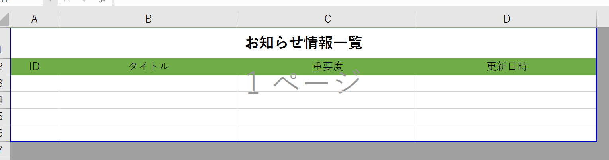

# Plugin (xuất)
Đây là plugin tự viết xử lý xuất danh sách dữ liệu tùy chỉnh.
Hãy dùng khi xuất tệp có định dạng riêng, hoặc khi thực hiện xử lý chuyển đổi đặc biệt.

> Chức năng này được thêm từ v3.2.0.

## Về định dạng xuất
Ngoài Excel, cũng có thể xuất theo các định dạng khác.
Lưu ý: với định dạng Excel, xử lý được tối ưu hơn.

## Cách tạo (thông thường)
Ở đây, chúng ta tạo plugin xuất danh sách thông tin thông báo theo định dạng csv không có header làm ví dụ.  
Lưu ý: điều kiện tiên quyết là cần có kiến thức về PHP và framework [Laravel](http://laravel.jp/).

### Tạo config.json
- Tạo tệp config.json như sau.  

~~~ json
{
    "plugin_name": "ExportTestCsv",
    "uuid": "1e7881d0-324f-11e9-b56e-0800200c9a33",
    "plugin_view_name": "ExportTestCsv",
    "description": "Thử xuất CSV.",
    "author": "Kajitori",
    "version": "0.0.1",
    "plugin_type": "export",
    "target_tables": "information",
    "label": "Xuất thông tin thông báo",
    "icon": "fa-question",
    "export_description": "Xuất danh sách thông tin thông báo theo định dạng csv riêng."
}
~~~

- plugin_name : tên plugin. Hãy nhập bằng chữ và số nửa độ rộng (half-width).
- uuid : chuỗi dùng để phân biệt plugin. Gồm 32 ký tự và các dấu gạch nối, tổng cộng 36 ký tự. Không được trùng với plugin khác.  
Có thể tạo ở URL sau, v.v.  
https://www.famkruithof.net/uuid/uuidgen
- plugin_type : hãy nhập export.  
- target_tables : hãy nhập tên bảng là đối tượng xuất. Nếu có nhiều bảng, hãy nhập cách nhau bằng dấu phẩy.  
- label : tiêu đề hiển thị trong hộp thoại xuất.
- icon : biểu tượng hiển thị trong hộp thoại xuất.    
- export_description : mô tả hiển thị trong hộp thoại xuất.

Lưu ý: target_tables, label, icon, export_description có thể đổi sau trên màn hình.

### Tạo tệp PHP
- Tạo tệp PHP như sau. Hãy đặt tên là "Plugin.php".

~~~ php
<?php
namespace App\Plugins\ExportTestCsv;

use Exceedone\Exment\Services\Plugin\PluginExportBase;

class Plugin extends PluginExportBase
{
    /**
     * execute
     */
    public function execute() 
    {
        // Lưu ý: lấy tệp tmp tạm thời bằng method "$this->getTmpFullPath()"
        // Lưu ý: sau khi chạy, tệp tmp tạm thời được tự động xóa.
        $tmp = $this->getTmpFullPath();

        ///// Xử lý tự viết --- từ đây
        // Mở tệp csv
        $fp = fopen($tmp, 'w');

        // Lấy danh sách dữ liệu với tất cả cột hệ thống và cột tùy chỉnh (mảng)
        $data = $this->getData();

        // Lấy danh sách dữ liệu theo dạng chế độ xem (mảng)
        // $data = $this->getViewData();

        // Lấy danh sách dữ liệu dưới dạng Collection của CustomValue
        // $data = $this->getRecords();

        foreach ($data as $fields) {
            fputcsv($fp, $fields);
        }

        fclose($fp);
        ///// Xử lý tự viết --- đến đây

        // Trả về chuỗi string của $tmp
        return $tmp;
    }

    /**
     * Get download file name.
     * Lấy tên tệp
     *
     * @return string
     */
    public function getFileName() : string {
        return "test.csv";
    }
}

~~~
- namespace hãy đặt là **App\Plugins\\(tên plugin viết theo kiểu Pascal case)**. [Chi tiết xem tại đây](/vi/plugin_quickstart?id=namespace-của-tên-plugin)

- Class Plugin cần kế thừa class PluginExportBase.  

### Nén thành zip
Nén thành zip với cấu hình tối thiểu là 2 tệp trên.  
- ExportTestCsv.zip
    - config.json
    - Plugin.php

### Tải lên
Tải plugin lên.  
Lưu ý: cách tải lên vui lòng xem [Plugin](/vi/plugin).  

### Cách chạy xuất
- Trên màn hình của target_tables đã đăng ký ở màn hình quản lý plugin, khi bấm nút "Nhập/Xuất", ô chọn plugin đã tải lên được hiển thị.  

  

- Khi bấm nút "Xuất" của plugin đã đăng ký, xử lý xuất được chạy theo nội dung của hàm execute trong Plugin.php.  

## Cách tạo (Excel)
Khi xuất theo định dạng Excel, các bước cơ bản vẫn giống vậy. Riêng việc tạo tệp PHP có thể viết tiện hơn.
Lưu ý: các bước ngoài "Tạo tệp PHP" giống với "Cách tạo (thông thường)".
Lưu ý: có dùng thư viện thao tác Excel bằng PHP [PhpSpreadsheet](https://github.com/PHPOffice/PhpSpreadsheet). 
  
Ở đây, lấy ví dụ là các bước xuất thông tin thông báo theo tệp template mẫu sau.  

  

### Tạo tệp PHP
- Tạo tệp PHP như sau. Hãy đặt tên là "Plugin.php".

~~~ php
<?php
namespace App\Plugins\ExportTestExcel;

// Đổi thành PluginExportExcel
use Exceedone\Exment\Services\Plugin\PluginExportExcel;

// Đổi extends thành PluginExportExcel
class Plugin extends PluginExportExcel
{
    /**
     * execute
     */
    public function execute() {
        // Đọc tệp template và khởi tạo PhpSpreadsheet
        $spreadsheet = $this->initializeExcel('template.xlsx');
        // Lưu ý: khi không dùng tệp template mà tạo tệp mới
        // $spreadsheet = $this->initializeExcel();

        // Lấy danh sách dữ liệu với tất cả cột hệ thống và cột tùy chỉnh (mảng)
        // $data = $this->getData();

        // Lấy danh sách dữ liệu theo dạng chế độ xem (mảng)
        // $data = $this->getViewData();

        // Lấy danh sách dữ liệu dưới dạng Collection của CustomValue
        $data = $this->getRecords();

        ///// Xử lý tự viết --- từ đây
        $sheet = $spreadsheet->getActiveSheet();
        $column = 3;
        foreach($data as $record){

            // Lặp qua dữ liệu và đặt giá trị
            $sheet->setCellValue("A{$column}", $record->id); // ID
            $sheet->setCellValue("B{$column}", $record->getValue('title', true)); // Tiêu đề
            $sheet->setCellValue("C{$column}", $record->getValue('priority', true)); // Mức độ quan trọng
            $sheet->setCellValue("D{$column}", $record->updated_at); // Ngày giờ cập nhật

            $column++;
        }
    
        // Cài đặt đường viền
        $laseRow = $column - 1;
        $sheet->getStyle("A2:D{$laseRow}")->applyFromArray([
            'borders' => [
                'outside'=>[
                    'borderStyle'=>\PhpOffice\PhpSpreadsheet\Style\Border::BORDER_THIN
                ],
                'inside'=>[
                    'borderStyle'=>\PhpOffice\PhpSpreadsheet\Style\Border::BORDER_HAIR
                ],
            ],
        ]);
        
        // Cài đặt vùng in
        $sheet->getPageSetup()->setPrintArea("A1:D{$laseRow}");
        ///// Xử lý tự viết --- đến đây

        // Lưu tệp đã tạo vào tệp tmp rồi trả về đường dẫn của tệp đó
        // (lưu thành tệp khác với template)
        return $this->getExcelResult($spreadsheet);
    }

    /**
     * Get download file name.
     *
     * @return string
     */
    public function getFileName() : string {
        return "test.xlsx";
    }
}

~~~

### Nén thành zip
Nén các tệp thành zip với cấu hình tối thiểu.  
- ExportTestExcel.zip
    - config.json
    - Plugin.php
    - template.xlsx (khi kèm tệp template)

### Các hạn chế khác
- PhpSpreadSheet 1.22.0, bản mới nhất (tính đến 25/02/2022), không hỗ trợ các nội dung sau. Vui lòng không đưa vào template.  
    - Hình vẽ được chèn vào
    - Biểu đồ
    - Bảng đã được "định dạng dưới dạng bảng" (Format as Table)

- Nếu tệp xuất ra không có hình ảnh, vui lòng xem mục "Xuất tài liệu dùng Excel làm template bị lỗi khi xuất hình ảnh" trong [Xử lý sự cố](/vi/troubleshooting).

## Plugin mẫu
- [Plugin xuất ra CSV](https://github.com/exment-git/plugin-sample/tree/main/export/ExportTestCsv)
- [Plugin xuất ra Excel](https://github.com/exment-git/plugin-sample/tree/main/export/ExportTestExcel)
