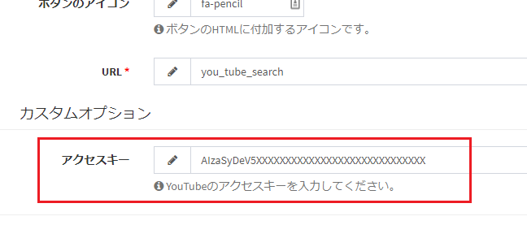

## Plugin (Trang)
Tạo được màn hình mới trong Exment.  
Hãy dùng khi muốn có trang hoàn toàn khác với chức năng chuẩn.  
Trang này giải thích cách làm plugin (Trang), lấy ví dụ là trang tìm kiếm YouTube.  

## Mở đầu
Trang plugin của Exment được phát triển bằng framework PHP [Laravel](http://laravel.jp/) và thư viện màn hình quản trị [exment-admin-core](https://github.com/exceedone/exment-admin-core) (thư viện dựa trên laravel-admin / open-admin; ở v6.x trở về trước là laravel-admin).  
Khi phát triển trang, nên để người có kiến thức về Laravel phát triển.

※Các class của thư viện màn hình quản trị được ghi bằng namespace của Exment v7.0.0 trở đi ("ExmentAdminCore\Admin").  
Nếu dùng v6.x trở về trước, hãy đọc thay thành "Encore\Admin". Chi tiết vui lòng xem [tại đây](/update/v7_0_0).

## Cách tạo

### Mẫu
Ở đây, ta tạo trang sau làm mẫu.
- Hiển thị thanh tìm kiếm để tìm dữ liệu trên YouTube.  
- Tìm kiếm YouTube bằng giá trị đã nhập và hiển thị 20 kết quả đầu.  
- Với video được bấm nút "Đăng ký", đăng ký ID video, tiêu đề, mô tả, liên kết, số lượt xem, số lượt thích, số lượt không thích vào bảng "YouTube".  

   

※Để chạy, cần access key của YouTube. Hãy tham khảo [tại đây](https://qiita.com/shinkai_/items/10a400c25de270cb02e4) (tiếng Nhật) để lấy key.  
  
※Hãy nhập trước mẫu (template) [tại đây](https://exment.net/downloads/sample/template/YouTube.zip).

- Plugin mẫu [tại đây](https://github.com/exment-git/plugin-sample/tree/main/page/YouTubeSearch)  

### Tạo config.json
- Tạo tệp config.json sau.  

~~~ json

{
    "plugin_name": "YouTubeSearch",
    "plugin_view_name" : "Tìm kiếm YouTube",
    "description": "Tìm kiếm YouTube và lưu số lượt xem, v.v. thành dữ liệu.",
    "uuid":  "c6d8daa0-c255-11e9-bb97-0800200c9a66",
    "author":  "(Your Name)",
    "version": "1.0.0",
    "plugin_type": "page",
    "route": [
        {
            "uri": "",
            "method": [
                "get"
            ],
            "function": "index"
        },
        {
            "uri": "list",
            "method": [
                "get"
            ],
            "function": "list"
        },
        {
            "uri": "save",
            "method": [
                "post"
            ],
            "function": "save"
        }
    ]
}

~~~

- plugin_name hãy ghi bằng chữ và số nửa độ rộng (half-width).
- uuid là chuỗi 32 ký tự cộng dấu gạch nối, tổng cộng 36 ký tự. Dùng để plugin là duy nhất.  
Hãy tạo từ URL sau, v.v.  
https://www.famkruithof.net/uuid/uuidgen
- plugin_type hãy ghi là page.  
- route định nghĩa thành danh sách các endpoint của URL sẽ chạy, HTTP method của chúng và phương thức trong Controller.
    - uri: uri để hiển thị trang. URL thực tế là "http(s)://(URL của Exment)/plugins/(URL đã thiết lập trên màn hình quản lý plugin)/(uri đã chỉ định)".  
    - method: HTTP method. Hãy ghi bằng get, post, put, delete.
    - function: phương thức trong Controller sẽ chạy
    - Ví dụ: nếu URL đã thiết lập trên màn hình quản lý plugin là "youtube_search", uri chỉ định trong config.json là "list", method chỉ định là "get", thì là "http(s)://(URL của Exment)/plugins/youtube_search/list (method: GET)".
- Trong route nhất định phải có một mục có uri rỗng (""). Khi chuyển từ menu sang trang của plugin, endpoint này được truy cập.

> ※URL trên là của thiết lập chuẩn không có "/admin" (site mới cài từ v7.2.1). Nếu `ADMIN_ROUTE_PREFIX` trong `.env` có giá trị (site cài bằng phiên bản trước là "admin"), hãy thêm giá trị đó vào sau URL của site (ví dụ: `http(s)://(URL của Exment)/admin/plugins/youtube_search/list`). Chi tiết vui lòng xem [Đổi hoặc bỏ "admin" trong URL](/vi/additional_prefix).

### Tạo tệp Plugin

#### Tạo logic chính
Tạo tệp PHP như sau. Tên tệp là "Plugin.php".

~~~ php
<?php

// (1)
namespace App\Plugins\YouTubeSearch;

use ExmentAdminCore\Admin\Widgets\Box;
use Exceedone\Exment\Model\CustomTable;
use Exceedone\Exment\Services\Plugin\PluginPageBase;
use GuzzleHttp\Client;

class Plugin extends PluginPageBase
{
    // (3)
    protected $useCustomOption = true;

    /**
     * (2) Index
     *
     * @return void
     */
    public function index()
    {
        return $this->getIndexBox();
    }

    /**
     * (2) Hiển thị danh sách kết quả YouTube
     *
     * @return void
     */
    public function list()
    {
        $html = $this->getIndexBox()->render();

        // Tìm theo chuỗi
        $client = new Client([
            'base_uri' => 'https://www.googleapis.com/youtube/v3/',
        ]);

        $method = 'GET';
        $uri = "search?part=id&type=video&maxResults=20&key=" . $this->plugin->getCustomOption('access_key') 
            . "&q=" . urlencode(request()->get('youtube_search_query')); // tìm kiếm
        $options = [];
        $response = $client->request($method, $uri, $options);

        $list = json_decode($response->getBody()->getContents(), true);
        $ids = collect(array_get($list, 'items', []))->map(function($l){
            return array_get($l, 'id.videoId');
        })->toArray();

        // Tìm chi tiết theo id
        $client = new Client([
            'base_uri' => 'https://www.googleapis.com/youtube/v3/',
        ]);

        $method = 'GET';
        $uri = "videos?part=id,snippet,statistics&key=" . $this->plugin->getCustomOption('access_key') 
            . "&id=" . implode(',', $ids); // tìm kiếm
        $options = [];
        $response = $client->request($method, $uri, $options);

        $list = json_decode($response->getBody()->getContents(), true);
        
        $html .= new Box("Kết quả tìm kiếm YouTube", view('exment_you_tube_search::list', [
            'items' => array_get($list, 'items', []),
            // (5)
            'item_action' => $this->plugin->getRouteUri('save'),
        ])->render());

        return $html;
    }

    /**
     * (2) Lưu dữ liệu
     *
     * @return void
     */
    public function save(){
        $request = request();
        $model = CustomTable::getEloquent('youtube')->getValueModel();
        $model->setValue('youtubeId', $request->get('youtubeId'));
        $model->setValue('description', $request->get('description'));
        $model->setValue('viewCount', $request->get('viewCount'));
        $model->setValue('likeCount', $request->get('likeCount'));
        $model->setValue('dislikeCount', $request->get('dislikeCount'));
        $model->setValue('url', $request->get('url'));
        $model->setValue('title', $request->get('title'));
        $model->setValue('publishedAt', $request->get('publishedAt'));
        $model->save();

        admin_toastr(trans('admin.save_succeeded'));
        return redirect()->back()->withInput();
    }

    /**
     * Lấy ô tìm kiếm
     *
     * @return void
     */
    protected function getIndexBox(){
        // (3) Kiểm tra access key của YouTube
        $hasKey = !is_null($this->plugin->getCustomOption('access_key'));

        // (4)
        return new Box("Tìm kiếm YouTube", view('exment_you_tube_search::index', [
            'action' => $this->plugin->getRouteUri('list'),
            'youtube_search_query' => request()->get('youtube_search_query'),
            'hasKey' => $hasKey,
        ]));
    }
    
    /**
     * (3) Tùy chọn thiết lập trên màn hình chỉnh sửa plugin. Cho nhập access key
     *
     * @param [type] $form
     * @return void
     */
    public function setCustomOptionForm(&$form)
    {
        $form->text('access_key', 'Access key')
            ->help('Hãy nhập access key của YouTube.');
    }
}
~~~

- (1) Namespace là **App\Plugins\\(tên plugin viết theo PascalCase)**. [Chi tiết xem tại đây](/vi/plugin_quickstart?id=namespace-của-tên-plugin)  
Ngoài ra, tên class là "Plugin" và kế thừa PluginPageBase.

- (2) Tên các phương thức public trong class là tên đã ghi ở function của config.json.  

- (3) Hàm "public function setCustomOptionForm(&$form)" là các mục hiển thị trên màn hình cài đặt của plugin.  
Trong trường hợp này, access key cần để chạy YouTube Data API thiết lập được từ màn hình.  

※Để dùng thiết lập tùy chỉnh, hãy thêm "protected $useCustomOption = true;".  
※Để lấy giá trị đã thiết lập, hãy dùng hàm "$this->plugin->getCustomOption('tên tham số')".

- (4) Khi dùng view, hãy thêm tiền tố "exment_(tên plugin viết theo snake_case)::" vào tên view.  

- (5) Khi muốn lấy endpoint của plugin, hãy dùng hàm "$this->getRouteUri('tên endpoint')".  
※Khi muốn lấy đường dẫn URL đầy đủ, hãy dùng admin_url($this->getRouteUri('tên endpoint')).

#### (Tùy chọn) Về view
Khi tách view, hãy lưu tệp blade dưới thư mục "resources/views".  

#### (Tùy chọn) Về css, js và các tệp tĩnh khác
- Tệp css hãy đặt ở thư mục "public/css".  
- Tệp js hãy đặt ở thư mục "public/js".  
- Các tệp khác (tệp ảnh, v.v.) hãy đặt ở thư mục "public/assets".  

### Nén thành zip
Lấy 2 tệp trên làm cấu hình tối thiểu và nén thành zip.  
Tên tệp zip hãy đặt là "(plugin_name).zip".  
- YouTubeSearch.zip
    - config.json
    - Plugin.php
    - (các tệp PHP, tệp ảnh cần thiết khác, v.v.)

### Khác
- Khi muốn hiển thị chi tiết dữ liệu của một giá trị ID cụ thể, hãy thêm nội dung như sau vào route của config.json.  
Có thể chỉ định uri như "{id}".  

~~~ json

{
    "route": [
        {
            "uri": "show_details/{id}",
            "method": [
                "get"
            ],
            "function": "show_details"
        }
    ]
}

~~~

### Plugin mẫu
※Plugin mẫu dưới đây hỗ trợ Exment v7.0.0 trở đi và dùng namespace "ExmentAdminCore\Admin".  
Nếu dùng v6.x trở về trước, hãy thay "ExmentAdminCore\Admin" trong "Plugin.php" bằng "Encore\Admin" rồi dùng. Chi tiết vui lòng xem [tại đây](/update/v7_0_0).

[Tìm kiếm YouTube](https://github.com/exment-git/plugin-sample/tree/main/page/YouTubeSearch)  
※Hãy nhập trước mẫu (template) [tại đây](https://exment.net/downloads/sample/template/YouTube.zip).
