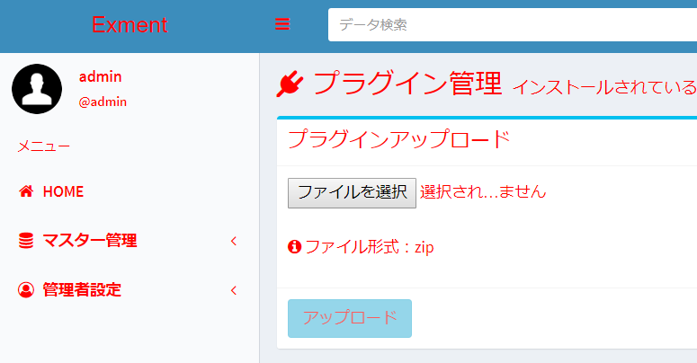

# Plugin (style)
Đây là plugin tải stylesheet riêng (css) trên màn hình của Exment để thay đổi thiết kế.

## Cách tạo
Ở đây, chúng ta tạo style đổi màu chữ của toàn bộ site thành màu đỏ làm ví dụ mẫu.  
  

### Tạo config.json
- Tạo tệp config.json như sau.  

~~~ json
{
    "plugin_name": "SetStyle",
    "uuid": "b5c0a5d2-2716-1937-98d0-b490c1ebc544",
    "plugin_view_name": "Thử style",
    "description": "Thử style",
    "author": "(Your Name)",
    "version": "1.0.0",
    "plugin_type": "style",
    "cdns": []
}
~~~

- plugin_name: hãy nhập bằng chữ và số nửa độ rộng (half-width).
- uuid là chuỗi dùng để phân biệt plugin. Gồm 32 ký tự và các dấu gạch nối, tổng cộng 36 ký tự. Không được trùng với plugin khác.  
Có thể tạo ở URL sau, v.v.  
https://www.famkruithof.net/uuid/uuidgen
- plugin_type: hãy nhập style.  
- (Tùy chọn) cdns: nhập khi tải thư viện liên quan bằng CDN. Hãy ghi đường dẫn đầy đủ http hoặc https, dưới dạng mảng.

### Tạo tệp css
- Tạo tệp css như sau. Tên đặt tùy ý, bằng chữ và số nửa độ rộng. Trong ví dụ mẫu này, tên là "style.css".

~~~ css
/* style.css */
*{
    color:red !important;
}
~~~

- Hãy đặt stylesheet đã tạo trong thư mục "public".  
Có thể đặt nhiều stylesheet, miễn là phần mở rộng là "css". Nếu cần thư viện liên quan, hãy đặt tất cả trong thư mục này.  

### Nén thành zip
Nén thành zip.  
Tên tệp zip là "(plugin_name).zip".  
- SetStyle.zip
    - config.json
    - Thư mục public
        - style.css

### Tải plugin lên
Hãy tải tệp zip đã tạo lên ở trang [Plugin](/vi/plugin).

### Điểm cần lưu ý
- Các tệp css đã tải lên **đều được tải khi tải màn hình lần đầu.**  
Thứ tự gọi tệp css không cố định (về cơ bản theo thứ tự tên; tuy nhiên sau css của jquery, bootstrap và adminLTE).
Hãy viết theo cách không phụ thuộc vào thứ tự tải.

- Với dữ liệu của từng bảng, có định nghĩa class tên là "custom_value_(tên bảng)".  
Khi chỉ muốn áp dụng style ở một bảng cụ thể, hãy lọc bằng tên class này.
Ví dụ: với màn hình "Người dùng" là "custom_value_user", với màn hình "Tổ chức" là "custom_value_organization"

### Plugin mẫu
[Thiết kế mẫu](https://github.com/exment-git/plugin-sample/tree/main/style/SetStyle)
