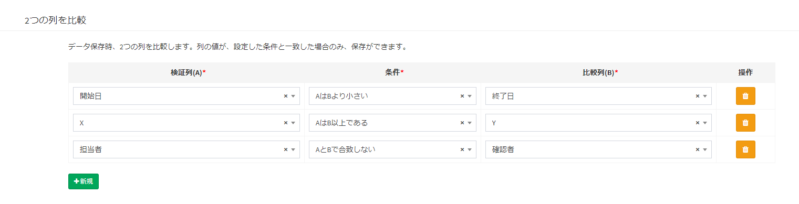

# Plugin (validation)
Đây là plugin chạy validation riêng (kiểm tra nội dung nhập) khi lưu dữ liệu tùy chỉnh và khi xóa dữ liệu tùy chỉnh.
Việc kiểm tra loại ký tự và số chữ số làm được bằng cài đặt của cột tùy chỉnh. Nên dùng plugin này khi muốn kiểm tra phức tạp hơn, hoặc kiểm tra liên quan giữa các mục.

   

> Nếu chỉ là validation so sánh đơn giản 2 giá trị, hãy thử cả [cài đặt trên màn hình](/vi/table?id=so-sánh-2-cột).

    

## Cách tạo

### Tạo config.json
- Tạo tệp config.json như sau.  

~~~ json
{
    "plugin_name": "PluginDemoTrigger",
    "uuid": "63d80590-4aad-11e9-b475-0800200c9a66",
    "plugin_view_name": "Plugin Validator",
    "description": "Thực hiện validation cho bảng tùy chỉnh.",
    "author": "(Your Name)",
    "version": "1.0.0",
    "target_tables": "test_table",
    "plugin_type": "validator"
}
~~~

- plugin_name : hãy nhập bằng chữ và số nửa độ rộng (half-width).
- uuid : chuỗi dùng để phân biệt plugin. Gồm 32 ký tự và các dấu gạch nối, tổng cộng 36 ký tự. Không được trùng với plugin khác.  
Có thể tạo ở URL sau, v.v.  
https://www.famkruithof.net/uuid/uuidgen
- plugin_type : hãy nhập validator.  
- (Tùy chọn) target_tables : hãy nhập tên bảng là đối tượng của validation.  

### Tạo tệp PHP
- Tạo tệp PHP như sau. Hãy đặt tên là "Plugin.php".

~~~ php
<?php
namespace App\Plugins\PluginDemoTrigger;

use Exceedone\Exment\Services\Plugin\PluginValidatorBase;
class Plugin extends PluginValidatorBase
{
    /**
     * Plugin Validator
     */
    public function validate()
    {
        // Lấy giá trị nhập
        $xpos = array_get($this->input_value, 'xpos');
        $ypos = array_get($this->input_value, 'ypos');

        if (isset($xpos) && isset($ypos)) {
            if (intval($xpos) > intval($ypos)) {
                // Đặt thông báo lỗi (khóa: tên cột, giá trị: thông báo)
                $this->messages['ypos'] = 'Hãy nhập vào Y giá trị lớn hơn X.';
                // Trả về false (có lỗi)
                return false;
            }
        }

        // Trả về true (bình thường)
        return true;

        
        ///// (Thêm từ v3.7.5) Khi lấy loại nơi đã gọi validation. Hãy dùng khi chỉ muốn thực hiện validation với cách gọi nhất định, v.v.
        \Log::debug($this->called_type);
        ///// Các loại của $this->called_type
        // form : màn hình
        // api : API
        // import : nhập dữ liệu
        // null : ngoài các loại trên (plugin khác, v.v.)
    }

    public function validateDestroy($custom_value)
    {
        // (Thêm từ v6.0.2) Khi trả về false, không xóa dữ liệu mà hiển thị trên màn hình thông báo lỗi đã đặt ở 'message'.
        if ($custom_value->getValue('priority') > 3) {
            return [
                'status'  => false,
                'message' =>  'Không thể xóa dữ liệu có mức độ quan trọng cao.',
            ];
        } else {
            // Khi trả về true, dữ liệu được xóa.
            return [
                'status'  => true
            ];
        }
    }
}
~~~

- namespace hãy đặt là **App\Plugins\\(tên plugin viết theo kiểu Pascal case)**. [Chi tiết xem tại đây](/vi/plugin_quickstart?id=namespace-của-tên-plugin)

- **Khi lưu**: ngay trước khi lưu dữ liệu của "Bảng mục tiêu" đã đặt trên màn hình quản lý plugin, plugin được gọi và chạy hàm validate trong Plugin.php.
    - Khi hàm validate trả về true, xử lý được tiếp tục như bình thường.
    - Khi trả về false, xử lý bị dừng và thông báo lỗi đã đặt ở thuộc tính $messages được hiển thị trên màn hình.

- **Khi xóa**: ngay trước khi xóa dữ liệu của "Bảng mục tiêu", plugin được gọi và chạy hàm validateDestroy trong Plugin.php.
    - Khi hàm validateDestroy trả về mảng có 'status' là true, dữ liệu được xóa.
    - Khi trả về mảng có 'status' là false, xử lý bị dừng và thông báo lỗi đã đặt ở 'message' được hiển thị trên màn hình.

- Class Plugin kế thừa class PluginValidatorBase.
PluginValidatorBase có các thuộc tính sau, v.v. Trong hàm validate, có thể tham chiếu các thuộc tính này.
Chi tiết về các thuộc tính vui lòng xem [Tài liệu tham khảo plugin](/vi/plugin_reference).
    - $custom_table: bảng tùy chỉnh đã gọi plugin
    - $original_value: giá trị dữ liệu tùy chỉnh trước khi thay đổi
    - $input_value: giá trị nhập trên màn hình

### Nén thành zip
Nén thành zip với cấu hình tối thiểu là 2 tệp trên.  
Tên tệp zip là "(plugin_name).zip".  
- PluginDemoTrigger.zip
    - config.json
    - Plugin.php

### Plugin mẫu
[Kiểm tra thứ tự hiển thị của thông báo](https://github.com/exment-git/plugin-sample/tree/main/validation/PluginValidatorTest)  
- Ví dụ mẫu báo lỗi khi thứ tự hiển thị của bảng thông báo vượt quá 100.  

