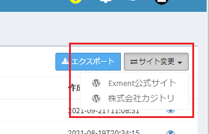
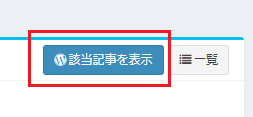

# Tài liệu tham khảo plugin (trang CRUD)
Trang này dành cho người phát triển plugin (trang CRUD).  
Trang này tổng hợp các hàm và thuộc tính dùng được trong lớp của trang CRUD.

**Ý nghĩa của ký hiệu ở tên hàm**

| Ký hiệu | Ý nghĩa |
| ---- | ---- |
| ★ | Hầu như luôn phải định nghĩa |
| ☆ | Phải định nghĩa trong một số trường hợp |

- Trang này chỉ dành cho trang CRUD. Về các loại plugin khác, vui lòng xem [Tài liệu tham khảo plugin](/vi/plugin_reference).
- Về các hàm của bảng tùy chỉnh, cột tùy chỉnh và dữ liệu tùy chỉnh, vui lòng xem [Tài liệu tham khảo hàm](/vi/func_reference).
- Trang này chủ yếu ghi những gì người phát triển plugin định nghĩa. Những gì hệ thống dùng và người phát triển không nên thay đổi thì được lược bỏ.
- Các lớp của thư viện màn hình quản trị được viết theo namespace của Exment v7.0.0 trở lên ("ExmentAdminCore\Admin"). Nếu bạn dùng v6.x trở xuống, hãy đọc thay thành "Encore\Admin". Chi tiết vui lòng xem [Cập nhật lên v7.0.0](/update/v7_0_0).

## PluginCrudBase
Lớp trừu tượng của plugin (trang CRUD). Khi phát triển plugin trang CRUD, hãy kế thừa lớp này.  

- namespace Exceedone\Exment\Services\Plugin
- trait Exceedone\Exment\Services\Plugin\PluginBase
- trait Exceedone\Exment\Services\Plugin\PluginPageTrait

##### Thuộc tính

| Tên | Kiểu | Mô tả |
| ---- | ---- | ---- |
| title | string | Tiêu đề hiển thị ở các trang |
| description | string | Mô tả hiển thị ở các trang |
| icon | string | Biểu tượng hiển thị ở các trang |


### Danh sách hàm

#### ★getFieldDefinitions
Hàm lấy định nghĩa cột dưới dạng mảng kết hợp.  
- Phải thêm 1 khóa có "primary" => true. (Hiện chưa hỗ trợ khóa kết hợp)  
- "key" là tên mục, dùng khi lấy dữ liệu và làm name của các phần tử HTML. Hãy nhập bằng chữ và số.  
- "label" dùng làm tên mục ở màn hình danh sách, v.v.  
- "grid": đặt cho mục hiển thị ở màn hình danh sách. Hãy ghi số nguyên theo thứ tự hiển thị.
- "show": đặt cho mục hiển thị ở màn hình chi tiết. Hãy ghi số nguyên theo thứ tự hiển thị.
- "create": đặt cho mục hiển thị ở màn hình tạo mới. Hãy ghi số nguyên theo thứ tự hiển thị.
- "edit": đặt cho mục hiển thị ở màn hình chỉnh sửa. Hãy ghi số nguyên theo thứ tự hiển thị.


##### Tham số
Không có


##### Giá trị trả về
| Kiểu | Mô tả |
| ---- | ---- |
| array | Mảng định nghĩa cột |


##### Ví dụ
``` php
/**
     * (2) Lấy định nghĩa cột
     * Get fields definitions
     *
     * @return array|Collection
     */
    public function getFieldDefinitions()
    {
        return [
            ['key' => 'id', 'label' => 'ID', 'primary' => true, 'grid' => 1, 'show' => 1],
            ['key' => 'title', 'label' => 'Tiêu đề', 'grid' => 2, 'show' => 2, 'create' => 1, 'edit' => 1],
            ['key' => 'date', 'label' => 'Ngày giờ tạo', 'grid' => 3, 'show' => 3, 'create' => 2, 'edit' => 2],
            ['key' => 'content', 'label' => 'Nội dung', 'show' => 4, 'create' => 3, 'edit' => 3],
        ];
    }
```

---


#### getAuthType
Trả về chuỗi biểu thị loại xác thực của trang CRUD.  
※ Ngoài đăng nhập của Exment, có thể đặt xác thực riêng để truy cập trang CRUD này. Hãy đặt loại xác thực theo loại dịch vụ muốn truy cập.


##### Loại xác thực
| Chuỗi trả về | Loại | Mô tả |
| ---- | ---- | ---- |
| (null) | Không xác thực | Dùng khi không xác thực riêng cho trang CRUD. Đây là giá trị mặc định. |
| key | Khóa truy cập | Đặt khóa truy cập ở trang cài đặt của plugin. Nếu chưa nhập khóa truy cập, lỗi sẽ được hiển thị. |
| id_password | ID và mật khẩu | Đặt ID và mật khẩu ở trang cài đặt của plugin. Nếu chưa nhập ID và mật khẩu, lỗi sẽ được hiển thị. |
| oauth | OAuth | Cài đặt OAuth ở màn hình cài đặt đăng nhập. Khi người dùng truy cập trang CRUD, đăng nhập OAuth sẽ được thực hiện. Chỉ khi đăng nhập OAuth thành công mới truy cập được trang CRUD. Ngoài ra, cũng dùng được access token. |


##### Tham số
Không có

##### Giá trị trả về
| Kiểu | Mô tả |
| ---- | ---- |
| ?string | Chuỗi biểu thị loại xác thực |


##### Ví dụ
``` php
    /**
     * Get auth type.
     * Please set null or "key" or "id_password" or "oauth".
     *
     * @return string|null
     */
    public function getAuthType() : ?string
    {
        return 'oauth';
    }
```

---


#### enablePaginate
Ghi rõ có hiển thị danh sách dữ liệu theo dạng phân trang hay không.  
Nếu dịch vụ cần lấy dữ liệu hỗ trợ phân trang (tổng số dữ liệu, lấy dữ liệu theo số trang, lấy dữ liệu theo từng trang), hãy trả về true. Nếu không hỗ trợ, hãy trả về false.

##### Tham số
Không có


##### Giá trị trả về
| Kiểu | Mô tả |
| ---- | ---- |
| boolean | Có hỗ trợ phân trang hay không. Giá trị mặc định: true |


##### Ví dụ
``` php
     /**
     * Whether use paginate
     * Default: true
     *
     * @return bool
     */
    public function enablePaginate() : bool
    {
        return true;
    }
```

---


#### ★getPaginate
Hàm lấy danh sách dữ liệu theo dạng phân trang.  
Hãy trả về dữ liệu đã lấy theo dạng \Illuminate\Pagination\LengthAwarePaginator.  
Mỗi phần tử của danh sách phải là mảng kết hợp, và các khóa của mảng kết hợp này phải giống với các khóa đã đặt trong getFieldDefinitions.  
※ Hãy viết hàm này khi hàm enablePaginate trả về true.


##### Tham số
| Tên | Kiểu | Mô tả |
| ---- | ---- | ---- |
| $options | array | Các tùy chọn dùng khi hiển thị màn hình danh sách |
| $options['per_page'] | int | Số dữ liệu hiển thị trên 1 trang |
| $options['page'] | int | Số trang |
| $options['query'] | string | Chuỗi tìm kiếm khi thực hiện tìm kiếm |


##### Giá trị trả về
| Kiểu | Mô tả |
| ---- | ---- |
| LengthAwarePaginator | Model kết quả tìm kiếm |


##### Ví dụ
``` php
    /**
     * (3) Lấy danh sách dữ liệu (Paginate)
     * Get data paginate
     *
     * @return LengthAwarePaginator
     */
    public function getPaginate(array $options = []) : ?LengthAwarePaginator
    {
        $client = new Client([
            'base_uri' => $this->getSiteUrl(),
        ]);

        $query = [
            'per_page' => $options['per_page'] ?? 20,
            'page' => $options['page'] ?? 1
        ];

        if(array_has($options, 'query')){
            $query['search'] = array_get($options, 'query');
        }

        $response = $client->get('wp-json/wp/v2/posts', ['query' => $query]);

        $json = json_decode((string)$response->getBody());

        $result = collect($json)->map(function($j){
            $j = json_decode(json_encode($j), true);
            return (object)[
                'id' => array_get($j, 'id'),
                'title' => array_get($j, 'title.rendered'),
                'content' => array_get($j, 'content.rendered'),
                'date' => array_get($j, 'date'),
            ];
        });
        
        return new LengthAwarePaginator(
            $result, 
            array_get($response->getHeaders(), 'X-WP-Total')[0], 
            $query['per_page'],
            $query['page'],
            [
                'path' => $this->getFullUrl(),
            ]
        );
    }
```


---

#### ☆getList
Hàm lấy danh sách dữ liệu.  
Hãy trả về dữ liệu đã lấy theo dạng Collection.  
Mỗi phần tử của danh sách phải là mảng kết hợp, và các khóa của mảng kết hợp này phải giống với các khóa đã đặt trong getFieldDefinitions.  
※ Hãy viết hàm này khi hàm enablePaginate trả về false.


##### Tham số
| Tên | Kiểu | Mô tả |
| ---- | ---- | ---- |
| $options | array | Các tùy chọn dùng khi hiển thị màn hình danh sách |
| $options['query'] | string | Chuỗi tìm kiếm khi thực hiện tìm kiếm |


##### Giá trị trả về
| Kiểu | Mô tả |
| ---- | ---- |
| \Illuminate\Support\Collection | Danh sách kết quả |


##### Ví dụ
``` php
    /**
     * (3) Lấy danh sách dữ liệu
     * Get data list
     *
     * @return Collection
     */
    public function getList(array $options = []) : Collection
    {
        $client = new Client([
            'base_uri' => $this->getSiteUrl(),
        ]);

        if(array_has($options, 'query')){
            $query['search'] = array_get($options, 'query');
        }

        $token = $this->getOauthAccessToken();
        $response = $client->get('v1.0/me/todo/lists', [
            'query' => $query, 
            'headers' => [
                'Authorization' => "Bearer $token",
                'Accept'        => 'application/json',
            ]
        ]);

        $json = json_decode((string)$response->getBody());

        $result = collect($json->value)->map(function($j){
            $j = json_decode(json_encode($j), true);
            return (object)[
                'id' => array_get($j, 'id'),
                'displayName' => array_get($j, 'displayName'),
            ];
        });

        return $result;
    }
```


---


#### getChunkCount
Trả về số dữ liệu lấy trong một lần khi lấy danh sách dữ liệu theo dạng phân trang.  

##### Tham số
Không có


##### Giá trị trả về
| Kiểu | Mô tả |
| ---- | ---- |
| int | Số dữ liệu lấy trong một lần. Giá trị mặc định: 1000 |


##### Ví dụ
``` php
    /**
     * Get max chunk count.
     *
     * @return int
     */
    public function getChunkCount() : int
    {
        return 1000;
    }
```


---

#### ★getData
Lấy 1 dữ liệu có ID đã chỉ định và trả về.  
Các phần tử của dữ liệu phải là mảng kết hợp, và các khóa của mảng kết hợp này phải giống với các khóa đã đặt trong getFieldDefinitions.  

##### Tham số
| Tên | Kiểu | Mô tả |
| ---- | ---- | ---- |
| $id | string | Giá trị khóa của dữ liệu |
| $options | array | Hiện chưa dùng. Tham số dành sẵn. |


##### Giá trị trả về
| Kiểu | Mô tả |
| ---- | ---- |
| array hoặc Collection | Dữ liệu đã lấy |


##### Ví dụ
``` php
    /**
     * (3) Lấy chi tiết dữ liệu (1 dữ liệu)
     * read single data
     *
     * @return array|Collection
     */
    public function getData($id, array $options = [])
    {
        $client = new Client([
            'base_uri' => $this->getSiteUrl(),
        ]);
        $response = $client->request('GET', "wp-json/wp/v2/posts/{$id}");
        $json = json_decode((string)$response->getBody());
        
        $j = json_decode(json_encode($json), true);
        return (object)[
            'id' => array_get($j, 'id'),
            'title' => array_get($j, 'title.rendered'),
            'content' => array_get($j, 'content.rendered'),
            'date' => array_get($j, 'date'),
        ];
    }
```


---

#### ★postCreate
Tạo mới dữ liệu.  
Hãy trả về giá trị khóa của dữ liệu đã tạo.  

##### Tham số
| Tên | Kiểu | Mô tả |
| ---- | ---- | ---- |
| $posts | array | Dữ liệu người dùng đã nhập. Mảng kết hợp. |
| $options | array | Hiện chưa dùng. Tham số dành sẵn. |


##### Giá trị trả về
| Kiểu | Mô tả |
| ---- | ---- |
| string | Hãy trả về giá trị khóa của dữ liệu đã tạo |


##### Ví dụ
``` php
    /**
     * post create value
     *
     * @return mixed
     */
    public function postCreate(array $posts, array $options = [])
    {
        $client = new Client([
            'base_uri' => $this->getSiteUrl(),
        ]);

        // create Authorization header 
        $id_password = $this->getAuthIdPassword();
        $Authorization = "Basic " . base64_encode("{$id_password['id']}:{$id_password['password']}");

        $response = $client->request('POST', "wp-json/wp/v2/posts", [
            'headers' => [
                'Authorization' => $Authorization,
                //'Content-Type' => 'application/json',
            ],
            'form_params' => [
                'title' => array_get($posts, 'title'),
                'content' => array_get($posts, 'content'),
                'status' => 'publish',
            ],
        ]);
        $json = json_decode((string)$response->getBody());
        $j = json_decode(json_encode($json), true);
        return array_get($j, 'id');
    }

```


---

#### ★putEdit
Chỉnh sửa dữ liệu.  
Hãy trả về giá trị khóa của dữ liệu đã chỉnh sửa.  

##### Tham số
| Tên | Kiểu | Mô tả |
| ---- | ---- | ---- |
| $id | string | Giá trị khóa của dữ liệu cần chỉnh sửa |
| $posts | array | Dữ liệu người dùng đã nhập. Mảng kết hợp. |
| $options | array | Hiện chưa dùng. Tham số dành sẵn. |


##### Giá trị trả về
| Kiểu | Mô tả |
| ---- | ---- |
| string | Hãy trả về giá trị khóa của dữ liệu đã cập nhật |


##### Ví dụ
``` php
    /**
     * edit posted value
     *
     * @return mixed
     */
    public function putEdit($id, array $posts, array $options = [])
    {
        $client = new Client([
            'base_uri' => $this->getSiteUrl(),
        ]);

        // create Authorization header 
        $id_password = $this->getAuthIdPassword();
        $Authorization = "Basic " . base64_encode("{$id_password['id']}:{$id_password['password']}");

        $response = $client->request('POST', "wp-json/wp/v2/posts/{$id}", [
            'headers' => [
                'Authorization' => $Authorization,
                //'Content-Type' => 'application/json',
            ],
            'form_params' => [
                'title' => array_get($posts, 'title'),
                'content' => array_get($posts, 'content'),
                'status' => 'publish',
            ],
        ]);
        $json = json_decode((string)$response->getBody());
        $j = json_decode(json_encode($json), true);
        return array_get($j, 'id');
    }

```


---

#### ★delete
Xóa dữ liệu.  

##### Tham số
| Tên | Kiểu | Mô tả |
| ---- | ---- | ---- |
| $id | string | Giá trị khóa của dữ liệu cần xóa |
| $options | array | Hiện chưa dùng. Tham số dành sẵn. |


##### Giá trị trả về
Không có


##### Ví dụ
``` php
    /**
     * delete value
     *
     * @param $id string
     * @return mixed
     */
    public function delete($id, array $options = [])
    {
        $client = new Client([
            'base_uri' => $this->getSiteUrl(),
        ]);

        // create Authorization header 
        $id_password = $this->getAuthIdPassword();
        $Authorization = "Basic " . base64_encode("{$id_password['id']}:{$id_password['password']}");

        $response = $client->request('DELETE', "wp-json/wp/v2/posts/{$id}", [
            'headers' => [
                'Authorization' => $Authorization,
                //'Content-Type' => 'application/json',
            ],
        ]);
    }
```


---

#### enableCreate
Xác định có tạo mới được hay không và trả về kiểu boolean.  
Nếu dịch vụ liên kết không hỗ trợ tạo mới, hoặc không cho một số người dùng tạo mới, hãy trả về false.

##### Tham số
| Tên | Kiểu | Mô tả |
| ---- | ---- | ---- |
| $options | array | Hiện chưa dùng. Tham số dành sẵn. |


##### Giá trị trả về
| Kiểu | Mô tả |
| ---- | ---- |
| boolean | Trả về true nếu tạo mới được. Giá trị mặc định: true |

---


#### enableEditAll
Xác định có chỉnh sửa được hay không và trả về kiểu boolean.  
Nếu dịch vụ liên kết không hỗ trợ chỉnh sửa, hoặc không cho một số người dùng chỉnh sửa, hãy trả về false.

##### Tham số
| Tên | Kiểu | Mô tả |
| ---- | ---- | ---- |
| $options | array | Hiện chưa dùng. Tham số dành sẵn. |


##### Giá trị trả về
| Kiểu | Mô tả |
| ---- | ---- |
| boolean | Trả về true nếu chỉnh sửa được. Giá trị mặc định: true |

---


#### enableEdit
Xác định có chỉnh sửa được dữ liệu đã chỉ định hay không và trả về kiểu boolean.  
Nếu dịch vụ liên kết không hỗ trợ chỉnh sửa, hoặc không cho một số người dùng chỉnh sửa, hãy trả về false.

##### Tham số
| Tên | Kiểu | Mô tả |
| ---- | ---- | ---- |
| $value | mixed | Giá trị tương ứng với ID. |
| $options | array | Hiện chưa dùng. Tham số dành sẵn. |


##### Giá trị trả về
| Kiểu | Mô tả |
| ---- | ---- |
| boolean | Trả về true nếu chỉnh sửa được. Giá trị mặc định: true |

---


#### enableDeleteAll
Xác định có xóa dữ liệu được hay không và trả về kiểu boolean.  
Nếu dịch vụ liên kết không hỗ trợ xóa, hoặc không cho một số người dùng xóa, hãy trả về false.

##### Tham số
| Tên | Kiểu | Mô tả |
| ---- | ---- | ---- |
| $options | array | Hiện chưa dùng. Tham số dành sẵn. |


##### Giá trị trả về
| Kiểu | Mô tả |
| ---- | ---- |
| boolean | Trả về true nếu xóa được. Giá trị mặc định: true |

---

#### enableDelete
Xác định có xóa được dữ liệu đã chỉ định hay không và trả về kiểu boolean.  
Nếu dịch vụ liên kết không hỗ trợ xóa, hoặc không cho một số người dùng xóa, hãy trả về false.

##### Tham số
| Tên | Kiểu | Mô tả |
| ---- | ---- | ---- |
| $value | mixed | Giá trị tương ứng với ID. |
| $options | array | Hiện chưa dùng. Tham số dành sẵn. |


##### Giá trị trả về
| Kiểu | Mô tả |
| ---- | ---- |
| boolean | Trả về true nếu xóa được. Giá trị mặc định: true |

---


#### enableExport
Xác định có xuất dữ liệu được hay không và trả về kiểu boolean.  
Tùy trường hợp, việc xuất dữ liệu sẽ lấy toàn bộ dữ liệu của dịch vụ. Vì vậy, hãy chú ý đến việc lấy lượng dữ liệu lớn.

##### Tham số
| Tên | Kiểu | Mô tả |
| ---- | ---- | ---- |
| $options | array | Hiện chưa dùng. Tham số dành sẵn. |


##### Giá trị trả về
| Kiểu | Mô tả |
| ---- | ---- |
| boolean | Trả về true nếu xuất dữ liệu được. Giá trị mặc định: false |

---


#### enableFreewordSearch
Xác định có tìm kiếm dữ liệu được hay không và trả về kiểu boolean.  

##### Tham số
| Tên | Kiểu | Mô tả |
| ---- | ---- | ---- |
| $options | array | Hiện chưa dùng. Tham số dành sẵn. |


##### Giá trị trả về
| Kiểu | Mô tả |
| ---- | ---- |
| boolean | Trả về true nếu tìm kiếm dữ liệu được. Giá trị mặc định: false |

---


#### callbackGridTool
Định nghĩa khi muốn hiển thị nút riêng ở góc trên bên phải của trang, v.v. trên màn hình GRID (danh sách dữ liệu).

##### Tham số

| Tên | Kiểu | Mô tả |
| ---- | ---- | ---- |
| $tools | \ExmentAdminCore\Admin\Widgets\Grid\Tools | Công cụ |


##### Giá trị trả về
Không có


##### Ví dụ
``` php
    /**
     * Callback tools. If add event, definition.
     * ※ Trong ví dụ này: hiển thị nút danh sách WordPress và chuyển WordPress cần lấy dữ liệu
     *
     * @param $tools
     * @return void
     */
    public function callbackGridTool($tools)
    {
        $menulist = [];

        foreach ($this->getSiteDefinitions() as $site) {
            $menulist[] = [
                'href' => admin_urls('plugins', $this->plugin->getOption('uri'), array_get($site, 'endpoint')),
                'label' => array_get($site, 'label'),
                'icon' => 'fa-wordpress',
            ];
        }
        $tools->prepend(view('exment::tools.menu-button', [
            'button_label' => 'Đổi site',
            'menulist' => $menulist,
        ])->render(), 'right');
    }

```

  

---


#### callbackShowTool
Định nghĩa khi muốn hiển thị nút riêng ở góc trên bên phải của trang, v.v. trên màn hình SHOW (chi tiết dữ liệu).

##### Tham số

| Tên | Kiểu | Mô tả |
| ---- | ---- | ---- |
| $id | string | Giá trị khóa |
| $box | \ExmentAdminCore\Admin\Widgets\Box | Box |


##### Giá trị trả về
Không có


##### Ví dụ
``` php
    /**
     * Callback show page tools. If add event, definition.
     *
     * @param Box $box
     * @return void
     */
    public function callbackShowTool($id, Box $box)
    {
        $box->tools(view('exment::tools.button', [
            'href' => $this->getSiteUrl() . "?p={$id}",
            'label' => 'Hiển thị bài viết này',
            'icon' => 'fa-wordpress',
            'btn_class' => 'btn-primary',
            'target' => '_blank',
        ])->render());
    }
```

  

---


#### callbackFormTool
Định nghĩa khi muốn hiển thị nút riêng ở góc trên bên phải của trang, v.v. trên màn hình CREATE (tạo mới dữ liệu) hoặc màn hình EDIT (chỉnh sửa dữ liệu).

##### Tham số

| Tên | Kiểu | Mô tả |
| ---- | ---- | ---- |
| $id | string | Giá trị khóa |
| $box | \ExmentAdminCore\Admin\Widgets\Box | Box |


##### Giá trị trả về
Không có


##### Ví dụ
``` php
    /**
     * Callback create or edit page tools. If add event, definition.
     *
     * @param Box $box
     * @return void
     */
    public function callbackFormTool($id, Box $box)
    {
        $box->tools(view('exment::tools.button', [
            'href' => $this->getSiteUrl() . "?p={$id}",
            'label' => 'Hiển thị bài viết này',
            'icon' => 'fa-wordpress',
            'btn_class' => 'btn-primary',
            'target' => '_blank',
        ])->render());
    }
```

  

---


#### setForm
Viết hàm này khi muốn tự tạo biểu mẫu nhập dữ liệu trên màn hình CREATE (tạo mới dữ liệu) hoặc màn hình EDIT (chỉnh sửa dữ liệu).  
※ Cách viết về cơ bản là cách thêm [biểu mẫu](https://github.com/exceedone/exment-admin-core/blob/master/docs/en/model-form-fields.md) của thư viện màn hình quản trị "exment-admin-core" (giống với [biểu mẫu của laravel-admin](https://laravel-admin.org/docs/en/model-form-fields), thư viện gốc). Về cách nhập, vui lòng xem các trang đó.  
※ Nếu không định nghĩa hàm này (trả về null), các cột được định nghĩa mục "create" (với màn hình CREATE) hoặc mục "edit" (với màn hình EDIT) trong hàm getFieldDefinitions sẽ được hiển thị ở dạng văn bản một dòng.


##### Tham số
| Tên | Kiểu | Mô tả |
| ---- | ---- | ---- |
| $form | \ExmentAdminCore\Admin\Widgets\Form | Biểu mẫu nhập |
| $isCreate | bool | true nếu là tạo mới |
| $options | array | Hiện chưa dùng. Tham số dành sẵn. |


##### Giá trị trả về
| Kiểu | Mô tả |
| ---- | ---- |
| ?\ExmentAdminCore\Admin\Widgets\Form | Biểu mẫu đã tạo. Nếu trả về null, biểu mẫu nhập sẽ được tạo từ định nghĩa của hàm getFieldDefinitions. |


##### Ví dụ
``` php
    /**
     * set form info
     *
     * @return Form|null
     */
    public function setForm(Form $form, bool $isCreate, array $options = []) : ?Form
    {
        if(!$isCreate){
            $form->display('ID');    
        }
        $form->text('Name');

        // Lấy danh sách quốc gia
        $countries = \DB::connection('world')->table('country') ->pluck('Name', 'Code');
        $form->select('CountryCode')->options($countries);
        
        $form->number('Population');

        return $form;
    }
```

---


#### validate
Hàm dùng khi muốn định nghĩa kiểm tra hợp lệ trước khi lưu dữ liệu trên màn hình CREATE (tạo mới dữ liệu) hoặc màn hình EDIT (chỉnh sửa dữ liệu).

##### Tham số

| Tên | Kiểu | Mô tả |
| ---- | ---- | ---- |
| $form | \ExmentAdminCore\Admin\Widgets\Form | Biểu mẫu nhập |
| $values | array | Giá trị người dùng đã nhập |
| $isCreate | bool | true nếu là tạo mới |
| $id | string | Giá trị khóa |


##### Giá trị trả về
| Kiểu | Mô tả |
| ---- | ---- |
| Một trong các kiểu sau<br/>array<br/>\Illuminate\Support\MessageBag<br/>\Exceedone\Exment\Validator\ExmentCustomValidator | Kết quả kiểm tra hợp lệ |


##### Ví dụ
``` php
    // ※ Ví dụ 1. Cách thêm kiểm tra hợp lệ vào biểu mẫu trong hàm setForm.
    // ※ Ví dụ này được ghi ở mục hàm validate cho tiện, nhưng với ví dụ này thì đừng định nghĩa hàm validate.
    /**
     * set form info
     *
     * @return Form|null
     */
    public function setForm(Form $form, bool $isCreate, array $options = []) : ?Form
    {
        if(!$isCreate){
            $form->display('ID');    
        }
        $form->text('Name')
            ->rules(['max:10']); // Thêm

        // Lấy danh sách quốc gia
        $countries = \DB::connection('world')->table('country')->pluck('Name', 'Code');
        $form->select('CountryCode')->options($countries);
        
        $form->number('Population')
            ->rules([new \Exceedone\Exment\Validator\NumberMinRule(10)]);  // Thêm

        return $form;
    }


    // ※ Ví dụ 2. Cách dùng kiểm tra hợp lệ của Laravel.
    /**
     * Validate form
     *
     * @param WidgetForm $form
     * @return array|MessageBag|ExmentCustomValidator
     */
    public function validate(WidgetForm $form, array $values, bool $isCreate, $id)
    {
        $validator = \Validator::make($values, 
        // Định nghĩa quy tắc của từng trường
        [
            'Name' => 'max:10',
            'Population' => new \Exceedone\Exment\Validator\NumberMinRule(10),
        ], 
        // (Tùy chọn) Khi muốn đổi thông báo của từng quy tắc
        [
            'max' => 'Độ dài của :attribute phải trong 10 ký tự.',
            'min' => 'Hãy nhập giá trị từ 10 trở lên cho :attribute',
        ], 
        // (Tùy chọn) Khi muốn đổi tên của từng trường
        [
            'Name' => 'Tên',
            'Population' => 'Dân số (ước tính)',
        ]);
        return $validator;
    }
    

    // ※ Ví dụ 3. Cách kiểm tra hợp lệ riêng từng mục.
    // Nếu có lỗi, trả về mảng có khóa là tên trường và giá trị là thông báo lỗi.
    /**
     * Validate form
     *
     * @param WidgetForm $form
     * @return array|MessageBag|ExmentCustomValidator
     */
    public function validate(WidgetForm $form, array $values, bool $isCreate, $id)
    {
        $errors = [];

        // Kiểm tra có trong 10 ký tự hay không
        $Name = array_get($values, 'Name');
        if(!is_nullorempty($Name) && mb_strlen($Name) > 10){
            $errors['Name'] = 'Độ dài của Tên phải trong 10 ký tự.';
        }
        
        // Kiểm tra có từ 10 trở lên hay không
        $Population = array_get($values, 'Population');
        if(!is_nullorempty($Population) && intval($Population) < 10){
            $errors['Population'] = 'Hãy nhập giá trị từ 10 trở lên cho Dân số (ước tính)';
        }
        
        return $errors;
    }
```

---

