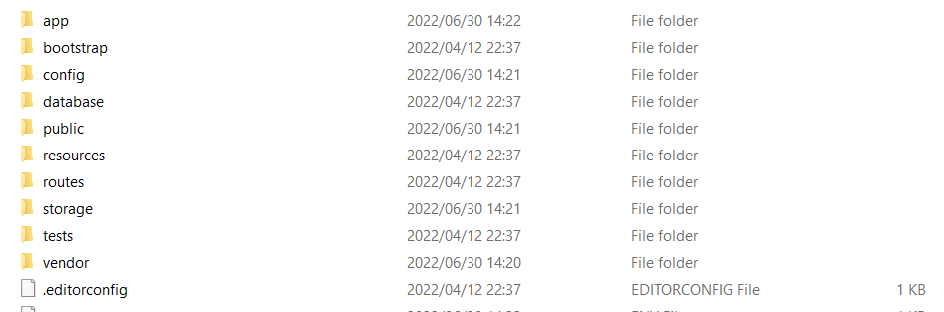

# Xây dựng site cho người dùng

Trang này dành cho người phát triển.  
Trong Exment, bằng cách đổi endpoint (lối vào của URL), ngoài site của Exment, bạn có thể tạo site dành cho người dùng thông thường do người phát triển tự làm (site cho người dùng).

Trang này lấy ví dụ tạo các trang sau, làm việc với dữ liệu của bảng "Tin tức" của Exment.

- Danh sách dữ liệu tin tức
- Hiển thị chi tiết dữ liệu tin tức
- Tạo mới dữ liệu tin tức
- Chỉnh sửa dữ liệu tin tức
- Xóa dữ liệu tin tức

Thứ tự làm như sau.

1. Kiểm tra xem có truy cập được không
2. Tạo trang danh sách (routing → controller → view)
3. Lần lượt thêm các trang chi tiết, tạo mới, chỉnh sửa, xóa

## Kiểm tra truy cập
Site cho người dùng vẫn truy cập được sau khi đã cài đặt Exment.

| Cuối URL | Site được mở |
|---|---|
| "/admin" | Site quản trị (Exment) |
| "/" | Site cho người dùng |

- Để đặt site cho người dùng ở "/", hãy đặt `ADMIN_ROUTE_PREFIX` trong `.env` thành "admin". Lý do: với bản cài đặt mới từ v7.2.1 trở lên, mặc định Exment nằm ở "/". Chi tiết vui lòng xem [Thay đổi hoặc xóa "admin" trong URL](/vi/additional_prefix).

■ Endpoint "/"

■ Endpoint "/admin"

## Tạo trang
Về cơ bản, site cho người dùng được tạo với cấu trúc và các bước giống như phát triển hệ thống Laravel thông thường.  
Hình dưới là cấu trúc thư mục gốc của Laravel. Trong đó, chủ yếu ta sẽ tạo các tệp php ở những thư mục sau.

| Thư mục | Nội dung đặt vào |
|---|---|
| app/Http/Controllers | Controller |
| routes | Thông tin endpoint |
| resources/views | View. Viết theo cú pháp blade |
| public | css, js, hình ảnh, v.v. |

#### routes: Routing
Viết routing của trang danh sách vào routes/web.php như sau.  
※ Về các cách viết routing khác, vui lòng xem [giải thích về routing của Laravel](https://readouble.com/laravel/8.x/ja/routing.html).

~~~
<?php

use Illuminate\Support\Facades\Route;

/*
|--------------------------------------------------------------------------
| Web Routes
|--------------------------------------------------------------------------
|
| Here is where you can register web routes for your application. These
| routes are loaded by the RouteServiceProvider within a group which
| contains the "web" middleware group. Now create something great!
|
*/

//Route::get('/', function () {
//    return view('welcome');
//});

///// Trang danh sách
Route::get('/', [\App\Http\Controllers\IndexController::class, 'index']);
~~~

#### Controller: Controller
Tạo IndexController.php trong thư mục app/Http/Controllers và viết như sau.

- CustomTable: Model tương ứng với "bảng tùy chỉnh" của Exment.
- CustomTable::getEloquent('information')->getValueModel(): Model dùng cho dữ liệu của bảng trong Exment. Nó biểu thị từng dữ liệu người dùng đã nhập.

※ Về các cách viết controller khác, vui lòng xem [giải thích về controller của Laravel](https://readouble.com/laravel/8.x/ja/controllers.html).

~~~
<?php

namespace App\Http\Controllers;

use Illuminate\Routing\Controller as BaseController;
use Illuminate\Http\Request;
use Exceedone\Exment\Model\CustomTable;

class IndexController extends BaseController
{
    //Màn hình danh sách
    public function index(Request $request){
        $items = CustomTable::getEloquent('information')->getValueModel()->get();
        return view('index', [
            'items' => $items,
        ]);
    }
}
~~~

#### view: View
Với view, ta tạo 2 tệp: khung dùng chung (_layout.blade.php) và nội dung của danh sách (index.blade.php).

Tạo _layout.blade.php trong resources/views và viết như sau.  
~~~
<!DOCTYPE html>
<html lang="{{ str_replace('_', '-', app()->getLocale()) }}">
    <head>
        <meta charset="utf-8">
        <meta name="viewport" content="width=device-width, initial-scale=1">

        <title>Laravel</title>

        <!-- Fonts -->
        <link href="https://fonts.googleapis.com/css2?family=Nunito:wght@400;600;700&display=swap" rel="stylesheet">

        <!-- Styles -->
        

        
    </head>
    <body class="antialiased">
        

            @if (Route::has('login'))
                

                    @auth
                        <a href="{{ url('/home') }}" class="text-sm text-gray-700 dark:text-gray-500 underline">Home</a>
                    @else
                        <a href="{{ route('login') }}" class="text-sm text-gray-700 dark:text-gray-500 underline">Log in</a>

                        @if (Route::has('register'))
                            <a href="{{ route('register') }}" class="ml-4 text-sm text-gray-700 dark:text-gray-500 underline">Register</a>
                        @endif
                    @endauth
                

            @endif

            <main>
                @yield('content')
            </main>
        

    </body>
</html>

~~~

Tạo index.blade.php trong resources/views và viết như sau.  
※ Về các cách viết Blade khác, vui lòng xem [giải thích về Blade của Laravel](https://readouble.com/laravel/8.x/ja/blade.html).

~~~
@extends('_layout')

@section('content')
    <h1>Danh sách tin tức</h1>
    <table>
        <thead>
            <tr>
                <th>ID</th>
                <th>Tiêu đề</th>
                <th>Ngày giờ tạo</th>
                <th>Ngày giờ cập nhật</th>
                <th></th>
            </tr>
        </thead>

        <tbody>
        @foreach($items as $item)
            <tr>
                <td>{{$item->id}}</td>
                <td>{{$item->getValue('title', 'html')}}</td>
                <td>{{$item->created_at}}</td>
                <td>{{$item->updated_at}}</td>
                <td><a href="{{asset($item->id)}}">Chi tiết</a></td>
            </tr>
        @endforeach
        </tbody>
    </table>

    

        <a href="{{asset('/create')}}">Tạo mới</a>
    

@endsection
~~~

#### Kết quả hiển thị
Nếu đã làm đúng đến đây, danh sách dữ liệu của bảng "Tin tức" của Exment sẽ được hiển thị như sau.  
※ Các liên kết "Tạo mới" và "Chi tiết" lúc này chưa mở được. Ta sẽ tạo ở các bước sau.

#### Tạo màn hình chi tiết dữ liệu
Tạo màn hình chi tiết dữ liệu. Viết thêm vào 3 tệp sau.

routes/web.php
~~~
///// Trang chi tiết
Route::get('/{id}', [\App\Http\Controllers\IndexController::class, 'show']);
~~~

app/Http/Controllers/IndexController.php (viết thêm bên dưới hàm index)
~~~
  //Màn hình chi tiết
    public function show(Request $request, $id){
        $item = CustomTable::getEloquent('information')->getValueModel()->find($id);
        if(!$item){
            return redirect('');
        }
        return view('show', [
            'item' => $item,
        ]);
    }
~~~

resources/views/show.blade.php (tạo mới)
~~~
@extends('_layout')

@section('content')
    <h1>Chi tiết dữ liệu</h1>
    <table>
        <tbody>
            <tr>
                <th>ID</th>
                <td>{{$item->id}}</td>
            </tr>
            <tr>
                <th>Tiêu đề</th>
                <td>{{$item->getValue('title', 'html')}}</td>
            </tr>
            <tr>
                <th>Nội dung</th>
                <td>{!! $item->getValue('body', 'html') !!}</td>
            </tr>
            <tr>
                <th>Cờ hiển thị</th>
                <td>{!! $item->getValue('view_flg', 'html') !!}</td>
            </tr>
            <tr>
                <th>Thứ tự hiển thị</th>
                <td>{!! $item->getValue('order', 'html') !!}</td>
            </tr>
            <tr>
                <th>Mức độ quan trọng</th>
                <td>{!! $item->getValue('priority', 'html') !!}</td>
            </tr>
            <tr>
                <th>Ngày giờ tạo</th>
                <td>{{$item->created_at}}</td>
            </tr>
            <tr>
                <th>Ngày giờ cập nhật</th>
                <td>{{$item->updated_at}}</td>
            </tr>
        </tbody>
    </table>

    

        <a href="{{asset('/')}}">Quay lại danh sách</a>
    

@endsection
~~~

#### Kết quả hiển thị
Nếu đã làm đúng, chi tiết của dữ liệu có ID đã chỉ định trong bảng "Tin tức" của Exment sẽ được hiển thị như sau.

#### Màn hình tạo mới dữ liệu
Tạo màn hình tạo mới dữ liệu. Viết thêm vào 3 tệp sau.

routes/web.php (viết phía trên trang chi tiết)
~~~
///// Trang tạo mới
Route::get('/create', [\App\Http\Controllers\IndexController::class, 'create']);
Route::post('/', [\App\Http\Controllers\IndexController::class, 'store']);
~~~

app/Http/Controllers/IndexController.php (viết thêm bên dưới hàm show)
~~~
    //Màn hình tạo mới
    public function create(Request $request){
        return view('create');
    }

    //Thực hiện đăng ký mới
    public function store(Request $request){
        //Tạo Model để lưu dữ liệu
        $custom_value = CustomTable::getEloquent('information')->getValueModel();

        //Đặt giá trị
        $custom_value->setValueStrictly([
            'title' => $request->get('title'),
            'body' => $request->get('body'),
            'view_flg' => $request->get('view_flg'),
            'order' => $request->get('order'),
            'priority' => $request->get('priority'),
        ]);

        //Lưu dữ liệu
        $custom_value->save();

        //Chuyển hướng tới dữ liệu đó
        return redirect($custom_value->id);
    }
~~~

resources/views/create.blade.php (tạo mới)
~~~
@extends('_layout')

@section('content')
    <h1>Tạo mới dữ liệu</h1>

    <form method="post" action="{{asset('/')}}">
        @csrf
        <table>
            <tbody>
                <tr>
                    <th>Tiêu đề</th>
                    <td><input type="text" name="title" value="{{old('title')}}" /></td>
                </tr>
                <tr>
                    <th>Nội dung</th>
                    <td><textarea name="body">{{old('body')}}</textarea></td>
                </tr>
                <tr>
                    <th>Cờ hiển thị</th>
                    <td>
                        <select name="view_flg">
                            <option value="0" selected>NO</option>
                            <option value="1">YES</option>
                        </select>
                    </td>
                </tr>
                <tr>
                    <th>Thứ tự hiển thị</th>
                    <td><input type="number" name="order" value="{{old('order')}}"></input></td>
                </tr>
                <tr>
                    <th>Mức độ quan trọng</th>
                    <td>
                        <select name="priority">
                            <option value="{{old('priority')}}" selected></option>
                            <option value="1">Rất thấp</option>
                            <option value="2">Thấp</option>
                            <option value="3">Bình thường</option>
                            <option value="4">Cao</option>
                            <option value="5">Rất cao</option>
                        </select>
                    </td>
                </tr>
            </tbody>
        </table>

        <button type="submit">Gửi</button>
          
        
        

            <a href="{{asset('/')}}">Quay lại danh sách</a>
        

    </form>
@endsection
~~~

#### Kết quả hiển thị
Nếu đã làm đúng, trang thêm dữ liệu vào bảng "Tin tức" của Exment sẽ được hiển thị như sau.

#### Màn hình chỉnh sửa dữ liệu
Tạo màn hình chỉnh sửa dữ liệu. Viết thêm vào (hoặc sửa lại) 5 tệp sau.

routes/web.php (viết phía trên trang chi tiết)
~~~
///// Trang chỉnh sửa
Route::get('/edit/{id}', [\App\Http\Controllers\IndexController::class, 'edit']);
Route::put('/{id}', [\App\Http\Controllers\IndexController::class, 'update']);
~~~

app/Http/Controllers/IndexController.php (viết thêm bên dưới hàm store)
~~~
 // Màn hình chỉnh sửa
    public function edit(Request $request, $id){
        $item = CustomTable::getEloquent('information')->getValueModel()->find($id);
        if(!$item){
            return redirect('');
        }
        return view('edit', [
            'item' => $item,
        ]);
    }

    // Thực hiện chỉnh sửa
    public function update(Request $request, $id){
        // Tạo Model để lưu dữ liệu
        $custom_value = CustomTable::getEloquent('information')->getValueModel()->find($id);

        // Đặt giá trị
        $custom_value->setValueStrictly([
            'title' => $request->get('title'),
            'body' => $request->get('body'),
            'order' => $request->get('order'),
            'view_flg' => $request->get('view_flg'),
            'priority' => $request->get('priority'),
        ]);

        // Lưu dữ liệu
        $custom_value->save();

        // Chuyển hướng tới dữ liệu đó
        return redirect($custom_value->id);
    }
~~~

resources/views/edit.blade.php (tạo mới)
~~~
@extends('_layout')

@section('content')
    <h1>Chỉnh sửa dữ liệu</h1>

    <form method="post" action="{{asset('/' . $item->id)}}">
        @csrf
    <table>
        <tbody>
            <tr>
                <th>ID</th>
                <td>{{$item->id}}</td>
            </tr>
            <tr>
                <th>Tiêu đề</th>
                <td><input type="text" name="title" value="{{old('title', $item->getValue('title', 'html'))}}" /></td>
            </tr>
            <tr>
                <th>Nội dung</th>
                <td>
                    <textarea name="body">{{old('body', $item->getValue('body', 'html'))}}</textarea>
                </td>
            </tr>
            <tr>
                <th>Cờ hiển thị</th>
                <td>
                    <select name="view_flg">
                    <option value="{{old('view_flg', $item->getValue('view_flg', 'html'))}}" selected>{{old('view_flg', $item->getValue('view_flg', 'html'))}}</option>
                            <option value="0">NO</option>
                            <option value="1">YES</option>
                    </select>
                </td>
            </tr>
            <tr>
                <th>Thứ tự hiển thị</th>
                <td>
                    <input type="number" name="order" value="{{old('order', $item->getValue('order', 'html'))}}"></input>
                </td>
            </tr>
            <tr>
                <th>Mức độ quan trọng</th>
                <td>
                    <select name="priority">
                            <option value="{{old('priority', $item->getValue('priority', 'html'))}}" selected>{{old('priority', $item->getValue('priority', 'html'))}}</option>
                            <option value="1">Rất thấp</option>
                            <option value="2">Thấp</option>
                            <option value="3">Bình thường</option>
                            <option value="4">Cao</option>
                            <option value="5">Rất cao</option>
                        </select>
                </td>
            </tr>
            <tr>
                <th>Ngày giờ tạo</th>
                <td>{{$item->created_at}}</td>
            </tr>
            <tr>
                <th>Ngày giờ cập nhật</th>
                <td>{{$item->updated_at}}</td>
            </tr>
        </tbody>
    </table>

        <button type="submit">Gửi</button>
          
        @method('PUT')
    </form>

    
    

        <a href="{{asset('/')}}">Quay lại danh sách</a>
    

@endsection
~~~

resources/views/show.blade.php (thêm phía trên thẻ div của "Quay lại danh sách")
~~~
    

        <a href="{{asset('/edit/' . $item->id)}}">Chỉnh sửa</a>  
    

~~~

resources/views/index.blade.php (sửa lại nội dung trong thẻ td)
~~~
<td><a href="{{asset($item->id)}}">Chi tiết</a>&nbsp;&nbsp;<a href="{{asset('edit/'.$item->id)}}">Chỉnh sửa</a></td>
~~~

#### Kết quả hiển thị

#### Màn hình xóa dữ liệu
Làm cho dữ liệu có thể xóa được. Viết thêm vào (hoặc sửa lại) 4 tệp sau.

routes/web.php
~~~
///// Xóa
Route::get('/delete/{id}', [\App\Http\Controllers\IndexController::class, 'delete']);
~~~

app/Http/Controllers/IndexController.php (viết thêm bên dưới hàm update)
~~~
// Thực hiện xóa
    public function delete(Request $request, $id){
        // Lấy dữ liệu cần xóa
        $custom_value = CustomTable::getEloquent('information')->getValueModel()->find($id);

        // Xóa dữ liệu
        $custom_value->delete();

        // Chuyển hướng tới danh sách
        return redirect('/');
    }
~~~

resources/views/show.blade.php (sửa lại nội dung trong thẻ div thứ nhất)
~~~
    

        <a href="{{asset('/edit/' . $item->id)}}">Chỉnh sửa</a>
        &nbsp;&nbsp;<a href="{{asset('/delete/' . $item->id)}}">Xóa</a>
    

~~~

resources/views/index.blade.php (sửa lại nội dung trong thẻ td)
~~~
<td><a href="{{asset($item->id)}}">Chi tiết</a>&nbsp;&nbsp;<a href="{{asset('edit/'.$item->id)}}">Chỉnh sửa</a>&nbsp;&nbsp;<a href="{{asset('/delete/' . $item->id)}}">Xóa</a></td>
~~~

#### Kết quả hiển thị
