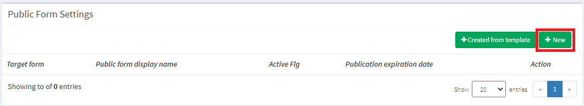
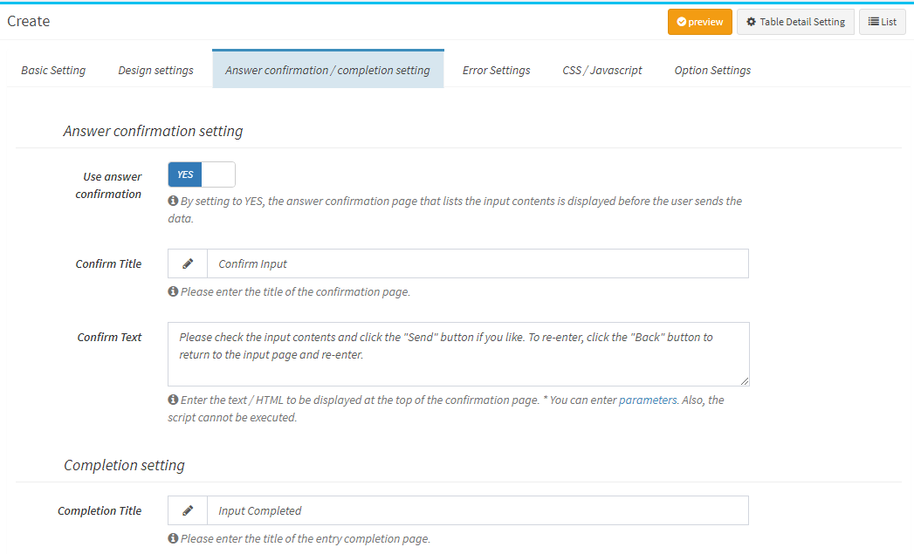
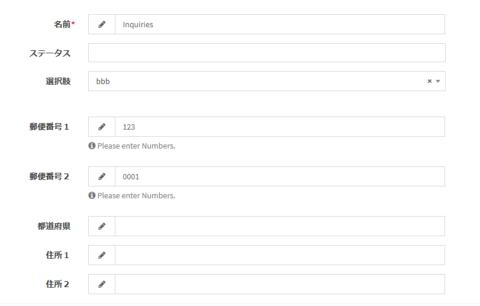

# Cài đặt biểu mẫu công khai
Trang này dùng để thiết lập "biểu mẫu công khai", nơi người chưa đăng nhập (người dùng thông thường) có thể nhập dữ liệu.  
Bạn có thể tạo khảo sát, biểu mẫu liên hệ, biểu mẫu đăng ký, v.v., chia sẻ URL và công khai rộng rãi ra bên ngoài.

- [Màn hình biểu mẫu dữ liệu](/vi/data_form) thông thường cần chuẩn bị người dùng trước và để họ đăng nhập bằng ID, mật khẩu.
- Với biểu mẫu công khai, ai cũng nhập được dữ liệu mà không cần đăng nhập.

## Về cách hoạt động của cài đặt biểu mẫu công khai

<span class="red bold">Dữ liệu nhập từ biểu mẫu công khai được đăng ký với người tạo, người cập nhật là người dùng đã đăng ký cài đặt biểu mẫu công khai.</span>  
Vai trò, quyền khi lấy hoặc tìm lựa chọn của bảng khác trên màn hình nhập dữ liệu cũng là của người dùng đã đăng ký cài đặt biểu mẫu công khai.  
  
Vì vậy, xin tránh để quản trị viên hệ thống đăng ký biểu mẫu công khai.  
Khuyến nghị thiết lập người dùng, nhóm vai trò mới theo các bước ở "<a href="#/vi/publicform?id=role_user">Thiết lập người dùng, nhóm vai trò thực hiện cài đặt biểu mẫu công khai</a>" nêu sau.   
  
Ngoài ra, các bảng sau không phải là đối tượng thiết lập biểu mẫu công khai.  
- Các bảng master như "Người dùng", "Tổ chức"
- Bảng được đặt "Chỉ cho phép lưu một bản ghi" trong thiết lập bảng


## Trình tự thiết lập
Thiết lập theo thứ tự sau. Các bước chi tiết vui lòng xem "Các bước thiết lập" ở dưới.

1. Chạy lệnh. (chỉ khi dùng Google reCAPTCHA)
2. Trên màn hình Cài đặt hệ thống, cho phép dùng biểu mẫu công khai.
3. Tại [thiết lập biểu mẫu tùy chỉnh](/vi/form), thiết lập các mục, tiêu đề, v.v. hiển thị trên biểu mẫu.
4. Đăng ký người dùng, nhóm vai trò thực hiện cài đặt biểu mẫu công khai.
5. Đăng nhập bằng người dùng đó và thực hiện cài đặt biểu mẫu công khai (thiết kế, màn hình xác nhận, Google Analytics, v.v.).
6. Kích hoạt biểu mẫu công khai. URL sẽ được cấp.

## Các bước thiết lập

### 1. Chạy lệnh
Chỉ chạy khi dùng Google reCAPTCHA (cơ chế chống gửi bằng robot) cho biểu mẫu công khai.  
Tại thư mục gốc của dự án, hãy chạy lệnh phù hợp với phiên bản Exment đang dùng.  
※ Từ v7.0.0, thư viện Google reCAPTCHA được dùng là "google/recaptcha". Exment v6.x trở về trước dùng "arcanedev/no-captcha".  

- Với Exment v7.0.0 trở đi

```
composer require google/recaptcha=^1.3.1
```

- Với Exment v6.x trở về trước

```
composer require arcanedev/no-captcha=^10.1
```

### 2. Màn hình Cài đặt hệ thống
- Chuyển đến "STEP2 Cài đặt chi tiết" của [màn hình Cài đặt hệ thống](/vi/system_setting) và đặt "Sử dụng biểu mẫu công khai" là YES.  
※ Mặc định là NO. Lý do là để bạn chọn một cách rõ ràng việc dùng biểu mẫu công khai.  


- Khi dùng Google reCAPTCHA, hãy đặt mục "Google reCAPTCHA" là V2 hoặc V3.  
Khi chọn, các mục site key và secret key sẽ hiển thị. Hãy đặt các giá trị sao chép từ [trang quản lý của Google reCAPTCHA](http://www.google.com/recaptcha/admin).  
※ Sau khi thiết lập, ở từng màn hình cài đặt biểu mẫu công khai, bạn chọn có dùng Google reCAPTCHA hay không.  
※ Ngưỡng điểm khi chọn V3 có thể đổi bằng [giá trị thiết lập](/vi/config) (mặc định 0.5).


### 3. Thiết lập biểu mẫu tùy chỉnh
- Tại [thiết lập biểu mẫu tùy chỉnh](/vi/form), thiết lập các mục, tiêu đề, v.v. hiển thị trên biểu mẫu. Các bước về cơ bản giống thiết lập biểu mẫu thông thường.  
※ Thiết lập này có thể do người khác ngoài người dùng cài đặt biểu mẫu công khai, như quản trị viên, thực hiện.

<h3 id="role_user"><a href="#/vi/publicform?id=role_user" data-id="role_user" class="anchor"><span>4. Thiết lập người dùng, nhóm vai trò thực hiện cài đặt biểu mẫu công khai</span></a></h3>
Đăng ký người dùng, nhóm vai trò thực hiện cài đặt biểu mẫu công khai.  
Dữ liệu gửi từ biểu mẫu công khai được coi là do người dùng này đăng ký, cập nhật.

- Tạo mới [thiết lập nhóm vai trò](/vi/role_group).
    - Thêm quyền "Quản lý biểu mẫu công khai".
    - Thêm quyền chỉnh sửa đối với bảng muốn thiết lập biểu mẫu công khai.
    - Đồng thời thêm cả quyền xem đối với các bảng mà biểu mẫu công khai đó truy cập.  

- Ví dụ: khi định thiết lập biểu mẫu công khai của bảng "Liên hệ", và bảng Liên hệ tham chiếu tất cả dữ liệu của các bảng "Sản phẩm", "Danh mục":  
    - Quyền "Quản lý biểu mẫu công khai", "Chỉnh sửa dữ liệu phụ trách" của bảng "Liên hệ"
    - Quyền "Xem tất cả dữ liệu" của các bảng "Sản phẩm", "Danh mục"


- Thêm người dùng quản lý biểu mẫu công khai.
    - Nhóm vai trò: chọn nhóm vai trò đã tạo ở trên.

- Đăng nhập bằng người dùng đã tạo ở trên, mở màn hình cài đặt biểu mẫu công khai và đăng ký biểu mẫu công khai.


### 5. Cài đặt biểu mẫu công khai

- Trong danh sách bảng tùy chỉnh, đánh dấu 1 bảng muốn thiết lập rồi nhấp "Cài đặt chi tiết bảng" ở phía trên bên phải.  

> ※ Cũng có thể mở từ màn hình danh sách dữ liệu hoặc màn hình đăng ký dữ liệu của bảng tùy chỉnh đó. Khi đó cũng nhấp "Cài đặt chi tiết bảng" ở phía trên bên phải.  

- Trên màn hình cài đặt chi tiết bảng vừa hiển thị, nhấp vào biểu tượng thiết lập biểu mẫu.


- Ở phía dưới màn hình danh sách biểu mẫu có khung "Cài đặt biểu mẫu công khai".  
Hãy nhấp nút "＋Mới" ở phía trên bên phải của khung này.



- Màn hình cài đặt biểu mẫu công khai mở ra. Hãy thiết lập các mục cần thiết. Nội dung thiết lập như sau.

#### Nội dung thiết lập - Cài đặt cơ bản


- ##### Biểu mẫu đích
Chọn biểu mẫu sẽ thiết lập làm biểu mẫu công khai. Hãy chọn biểu mẫu đã tạo ở "Thiết lập biểu mẫu tùy chỉnh" ở trên.

- ##### Tên hiển thị biểu mẫu công khai
Hãy nhập tên hiển thị dùng ở màn hình danh sách, v.v.

- ##### Thời hạn công khai
Khi muốn quyết định khoảng thời gian công khai biểu mẫu, hãy nhập ngày giờ bắt đầu và ngày giờ kết thúc.  
※ Cũng có thể chỉ nhập "ngày giờ bắt đầu" hoặc chỉ nhập "ngày giờ kết thúc". Nếu không nhập cả hai, biểu mẫu luôn có hiệu lực.  
※ Ngoài thời hạn công khai, biểu mẫu công khai này không dùng được.


#### Nội dung thiết lập - Cài đặt thiết kế


Thiết lập các yếu tố thiết kế như có dùng đầu trang, chân trang hay không, ảnh logo và câu chữ, màu nền của biểu mẫu.  


#### Nội dung thiết lập - Cài đặt xác nhận / hoàn tất trả lời
Đây là thiết lập của "màn hình xác nhận trả lời" và "màn hình hoàn tất" hiển thị sau khi người dùng nhập xong biểu mẫu. Bạn quyết định có dùng hay không, cùng tiêu đề và câu chữ.



- ##### Sử dụng xác nhận trả lời
Khi là YES, việc chuyển màn hình của người dùng theo luồng sau.

```
Màn hình nhập → Màn hình xác nhận → Màn hình hoàn tất (đăng ký dữ liệu)
```

※ Khi là NO, việc chuyển màn hình của người dùng theo luồng sau.

```
Màn hình nhập → Màn hình hoàn tất (đăng ký dữ liệu)
```

- ##### Tiêu đề xác nhận
Hãy nhập câu chữ tiêu đề của màn hình xác nhận trả lời.

- ##### Văn bản xác nhận
Hãy nhập văn bản, HTML hiển thị ở phía trên trang của màn hình xác nhận.  
※ Có thể dùng [tham số](/vi/params). Không thể chạy script.


- ##### Tiêu đề hoàn tất
Hãy nhập câu chữ tiêu đề của màn hình hoàn tất.

- ##### Văn bản hoàn tất
Hãy nhập văn bản, HTML hiển thị ở phía trên trang của màn hình hoàn tất.  
※ Có thể dùng [tham số](/vi/params). Không thể chạy script.

- ##### URL liên kết khi hoàn tất
Có thể hiển thị liên kết trên màn hình hoàn tất. Khi muốn chuyển sang màn hình khác sau khi nhập, hãy nhập URL đích.  
※ Nếu không nhập "Văn bản liên kết khi hoàn tất", URL đã nhập được hiển thị nguyên vẹn làm văn bản của liên kết.

- ##### Văn bản liên kết khi hoàn tất
Có thể hiển thị liên kết trên màn hình hoàn tất. Khi muốn chuyển sang màn hình khác sau khi nhập, hãy nhập câu chữ hiển thị trên màn hình làm liên kết.  


#### Thông báo hoàn tất (người dùng thông thường)
Có thể gửi email cho người dùng thông thường đã nhập dữ liệu, sau khi đăng ký xong.

- Vì là thông báo cho người dùng thông thường chưa đăng nhập, cách thông báo chỉ là gửi email.
- Nơi nhận chỉ là địa chỉ email mà người dùng thông thường đã điền.
- Để dùng chức năng này, bảng tùy chỉnh cần có cột loại: Email.

- ##### Gửi thông báo hoàn tất cho người dùng thông thường
Đặt YES để bật thông báo hoàn tất. 

- ##### Mẫu thông báo
Hãy chọn mẫu thông báo gửi cho người dùng thông thường. Cần tạo mẫu mới từ trước tại [thiết lập mẫu thông báo](/vi/mail).  
※ Trong thông báo có thể dùng [biến (tham số)](/vi/params). Khi dùng biến, có thể thêm dữ liệu đã đăng ký, tên hệ thống, giá trị người dùng nhập, v.v. vào tiêu đề, nội dung.  

- ##### Đối tượng nhận thông báo
Hãy chọn cột tùy chỉnh có địa chỉ email là đối tượng nhận thông báo.  
Ví dụ: khi trong các mục nhập có cột "Địa chỉ email trả lời", chọn cột này làm đối tượng nhận thông báo thì sau khi nhập xong dữ liệu, thông báo được gửi đến địa chỉ email đó.  


#### Thông báo hoàn tất (quản trị viên)
Có thể gửi thông báo cho quản trị viên sau khi nhập xong dữ liệu.  
※ Tuy ghi là "quản trị viên", nhưng ngoài quản trị viên còn có thể thông báo đến người dùng đã đăng ký trong Exment, Slack, v.v.

- ##### Gửi thông báo hoàn tất cho quản trị viên
Đặt YES để bật thông báo hoàn tất. 

- ##### Mẫu thông báo
Hãy chọn mẫu thông báo gửi cho quản trị viên. Cần tạo mẫu mới từ trước tại [thiết lập mẫu thông báo](/vi/mail).  
※ Trong thông báo có thể dùng [biến (tham số)](/vi/params). Khi dùng biến, có thể thêm dữ liệu đã đăng ký, tên hệ thống, giá trị người dùng nhập, v.v. vào tiêu đề, nội dung.  

- ##### Đối tượng nhận thông báo
Hãy chọn đối tượng nhận thông báo.  
※ Về các mục và cách thiết lập đối tượng nhận thông báo, vui lòng xem [Cài đặt hành động thông báo](/vi/notify?id=cài-đặt-hành-động-thông-báo).


#### Nội dung thiết lập - Cài đặt lỗi
Điều khiển khi xảy ra lỗi.


- ##### Tiêu đề lỗi
Hãy nhập câu chữ tiêu đề của màn hình lỗi.

- ##### Văn bản lỗi
Hãy nhập văn bản, HTML hiển thị ở phía trên trang của màn hình lỗi.  

- ##### URL liên kết khi lỗi
Có thể hiển thị liên kết trên màn hình lỗi. Khi muốn chuyển sang màn hình khác lúc xảy ra lỗi, hãy nhập URL đích.  
※ Nếu không nhập "Văn bản liên kết khi lỗi", URL đã nhập được hiển thị nguyên vẹn làm văn bản của liên kết.

- ##### Văn bản liên kết khi lỗi
Có thể hiển thị liên kết trên màn hình lỗi. Khi muốn hiển thị liên kết đến màn hình khác lúc xảy ra lỗi, hãy nhập câu chữ hiển thị trên màn hình.  

#### Thông báo lỗi
Có thể thông báo cho quản trị viên khi xảy ra lỗi.  
※ Tuy ghi là "quản trị viên", nhưng ngoài quản trị viên còn có thể thông báo đến người dùng đã đăng ký trong Exment, Slack, v.v.

- ##### Gửi thông báo lỗi
Khi là YES, nếu xảy ra lỗi sẽ thông báo cho quản trị viên.

- ##### Mẫu thông báo
Hãy chọn mẫu gửi cho quản trị viên. Cần tạo mẫu mới từ trước tại [thiết lập mẫu thông báo](/vi/mail).  
※ Trong thông báo có thể dùng [biến (tham số)](/vi/params). Khi dùng biến, có thể thêm dữ liệu đã đăng ký, tên hệ thống, giá trị người dùng nhập, nội dung lỗi, v.v. vào tiêu đề, nội dung.  

- ##### Đối tượng nhận thông báo
Hãy chọn đối tượng nhận thông báo.  
※ Về các mục và cách thiết lập đối tượng nhận thông báo, vui lòng xem [Cài đặt hành động thông báo](/vi/notify?id=cài-đặt-hành-động-thông-báo).


#### CSS / Javascript
Có thể thêm CSS và Javascript riêng.


- ##### CSS tùy chỉnh
Hãy ghi trực tiếp CSS muốn dùng.  
※ Không cần thẻ &lt;style&gt;. Chỉ ghi nội dung css.

- ##### Plugin (CSS)
Khi muốn phản ánh plugin (CSS) đã cài vào cả biểu mẫu công khai, hãy chọn tên plugin.

- ##### Javascript tùy chỉnh
Hãy ghi trực tiếp Javascript muốn dùng.  
※ Không cần thẻ &lt;script&gt;. Chỉ ghi nội dung Javascript.  
※ Javascript được thêm vào trong jquery sau.

``` javascript
<script data-exec-on-popstate>
    $(function () {
        (mã đã thêm)
    });
</script>
```

- ##### Plugin (Javascript)
Khi muốn phản ánh plugin (Javascript) đã cài vào cả biểu mẫu công khai, hãy chọn tên plugin.


#### Nội dung thiết lập - Cài đặt tùy chọn
Thực hiện các thiết lập tùy chọn khác.


- ##### Cho phép đặt giá trị mặc định từ URL
Khi là YES, có thể dùng giá trị của chuỗi truy vấn (query string) trong URL làm giá trị mặc định của biểu mẫu. Chi tiết vui lòng xem [Đặt giá trị mặc định từ URL](/vi/publicform?id=Đặt-giá-trị-mặc-định-từ-url).

- ##### Google Analytics
Khi thiết lập Google Analytics cho biểu mẫu, hãy nhập thẻ Google Analytics bắt đầu bằng "UA-" hoặc "G-".

- ##### Sử dụng Google reCAPTCHA
Khi dùng Google reCAPTCHA, hãy đặt YES.  
※ Chỉ có hiệu lực khi đã nhập khóa của Google reCaptcha ở màn hình Cài đặt hệ thống.


#### Xem trước
- Có thể hiển thị bản xem trước của biểu mẫu công khai với nội dung đang thiết lập.  
※ Xem trước được cả khi chưa lưu biểu mẫu.

- Nhấp nút "Xem trước" ở phía trên bên phải màn hình, màn hình xem trước của biểu mẫu công khai sẽ hiển thị ở cửa sổ khác.  
※ Cửa sổ khác được mở bằng javascript. Tùy thiết lập của trình duyệt, cửa sổ bật lên (pop-up) có thể bị chặn. Khi đó, hãy bỏ chặn rồi nhấp nút lần nữa.


#### Kích hoạt biểu mẫu công khai
- Để công khai biểu mẫu cho người dùng thông thường, cần "kích hoạt". Hãy lưu một lần, mở lại màn hình chỉnh sửa rồi nhấp nút "Kích hoạt" ở phía trên bên phải trang.  


- Khi biểu mẫu sẽ công khai có tham chiếu bảng khác, người dùng thông thường sẽ đọc được dữ liệu của các bảng đó.  
Thông báo xác nhận như dưới đây sẽ hiển thị, vì vậy hãy kiểm tra kỹ xem các bảng được truy cập có vấn đề gì không.  


- "Truy cập bảng khác" chủ yếu gồm các trường hợp sau.
    - Khi biểu mẫu công khai có mục thuộc loại cột "Lựa chọn (từ bảng khác)", "Người dùng", v.v., dữ liệu được hiển thị, tìm kiếm làm ứng viên lựa chọn.
    - Khi biểu mẫu công khai là của bảng con trong quan hệ 1:n, dữ liệu của bảng cha được hiển thị, tìm kiếm làm lựa chọn.


#### Sau khi kích hoạt, hiển thị URL, v.v.
- Khi kích hoạt biểu mẫu công khai, các mục sau được thêm vào Cài đặt cơ bản.

- ##### URL biểu mẫu công khai
URL của biểu mẫu công khai được hiển thị. Hãy sao chép URL này và chia sẻ cho người dùng thông thường qua email, trang web của công ty, v.v.  
※ Nhấp vào mục này để sao chép URL.

- ##### Người thực hiện
Là người dùng đã đăng ký biểu mẫu công khai. Việc đăng ký, tham chiếu dữ liệu từ biểu mẫu công khai này đều được thực hiện bằng quyền của người dùng này.  
※ Dù người dùng khác cập nhật cài đặt biểu mẫu công khai, người thực hiện vẫn không đổi. Khi muốn đổi, hãy đăng nhập bằng người dùng khác và tạo cài đặt biểu mẫu công khai mới.


### 6. Sử dụng biểu mẫu công khai
- Khi truy cập URL đã sao chép ở trên, biểu mẫu công khai được hiển thị.  


- Khi cài đặt biểu mẫu công khai chưa được "kích hoạt", khi ngoài thời hạn hiệu lực, hoặc khi URL sai, lỗi sau sẽ hiển thị.  


### 7. Sử dụng mẫu
Khi dùng mẫu (template), có thể tạo biểu mẫu công khai mới kế thừa các giá trị thiết lập của biểu mẫu công khai đã tạo.
>Các mục sau cần thiết lập thủ công.<br />• Logo đầu trang<br />• Google Analytics<br />• Sử dụng Google reCAPTCHA

#### Xuất
Nhấp [Mẫu: Xuất] trên màn hình cài đặt biểu mẫu công khai, biểu mẫu công khai đang mở sẽ được xuất thành mẫu.


#### Tạo từ mẫu
Nhấp [+Tạo từ mẫu] ở phần cài đặt biểu mẫu công khai trên màn hình thiết lập biểu mẫu tùy chỉnh.


##### Biểu mẫu đích
Chọn biểu mẫu làm đối tượng khi tạo biểu mẫu công khai bằng mẫu.

##### Tên hiển thị biểu mẫu công khai
Nhập tên hiển thị trên màn hình của biểu mẫu công khai sẽ tạo.

##### Tải lên
Chọn mẫu dùng để tạo biểu mẫu công khai.


## Các thiết lập chi tiết khác

### Đặt giá trị mặc định từ URL
- Khi đặt thiết lập "Cho phép đặt giá trị mặc định từ URL" là YES, có thể ghi giá trị mặc định của các mục vào URL của biểu mẫu công khai.  
Khi đã biết các giá trị phù hợp với người được chia sẻ URL, như tên công ty hay danh mục, đưa sẵn vào URL sẽ giảm công nhập.

#### Cách gắn
Đặt chuỗi truy vấn như sau.

```
http://(URL đến biểu mẫu công khai)?value.(tên cột tùy chỉnh)=(giá trị mặc định)

Khi đặt cho nhiều cột, các value từ cái thứ 2 trở đi được nối bằng &.
http://(URL đến biểu mẫu công khai)?value.(tên cột tùy chỉnh)=(giá trị mặc định)&value.(tên cột tùy chỉnh)=(giá trị mặc định)


# Ví dụ
http://localhost/publicform/c4f31330-7a75-11eb-a8b0-279816836d79?value.title=Xin chào

http://localhost/publicform/c4f31330-7a75-11eb-a8b0-279816836d79?value.client_name=Công ty ABC&value.category=Triển khai ban đầu
```

- Ví dụ: khi có biểu mẫu như sau  


- Thêm chuỗi truy vấn dưới đây vào URL của biểu mẫu này, giá trị mặc định sẽ được đặt khi mở biểu mẫu.

```
http://localhost/publicform/ab3d55e4-1afc-d1de-ac1b-bc64c51d4d7d?value.title=Về việc liên hệ&value.body=Đây là nội dung.
```



#### Khi muốn chỉ cho đặt giá trị mặc định bằng suuid (chuỗi ngẫu nhiên 20 ký tự) với cột tùy chỉnh "Lựa chọn (từ bảng khác)", "Người dùng", "Tổ chức"
Giá trị mặc định của cột tùy chỉnh "Lựa chọn (từ bảng khác)", "Người dùng", "Tổ chức" (dưới đây chỉ ghi là "Lựa chọn (từ bảng khác)") thông thường được chỉ định bằng ID (số nguyên liên tiếp).  
Tuy nhiên, vì ID là số liên tiếp, người được công khai biểu mẫu có thể sửa tham số của URL và dễ dàng đoán ra các giá trị khác.  
Khi muốn giá trị mặc định của các cột này được chỉ định bằng suuid (chuỗi ngẫu nhiên 20 ký tự) thay cho ID, hãy thiết lập như sau.  

- Tại [danh sách giá trị thiết lập của Exment](/vi/config), thực hiện thiết lập "Với 'Đặt giá trị mặc định từ URL' của biểu mẫu công khai, chỉ chấp nhận suuid thay cho ID".  

``` .env
EXMENT_PUBLICFORM_URLPARAM_SUUID=true
```

- Với thiết lập này, giá trị mặc định của cột "Lựa chọn (từ bảng khác)" chỉ chấp nhận suuid.

- Suuid trong các bước có thể kiểm tra bằng các cách sau.
    - Chọn ID hệ thống (20 ký tự) ở "Chọn cột hiển thị" của view
    - Xuất dữ liệu

### Thay đổi "publicform" trong URL
- Đây là các bước đổi chuỗi "publicform" có trong URL của biểu mẫu công khai.  
※ Chuỗi này giống nhau ở mọi biểu mẫu công khai. Không thể đổi theo từng biểu mẫu.

#### Các bước thay đổi

- Để thay đổi, thực hiện [thay đổi giá trị thiết lập](/vi/config).

- Tại thư mục gốc của Exment, mở tệp ".env".

- Thêm giá trị sau.

~~~
### Khi đổi "publicform" thành tên khác
EXMENT_PUBLICFORM_ROUTE_PREFIX=afiewqbfwehghwb
# http://localhost/afiewqbfwehghwb/(UUID) sẽ là URL của biểu mẫu công khai
~~~

※ Lưu ý, toàn bộ tài liệu hướng dẫn này được viết với giả định là "publicform".


### Cách hoạt động riêng của biểu mẫu công khai
Các điểm khác riêng của biểu mẫu công khai.  

- Nút "Tìm kiếm" hiển thị ở các cột tùy chỉnh "Lựa chọn (từ bảng khác)", "Người dùng", "Tổ chức", v.v. không hiển thị trên biểu mẫu công khai.  

- Thông báo có điều kiện kích hoạt "tạo mới dữ liệu", đăng ký được ở "Cài đặt thông báo" của cài đặt chi tiết bảng, không được gửi từ biểu mẫu công khai.  
Lý do là cài đặt biểu mẫu công khai có riêng các thông báo "cho người dùng thông thường", "cho quản trị viên", và để không gửi trùng với chúng.
