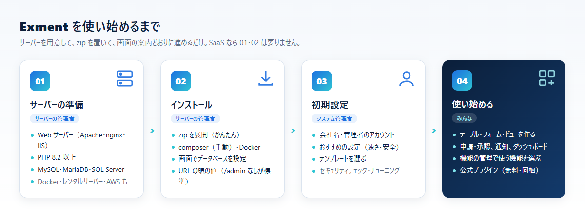

# Quy trình cài đặt
Đây là quy trình từ lúc cài Exment lên máy chủ của bạn đến lúc bắt đầu dùng. Toàn bộ gồm 4 bước.

> **Khi muốn dùng mà không chuẩn bị máy chủ**  
> Cũng có **Exment SaaS**, dùng được mà không cần cài đặt (không cần bước 01 và 02 ở trên). Nếu trước tiên muốn dùng thử, mời bạn xem [demo](https://exment.net/demo-env/). Chi tiết vui lòng xem [giá và hỗ trợ](https://exment.net/plan/).

## 1. Chuẩn bị máy chủ
Exment chạy được khi có máy chủ Web chạy PHP và cơ sở dữ liệu.

| Thứ cần có | Nội dung |
|---|---|
| Máy chủ Web | Apache, nginx, IIS, v.v. |
| PHP | 8.2 trở lên |
| Cơ sở dữ liệu | Một trong: MySQL 8.0 trở lên, MariaDB 10.11 trở lên, SQL Server 13.0 trở lên |

Môi trường hoạt động và thiết lập chi tiết vui lòng xem [Thiết lập máy chủ](/vi/server). Cũng có các bước cho từng môi trường.

| Môi trường dùng | Các bước |
|---|---|
| Thử trên máy tính của mình | [XAMPP (Windows)](/vi/install_xampp), [XAMPP (Mac)](/vi/install_xampp_mac) |
| Máy chủ thuê (Xserver, v.v.) | [Máy chủ thuê](/vi/install_rental) |
| Máy chủ Linux | [Linux](/vi/install_linux) |
| Đám mây | [AWS](/vi/install_aws), [AWS (1 máy)](/vi/install_aws_single), [Azure Web Apps](/vi/install_azure_web_apps) |
| Docker | [Docker](/vi/install_docker) |
| Máy chủ Windows | [IIS](/vi/install_iis) |

## 2. Cài Exment
Cài bằng một trong các cách sau. Nếu phân vân, chúng tôi khuyên dùng "Cài đặt đơn giản".

| Cách | Khi nào dùng | Các bước |
|---|---|---|
| **Cài đặt đơn giản (khuyến nghị)** | Đặt tệp zip rồi làm theo hướng dẫn trên màn hình | [Cài đặt đơn giản](/vi/quickstart_easy) |
| Cài đặt thủ công | Cài bằng composer và lệnh | [Cài đặt thủ công](/vi/quickstart_manual) |
| Docker | Chạy bằng container | [Docker](/vi/install_docker) |

- Tệp zip của phiên bản mới nhất, các phiên bản cũ và SHA-256 có ở trang [tải về](https://exment.net/download/).
- Với cài đặt mới từ v7.2.1 trở đi, URL không có "/admin" (ví dụ: `http://localhost`). Nếu muốn có, bạn đặt được ở mục "Tiền tố URL" trên màn hình cài đặt ([admin trong URL](/vi/additional_prefix)).

## 3. Thiết lập ban đầu
Khi cài đặt xong, màn hình thiết lập ban đầu sẽ hiện ra.

- Đặt tên công ty và tài khoản của quản trị viên hệ thống.
- **Các thiết lập khuyến nghị** (cache của Exment, cache của thiết lập, quyền của tệp, v.v.) hiện ra ở trạng thái đã được đánh dấu. Để dùng nhanh và an toàn, chúng tôi khuyên bạn để nguyên như vậy ([Tinh chỉnh hiệu năng](/vi/tuning)).
- Khi bạn chọn template muốn dùng (quản lý khách hàng, gói đơn yêu cầu, v.v.), các bảng và menu sẽ được thêm vào cùng lúc.

Chi tiết vui lòng xem [Thiết lập ban đầu](/vi/first_setting).

## 4. Bắt đầu dùng
- **Việc cần quyết định trước tiên (trang nào cũng cần)**: hãy thiết lập [lịch chạy tác vụ](/vi/additional_task_schedule) (cron). Nhờ đó thông báo, lịch chạy, sao lưu tự động, v.v. mới hoạt động.
- Tạo [bảng](/vi/table), [form](/vi/form) và [view](/vi/view) cho hợp với công việc.
- Ở [Quản lý tính năng](/vi/feature), chọn chức năng sẽ dùng và các plugin chính thức miễn phí (quản lý dự án, Support Desk, Groupware).
- Kiểm tra các thiết lập về an toàn và tốc độ ở [Kiểm tra bảo mật](/vi/security_check) và [Tinh chỉnh hiệu năng](/vi/tuning).
- Các thiết lập khác (email, nơi lưu tệp, queue, v.v.) có ở [Thiết lập bổ sung](/vi/quickstart_more).

## Khi không thành công
- Nếu có lỗi khi cài đặt, vui lòng xem [Xử lý sự cố](/vi/troubleshooting).
- Chúng tôi không nhận miễn phí các câu hỏi riêng về cài đặt và xây dựng máy chủ. Nếu cần hỗ trợ riêng, vui lòng dùng [dịch vụ hỗ trợ có trả phí](https://exment.net/plan/).
