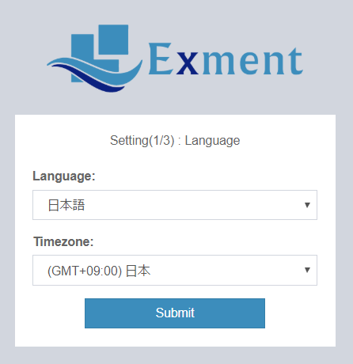

# Các bước cài đặt (cài đặt đơn giản)
Đây là các bước đặt tệp zip rồi cài đặt Exment theo hướng dẫn trên màn hình.  

Có 3 bước sau.

1. Chuẩn bị máy chủ
2. Tải tệp zip về và giải nén trên máy chủ
3. Mở Exment bằng trình duyệt và cài đặt theo hướng dẫn trên màn hình

> ※Nếu cài đặt thủ công hoặc cài đặt một phiên bản chỉ định, vui lòng xem [Cài đặt thủ công](/vi/quickstart_manual).

## Lưu ý
- Nếu có lỗi khi cài đặt, vui lòng xem [Xử lý sự cố](/vi/troubleshooting).
- ※Chúng tôi không nhận các câu hỏi riêng về các bước cài đặt và xây dựng máy chủ. Nếu cần hỗ trợ riêng, vui lòng dùng dịch vụ hỗ trợ có trả phí.

## Xây dựng máy chủ
Nếu chưa chuẩn bị máy chủ Web và máy chủ cơ sở dữ liệu, hãy chuẩn bị trước.  
Các bước vui lòng xem [Thiết lập máy chủ](/vi/server).

## Thiết lập ứng dụng Exment
Khi đã chuẩn bị xong máy chủ, bạn đặt ứng dụng Exment vào.

### Tải và giải nén tệp zip

- Tải tệp zip từ liên kết sau.  
<a id="link" href="https://exment.net/downloads/ja/exment.zip" target="_blank">[Tệp zip Exment (phiên bản mới nhất)]</a>  
Phiên bản mới nhất hiện nay là **v7.2.4** (phát hành ngày 24/11/2026, PHP 8.2 trở lên). Tệp zip, ngày phát hành, SHA-256 và phiên bản PHP tương ứng của từng phiên bản có ở [trang tải về](https://exment.net/download/) (ở đó bạn cũng kiểm tra được tệp đã tải có bị hỏng không).            
  
- Nếu nhất định phải dùng PHP7.4, hãy tải từ liên kết sau. Phiên bản này nằm ngoài phạm vi hỗ trợ, liên hệ, Github issue, v.v. Ngoài ra, nó có thể bị xóa mà không báo trước.  
<a href="https://exment.net/downloads/ja/exment_v4_4_2.zip" target="_blank">[Tệp zip Exment (phiên bản cuối cùng chạy được trên PHP 7.4: v4.4.2)]</a>

- Giải nén tệp zip vào nơi PHP chạy được.  
Ví dụ 1 (XAMPP Windows): C:\xampp\local\exment  
Ví dụ 2 (XAMPP Mac): /Applications/XAMPP/local/exment  
Ví dụ 3 (XServer): $HOME/domain.com.foobar/exment/  
  
- Đừng đặt nguyên tệp zip vào ngay dưới thư mục công khai của máy chủ (ví dụ với linux: /var/www/html). Tệp thiết lập có ghi thiết lập cơ sở dữ liệu, mật khẩu email, v.v. sẽ bị nhìn thấy từ bên ngoài, dẫn đến rò rỉ thông tin nghiêm trọng.  

## Cài đặt dữ liệu ban đầu
Cài đặt Exment theo hướng dẫn trên màn hình.  
※Khi bấm "Đặt lại" ở mỗi màn hình thiết lập, việc cài đặt được làm lại từ bước thiết lập ngôn ngữ và múi giờ.

### Truy cập màn hình cài đặt
Trước tiên, mở trang Exment bằng trình duyệt.  
Ví dụ: http(s)://(URL trang của bạn)  

### Thiết lập ngôn ngữ và múi giờ
Chọn ngôn ngữ và múi giờ.  
Khi cần, hãy đổi khác với giá trị ban đầu.  
  

### Cài đặt cơ sở dữ liệu
Nhập các thiết lập của cơ sở dữ liệu.  
Hãy nhập các nội dung sau cho hợp với môi trường của bạn.   
※Nếu không biết giá trị, chúng có ghi trong các bước của từng môi trường ở [Thiết lập máy chủ](/vi/server), vui lòng xem lại.
~~~
Loại cơ sở dữ liệu
Tên máy chủ của cơ sở dữ liệu
Số cổng của cơ sở dữ liệu
Tên cơ sở dữ liệu dành cho Exment
Tên người dùng của cơ sở dữ liệu dành cho Exment
Mật khẩu của cơ sở dữ liệu dành cho Exment
~~~  

  
  

### Kiểm tra yêu cầu hệ thống
Đây là màn hình kiểm tra các thiết lập máy chủ cần có để chạy Exment.  
Màn hình kiểm tra các giá trị thiết lập của máy chủ Web, v.v. Nếu có thiết lập không được khuyến nghị hoặc thiết lập có vấn đề, nó sẽ hiện cảnh báo hoặc lỗi.  
※Nếu có lỗi, bạn không sang được màn hình tiếp theo.  
※Giải thích chi tiết về màn hình này vui lòng xem [Kiểm tra yêu cầu hệ thống](/vi/server?id=kiểm-tra-yêu-cầu-hệ-thống).

  

### Thực hiện cài đặt
Hãy bấm "Thực hiện cài đặt".  
  

> **Tùy chọn: chi phí băm mật khẩu**  
> Mật khẩu được băm bằng bcrypt, và giá trị mặc định của chi phí tính toán (số vòng) là 12. Nếu muốn đổi, hãy thêm `BCRYPT_ROUNDS` vào ".env". Ví dụ thiết lập vui lòng xem [Cài đặt thủ công](/vi/quickstart_manual).

### Hoàn tất thiết lập
Khi cài đặt xong, hãy làm tiếp [Thiết lập ban đầu](/vi/first_setting.md).  

## Các thiết lập bổ sung khác
Với các việc đã làm đến đây, bạn bắt đầu dùng được Exment. Tuy nhiên, để dùng một số chức năng thì cần thiết lập thêm.  
Vui lòng xem trang sau.  
- [Thiết lập bổ sung](/vi/quickstart_more)

[←Quay lại Quy trình cài đặt](/vi/quickstart)
