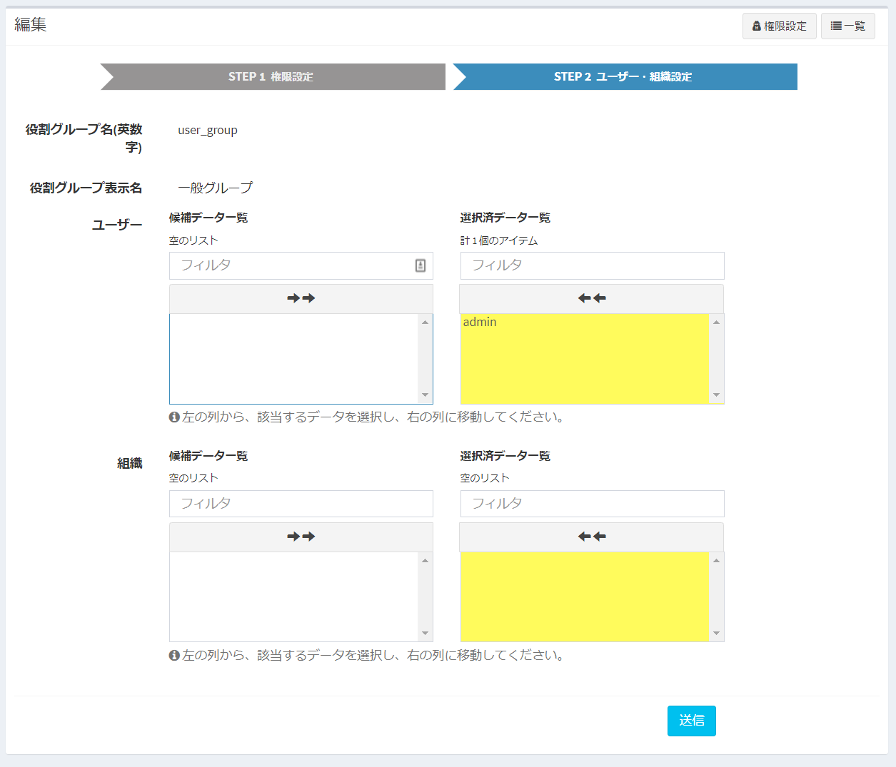

# Nhóm vai trò / Thiết lập quyền

Exment sử dụng một phương thức quản lý gọi là "nhóm vai trò" để kiểm soát quyền thao tác trên hệ thống.  
Đây là một khái niệm quan trọng trong Exment, giúp cho những dữ liệu hoặc trang nhất định chỉ có thể được quản lý bởi những người dùng được chỉ định.  

Khi thêm mới một người dùng và người dùng đó đăng nhập, người dùng đăng nhập đó hầu như không sử dụng được chức năng nào.  
Quản trị viên hệ thống cần gán nhóm vai trò phù hợp cho người dùng mới được thêm.  

> Trước khi thiết lập nhóm vai trò, khuyến nghị xem trang [Tổng quan về vai trò và quyền trong Exment](/permission).

## Sơ đồ minh họa nhóm vai trò
Có thể kiểm soát những nội dung muốn cho từng người dùng thực hiện, tùy theo bộ phận và chức vụ của người dùng sử dụng Exment.  
Ví dụ, có thể phân quyền phù hợp theo các bộ phận và chức vụ như dưới đây.

## Danh sách các nhóm vai trò ban đầu
Phần này giải thích các nhóm vai trò được thiết lập sẵn khi cài đặt.

### All data manager group (Nhóm quản trị toàn bộ dữ liệu)
Nhóm vai trò có thể chỉnh sửa và xem dữ liệu của tất cả các bảng do người dùng đăng ký.

### User / organization management group (Nhóm quản lý người dùng / tổ chức)
Nhóm vai trò quản lý thông tin người dùng, tổ chức cũng như thiết lập người dùng đăng nhập.  
Nhóm này cũng có thể thay đổi người dùng và tổ chức thuộc các nhóm vai trò.

### Announcement information management group (Nhóm quản lý thông tin thông báo chung)
Nhóm vai trò có thể tạo mới, chỉnh sửa và xóa dữ liệu trong "Information" (thông tin thông báo chung) được cài đặt sẵn trong Exment.  

### General group (Nhóm chung)
Nhóm dùng để đăng ký những người dùng khác ngoài các nhóm trên.  
※Khi mới cài đặt, nhóm này không được thiết lập quyền nào.

## Cấu trúc dữ liệu của nhóm vai trò
Nhóm vai trò có cấu trúc dữ liệu như sau.

### (1) Thiết lập quyền
Quyền (permission) quyết định có được phép thực hiện một thao tác nhất định trong Exment hay không.  
Ví dụ, có các quyền như sau.
##### Quản lý người dùng đăng nhập   
Quyền cấp quyền đăng nhập cho từng người dùng và đặt lại mật khẩu
##### Chỉnh sửa tất cả dữ liệu  
Quyền thêm, chỉnh sửa và xóa tất cả dữ liệu trên một bảng nhất định
##### Xem dữ liệu được phụ trách
Quyền xem các dữ liệu mà bản thân là người phụ trách  
Thiết lập quyền được gắn với nhóm vai trò.

### (2) Người dùng / tổ chức
Thiết lập người dùng và tổ chức thuộc nhóm vai trò.  
Khi người dùng được thiết lập ở đây đăng nhập, người dùng đó sẽ có thể thực hiện các thao tác thuộc quyền đã thiết lập.

## Cách thiết lập

### Trình tự thiết lập tổng thể
1. Thực hiện thiết lập ban đầu cho nhóm vai trò, chẳng hạn như thiết lập tên nhóm vai trò.
1. Thiết lập các quyền có thể thực hiện trong nhóm vai trò đó.
1. Thiết lập người dùng và tổ chức thuộc nhóm vai trò đó.

※Vui lòng thiết lập quản trị viên hệ thống tại <a href="https://exment.net/docs/#/vi/system_setting">trang thiết lập hệ thống</a>.

### Danh sách
Vui lòng nhấp vào "Role group" trên menu.  
Màn hình danh sách các thiết lập nhóm vai trò đã tạo sẽ hiển thị.  

### Tạo mới nhóm vai trò
Đây là cách tạo mới nhóm vai trò.

- Nhấp vào nút [New] ở phía trên bên phải của màn hình danh sách.

- Màn hình tạo mới nhóm vai trò sẽ hiển thị, hãy nhập các thông tin cần thiết rồi nhấp vào [Submit].  

- Sau khi lưu, màn hình danh sách sẽ hiển thị lại và nhóm vai trò vừa tạo đã được thêm vào.

### Cách thay đổi thiết lập quyền
Đây là cách thay đổi thiết lập quyền.

- Trên màn hình danh sách nhóm vai trò, nhấp vào dòng của nhóm vai trò đã tạo.  
Hoặc nhấp vào liên kết [Permission setting] (thiết lập quyền).

- Màn hình thiết lập quyền sẽ hiển thị, hãy tiến hành thiết lập quyền.

### Các loại quyền và danh sách quyền
Phần này mô tả các loại quyền có thể thiết lập.

#### System permissions (Toàn hệ thống)
Đây là các quyền quyết định thao tác đối với toàn bộ Exment.  

##### Danh sách quyền
- ##### All table management (Quản lý tất cả các bảng)  
Có thể thêm bảng tùy chỉnh, cũng như thay đổi và xóa tất cả các bảng tùy chỉnh. Ngoài ra, có thể thêm, thay đổi và xóa tất cả dữ liệu trong các bảng tùy chỉnh.
- ##### Edit all data (Chỉnh sửa tất cả dữ liệu)  
Có thể thêm, thay đổi và xóa tất cả dữ liệu trong các bảng tùy chỉnh.
- ##### User login setting (Thiết lập đăng nhập của người dùng)  
Có thể quản lý những người dùng đăng nhập vào Exment. Có thể cấp quyền đăng nhập, đặt lại mật khẩu, v.v.
- ##### Workflow setting (Thiết lập workflow)  
Có thể thay đổi thiết lập workflow.
- ##### Manage all API apps (Quản lý toàn bộ ứng dụng API)  
Có thể thêm, thay đổi và xóa tất cả các ứng dụng API.
- ##### Manage API apps (Quản lý ứng dụng API)  
Chỉ có thể thêm, thay đổi và xóa các ứng dụng API do chính mình tạo. ※Không thể xem, thêm, thay đổi hoặc xóa các ứng dụng API do người dùng khác tạo.
- ##### Manage all plugins (Quản lý toàn bộ plugin)
Có thể thêm, thay đổi và xóa tất cả các plugin. Ngoài ra, có thể sử dụng các plugin.

#### Role group (Nhóm vai trò)
Đây là các quyền quyết định thao tác đối với nhóm vai trò.  

##### Danh sách quyền
- ##### Manage all role groups (Quản lý toàn bộ nhóm vai trò)  
Có thể thay đổi toàn bộ thiết lập của nhóm vai trò. Có thể thêm, thay đổi và xóa nhóm, thay đổi thiết lập quyền của nhóm, và thay đổi thiết lập người dùng / tổ chức.
- ##### Change permission settings (Thay đổi thiết lập quyền)  
Có thể thay đổi thiết lập quyền của nhóm vai trò.
- ##### User / organization management (Quản lý người dùng / tổ chức)  
Có thể thay đổi thiết lập người dùng và tổ chức được đăng ký vào nhóm vai trò.

#### Plugin permissions (Thiết lập quyền plugin)
Có thể phân quyền truy cập đối với các plugin của Exment.  
  
##### Danh sách quyền
- ##### Change settings (Thay đổi thiết lập)
Đối với plugin có phần thiết lập, có thể thay đổi thiết lập của plugin này.  
※Không thể xóa hoặc tải lên plugin. Nếu cần xóa, vui lòng thêm quyền "Manage all plugins".

- ##### Use / access (Sử dụng / truy cập)
Có thể sử dụng plugin trên thực tế và truy cập vào trang. Nội dung được kiểm soát khác nhau tùy theo loại plugin.

- **Nút, xuất tài liệu**: Kiểm soát việc hiển thị hoặc ẩn nút trên màn hình.
- **Trang, dashboard**: Chuyển đổi việc cho phép hoặc không cho phép truy cập trang.
- **API**: Chuyển đổi việc cho phép hoặc không cho phép thực thi API. (Nếu không được phép truy cập, lỗi 403 sẽ xảy ra.)
- **Nhập (import), xuất (export)**: Kiểm soát việc cho phép hoặc không cho phép thực hiện nhập và xuất dữ liệu.
- **Các loại khác**: Không thể kiểm soát bằng nhóm vai trò. Plugin được thực thi đối với tất cả người dùng.
    

#### Master permissions (Thiết lập quyền master)
Có thể phân quyền đối với các bảng dùng để quản lý dữ liệu master của Exment.  
  
##### Danh sách quyền
- ##### Master management (Quản lý master)  
Có thể thay đổi định nghĩa của master. Ngoài ra, có thể thêm, chỉnh sửa và xóa dữ liệu master.
- ##### System view (View hệ thống)  
Có thể quản lý các System view của bảng tùy chỉnh được chỉ định.  
- ##### Edit data (Chỉnh sửa dữ liệu)  
Có thể thêm, chỉnh sửa và xóa dữ liệu master.
- ##### View data (Xem dữ liệu)  
Có thể xem dữ liệu master. ※Không thể chỉnh sửa hoặc xóa dữ liệu.

#### Table permissions (Quyền đối với bảng)
Trong Exment, có thể tạo các bảng để quản lý dữ liệu.  
Có thể phân quyền theo từng bảng đó.  
Ví dụ, có các cách sử dụng như sau.  
- Người dùng của phòng kinh doanh có thể chỉnh sửa và xem tất cả dữ liệu của bảng "Hoạt động kinh doanh".
- Người dùng của phòng kỹ thuật có thể chỉnh sửa và xem tất cả dữ liệu của bảng "Quản lý kỹ thuật".
- Người dùng của công ty đối tác chỉ có thể xem những dữ liệu mà mình có quyền trong bảng "Yêu cầu đặt hàng".  
  
##### Danh sách quyền
- ##### Table management (Quản lý bảng)  
Có thể sửa định nghĩa bảng, form, v.v. đối với bảng tùy chỉnh được chỉ định.  
Ngoài ra, đây là quyền cho phép thêm, chỉnh sửa và xóa tất cả dữ liệu trong bảng tùy chỉnh được chỉ định.
- ##### Form (Thiết lập form)  
Có thể thêm, chỉnh sửa và xóa form đối với bảng tùy chỉnh được chỉ định.  
- ##### Public Form Management (Quản lý form công khai)  
Có thể thêm, chỉnh sửa và xóa thiết lập form công khai đối với bảng tùy chỉnh được chỉ định.  
※Chỉ được hiển thị khi "Use public form" được đặt là YES trong thiết lập hệ thống.  
※Không thể thêm, chỉnh sửa hoặc xóa bản thân form.  
- ##### View (View hệ thống)  
Có thể quản lý các System view của bảng tùy chỉnh được chỉ định.  
- ##### Edit All Data (Chỉnh sửa toàn bộ dữ liệu)  
Quyền cho phép thêm, chỉnh sửa và xóa tất cả dữ liệu trong bảng tùy chỉnh được chỉ định.
- ##### View All Data (Xem toàn bộ dữ liệu)  
Quyền cho phép xem tất cả dữ liệu trong bảng tùy chỉnh được chỉ định.  
※Không thể chỉnh sửa hoặc xóa dữ liệu.
- ##### Edit responsible data (Chỉnh sửa dữ liệu được phụ trách)  
Quyền cho phép thêm, chỉnh sửa và xóa những dữ liệu trong bảng tùy chỉnh được chỉ định mà chính người dùng đăng nhập được thiết lập là người phụ trách.  
- ##### View assigned data (Xem dữ liệu được phụ trách)  
Quyền cho phép xem những dữ liệu trong bảng tùy chỉnh được chỉ định mà chính người dùng đăng nhập được thiết lập là người phụ trách.  
※Không thể chỉnh sửa hoặc xóa dữ liệu.
- ##### Data sharing (Chia sẻ dữ liệu)  
Quyền cho phép chia sẻ những dữ liệu mà mình có quyền chỉnh sửa với người dùng hoặc tổ chức khác.  
- ##### Data import (Nhập dữ liệu)  
Có thể nhập (import) dữ liệu từ tệp định dạng csv hoặc Excel vào bảng tùy chỉnh được chỉ định.  
- ##### Data export (Xuất dữ liệu)  
Có thể xuất (export) dữ liệu của bảng tùy chỉnh được chỉ định ra tệp định dạng csv hoặc Excel.  
- ##### Show Trashed Data (Hiển thị dữ liệu đã xóa)  
Có thể hiển thị lại các dữ liệu đã bị xóa logic. ※Để khôi phục dữ liệu, cần có quyền chỉnh sửa đối với dữ liệu đó.  

### Cách thiết lập người dùng / tổ chức
Đây là cách thay đổi thiết lập người dùng và tổ chức thuộc nhóm vai trò.

- Trên màn hình danh sách, nhấp vào liên kết người dùng.
  
Hoặc nhấp vào nút [User / Organization Settings] (thiết lập người dùng / tổ chức) ở phía trên bên phải của màn hình thiết lập quyền.  
  

- Màn hình thiết lập người dùng / tổ chức sẽ hiển thị. Vui lòng đăng ký người dùng và tổ chức thuộc nhóm vai trò này.  

### Xóa
- Trên màn hình danh sách nhóm vai trò, nhấp vào liên kết [Delete].

### Khác

#### Khi thêm nhiều nhóm vai trò
Khi thêm nhiều nhóm vai trò cho một người dùng hoặc tổ chức, tất cả các quyền gắn với từng nhóm vai trò sẽ được kết hợp lại.

- Ví dụ: Người dùng A
    - Nhóm vai trò X
        - Bảng 1
            - Chỉnh sửa dữ liệu được phụ trách
        - Bảng 2
            - Xem dữ liệu được phụ trách
        - Bảng 3
            - Xem toàn bộ dữ liệu
        
    - Nhóm vai trò Y
        - Bảng 1
            - Xem toàn bộ dữ liệu
        - Bảng 4
            - Chỉnh sửa dữ liệu được phụ trách

    - →Quyền cuối cùng của người dùng A
        - Bảng 1
            - Xem toàn bộ dữ liệu
            - Chỉnh sửa dữ liệu được phụ trách
        - Bảng 2
            - Xem dữ liệu được phụ trách
        - Bảng 3
            - Xem toàn bộ dữ liệu
        - Bảng 4
            - Chỉnh sửa dữ liệu được phụ trách
