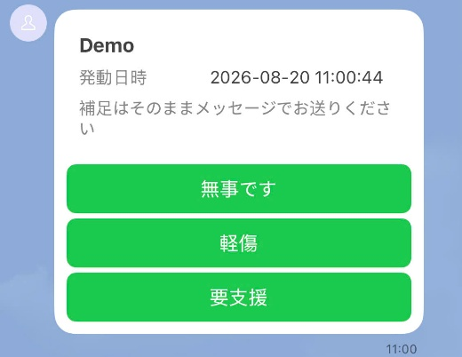
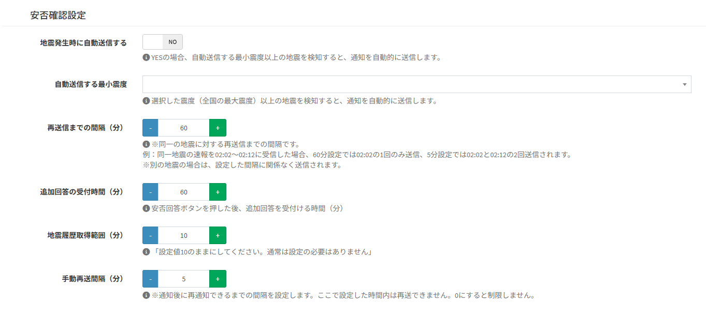
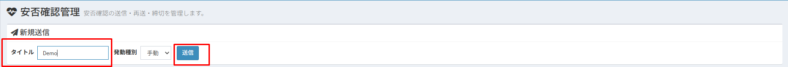
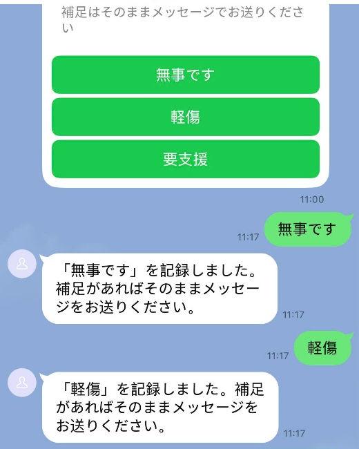
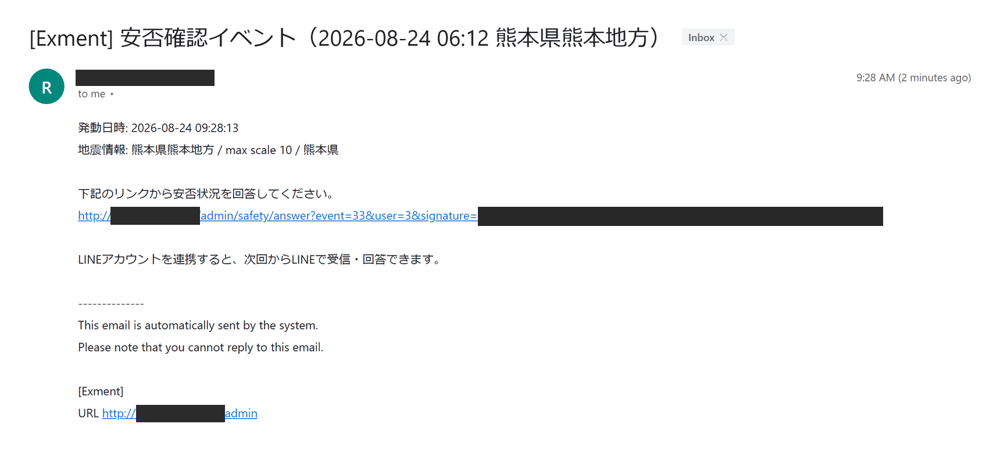
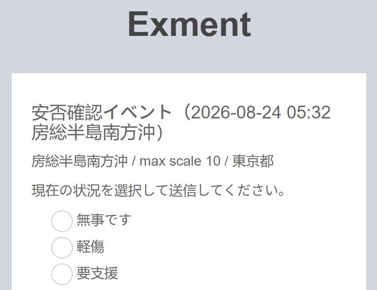
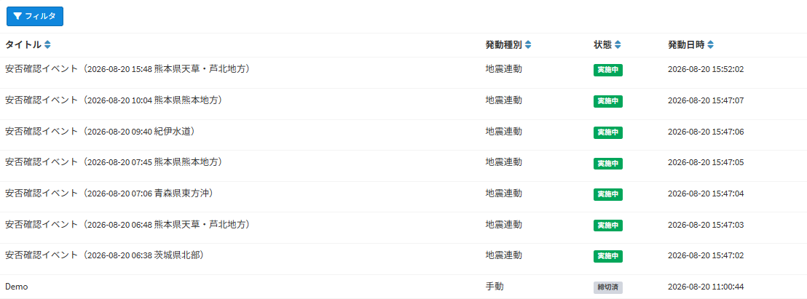
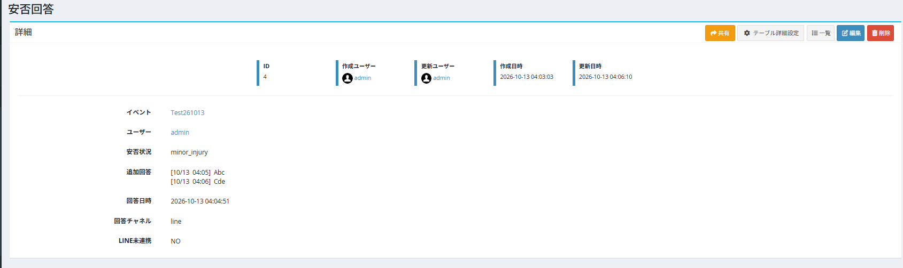
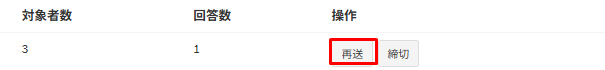
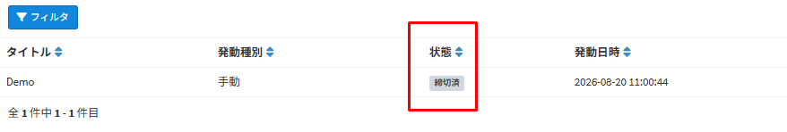

# Xác nhận an toàn
Đây là tính năng hỏi nhân viên có an toàn không bằng LINE và email trong trường hợp khẩn cấp như động đất, bão.  
Quản trị viên gửi được từ màn hình. Cũng có thể gửi tự động khi xảy ra động đất từ cấp Shindo đã thiết lập trở lên.  
Tình hình trả lời xem được ở màn hình Quản lý xác nhận an toàn và bảng Câu trả lời xác nhận an toàn.  
※Xác nhận an toàn dùng được từ v7.0.0.

Trình tự cho đến khi dùng được như sau.

1. Làm [chuẩn bị trước](/vi/safety_check?id=chuẩn-bị-trước) (LINE, email, task schedule).
2. Làm [cài đặt xác nhận an toàn](/vi/safety_check?id=cài-đặt-xác-nhận-an-toàn) (có gửi tự động khi động đất không, v.v.).
3. [Gửi xác nhận an toàn](/vi/safety_check?id=gửi-xác-nhận-an-toàn).
4. Nhân viên [trả lời](/vi/safety_check?id=trả-lời).
5. [Kiểm tra tình hình trả lời](/vi/safety_check?id=kiểm-tra-tình-hình-trả-lời), và nếu cần thì [gửi lại hoặc kết thúc](/vi/safety_check?id=gửi-lại-và-kết-thúc).

## Cơ chế của xác nhận an toàn
- Mỗi lần gửi xác nhận an toàn, 1 dữ liệu "Sự kiện xác nhận an toàn" được tạo.
- Đồng thời, với mọi người dùng, dữ liệu "Câu trả lời xác nhận an toàn" có tình trạng an toàn là "not_answered" (chưa trả lời) được tạo.
- Từng người dùng được gửi bằng các cách sau. Người dùng nhận cả LINE và email thì trả lời từ bên nào cũng được.

| Cách gửi | Đối tượng gửi | Cách trả lời |
| --- | --- | --- |
| LINE | Người dùng đã [liên kết tài khoản LINE](/vi/line?id=liên-kết-tài-khoản-line) | Nút "An toàn", "Bị thương nhẹ", "Cần hỗ trợ" trên thẻ |
| Email | Người dùng có đăng ký địa chỉ email (gồm cả người dùng đã liên kết tài khoản LINE) | Màn hình trả lời mở từ liên kết trong email (không cần đăng nhập) |

※Người dùng chưa liên kết tài khoản LINE và cũng không đăng ký địa chỉ email thì không được gửi.

### Loại kích hoạt
Xác nhận an toàn có các loại kích hoạt sau.

| Loại kích hoạt | Nội dung |
| --- | --- |
| Thủ công | Quản trị viên gửi từ màn hình Quản lý xác nhận an toàn. Dùng được cho nhiều trường hợp khẩn cấp như động đất, bão, hỏa hoạn. |
| Diễn tập | Gửi bằng cách giống như thủ công. Đầu tiêu đề của tin nhắn được gửi có thêm "[Diễn tập]". |
| Tự động theo động đất (JMA) | Được gửi tự động khi xảy ra động đất từ cấp Shindo đã thiết lập trở lên. |

## Chuẩn bị trước
Việc cần chuẩn bị thay đổi tùy theo cách dùng.

| Cách dùng | Việc cần chuẩn bị |
| --- | --- |
| **Khi gửi bằng LINE** | Làm các thiết lập của [Liên kết LINE](/vi/line) (chuẩn bị LINE Official Account, "Cài đặt LINE" trong cài đặt hệ thống, thiết lập Webhook), và nhờ từng người dùng liên kết tài khoản LINE. |
| **Khi gửi bằng email** | Làm [thiết lập gửi email](/vi/mailsend_setting). Ngoài ra, vui lòng xem [Thiết lập email](/vi/safety_check?id=thiết-lập-email). |
| **Khi gửi tự động lúc xảy ra động đất** | Cần thiết lập [task schedule](/vi/additional_task_schedule). Ngoài ra, máy chủ Exment phải truy cập được API lấy thông tin động đất (https://api.p2pquake.net). |

※Chỉ người dùng có quyền quản trị viên hệ thống mới dùng được màn hình Quản lý xác nhận an toàn.

## Cài đặt (install)
Các bảng và menu dùng cho xác nhận an toàn được tạo tự động khi cài đặt hoặc cập nhật Exment.  
Với môi trường đã có, hãy chạy "php artisan exment:update" theo các bước của [Cập nhật](/vi/update).

Những thứ sau được tạo.

| Loại | Tên | Nội dung |
| --- | --- | --- |
| Bảng | Sự kiện xác nhận an toàn | Mỗi lần gửi xác nhận an toàn, 1 dữ liệu được tạo. |
| Bảng | Câu trả lời xác nhận an toàn | Với mỗi xác nhận an toàn và mỗi người dùng, 1 dữ liệu được tạo. |
| Menu | Quản lý xác nhận an toàn | Màn hình để gửi, gửi lại và kết thúc xác nhận an toàn. |
| Mẫu thông báo | Email xác nhận an toàn | Mẫu email của xác nhận an toàn. |
| Mẫu LINE Flex | Xác nhận an toàn | Khóa Flex là "safety_check". Nội dung thẻ LINE của xác nhận an toàn là cố định, nên dù sửa mẫu này thẻ cũng không đổi. Đừng chọn mẫu này trong thiết lập thông báo, cũng đừng sửa hoặc xóa. |

※Nếu không được tạo, hãy chạy "php artisan exment:patchdata line_safety_check".

## Cài đặt xác nhận an toàn
1. Bấm "Cài đặt quản trị" → "Cài đặt hệ thống" ở menu bên trái, rồi chuyển sang [Cài đặt chi tiết] bằng nút ở góc trên bên phải.
2. Ở "Cài đặt xác nhận an toàn" (bên dưới "Cài đặt LINE"), thiết lập các mục sau rồi bấm [Lưu].

| Mục | Nội dung |
| --- | --- |
| Tự động gửi khi có động đất | Nếu là YES, khi xảy ra động đất từ "Cường độ địa chấn tối thiểu để tự động gửi" trở lên, xác nhận an toàn được gửi tự động. Nếu là NO, chỉ gửi được từ màn hình Quản lý xác nhận an toàn. Giá trị ban đầu: NO |
| Cường độ địa chấn tối thiểu để tự động gửi | Chọn cấp Shindo làm mốc để gửi tự động: Cấp Shindo 4, 5 yếu, 5 mạnh, 6 yếu, 6 mạnh hoặc 7. Việc xét dựa trên cấp Shindo lớn nhất toàn quốc trong thông tin động đất. Không lọc được theo vùng. Giá trị ban đầu: Cấp Shindo 5 yếu |
| Khoảng cách gửi lại (phút) | Thời gian (phút) không gửi tự động lại cho cùng một trận động đất. Với một trận động đất, có nhiều thông tin được công bố như tin nhanh, tin chi tiết, tin đính chính. Sau khi đã gửi cho một trận động đất, thông tin đến trong khoảng thời gian này sẽ không làm gửi nữa. Với trận động đất khác thì gửi, không phụ thuộc khoảng thời gian này. Giá trị ban đầu: 60 |
| Thời gian nhận phản hồi bổ sung (phút) | Thời gian (phút) mà tin nhắn gửi tiếp sau khi bấm nút trả lời trên LINE được ghi là "trả lời bổ sung". Mỗi lần gửi trả lời bổ sung, thời gian nhận được kéo dài thêm. Giá trị ban đầu: 60 |
| Phạm vi lấy lịch sử động đất (phút) | Thông tin động đất đã quá khoảng thời gian này (phút) kể từ lúc công bố sẽ không làm gửi tự động. Việc này tránh gửi hàng loạt cho các trận động đất trong quá khứ ngay sau khi bật tính năng, hoặc sau khi task schedule bị dừng. Thông thường hãy giữ nguyên "10". Giá trị ban đầu: 10 |
| Khoảng cách gửi lại thủ công (phút) | Thời gian (phút) từ sau khi chạy [Gửi lại] đến khi chạy được [Gửi lại] lần tiếp theo. Nếu là 0 thì không giới hạn. Giá trị ban đầu: 5 |

※Với các mục số ngoài "Khoảng cách gửi lại thủ công (phút)", nếu lưu 0 hoặc để trống thì giá trị ban đầu được dùng.

## Thiết lập email

### Liên kết trả lời
Email xác nhận an toàn có ghi liên kết để mở màn hình trả lời (liên kết trả lời). Hãy chú ý 2 điểm sau.

- **Dùng URL mà nhân viên mở được**: liên kết trả lời được tạo từ URL của Exment.
    - Khi gửi tự động lúc xảy ra động đất, "APP_URL" trong tệp ".env" được dùng. Hãy đặt "APP_URL" là URL mà nhân viên truy cập được cả từ ngoài công ty.
    - Khi gửi từ màn hình cũng vậy, hãy mở Exment bằng URL mà nhân viên truy cập được rồi gửi.
- **Nếu đổi "APP_KEY", các liên kết đã gửi sẽ mất hiệu lực**: liên kết trả lời có kèm chữ ký dùng "APP_KEY" trong tệp ".env". Nếu đổi "APP_KEY" sau khi gửi email, hãy gửi liên kết mới bằng [Gửi lại].

### Mẫu email
Tiêu đề và nội dung email đổi được ở "Email xác nhận an toàn" của [mẫu thông báo](/vi/mail). Giá trị ban đầu như sau.

~~~
Tiêu đề:
[${system:site_name}] ${safety_title}

Nội dung:
${safety_body}

Vui lòng trả lời tình trạng an toàn của bạn qua liên kết bên dưới.
${answer_url}

Nếu liên kết tài khoản LINE, từ lần sau bạn có thể nhận và trả lời qua LINE.
~~~

| Biến | Nội dung |
| --- | --- |
| ${safety_title} | Tiêu đề của xác nhận an toàn. Với diễn tập, ở đầu có thêm "[Diễn tập]". |
| ${safety_body} | Thời điểm kích hoạt, và thông tin động đất (với loại tự động theo động đất). |
| ${answer_url} | Liên kết trả lời. |

※Nếu xóa "${answer_url}" khỏi nội dung, sẽ không trả lời được từ email. Nhất định phải giữ lại.

## Gửi xác nhận an toàn

### Mở màn hình
Bấm "Cài đặt quản trị" → "Quản lý xác nhận an toàn" ở menu bên trái (ở v7.0, mục này nằm trên cùng của menu bên trái). Cũng có thể mở bằng URL sau.

~~~
http(s)://(URL của Exment)/safety_check
~~~

> ※URL trên là của thiết lập chuẩn không có "/admin" (site mới cài từ v7.2.1). Nếu `ADMIN_ROUTE_PREFIX` trong `.env` có giá trị (site cài bằng phiên bản trước là "admin"), hãy thêm giá trị đó vào sau URL của site (ví dụ: `http(s)://(URL của Exment)/admin/safety_check`). Chi tiết vui lòng xem [Đổi hoặc bỏ "admin" trong URL](/vi/additional_prefix).

### Gửi thủ công hoặc diễn tập
1. Nhập tiêu đề của xác nhận an toàn vào "Tiêu đề" của "Gửi mới" (ví dụ: Bão số 15 - xác nhận an toàn).
2. Chọn "Thủ công" hoặc "Diễn tập" ở "Loại kích hoạt".
3. Bấm [Gửi]. Thông báo "Đã bắt đầu gửi xác nhận an toàn." hiển thị, và xác nhận an toàn "Đang thực hiện" được thêm vào danh sách.
4. Việc gửi được làm sau khi màn hình hiển thị. Khi gửi xong, "Số đã gửi" và "Số người đối tượng" trong danh sách được cập nhật. Hãy tải lại màn hình để kiểm tra.

- **"Diễn tập" cũng được gửi cho mọi người dùng**. Cũng được tính vào số tin nhắn của LINE.
- **Đừng bấm [Gửi] nhiều lần**. Cho đến khi lần gửi trước của cùng người dùng đó hoàn tất (tối đa 10 phút), không gửi được xác nhận an toàn mới. Nếu hiển thị "Đang trong quá trình gửi. Vui lòng chờ một lát rồi tải lại trang." thì lần gửi trước đang được xử lý. Hãy chờ một lát rồi tải lại màn hình.
- Khi số người dùng nhiều, có thể mất thời gian đến khi gửi xong.

**Khi đang dùng thực thi trễ việc thông báo (queue)**

- Bản thân xử lý gửi được chạy mà không dùng queue worker.
- Nếu đã thiết lập [thực thi trễ việc thông báo](/vi/additional_queue), việc phát LINE và email được chạy bằng queue, nên cần cho queue worker chạy sẵn.
- Khi chạy bằng queue, tin nhắn gửi thất bại được tự động gửi lại (thử tối đa 3 lần, gồm cả lần gửi đầu). Với LINE, chỉ gửi lại khi thất bại do máy chủ LINE quá tải (HTTP 429) hoặc lỗi máy chủ (HTTP 5xx).

### Gửi tự động khi xảy ra động đất
Khi đặt "Tự động gửi khi có động đất" của "Cài đặt xác nhận an toàn" thành YES, mỗi phút Exment lấy thông tin động đất của Cơ quan Khí tượng Nhật Bản từ API của P2P Quake (p2pquake.net).  
Khi có thông tin động đất thỏa mãn tất cả các điều kiện sau, xác nhận an toàn có loại kích hoạt "Tự động theo động đất (JMA)" được gửi tự động.

- Cấp Shindo lớn nhất toàn quốc từ "Cường độ địa chấn tối thiểu để tự động gửi" trở lên
- Chưa quá "Phạm vi lấy lịch sử động đất (phút)" kể từ lúc công bố thông tin động đất
- Chưa gửi cho cùng trận động đất đó trong vòng "Khoảng cách gửi lại (phút)"

- Tiêu đề của xác nhận an toàn gửi tự động là "Sự kiện xác nhận an toàn ((thời điểm xảy ra) (tâm chấn))".
- Nếu gửi theo thông tin trước khi xác định được tâm chấn (tin nhanh về cấp Shindo), tâm chấn hiển thị là "Đang xác định tâm chấn". Khi thông tin đến sau xác định được tâm chấn, tiêu đề được cập nhật (không gửi lại).

※Gửi tự động cần thiết lập [task schedule](/vi/additional_task_schedule). Nhờ task schedule, lệnh "exment:safetywatch" được chạy mỗi phút.

## Trả lời
Đây là các bước để người dùng trả lời. Hãy dùng để hướng dẫn nhân viên.

### Trả lời bằng LINE
Người dùng đã liên kết tài khoản LINE nhận được thẻ có các nút "An toàn", "Bị thương nhẹ", "Cần hỗ trợ".

- **Trả lời**: bấm một trong các nút. Câu trả lời đến có dạng "Đã ghi nhận "An toàn". Nếu có thông tin bổ sung, vui lòng gửi dưới dạng tin nhắn.".
- **Đổi câu trả lời**: bấm một nút khác lần nữa. Nội dung của nút bấm sau cùng được ghi lại.
- **Bổ sung tình hình**: sau khi bấm nút, gửi tiếp tin nhắn. Câu trả lời "Đã thêm câu trả lời bổ sung." đến, và tin nhắn được ghi là "trả lời bổ sung".

※Hãy gửi trả lời bổ sung trong vòng "Thời gian nhận phản hồi bổ sung (phút)" (mặc định 60 phút) kể từ khi bấm nút hoặc từ lần gửi trả lời bổ sung trước. Nếu đã quá thời gian nhận, hãy bấm nút lần nữa rồi gửi.

### Trả lời bằng email
Người dùng có đăng ký địa chỉ email nhận được email có ghi liên kết trả lời.

1. Bấm liên kết trong email. Màn hình trả lời mở ra mà không cần đăng nhập.
2. Chọn tình trạng hiện tại ("An toàn", "Bị thương nhẹ", "Cần hỗ trợ"), nhập "Trả lời bổ sung (không bắt buộc)" nếu cần, rồi bấm [Gửi].

3. Khi hiển thị "Đã ghi nhận câu trả lời của bạn" là đã trả lời xong.

- Mở lại cùng liên kết đó sẽ thấy câu trả lời hiện tại. Cho đến khi xác nhận an toàn được kết thúc, vẫn đổi được câu trả lời.
- Liên kết trả lời không có thời hạn hiệu lực. Khi xác nhận an toàn được kết thúc thì không trả lời được nữa.
- **Đừng chuyển tiếp email xác nhận an toàn cho người khác**. Ai biết liên kết cũng trả lời được với tư cách người dùng đó.
- Kể cả khi đã làm [thiết lập lọc IP](/vi/additional_ip_filter), màn hình trả lời vẫn mở được từ ngoài công ty.

Màn hình trả lời có thể hiển thị các thông báo sau.

| Thông báo | Nội dung |
| --- | --- |
| Đợt xác nhận an toàn này đã kết thúc. | Xác nhận an toàn đã được kết thúc nên không trả lời được. |
| Liên kết không hợp lệ. Vui lòng liên hệ quản trị viên. | Liên kết không đúng. Hiển thị khi liên kết bị thiếu một phần, hoặc khi "APP_KEY" đã bị đổi sau khi gửi email. |

## Kiểm tra tình hình trả lời

### Màn hình Quản lý xác nhận an toàn
Ở danh sách của màn hình Quản lý xác nhận an toàn, bạn xem được tình hình của từng xác nhận an toàn.

| Cột | Nội dung |
| --- | --- |
| Tiêu đề | Tiêu đề của xác nhận an toàn. |
| Loại kích hoạt | Một trong "Thủ công", "Diễn tập", "Tự động theo động đất (JMA)". |
| Trạng thái | "Đang thực hiện" hoặc "Đã kết thúc". |
| Thời điểm kích hoạt | Ngày giờ đã gửi xác nhận an toàn. |
| Số đã gửi | Số người dùng đã được gửi ít nhất một trong LINE hoặc email ở lần gửi đầu. Không đổi khi [Gửi lại]. |
| Số người đối tượng | Số người dùng là đối tượng của xác nhận an toàn. |
| Số đã trả lời | Số người dùng đã trả lời. |
| Thao tác | Nút [Gửi lại] và [Kết thúc]. Không hiển thị với xác nhận an toàn đã kết thúc. |

### Bảng Câu trả lời xác nhận an toàn
Câu trả lời của từng người dùng xem được ở bảng "Câu trả lời xác nhận an toàn".  
Bảng này không hiển thị ở menu bên trái. Hãy truy cập URL sau.

~~~
http(s)://(URL của Exment)/data/safety_check_answer
~~~

| Cột | Nội dung |
| --- | --- |
| Sự kiện | Xác nhận an toàn mà câu trả lời thuộc về. |
| Người dùng | Người dùng trả lời. |
| Tình trạng an toàn | Một trong "not_answered" (chưa trả lời), "safe" (An toàn), "minor_injury" (Bị thương nhẹ), "need_help" (Cần hỗ trợ). |
| Trả lời bổ sung | Nội dung trả lời bổ sung. Mỗi lần gửi, nội dung được ghi thêm kèm ngày giờ gửi (tháng/ngày giờ:phút). |
| Thời điểm trả lời | Ngày giờ trả lời sau cùng. |
| Kênh trả lời | Cách đã dùng để trả lời. Là "line" hoặc "mail". |
| Chưa liên kết LINE | Là YES nếu lúc gửi người dùng chưa liên kết tài khoản LINE. |

※Dù "Chưa liên kết LINE" là YES, người dùng vẫn có thể đã trả lời bằng email. Để tìm người dùng không được gửi cả LINE lẫn email, hãy tìm người dùng có "Chưa liên kết LINE" là YES và không đăng ký địa chỉ email.

#### Ví dụ tạo view
Tạo [view tùy chỉnh](/vi/view) cho bảng Câu trả lời xác nhận an toàn sẽ giúp xem tình hình dễ hơn.

- **Danh sách người chưa trả lời**: tạo view (Chế độ xem danh sách), và ở Điều kiện hiển thị dữ liệu, đặt điều kiện "Tình trạng an toàn" là "not_answered". Thêm điều kiện của "Sự kiện" thì lọc được theo một xác nhận an toàn cụ thể.
- **Số người theo tình trạng an toàn**: tạo Chế độ xem tổng hợp, nhóm theo "Tình trạng an toàn" và hiển thị số lượng.

## Gửi lại và kết thúc
Ở danh sách của màn hình Quản lý xác nhận an toàn, bạn chạy được [Gửi lại] và [Kết thúc] cho từng xác nhận an toàn.

### Gửi lại
Bấm [Gửi lại], rồi bấm [Xác nhận] ở hộp thoại xác nhận. Thông báo "Đã bắt đầu gửi lại." hiển thị.

- LINE và email được gửi lại **chỉ cho người dùng chưa trả lời**. Người dùng đã trả lời không được gửi.
- Người dùng được thêm sau lần gửi đầu cũng được gửi, và "Số người đối tượng" được cập nhật.
- Việc gửi lại cũng được làm sau khi màn hình hiển thị.

- Cho đến khi qua "Khoảng cách gửi lại thủ công (phút)" (mặc định 5 phút) kể từ lần [Gửi lại] trước, không gửi lại được. Thông báo hiển thị có dạng "Vui lòng chờ ít nhất 5 phút giữa các lần gửi lại.".
- "Số đã gửi" vẫn là giá trị của lần gửi đầu. Tình hình trả lời mới nhất, hãy xem ở "Số đã trả lời" hoặc bảng Câu trả lời xác nhận an toàn.

### Kết thúc
Bấm [Kết thúc], rồi bấm [Xác nhận] ở hộp thoại xác nhận.  
Trạng thái thành "Đã kết thúc", và từ đó không trả lời được nữa, cả từ LINE lẫn email. Các câu trả lời đã ghi vẫn được giữ nguyên.

- **Không đưa được xác nhận an toàn đã kết thúc về lại "Đang thực hiện"**. Nếu muốn xác nhận an toàn lần nữa, hãy gửi một xác nhận an toàn mới.
- Sau khi kết thúc, nếu bấm nút trên LINE hoặc mở liên kết trong email, sẽ hiển thị "Đợt xác nhận an toàn này đã kết thúc.".

## Khi không hoạt động đúng
| Hiện tượng | Nguyên nhân chính | Cách xử lý |
| --- | --- | --- |
| Màn hình Quản lý xác nhận an toàn hiển thị "Các bảng xác nhận an toàn chưa được cài đặt hoặc chưa đầy đủ." | Việc cập nhật, hoặc việc tạo các bảng xác nhận an toàn chưa hoàn tất | Hãy chạy "php artisan migrate". Nếu vẫn hiển thị, hãy chạy "php artisan exment:patchdata line_safety_check". |
| Xảy ra động đất nhưng không gửi tự động | • "Tự động gửi khi có động đất" là NO • Task schedule không chạy • Cấp Shindo lớn nhất toàn quốc thấp hơn "Cường độ địa chấn tối thiểu để tự động gửi" • Thông tin động đất cũ hơn "Phạm vi lấy lịch sử động đất (phút)" | Hãy kiểm tra thiết lập và [task schedule](/vi/additional_task_schedule). Hãy xem các dòng log có chứa "safety check" trong "storage/logs/laravel.log". |
| Đã gửi được một lúc nhưng "Số đã gửi" và "Số người đối tượng" trong danh sách không được cập nhật | • Xử lý gửi chưa hoàn tất • Xử lý gửi đã xảy ra lỗi | Hãy chờ một lát rồi tải lại màn hình. Nếu vẫn không cập nhật, hãy xem trong "storage/logs/laravel.log" các dòng log có chứa "safety check", như "safety check send failed", "safety check LINE dispatch failed". |
| Email không đến | • Thiết lập gửi email không đúng • Người dùng không đăng ký địa chỉ email | Hãy kiểm tra có gửi được email không bằng "Gửi email thử" trong cài đặt hệ thống. Hãy xem các dòng log có chứa "safety check mail" trong "storage/logs/laravel.log". |
| Mở liên kết trong email thì hiển thị "Liên kết không hợp lệ." | • "APP_KEY" đã bị đổi sau khi gửi email • Liên kết bị thiếu một phần | Hãy gửi liên kết mới bằng [Gửi lại]. |
| Không mở được liên kết trong email | URL của liên kết trả lời không truy cập được từ ngoài công ty (localhost, địa chỉ IP nội bộ, v.v.) | Hãy xem [Liên kết trả lời](/vi/safety_check?id=liên-kết-trả-lời), rồi gửi liên kết mới bằng [Gửi lại]. |
| Gửi tin nhắn trên LINE thì câu trả lời là "Lệnh không hợp lệ." | • Chưa bấm nút trả lời • Đã quá "Thời gian nhận phản hồi bổ sung (phút)" • Xác nhận an toàn đã được kết thúc | Hãy bấm nút trả lời rồi gửi tiếp tin nhắn. Cũng nhập được trả lời bổ sung từ màn hình trả lời của email. |
