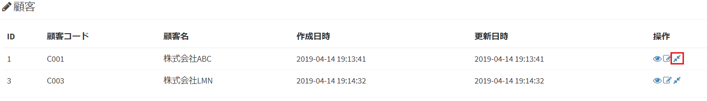
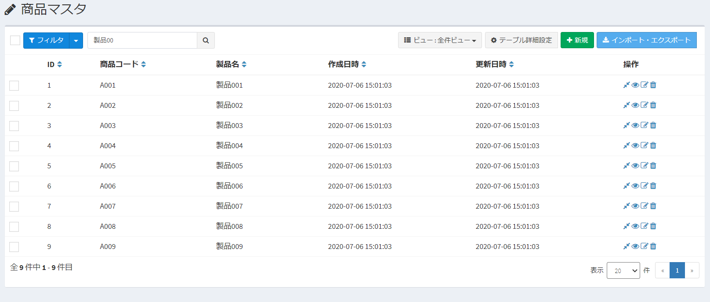
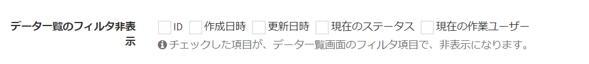
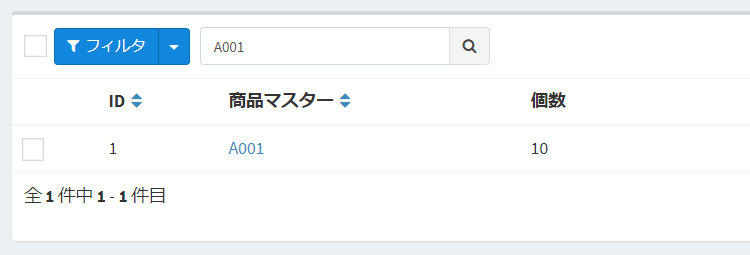

# Tìm kiếm
Trang này giải thích các cách tìm dữ liệu của Exment. Có 2 cách tìm chính.

| Cách tìm | Phạm vi tìm |
|---|---|
| Thanh tìm kiếm ở phía trên của trang | Tất cả các bảng được đặt là đối tượng tìm kiếm |
| Tìm kiếm trên màn hình danh sách dữ liệu (thanh tìm kiếm, bộ lọc) | Bảng đang mở |

- **Tìm kiếm lúc đầu là khớp phần đầu** (tìm dữ liệu bắt đầu bằng các ký tự đã nhập). Về cách đổi thành khớp một phần, vui lòng xem "Chuyển tìm kiếm dữ liệu sang khớp một phần" ở dưới.

## Tìm kiếm bằng thanh tìm kiếm (tìm kiếm tự do)
Phía trên mỗi trang có thanh tìm kiếm.  
  
Khi nhập từ vào thanh tìm kiếm này, bạn có thể tìm dữ liệu đã đăng ký trong Exment.  
Có 2 loại tìm kiếm: "tìm kiếm theo từ" và "tìm kiếm dữ liệu liên quan".  

### Tìm kiếm theo từ
Đây là tìm kiếm thông thường. Dữ liệu chứa từ đã nhập (khớp phần đầu) hiển thị trong kết quả.  
  

Nhập từ vào thanh tìm kiếm rồi nhấp ngay vào nút tìm kiếm thì việc tìm kiếm được thực hiện.  
Trước tiên danh sách các bảng là đối tượng tìm kiếm hiển thị, sau đó hệ thống tìm các dữ liệu phù hợp.

**Những gì là đối tượng tìm kiếm**

- Bảng: bảng có "Cho phép tìm kiếm" là YES trong thiết lập bảng tùy chỉnh.  

- Cột tùy chỉnh: cột có "Chỉ mục tìm kiếm" là YES và "Đối tượng tìm kiếm tự do" cũng là YES trong cài đặt cột tùy chỉnh.  
※Bảng không có cột tùy chỉnh nào có "Chỉ mục tìm kiếm" là YES sẽ không hiển thị trong kết quả tìm kiếm.  

> Từ v3.4.0, điều kiện để là đối tượng tìm kiếm cần thêm "Đối tượng tìm kiếm tự do" là YES.  
Trước đó, việc tìm kiếm được thực hiện trên tất cả các cột có "Chỉ mục tìm kiếm" là YES. Tuy nhiên, khi có 10–20 chỉ mục tìm kiếm được thiết lập, hiệu năng có thể giảm, nên đã cho phép thu hẹp đối tượng của tìm kiếm tự do.

- Chỉ những bảng mà người dùng có quyền xem mới được tìm kiếm.  

- **Thiết lập tìm kiếm mặc định là khớp phần đầu**. Đó là vì tốc độ tìm kiếm.  
Khi muốn đổi thành khớp một phần, vui lòng xem "Chuyển tìm kiếm dữ liệu sang khớp một phần" ở dưới.

**Kết quả tìm kiếm**

Dữ liệu trong kết quả tìm kiếm có các biểu tượng [Xem], [Chỉnh sửa] và [Tìm kiếm dữ liệu liên quan].  
    
Khi nhấp vào biểu tượng [Tìm kiếm dữ liệu liên quan], "Tìm kiếm dữ liệu liên quan" ở dưới được thực hiện.  

### Tìm kiếm dữ liệu liên quan
Tìm kiếm dữ liệu liên quan là chức năng tìm các dữ liệu gắn với một dữ liệu nào đó.  
Ví dụ, khi có bảng "Khách hàng", có lúc bạn muốn xem danh sách dữ liệu "Hợp đồng" gắn với khách hàng đó.  
  
Khi đó, dùng "Tìm kiếm dữ liệu liên quan" này, bạn có thể xem danh sách dữ liệu hợp đồng gắn với khách hàng.  

Tìm kiếm dữ liệu liên quan được thực hiện trong các trường hợp sau.  
- Khi nhập từ vào thanh tìm kiếm rồi chọn gợi ý hiện ra  
  
>Chữ hiển thị trong danh sách gợi ý có thể đổi ở [thiết lập cột hiển thị tiêu đề](/vi/table?id=thiết-lập-cột-hiển-thị-tiêu-đề).

- Khi thực hiện tìm kiếm theo từ rồi chọn biểu tượng [Tìm kiếm dữ liệu liên quan] trong kết quả  
  
  
Trong tìm kiếm dữ liệu liên quan, danh sách hiển thị các dữ liệu gắn với nhau theo các điều kiện sau.  
- Dữ liệu chọn dữ liệu đã chọn khi tìm kiếm ở "lựa chọn" của cột tùy chỉnh (tuy nhiên, "Chỉ mục tìm kiếm" trong cài đặt cột tùy chỉnh phải là YES)  
- Dữ liệu đăng ký dữ liệu đã chọn khi tìm kiếm làm cha, với 1:n hoặc n:n trong cài đặt quan hệ  
  
Trong tìm kiếm dữ liệu liên quan, chính dữ liệu đã chọn và các dữ liệu liên quan theo điều kiện trên hiển thị dưới dạng danh sách.  
Trong ví dụ dưới đây, dữ liệu của khách hàng đã chọn "Công ty cổ phần ABC" và các hợp đồng liên quan đến khách hàng đó hiển thị dưới dạng danh sách.  
  

## Tìm kiếm trên màn hình danh sách dữ liệu
Cũng có thể tìm kiếm trên màn hình danh sách dữ liệu.
Có 2 cách: tìm kiếm bằng thanh tìm kiếm, và tìm kiếm bằng bộ lọc có chỉ định cột.

  

### Tìm kiếm bằng thanh tìm kiếm (tìm kiếm tự do)
Khi nhập từ vào thanh tìm kiếm này, bạn có thể tìm dữ liệu trong bảng đang hiển thị.  

  

Nhập từ vào thanh tìm kiếm rồi nhấp ngay vào nút tìm kiếm thì việc tìm kiếm được thực hiện.  

  

- Tìm kiếm tự do là chức năng riêng với view tùy chỉnh đang chọn.  
Phạm vi tìm là tất cả dữ liệu của bảng đó. Việc tìm kiếm được thực hiện trên tất cả các cột tìm kiếm tự do.  
Vì vậy, kết quả hiển thị theo dạng của view toàn bộ dữ liệu, không phải view tùy chỉnh đang chọn.

- Cột tùy chỉnh là đối tượng tìm kiếm là cột có "Chỉ mục tìm kiếm" là YES và "Đối tượng tìm kiếm tự do" cũng là YES trong cài đặt cột tùy chỉnh.  

> Từ v3.4.0, điều kiện để là đối tượng tìm kiếm cần thêm "Đối tượng tìm kiếm tự do" là YES.  
Trước đó, việc tìm kiếm được thực hiện trên tất cả các cột có "Chỉ mục tìm kiếm" là YES. Tuy nhiên, khi có 10–20 chỉ mục tìm kiếm được thiết lập, hiệu năng có thể giảm, nên đã cho phép thu hẹp đối tượng của tìm kiếm tự do.

- **Thiết lập tìm kiếm mặc định là khớp phần đầu**. Đó là vì tốc độ tìm kiếm.  
Khi muốn đổi thành khớp một phần, vui lòng xem "Chuyển tìm kiếm dữ liệu sang khớp một phần" ở dưới.

### Tìm kiếm bằng bộ lọc có chỉ định cột
Khi nhấp vào nút "Bộ lọc", hộp dùng để chỉ định cột và tìm kiếm chi tiết sẽ hiển thị.

  

  

- Các mục hiển thị làm cột tìm kiếm như sau.
    1. ID, ngày giờ tạo, ngày giờ cập nhật
    2. Với bảng có thiết lập quy trình làm việc: "trạng thái quy trình làm việc" và bộ lọc "dữ liệu mà tôi là người phụ trách"
    3. Khi có cài đặt quan hệ lấy bảng đó làm con: hiển thị lựa chọn để lọc dữ liệu cha
    4. Các cột tùy chỉnh của bảng đó có "Chỉ mục tìm kiếm" là YES trong cài đặt cột tùy chỉnh

※Trong số này, 1 và 2 có thể cho ẩn đi ở màn hình cài đặt chi tiết của thiết lập hệ thống.

  

## Bổ sung

### Chuyển tìm kiếm dữ liệu sang khớp một phần
Tìm kiếm theo từ của dữ liệu mặc định là khớp phần đầu.  
Đó là để tìm kiếm nhanh. Với khớp một phần, tốc độ tìm kiếm không đủ nhanh.  
  
Tuy nhiên, có thể chuyển sang khớp một phần.  
Ở menu "Cài đặt quản trị > Cài đặt hệ thống (cài đặt chi tiết)", hãy đổi "Phương thức tìm kiếm dữ liệu" thành khớp một phần.  
  
  

Như vậy, tìm kiếm thành khớp một phần.  
※Với thiết lập này, tìm kiếm có thể chậm đi. Mong bạn thông cảm.

### Sử dụng công cụ tìm kiếm toàn văn (Meilisearch)
Ở môi trường có nhiều dữ liệu, khi tìm kiếm bằng khớp một phần, tìm kiếm có thể chậm.  
Khi đó, dùng công cụ tìm kiếm toàn văn "Meilisearch" sẽ tìm kiếm được nhanh.  
Chi tiết vui lòng xem [Công cụ tìm kiếm toàn văn (Meilisearch)](/vi/additional_meilisearch).

### Về quy cách của tìm kiếm tự do theo loại cột tùy chỉnh
Về cơ bản, tìm kiếm tự do chỉ tìm được các giá trị có trong cơ sở dữ liệu.  
Tuy nhiên, với một số cột tùy chỉnh, hệ thống ghi lại giá trị tìm kiếm mà người dùng đã nhập trước khi tìm kiếm.  
Quy cách đó được ghi ở dưới.

> Hiện tại, chưa hỗ trợ tìm kiếm AND trên nhiều cột bằng cách nhập khoảng trắng nửa chiều rộng như tìm kiếm Google.

#### Lựa chọn (giá trị và văn bản)
Có thể tìm kiếm bằng giá trị đã đặt ở giá trị thiết lập "giá trị", hoặc giá trị đã đặt ở giá trị thiết lập "văn bản".

  

  

#### Lựa chọn (từ bảng khác)
Có thể tìm kiếm bằng chữ được thiết lập ở "cột tiêu đề".  

Ví dụ:  
- Có "Master sản phẩm".  

  

- Ở "Master sản phẩm" đó, "Mã sản phẩm" được thiết lập ở "thiết lập cột tiêu đề" của "Cài đặt bảng (cài đặt mở rộng)".  

  

- Thêm cột "Master sản phẩm", có bảng tham chiếu là "Master sản phẩm" đó, vào bảng "Thông tin tồn kho sản phẩm".  

  

- Với thiết lập như vậy, khi nhập mã sản phẩm "A001" ở tìm kiếm tự do, danh sách "Thông tin tồn kho sản phẩm" tham chiếu đến master sản phẩm "A001" sẽ hiển thị.

  

#### YES/NO
Có thể tìm kiếm bằng chuỗi 0/1 hoặc NO/YES.  
(Vì sẽ tìm kiếm bằng các chuỗi ở đâu cũng có như "0", "1", "NO", "YES", nên không khuyến nghị đặt làm đối tượng của "tìm kiếm tự do".)

#### Lựa chọn 2 giá trị
Có thể tìm kiếm bằng giá trị hoặc nhãn của lựa chọn.  

  
  

