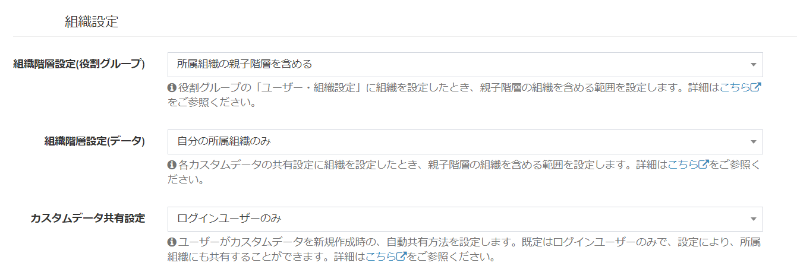

# Thiết lập hệ thống
Đây là màn hình thiết lập những gì liên quan đến toàn bộ hệ thống Exment, như tên, logo, thiết kế của trang và cách dùng quyền.  
Trang này giải thích các mục trên màn hình theo thứ tự từ trên xuống. Với email, LINE, bộ lọc IP, v.v., có liên kết đến trang riêng của từng phần.  

## Màn hình thiết lập
Bấm "Cài đặt hệ thống" trong menu.  
Màn hình thiết lập hệ thống hiện ra.  
Thiết lập hệ thống được chia thành [Cài đặt cơ bản] và [Cài đặt chi tiết].  
Bấm nút ở góc trên bên phải rồi chọn trong hộp thoại hiện ra để chuyển qua lại.

  
  

## Thông tin cơ bản của trang
Đặt các thông tin cơ bản của trang, như tên, logo và kiểu menu.

- Bố cục menu (kiểu menu) của Exment có 2 loại: "Tiêu chuẩn" và "Biểu tượng nhỏ".  
Sự khác nhau vui lòng xem ở các hình dưới đây.  
- Bố cục menu hiện ra lúc đầu được đặt ở [Bố cục menu của trang](/vi/system_setting?id=site-menu-layout-bố-cục-menu-của-trang). Bạn cũng chuyển được mỗi lần bằng cách bấm vào chỗ có khung đỏ trong hình.

Tiêu chuẩn
  

Biểu tượng nhỏ
  

#### Site name (Tên trang) ※Bắt buộc
- Tên trang hiện ở góc trên bên trái của trang khi bố cục menu là "Tiêu chuẩn".  
- Giá trị ban đầu là "Exment".  

#### Site name (omitted) (Tên trang rút gọn) ※Bắt buộc
- Tên trang hiện ở góc trên bên trái khi bố cục menu là "Biểu tượng nhỏ".
- Giá trị ban đầu là "Exm".  

#### Site logo (Logo của trang)
- Logo của trang hiện ở góc trên bên trái của trang khi bố cục menu là "Tiêu chuẩn".  
- Bấm nút [Browse] rồi chọn hình ảnh muốn dùng.  
- Kích thước khuyến nghị: 200px * 40px  

※Khi đã đặt "Logo trang" và bố cục menu là "Tiêu chuẩn", ở góc trên bên trái sẽ hiện logo của trang thay cho tên trang.

#### Site logo (small) (Logo của trang - nhỏ)
- Logo của trang hiện ở góc trên bên trái của trang khi bố cục menu là "Biểu tượng nhỏ".  
- Bấm nút [Browse] rồi chọn hình ảnh muốn dùng.  
- Kích thước khuyến nghị: 40px * 40px  

※Khi đã đặt "Logo trang (nhỏ)" và bố cục menu là "Biểu tượng nhỏ", ở góc trên bên trái sẽ hiện logo nhỏ của trang thay cho tên trang.

#### Site favicon (ico)  
- Như hình dưới đây, đây là hình biểu tượng được dùng khi xem trang hoặc khi đánh dấu trang (bookmark).  
- Bấm nút [Browse] rồi chọn hình ảnh muốn dùng.  
- Kích thước khuyến nghị: 16px * 16px  

  

#### Site skin (Giao diện màu của trang)
- Đây là màu chủ đề của trang. Chọn màu của header và sidebar từ các tổ hợp sau.  
- Header (thiết lập ban đầu là xanh dương): xanh dương, vàng, xanh lá, tím, đỏ, trắng
- Sidebar (thiết lập ban đầu là trắng): đen, trắng

※Khi [Thiết kế màn hình](/vi/system_setting?id=screen-design-thiết-kế-màn-hình) là "Hiện đại", header và sidebar vẫn là màu trắng và xám, còn màu đã chọn trở thành "màu nhấn" (nút quan trọng, liên kết, menu đang chọn, viền của ô đang nhập, v.v.). Với màu khác xanh dương, ở mép trên của header có một đường mảnh màu đó. Màu có "-light" có cùng màu nhấn với màu không có "-light".  
※Từ v7.1.0 trở đi, thay đổi được áp dụng ngay khi lưu. Ở v7.0 trở về trước, thay đổi được áp dụng khi tải lại trang Web sau khi lưu.

#### Site menu layout (Bố cục menu của trang)
- Chọn bố cục menu của trang: "Tiêu chuẩn" hoặc "Biểu tượng nhỏ".  
Ví dụ của từng loại vui lòng xem ở các hình phía trên.
- Giá trị ban đầu là "Tiêu chuẩn".  

※Thay đổi được áp dụng khi tải lại trang Web sau khi lưu.

#### Screen design (Thiết kế màn hình)
- Chọn thiết kế của màn hình đăng nhập và màn hình quản trị: "Hiện đại" hoặc "Cổ điển".
    - Hiện đại: thiết kế mới, lấy màu trắng và xám làm nền.
    - Cổ điển: thiết kế giống v7.0 trở về trước.
- Giá trị ban đầu là "Hiện đại".

※Dùng được từ v7.1.0.  
※Khi cập nhật lên v7.1.0, thiết kế màn hình đổi thành "Hiện đại". Nếu muốn quay lại thiết kế trước đây, hãy chọn "Cổ điển" ở mục này rồi lưu.  
※Với "Hiện đại", header và sidebar hiển thị với màu trắng và xám làm nền, và màu đã chọn ở [Giao diện màu của trang](/vi/system_setting?id=site-skin-giao-diện-màu-của-trang) trở thành màu nhấn. Nếu đã đặt hình ảnh cho logo của trang, phía sau logo có nền màu nhấn.  
※Trong danh sách dữ liệu của "Hiện đại", cột thao tác (xem, sửa, xóa) hiện ngay bên phải ô đánh dấu (ở phía bên trái).  
※Nếu thiết kế được cố định bằng thiết lập của máy chủ ("EXMENT_UI_DESIGN" trong tệp .env), thiết lập đó được ưu tiên. Khi đó không đổi được mục này, và "(được cố định bởi cài đặt máy chủ)" sẽ hiện ra. Chi tiết vui lòng xem [Danh sách giá trị thiết lập](/vi/config).  
※Thay đổi được áp dụng ngay khi lưu. Nếu hiển thị bị vỡ, hãy nhấn Ctrl+F5 (super reload) trên trình duyệt.

#### Use API (Sử dụng API)
- Đặt thành "YES" thì dùng được API.
- Giá trị ban đầu là "NO".

#### Communicate outside the server (Thực hiện giao tiếp ra ngoài máy chủ)
- Đặt thành YES thì hệ thống thực hiện được các xử lý giao tiếp với máy chủ bên ngoài (chỉ nhận dữ liệu), như thông báo về phiên bản mới nhất của Exment.
- Giá trị ban đầu là "YES".  

#### Use privilege management (Sử dụng quản lý quyền)
- Khi thiết lập là YES, bạn thiết lập được [quyền đối với toàn bộ hệ thống và quyền theo từng bảng tùy chỉnh](/vi/role_group).  
- Khi là YES, bạn cấp được quyền bằng cách chỉ định người dùng.
- Giá trị ban đầu là "YES".  

#### Use organizational management (Sử dụng quản lý tổ chức)
- Khi thiết lập là YES, lúc [sử dụng quản lý quyền](/vi/system_setting?id=use-privilege-management-sử-dụng-quản-lý-quyền), bạn cấp được quyền bằng cách chỉ định tổ chức.  
- Giá trị ban đầu là "YES".  

#### Enable System Performance Log (Bật nhật ký hiệu năng hệ thống)
- Đặt thành YES thì các thao tác trên màn hình chậm được ghi vào "Nhật ký hiệu năng hệ thống".
- Nội dung được ghi là URL của màn hình (các giá trị như từ khóa tìm kiếm được che bằng "***"), người dùng, thời gian xử lý và SQL. SQL được ghi nguyên với "?", không chèn giá trị vào.
- Giá trị ban đầu là "NO".

Khi đặt thành YES, 3 mục sau hiện ra (từ v7.1.0 trở đi).

| Mục | Nội dung | Giá trị ban đầu |
| --- | --- | --- |
| Nhật ký hiệu năng: số giây của màn hình chậm | Ghi lại khi xử lý của màn hình mất từ số giây này trở lên. Đặt 0 thì không ghi theo điều kiện này. | 3 |
| Nhật ký hiệu năng: số giây của SQL chậm | Ghi lại khi một câu SQL mất từ số giây này trở lên. Đặt 0 thì không ghi theo điều kiện này. | 1 |
| Nhật ký hiệu năng: số bản ghi tối đa mỗi giờ | Giới hạn số bản ghi trong 1 giờ. Phần vượt giới hạn không được ghi. Đặt 0 thì không giới hạn. | 100 |

※Nếu đặt cả "số giây của màn hình chậm" và "số giây của SQL chậm" là 0, mọi thao tác đều được ghi lại (giống v7.0 trở về trước). Chỉ nên dùng khi điều tra. Môi trường đã bật log từ v7.0 trở về trước thì sau khi cập nhật vẫn ở trạng thái "ghi tất cả" này.  
※Để xem log, mở "Cài đặt quản trị" → "Nhật ký hiệu năng hệ thống" ở menu bên trái.  
※Từ v7.0.3 trở đi, khi đặt YES rồi lưu, bảng của log và menu (trong "Cài đặt quản trị") được tạo tự động. Không cần cài đặt template.  
※Ở v7.0.2 trở về trước, hãy cài đặt template ([Template zip file](https://exment.net/template/system_logs.zip)) rồi chạy `php artisan exment:update`.

#### System Administrator (Quản trị viên hệ thống)
- Bạn đặt được người dùng sẽ là quản trị viên hệ thống.
- Giá trị ban đầu là người dùng đã làm thiết lập ban đầu khi cài đặt Exment.

#### Number of data list displayed (Số dòng hiển thị của danh sách dữ liệu)
- Đây là số dòng dữ liệu hiện ra lúc đầu trên trang danh sách dữ liệu.  
  Chọn một trong "10", "20", "30", "50", "100".
- Giá trị ban đầu là "20".  

#### Number of search / dashboard displays (Số dòng hiển thị của tìm kiếm và dashboard)
- Đây là số dòng dữ liệu hiện ra lúc đầu khi [tìm kiếm theo từ khóa](/vi/search) và ở [danh sách dữ liệu của dashboard](/vi/dashboard).  
Chọn một trong "5", "10", "20".  
- Giá trị ban đầu là "5".  

#### Date and time display format (Định dạng hiển thị ngày giờ)
- Chọn định dạng hiển thị ngày tháng trong 3 loại ("Tiêu chuẩn (Y-m-d H:i:s)", "Tùy chỉnh (Y/m/d H:i:s)", "Địa phương (d/m/Y H:i:s)"). Giá trị ban đầu là "Tiêu chuẩn (Y-m-d H:i:s)".

#### Data search method (Phương pháp tìm kiếm dữ liệu)
- Chọn cách tìm dữ liệu đã đăng ký: "Khớp phần đầu" (phần đầu giống nhau) hoặc "Khớp một phần" (có chứa ở giữa).
- Giá trị ban đầu là "Khớp phần đầu".

#### Hide filter in data list (Ẩn bộ lọc của danh sách dữ liệu)
- Các mục được đánh dấu sẽ không hiện trong bộ lọc của màn hình danh sách dữ liệu.

#### System values display position (Vị trí hiển thị các mục hệ thống trên màn hình dữ liệu)
- Đặt vị trí hiện các mục hệ thống trên màn hình chỉnh sửa dữ liệu và màn hình chi tiết dữ liệu.  
- Chọn được từ "Hiển thị ở trên", "Hiển thị ở dưới", "Ẩn". Giá trị ban đầu là "Hiển thị ở trên".  

#### Data Submit Redirect (Đích chuyển hướng mặc định sau khi lưu dữ liệu)
- Trên màn hình [đăng ký dữ liệu](/vi/data_form) có các ô đánh dấu để chọn chuyển đến màn hình nào sau khi lưu dữ liệu. Bạn đặt được để ô đó được đánh dấu sẵn ngay từ đầu.

#### Header User Information (Nội dung hiển thị thông tin người dùng ở header)
- Bạn đặt được nội dung hiện trong phần thông tin người dùng ở header. Để trống thì không hiện.
- Chọn được từ các cột tùy chỉnh của bảng người dùng và ngày giờ tạo.

#### Ngôn ngữ người dùng có thể chọn
- Đây là các ngôn ngữ mà người dùng chọn được ở menu góc trên bên phải, màn hình đăng nhập và thiết lập người dùng đăng nhập (từ v7.2.4 trở đi). Khi để trống, chọn được tất cả ngôn ngữ đã có. Ngôn ngữ của trang thì lúc nào cũng chọn được.
- Chi tiết vui lòng xem [Ngôn ngữ và múi giờ của từng người dùng](/vi/user_locale).

#### Dùng ngôn ngữ của trình duyệt khi người dùng chưa chọn
- Đặt thành YES thì với người dùng chưa chọn ngôn ngữ, màn hình hiện bằng ngôn ngữ của trình duyệt (trong các ngôn ngữ người dùng có thể chọn). Đặt thành NO thì hiện bằng ngôn ngữ của trang (từ v7.2.4 trở đi).
- Giá trị ban đầu là "YES". Nếu muốn mọi người vẫn dùng ngôn ngữ của trang, hãy đặt NO.

## Thiết lập tổ chức
Đặt xem trong các thiết lập về quyền và chia sẻ, tổ chức được tính đến đâu.

#### Organizational hierarchy setting (role group) (Thiết lập phân cấp tổ chức - nhóm vai trò)
-  Khi đặt tổ chức ở "Cài đặt người dùng/tổ chức" của nhóm vai trò, mục này quyết định tính đến đâu các tổ chức cấp trên và cấp dưới của tổ chức đó.
- Giá trị ban đầu là "Bao gồm cả người dùng thuộc tổ chức cấp trên và cấp dưới của tổ chức được gán nhóm vai trò".

#### Organizational hierarchy setting (data) (Thiết lập phân cấp tổ chức - dữ liệu)
- Khi đặt tổ chức trong thiết lập chia sẻ của từng dữ liệu tùy chỉnh, mục này quyết định tính đến đâu các tổ chức cấp trên và cấp dưới của tổ chức đó.
- Giá trị ban đầu là "Chỉ người dùng thuộc tổ chức được chia sẻ dữ liệu".

#### Custom data sharing settings (Thiết lập chia sẻ dữ liệu tùy chỉnh)
-  Khi người dùng tạo mới dữ liệu, mục này quyết định đối tượng được chia sẻ tự động: chỉ người dùng đó, hay gồm cả tổ chức mà người dùng trực thuộc.
- Giá trị ban đầu là "Chỉ người dùng đăng nhập".

## Thiết lập email hệ thống
Đây là thiết lập để gửi email từ hệ thống.  
Khi thiết lập trên màn hình, bạn nhập các giá trị thiết lập của SMTP.  
Chi tiết vui lòng xem [Thiết lập gửi email](/vi/mailsend_setting).

## Thiết lập LINE
Ở "Cài đặt LINE" trong [Cài đặt chi tiết], bạn đặt thông tin của tài khoản LINE chính thức (channel access token, channel secret, basic ID) dùng cho [liên kết LINE](/vi/line).  
Chi tiết vui lòng xem phần thiết lập hệ thống của [liên kết LINE](/vi/line).

## Thiết lập xác nhận an toàn
Ở "Cài đặt xác nhận an toàn" trong [Cài đặt chi tiết], bạn đặt việc gửi tự động khi có động đất, v.v. của [xác nhận an toàn](/vi/safety_check).  
Chi tiết vui lòng xem phần cài đặt xác nhận an toàn của [xác nhận an toàn](/vi/safety_check).

## Thiết lập bộ lọc IP
Đặt các địa chỉ IP được phép kết nối, theo dạng IP cố định (ví dụ: 12.3.5.6) hoặc dạng chỉ định dải (ví dụ: 123.4.5.0/24).  
Nếu chưa đặt, mọi địa chỉ IP đều được phép.
Chi tiết vui lòng xem [Bộ lọc IP](/vi/additional_ip_filter.md).

## Chính sách mật khẩu

> Đã chuyển sang [Thiết lập đăng nhập](/vi/login_setting).

## Thiết lập SSO

> Đã chuyển sang [Thiết lập đăng nhập (SSO)](/vi/login_sso).
