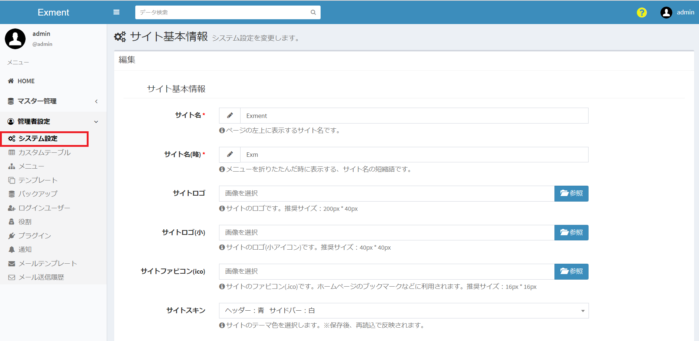

# Thiết lập hệ thống
Thực hiện các thiết lập áp dụng cho toàn bộ hệ thống Exment, chẳng hạn như thông tin cơ bản của trang và việc cấp quyền.  

## Màn hình thiết lập
Nhấp vào "System Settings" (Thiết lập hệ thống) trong menu.  
Màn hình thiết lập hệ thống sẽ được hiển thị.  
Thiết lập hệ thống được chia thành [Basic settings] (thiết lập cơ bản) và [Detail Setting] (thiết lập chi tiết).  
Sau khi nhấp vào nút ở phía trên bên phải, bạn có thể chuyển đổi bằng cách chọn trong hộp thoại.

  
  

## Thông tin cơ bản của trang
Thiết lập các thông tin cơ bản của trang để quản lý thông tin bằng Exment.

- Bố cục menu của Exment có 2 kiểu hiển thị: "Standard" (tiêu chuẩn) và "Small Icon" (biểu tượng nhỏ).  
Vui lòng tham khảo các hình ảnh dưới đây để thấy sự khác biệt khi hiển thị.  
- Kiểu hiển thị mặc định của bố cục menu được thiết lập tại [Site menu layout](/vi/system_setting?id=site-menu-layout-bố-cục-menu-của-trang), tuy nhiên bạn cũng có thể chuyển đổi bất cứ lúc nào bằng cách nhấp vào phần được đóng khung đỏ trong hình.

Standard (tiêu chuẩn)
  

Small Icon (biểu tượng nhỏ)
  

#### Site name (Tên trang) ※Bắt buộc
- Tên trang được hiển thị ở phía trên bên trái của trang khi bố cục menu là "Standard".  
- Giá trị ban đầu là "Exment".  

#### Site name (omitted) (Tên trang rút gọn) ※Bắt buộc
- Tên trang được hiển thị ở phía trên bên trái khi bố cục menu là "Small Icon".
- Giá trị ban đầu là "Exm".  

#### Site logo (Logo của trang)
- Logo của trang được hiển thị ở phía trên bên trái của trang khi bố cục menu là "Standard".  
- Nhấp vào nút [Browse] và chọn hình ảnh muốn sử dụng.  
- Kích thước khuyến nghị: 200px * 40px  

※Khi đã thiết lập Site logo, nếu bố cục menu là "Standard" thì logo của trang sẽ được hiển thị ở vị trí tương ứng phía trên bên trái thay cho tên trang.

#### Site logo (small) (Logo của trang - nhỏ)
- Logo của trang được hiển thị ở phía trên bên trái của trang khi bố cục menu là "Small Icon".  
- Nhấp vào nút [Browse] và chọn hình ảnh muốn sử dụng.  
- Kích thước khuyến nghị: 40px * 40px  

※Khi đã thiết lập Site logo (small), nếu bố cục menu là "Small Icon" thì logo nhỏ của trang sẽ được hiển thị ở vị trí tương ứng phía trên bên trái thay cho tên trang.

#### Site favicon (ico)  
- Như trong hình dưới đây, đây là hình ảnh biểu tượng được sử dụng khi xem trang hoặc khi đánh dấu trang (bookmark).  
- Nhấp vào nút [Browse] và chọn hình ảnh muốn sử dụng.  
- Kích thước khuyến nghị: 16px * 16px  

  

#### Site skin (Giao diện màu của trang)
- Thiết lập màu chủ đề của trang. Chọn màu của header và sidebar từ các tổ hợp dưới đây.  
- Header (mặc định là xanh dương): xanh dương, vàng, xanh lá, tím, đỏ, trắng  
- Sidebar (mặc định là trắng): đen, trắng

※ Khi [Screen design](#screen-design-thiết-kế-màn-hình) là "Modern", header và sidebar vẫn có màu trắng và xám, còn màu đã chọn trở thành "màu nhấn" (accent color) cho các nút quan trọng, liên kết, menu đang chọn, viền ô đang nhập, v.v. Với màu khác xanh dương, một đường mảnh có màu đó được hiển thị ở mép trên của header.  
※ Từ v7.1.0, thay đổi được áp dụng ngay sau khi lưu. Ở v7.0 trở về trước, hãy tải lại trang web sau khi lưu thiết lập.

#### Site menu layout (Bố cục menu của trang)
- Chọn một trong hai bố cục "Standard" hoặc "Small Icon" làm menu của trang.  
Vui lòng tham khảo các hình ảnh ở phía trên để xem ví dụ của từng bố cục.
- Giá trị ban đầu là "Standard".

※Sau khi lưu thiết lập, hãy tải lại trang web để thiết lập được áp dụng và hiển thị.

#### Screen design (Thiết kế màn hình)
- Chọn thiết kế của màn hình đăng nhập và các màn hình quản trị: "Modern" hoặc "Classic".
    - Modern: thiết kế mới, dựa trên màu trắng và xám.
    - Classic: thiết kế giống v7.0 trở về trước.
- Giá trị ban đầu là "Modern".

※ Có thể sử dụng từ v7.1.0.  
※ Sau khi cập nhật lên v7.1.0, thiết kế màn hình sẽ chuyển thành "Modern". Để quay lại thiết kế cũ, hãy chọn "Classic" ở mục này rồi lưu lại.  
※ Với "Modern", màu đã chọn trong [Site skin](#site-skin-giao-diện-màu-của-trang) là màu nhấn. Trong danh sách dữ liệu, cột thao tác (xem / sửa / xóa) được hiển thị ngay bên phải ô chọn (bên trái bảng).  
※ Nếu thiết kế được cố định bằng thiết lập của máy chủ ("EXMENT_UI_DESIGN" trong tệp .env), giá trị đó sẽ được ưu tiên. Khi đó không thể thay đổi mục này, và "(set by the server)" sẽ được hiển thị. Xem [danh sách giá trị thiết lập](/config?id=screen-design).  
※ Thay đổi được áp dụng ngay sau khi lưu. Nếu màn hình hiển thị không đúng, hãy nhấn Ctrl+F5 trên trình duyệt.

#### Use API (Sử dụng API)
- Đặt thành "YES" để có thể sử dụng API.
- Giá trị ban đầu là "NO".

#### Communicate outside the server (Thực hiện giao tiếp ra ngoài máy chủ)
- Nếu thiết lập là YES, hệ thống có thể thực hiện các xử lý giao tiếp với máy chủ bên ngoài (chỉ nhận dữ liệu), chẳng hạn như thông báo về phiên bản mới nhất của Exment.
- Giá trị ban đầu là "YES".  

#### Use privilege management (Sử dụng quản lý quyền)
- Nếu thiết lập là YES, bạn có thể thiết lập [quyền đối với toàn bộ hệ thống](/vi/role_group) và [quyền theo từng bảng tùy chỉnh](/vi/table).  
- Nếu thiết lập này là YES, có thể cấp quyền bằng cách chỉ định người dùng.
- Giá trị ban đầu là "YES".  

#### Use organizational management (Sử dụng quản lý tổ chức)
- Nếu thiết lập là YES, khi [sử dụng quản lý quyền](/vi/system_setting?id=use-privilege-management-sử-dụng-quản-lý-quyền), có thể cấp quyền bằng cách chỉ định tổ chức.  
- Giá trị ban đầu là "YES".  

#### Enable System Performance Log (Bật nhật ký hiệu năng hệ thống)
- Khi đặt thành YES, các thao tác màn hình chậm sẽ được ghi vào "System Performance Log": URL của màn hình (giá trị tìm kiếm v.v. được ẩn bằng "***"), người dùng, thời gian xử lý và SQL (giữ nguyên "?", không chứa giá trị).
- Giá trị ban đầu là "NO".

Khi đặt thành YES, 3 mục sau được hiển thị (từ v7.1.0).

| Mục | Nội dung | Giá trị ban đầu |
| --- | --- | --- |
| Performance log: seconds of a slow screen | Ghi lại khi màn hình xử lý mất từ số giây này trở lên. 0: không ghi theo điều kiện này. | 3 |
| Performance log: seconds of a slow SQL | Ghi lại khi một câu SQL mất từ số giây này trở lên. 0: không ghi theo điều kiện này. | 1 |
| Performance log: maximum logs in an hour | Số bản ghi tối đa trong 1 giờ. Vượt quá sẽ không được ghi. 0: không giới hạn. | 100 |

※ Nếu cả hai mục số giây đều là 0, mọi thao tác sẽ được ghi lại (giống v7.0 trở về trước). Chỉ dùng khi điều tra.  
※ Để xem nhật ký, mở "Admin Setting" > "System Performance Log" ở menu bên trái.  
※ Từ v7.0.3, khi lưu với YES, bảng và menu (bên trong "Admin Setting") được tạo tự động; không cần cài đặt template. Ở v7.0.2 trở về trước, hãy cài đặt template ([Template zip file](https://exment.net/template/system_logs.zip)) rồi chạy `php artisan exment:update`.
  

#### System Administrator (Quản trị viên hệ thống)
- Có thể thiết lập người dùng sẽ đảm nhận vai trò giám sát hệ thống.
- Người dùng đã thực hiện thiết lập ban đầu khi cài đặt Exment được đăng ký làm giá trị ban đầu.

#### Number of data list displayed (Số dòng hiển thị của danh sách dữ liệu)
- Đây là số dòng dữ liệu hiển thị mặc định trên trang danh sách dữ liệu.  
  Chọn một trong các giá trị "10", "20", "30", "50", "100".
- Giá trị ban đầu là "20".  

#### Number of search / dashboard displays (Số dòng hiển thị của tìm kiếm và dashboard)
- Đây là số dòng dữ liệu hiển thị mặc định khi thực hiện [tìm kiếm theo từ khóa](/search?id=word-search) và tại [danh sách dữ liệu của dashboard](/vi/dashboard).  
Chọn một trong các giá trị "5", "10", "20".  
- Giá trị ban đầu là "5".  

#### Date and time display format (Định dạng hiển thị ngày giờ)
- Có thể thiết lập định dạng hiển thị ngày tháng từ 3 kiểu.

#### Data search method (Phương pháp tìm kiếm dữ liệu)
- Thiết lập phương pháp tìm kiếm dữ liệu đã đăng ký là "Prefix match" (khớp phần đầu) hoặc "Partial match" (khớp một phần).
- Giá trị ban đầu là "Prefix match".

#### Hide filter in data list (Ẩn bộ lọc của danh sách dữ liệu)
- Các mục được đánh dấu chọn sẽ bị ẩn trong bộ lọc của màn hình danh sách dữ liệu.

#### System values display position (Vị trí hiển thị các mục hệ thống trên màn hình dữ liệu)
- Thiết lập vị trí hiển thị các mục hệ thống trên màn hình chỉnh sửa dữ liệu và màn hình chi tiết dữ liệu.  
- Có thể chọn từ "Display at the top" (hiển thị phía trên), "Display at the bottom" (hiển thị phía dưới), "Hide" (ẩn). Giá trị ban đầu là "Display at the top".  

#### Data Submit Redirect (Đích chuyển hướng mặc định sau khi lưu dữ liệu)
- Trên màn hình [đăng ký dữ liệu](/vi/data_form), có thể đặt sẵn dấu chọn mặc định cho hộp kiểm chọn đích chuyển hướng sau khi lưu dữ liệu.

#### Header User Information (Nội dung hiển thị thông tin người dùng ở header)
- Có thể thiết lập nội dung hiển thị trong phần thông tin người dùng ở header. Nếu để trống, nội dung này sẽ không được hiển thị.
- Có thể chọn từ các cột tùy chỉnh của bảng người dùng và ngày giờ tạo.

## Thiết lập tổ chức
Thiết lập việc có bao gồm tổ chức trong phạm vi của từng thiết lập hay không.

#### Organizational hierarchy setting (role group) (Thiết lập phân cấp tổ chức - nhóm vai trò)
-  Khi thiết lập tổ chức tại "User / Organization Settings" của nhóm vai trò, thiết lập phạm vi bao gồm các tổ chức thuộc phân cấp cha con.
- Giá trị ban đầu được đặt là "Include parent-child hierarchy of affiliated organization" (bao gồm phân cấp cha con của tổ chức trực thuộc).

#### Organizational hierarchy setting (data) (Thiết lập phân cấp tổ chức - dữ liệu)
- Khi thiết lập tổ chức trong thiết lập chia sẻ của từng dữ liệu tùy chỉnh, thiết lập phạm vi bao gồm các tổ chức thuộc phân cấp cha con.
- Giá trị ban đầu được đặt là "Organization hierarchy setting (data)".

#### Custom data sharing settings (Thiết lập chia sẻ dữ liệu tùy chỉnh)
-  Thiết lập phạm vi đối tượng được tự động chia sẻ khi người dùng tạo mới dữ liệu: chỉ người dùng đó, hay bao gồm cả tổ chức mà người dùng trực thuộc.
- Giá trị ban đầu là "Login user only" (chỉ người dùng đăng nhập).

## Thiết lập email hệ thống
Thực hiện các thiết lập cho trường hợp gửi email từ hệ thống.  
Khi thiết lập từ màn hình, hãy nhập các giá trị thiết lập theo SMTP.  
Chi tiết vui lòng xem [tại đây](/vi/mailsend_setting).

## Thiết lập LINE
Tại "LINE Setting" trong [Detail Setting], thiết lập thông tin của tài khoản LINE chính thức (channel access token, channel secret, basic ID) được sử dụng trong [liên kết LINE](/line).  
Chi tiết vui lòng xem [tại đây](/line?id=system-settings).

## Thiết lập xác nhận an toàn
Tại "Safety Check Settings" trong [Detail Setting], thiết lập việc tự động gửi khi xảy ra động đất, v.v. của chức năng [xác nhận an toàn](/safety_check).  
Chi tiết vui lòng xem [tại đây](/safety_check?id=safety-check-settings).

## Thiết lập bộ lọc IP
Thiết lập các địa chỉ IP được phép giao tiếp theo dạng IP cố định (ví dụ: 12.3.5.6) và dạng chỉ định dải (ví dụ: 123.4.5.0/24).  
Nếu không thiết lập, tất cả các địa chỉ IP đều được cho phép.
Chi tiết vui lòng xem [tại đây](/additional_ip_filter).

## Chính sách mật khẩu

> Nội dung này đã được chuyển sang [trang này](/vi/login_setting).

## Thiết lập SSO

> Nội dung này đã được chuyển sang [trang này](/vi/login_sso).
