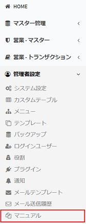
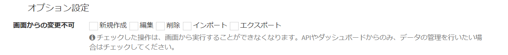
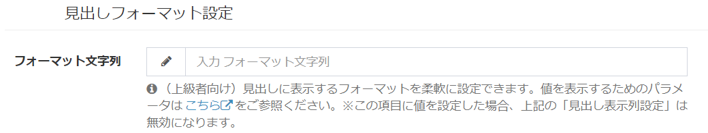
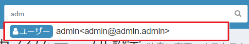

# Bảng tùy chỉnh
Exment sử dụng "bảng tùy chỉnh" (Custom Table) để quản lý thông tin.  
Tại đây, bạn thực hiện các thiết lập cần thiết, chẳng hạn như các chức năng và quyền được phép đối với dữ liệu đã đăng ký.

## Danh sách
Nhấp vào "Custom Table" trong menu.  
Màn hình danh sách các thiết lập bảng tùy chỉnh đã tạo sẽ được hiển thị.  

※ "Basic information" (thông tin cơ bản), "User" (người dùng), "Organization" (tổ chức), "Notification template" (mẫu thông báo), "Email sending history" (lịch sử gửi email), "Notice" (thông tin thông báo chung)  
Các bảng này được thiết lập sẵn khi cài đặt Exment.  
Ngoài ra, các bảng được nhập (import) dưới dạng template cũng được hiển thị trên màn hình danh sách.  

## Tạo mới

- Nhấp vào nút "New" ở phía trên bên phải màn hình danh sách.
  
  
- Màn hình tạo bảng sẽ được hiển thị, hãy nhập các mục cần thiết.

## Chi tiết các mục thiết lập

#### Table name (alphanumeric) (Tên bảng - chữ và số) ※Bắt buộc
- Là tên của bảng. (Ví dụ: user , information , estimate )  
- Chuỗi chữ và số đã thiết lập sẽ được dùng trong URL khi mở bảng, v.v. (Ví dụ: http(s)://(URL của Exment)/admin/data/user)  
- Chỉ có thể sử dụng chữ cái và chữ số nửa chiều rộng (half-width) cùng các ký hiệu "-" và "_".
- Không thể sử dụng tên bảng đã được dùng cho bảng khác.  
- Tên bảng không được dài quá 30 ký tự và phải bắt đầu bằng một chữ cái.  
- Chỉ có thể thiết lập khi tạo mới bảng. Sau khi lưu thì không thể thay đổi.  

#### Table display name (Tên hiển thị của bảng) ※Bắt buộc
- Là tên được hiển thị trên màn hình. Có thể sử dụng cả tiếng Nhật. (Ví dụ: Người dùng, Thông báo, Báo giá)  

  

#### Description (Mô tả)
- Là phần mô tả về bảng.

- Như trong hình dưới đây, trên màn hình dữ liệu, phần mô tả đã nhập sẽ được hiển thị ở bên phải tên hiển thị của bảng.  

#### Display order (Thứ tự hiển thị)
- Là thứ tự hiển thị trên màn hình danh sách thiết lập bảng tùy chỉnh.  
- Hãy nhập số bằng ký tự nửa chiều rộng, hoặc chỉ định số bằng các nút "-" "+" ở hai bên.

#### Color (Màu)
- Thiết lập màu của bảng. Màu thiết lập tại đây được dùng cho các gợi ý khi tìm kiếm, v.v.

- Khi nhấp vào màu đang được chỉ định, màn hình chọn màu sẽ được hiển thị.

#### Icon (Biểu tượng)
- Thiết lập biểu tượng của bảng. Biểu tượng đã thiết lập được hiển thị làm biểu tượng của menu và biểu tượng trong kết quả tìm kiếm.  

- Khi nhấp vào biểu tượng đang được chỉ định, màn hình chọn biểu tượng sẽ được hiển thị.

#### Searchable (Cho phép tìm kiếm)
- Thiết lập có đưa bảng này vào phạm vi tìm kiếm hay không khi thực hiện [tìm kiếm](/search.md) từ thanh tìm kiếm. Giá trị mặc định là YES.  
Nếu muốn loại bảng khỏi kết quả tìm kiếm, chẳng hạn khi muốn dùng bảng làm bảng ẩn, hãy thiết lập là NO.

#### Use ID for labels (Sử dụng ID trong nhãn)
- Trong các đề xuất tìm kiếm được hiển thị khi dùng thanh tìm kiếm, bạn có thể thêm ID của dữ liệu vào đầu nhãn. Để biết chi tiết, vui lòng tham khảo [Thiết lập cột hiển thị tiêu đề](/vi/table?id=thiết-lập-cột-hiển-thị-tiêu-đề). Giá trị mặc định là NO.  

#### Only one can be registered (Chỉ cho phép đăng ký 1 dữ liệu)
- Đối với bảng chỉ cho phép đăng ký 1 dữ liệu thay vì nhiều dữ liệu, hãy thiết lập là YES. Giá trị mặc định là NO.  

#### Use attachments (Sử dụng tệp đính kèm)
- Nếu muốn cho phép tải lên [tệp đính kèm](/vi/data_details) cho dữ liệu của bảng, hãy thiết lập là YES. Giá trị mặc định là YES.  

#### Use comments (Sử dụng bình luận)
- Nếu muốn cho phép [bình luận](/vi/data_details) trên dữ liệu của bảng, hãy thiết lập là YES. Giá trị mặc định là YES.  

#### Use data change history (Sử dụng lịch sử thay đổi dữ liệu)
- Nếu muốn quản lý dưới dạng bản sửa đổi (lịch sử) việc ai đã cập nhật dữ liệu của bảng với nội dung như thế nào, hãy thiết lập là YES. Giá trị mặc định là YES.  

#### Change history version number (Số phiên bản lịch sử thay đổi)
- Khi "Use data change history" là YES, hãy nhập bằng số nguyên số phiên bản lịch sử thay đổi cần lưu giữ.  
Nếu nhập "200", thì ở lần cập nhật thứ 201, thông tin lịch sử thay đổi của lần thứ 1 sẽ bị xóa. Giá trị mặc định là 100.  

#### Editable by all users (Tất cả người dùng đều có thể chỉnh sửa)

> Về tổng quan quyền của bảng, trước tiên vui lòng xem trang [Tổng quan về vai trò và quyền trong Exment](/permission).

- Nếu thiết lập là YES, tất cả người dùng đều có thể chỉnh sửa toàn bộ dữ liệu trong bảng đó. Không cần phải gán quyền riêng lẻ nữa. Giá trị mặc định là NO.  

#### Visible to all users (Tất cả người dùng đều có thể xem)

> Về tổng quan quyền của bảng, trước tiên vui lòng xem trang [Tổng quan về vai trò và quyền trong Exment](/permission).

- Nếu thiết lập là YES, tất cả người dùng đều có thể xem toàn bộ dữ liệu trong bảng đó. Không cần phải gán quyền riêng lẻ nữa. Giá trị mặc định là NO.  

※ Khi cài đặt Exment, chỉ riêng bảng "Notice" được thiết lập sẵn "Visible to all users" là YES. Mục đích là để tất cả người dùng đều có thể xem thông tin thông báo chung.  
Mặt khác, chỉ quản trị viên mới có thể chỉnh sửa thông tin thông báo chung.

#### Available to all users (Tất cả người dùng đều có thể tham chiếu)

> Về tổng quan quyền của bảng, trước tiên vui lòng xem trang [Tổng quan về vai trò và quyền trong Exment](/permission).

- Nếu thiết lập là YES, tất cả người dùng đều có thể tham chiếu toàn bộ dữ liệu trong bảng đó. Không cần phải gán quyền riêng lẻ nữa. Giá trị mặc định là NO.  

※ Nếu chỉ thiết lập "Available to all users" là YES, bảng đó sẽ không thể hiển thị trong menu hay màn hình danh sách, nhưng có thể được tham chiếu từ các bảng khác.  

Ví dụ: Bảng "Thuế tiêu dùng" không cần hiển thị trên màn hình danh sách đối với người dùng thông thường, nhưng họ vẫn cần chọn "Thuế tiêu dùng" như một lựa chọn. Với những bảng như vậy, hãy thiết lập "Available to all users" là YES.  

#### Viewable with permissions of parent data (Có thể xem bằng quyền của dữ liệu cha)

> Về tổng quan quyền của bảng, trước tiên vui lòng xem trang [Tổng quan về vai trò và quyền trong Exment](/permission).

- Nếu thiết lập là YES, có thể xem dữ liệu bằng quyền của dữ liệu cha (một-nhiều). Tuy nhiên, người dùng vẫn phải có quyền đối với chính bảng này, chẳng hạn quyền xem của người phụ trách. Giá trị mặc định là NO.  

※ Đây là tùy chọn chỉ hiển thị ở bảng con của quan hệ một-nhiều (1:n).  

※ Ngay cả khi có quyền chỉnh sửa dữ liệu cha, bạn cũng không thể chỉnh sửa dữ liệu con. Chỉ có thể xem.  

#### Need Edit permission for parent data (Cần có quyền chỉnh sửa dữ liệu cha)

> Về tổng quan quyền của bảng, trước tiên vui lòng xem trang [Tổng quan về vai trò và quyền trong Exment](/permission).

- Nếu thiết lập là YES, để chỉnh sửa dữ liệu của bảng này cần có quyền chỉnh sửa dữ liệu cha (một-nhiều). Giá trị mặc định là YES.  

※ Đây là tùy chọn chỉ hiển thị ở bảng con của quan hệ một-nhiều (1:n).  

#### Add to menu (Thêm vào menu)
- Nếu thiết lập là YES, bảng sẽ được thêm vào menu cùng lúc với việc lưu bảng. Giá trị mặc định là NO.  

※ Đây là mục chỉ hiển thị khi tạo mới bảng. Sau khi đã thêm vào menu, nếu muốn thay đổi thiết lập của menu, hãy thực hiện trên màn hình [Menu](/menu.md).  

#### Parent menu to add to (Menu cha để thêm vào)
- Đây là mục được hiển thị khi "Add to menu" là YES. Hãy chọn tên menu sẽ làm menu cha khi thêm vào menu.  

Ví dụ: Khi tạo mới bảng "Hướng dẫn sử dụng", nếu chọn "Thiết lập quản trị viên" làm menu cha, thì như trong hình, menu của bảng "Hướng dẫn sử dụng" vừa tạo sẽ được tạo ở vị trí dưới cùng bên trong "Thiết lập quản trị viên".

#### Add to notification (Thêm vào thông báo)
- Nếu thiết lập là YES, cùng lúc với việc lưu bảng, hệ thống sẽ thêm một thiết lập thông báo để gửi thông báo trong hệ thống đến những người dùng có quyền khi dữ liệu được tạo mới, cập nhật, chia sẻ hoặc khi có bình luận.  

※ Đây là mục chỉ hiển thị khi tạo mới bảng. Sau khi đã thêm vào thông báo, nếu muốn thay đổi thiết lập của thông báo, hãy thực hiện trên màn hình [Thông báo](/notify.md).  

## Lưu
- Để lưu nội dung đã thiết lập, hãy nhấp vào nút "Submit". Bảng sẽ được tạo theo nội dung thiết lập.

- Trường hợp tạo mới bảng, sau khi lưu, hệ thống sẽ chuyển sang [màn hình danh sách cột tùy chỉnh](/vi/column).  
Hãy tiếp tục đăng ký các cột tùy chỉnh.

## Chỉnh sửa
- Nhấp vào nút "Edit" của bảng tương ứng được hiển thị trong danh sách bảng tùy chỉnh.  
Hệ thống sẽ chuyển sang màn hình chỉnh sửa, tại đó bạn có thể thay đổi thiết lập.  

## Xóa
- Nếu muốn xóa bảng, trước tiên hãy chuyển sang màn hình chỉnh sửa theo cùng thao tác như phần chỉnh sửa ở trên.

- Tiếp theo, nhấp vào nút "Delete" ở phía trên bên phải màn hình chỉnh sửa.  

  

- Màn hình xác nhận sẽ được hiển thị như trong hình dưới đây; hãy nhập delete me vào ô văn bản rồi nhấp vào nút "Confirm". Bảng sẽ bị xóa.  
**※ Tuy nhiên, không thể xóa các loại bảng sau đây. ・Bảng được hệ thống cài đặt sẵn ・Bảng đang được thiết lập làm bảng con trong quan hệ (relation)**

## Thiết lập mở rộng
Bạn có thể thực hiện các thiết lập mở rộng sử dụng nhiều cột trong bảng.

- Nhấp vào nút "Extended setting" của bảng tương ứng được hiển thị trong danh sách bảng tùy chỉnh.  

- Hệ thống sẽ chuyển sang màn hình thiết lập.

  

### Thiết lập khóa duy nhất kết hợp
Bằng cách thiết lập nhiều cột làm khóa duy nhất (unique key), bạn có thể ngăn việc đăng ký trùng lặp theo một tổ hợp giá trị nhất định khi đăng ký mới dữ liệu.  

- Hãy chọn 2 đến 3 cột mà bạn muốn ngăn đăng ký trùng lặp theo tổ hợp.
- Khi đăng ký mới dữ liệu, nếu giá trị định đăng ký trùng với giá trị đã đăng ký ở tất cả các cột đã thiết lập thì sẽ xảy ra lỗi.  

Ví dụ: Với thiết lập như trong hình dưới đây, bằng cách đặt "Ngày dự kiến tiếp theo" và "Tên" làm khóa duy nhất, bạn có thể ngăn việc cùng một tên được đăng ký nhiều lần cho cùng một ngày dự kiến tiếp theo.  

※ Nếu muốn kiểm tra trùng lặp chỉ với 1 cột để ngăn đăng ký trùng lặp, hãy thiết lập mục duy nhất (unique) của cột tương ứng là YES trong [thiết lập cột tùy chỉnh](/vi/column).

※ Trường hợp quan hệ 1:N ([tham khảo phần thiết lập quan hệ của Exment](/vi/relation)), khi thiết lập khóa duy nhất kết hợp cho bảng con, bạn cũng có thể chọn bảng cha làm một thành phần của khóa duy nhất.  
Nhờ đó, có thể kiểm tra trùng lặp trong phạm vi cùng một bản ghi cha.

### So sánh 2 cột
Khi tạo mới và khi cập nhật dữ liệu, hệ thống sẽ so sánh 2 cột. Chỉ khi giá trị của các cột thỏa mãn điều kiện đã thiết lập thì mới có thể lưu. Nếu không thỏa mãn, thông báo lỗi sẽ được hiển thị.  
Hãy sử dụng cho các trường hợp như sau.  

- Chỉ có thể lưu khi "Ngày bắt đầu" bằng hoặc trước "Ngày kết thúc".
-  Chỉ có thể lưu khi giá trị của "X" lớn hơn hoặc bằng giá trị của "Y".
- Chỉ có thể lưu khi "Người phụ trách" và "Người xác nhận" khác nhau.

    

#### Cách xử lý khi chưa nhập
Khi một hoặc cả hai mục chưa được nhập, kết quả sẽ khác nhau tùy theo điều kiện đã chọn.  
Ở đây, trường hợp có thể lưu bình thường được ghi là "true", trường hợp xảy ra lỗi được ghi là "false".

- **A và B khớp nhau** : true nếu cả hai giá trị đều chưa nhập. false nếu chỉ một trong hai chưa nhập.
- **A và B không khớp nhau** : true nếu chỉ một trong hai giá trị chưa nhập. false nếu cả hai đều chưa nhập.
- **Các điều kiện khác** : Luôn là true. Lý do là vì với ngày tháng và số, thông thường không thể so sánh khi giá trị bị trống.  
Nếu không muốn cho phép để trống, hãy thiết lập bắt buộc trong thiết lập cột tùy chỉnh hoặc thiết lập form tùy chỉnh.

#### Cách xử lý theo từng loại cột
- Việc so sánh lớn nhỏ (A lớn hơn B, A nhỏ hơn B, A lớn hơn hoặc bằng B, A nhỏ hơn hoặc bằng B) chỉ thực hiện được với các loại cột sau đây.
    - Số nguyên
    - Số thập phân
    - Tiền tệ
    - Ngày
    - Giờ
    - Ngày giờ

- Nếu so sánh với các loại cột khác, kết quả luôn là true.

- Ngoài ra, nói một cách chặt chẽ thì khi lưu thiết lập này, nếu loại của hai cột không giống nhau thì cần phải báo lỗi. (Vì không thể so sánh lớn nhỏ giữa "Số nguyên" và "Ngày giờ")  
Hiện tại hệ thống không thực hiện việc kiểm tra này. Hãy chọn loại của 2 cột cho phù hợp.

#### Khác
- Nếu muốn so sánh giá trị của từ 3 cột trở lên, so sánh theo điều kiện đặc biệt, so sánh có liên kết với giá trị của bảng khác, v.v., hãy tạo [plugin validation](/plugin_quickstart_validate).

### Thiết lập cột hiển thị tiêu đề
Với thiết lập này, bạn có thể kiểm soát nội dung văn bản được hiển thị khi hiển thị đề xuất của thanh tìm kiếm hoặc khi hiển thị danh sách các lựa chọn.  
  
Ví dụ, giả sử có một bảng tên là "Thông tin khách hàng" như dưới đây.  
Giả sử bảng thông tin khách hàng có các thông tin như "Mã khách hàng", "Tên khách hàng", "Số điện thoại", "Địa chỉ email".  
    

Khi nhập từ khóa vào thanh tìm kiếm, các đề xuất tìm kiếm sẽ được hiển thị,  
và giả sử lúc đó bạn muốn hiển thị như sau.  
"(Mã khách hàng) (Tên khách hàng)"  
    
  
Trong trường hợp đó, trên màn hình thiết lập mở rộng của bảng tùy chỉnh, hãy thiết lập như sau cho các cột muốn hiển thị làm tiêu đề.  
  
  
Khi đăng ký như vậy, lúc nhập ký tự vào thanh tìm kiếm ở phía trên trang, đề xuất sẽ được hiển thị như sau.  
Khi đăng ký các cột theo thứ tự từ trên xuống trên màn hình thiết lập mở rộng, chuỗi đề xuất sẽ được hiển thị theo đúng thứ tự các cột đó.  
  
  
Ngoài ra, nếu muốn hiển thị cả "Địa chỉ email", hãy thêm cột "Địa chỉ email".  
  
  
  
Ngoài ra, trong thiết lập bảng tùy chỉnh có mục "Display ID on label" (hiển thị ID trong nhãn).
  
Nếu thiết lập mục này là YES, chuỗi "#(id)" sẽ được thêm vào đầu nhãn.  
  

#### Khác
- Nếu chưa đăng ký thiết lập cột hiển thị tiêu đề này, giá trị của cột đầu tiên trong thiết lập cột tùy chỉnh sẽ được hiển thị.
- Nếu giá trị của cột đầu tiên trong thiết lập cột tùy chỉnh bị trống, ID sẽ được hiển thị.
- ID chỉ có thể được thêm cố định ở đầu nhãn. Không thể thêm vào vị trí khác.  

### Thiết lập tự động chia sẻ dữ liệu

> Về thiết lập chia sẻ dữ liệu, trước tiên vui lòng xem trang [Tổng quan về vai trò và quyền trong Exment](/permission).

Khi lưu dữ liệu, có thể tự động chia sẻ dữ liệu cho tổ chức hoặc người dùng được thiết lập làm giá trị của cột.  
Hãy sử dụng cho các mục đích như sau.  

- Khi tạo mới dữ liệu "Thông tin hợp đồng", tự động thêm quyền chỉnh sửa cho người dùng được gán ở cột "Người phụ trách chính".  
- Khi cập nhật dữ liệu "Thông tin hợp đồng", tự động thêm quyền xem cho tổ chức được gán ở cột "Tổ chức liên quan".  
- Khi tạo mới dữ liệu "Quản lý công việc", tự động thêm quyền chỉnh sửa cho người dùng được gán ở cột "Người phụ trách".  

※ Bảng tùy chỉnh cần có sẵn cột loại "User" (người dùng) hoặc "Organization" (tổ chức).

#### Ví dụ  
Trong trường hợp bảng "Quản lý khách hàng" được định nghĩa các cột như sau,

hãy thiết lập "Vào thời điểm 'When creating new' (khi tạo mới), thêm quyền 'Edit' (chỉnh sửa) cho người dùng được gán ở cột 'Người phụ trách'".

Sau đó, khi tạo mới dữ liệu có người phụ trách là người dùng "user1",

thông tin hợp đồng này sẽ được chia sẻ cho người dùng "user1" với quyền chỉnh sửa.

#### Cách thiết lập

- ##### Trigger (Thời điểm kích hoạt)
Là thời điểm chia sẻ dữ liệu.  
Có thể chọn "When creating new" (khi tạo mới) hoặc "When updating" (khi cập nhật).  

- ##### Target column (Cột đối tượng)
Là người dùng hoặc tổ chức sẽ được chia sẻ dữ liệu.

- ##### Target authority (Quyền áp dụng)
Chọn chia sẻ với quyền chỉnh sửa hay quyền xem khi thực hiện chia sẻ.

#### Thiết lập đồng bộ chia sẻ
Theo thiết lập tiêu chuẩn, khi trigger là "When updating", dù có thay đổi giá trị người dùng/tổ chức đối tượng thì thông tin chia sẻ của người dùng/tổ chức đã được thiết lập ban đầu cũng không bị xóa mà vẫn tiếp tục được chia sẻ.  

Bằng cách thay đổi thiết lập, khi cập nhật dữ liệu, có thể xóa khỏi thiết lập chia sẻ những người dùng/tổ chức không phải là người dùng/tổ chức đang được thiết lập ở cột và cũng không phải là người dùng thực hiện cập nhật.

Để thay đổi thiết lập này, hãy thiết lập mục "Synchronize automatic data sharing settings when updating" (đồng bộ thiết lập tự động chia sẻ dữ liệu khi cập nhật) trong phần thiết lập tùy chọn là YES.

### Thiết lập không cho phép thực hiện từ màn hình

Thiết lập khi không muốn cho phép thực hiện từ màn hình các thao tác tạo mới, chỉnh sửa, xóa dữ liệu hoặc nhập (import), xuất (export).  
Khi thực hiện thiết lập này, các nút tương ứng sẽ bị ẩn khỏi màn hình.  

- Mục "Cannot be changed from the screen" (không cho phép thay đổi từ màn hình) sẽ được hiển thị.

  

- Ví dụ thiết lập: Trường hợp ẩn "Export"

  

  

### Vị trí hiển thị các mục hệ thống trên màn hình dữ liệu

Thiết lập vị trí hiển thị các mục hệ thống trên màn hình chỉnh sửa dữ liệu và màn hình chi tiết dữ liệu.  
Có thể chọn trong số "Adjust to system settings" (theo thiết lập hệ thống), "Display at the top" (phía trên), "Display at the bottom" (phía dưới), "Hide" (ẩn). (Giá trị ban đầu là "Adjust to system settings")  
※ Vị trí hiển thị áp dụng cho toàn hệ thống có thể thay đổi trong thiết lập hệ thống.  

  

### Chuyển màn hình khi nhấp vào dòng

Thiết lập màn hình sẽ chuyển đến khi nhấp vào một dòng trên màn hình danh sách dữ liệu.  
Có thể chọn trong số "Match Default" (theo giá trị mặc định), "Data Edit" (màn hình chỉnh sửa dữ liệu), "Data Detail" (màn hình chi tiết dữ liệu), "No transaction" (không chuyển màn hình). (Giá trị ban đầu là "Match Default")  
※ Giá trị mặc định của toàn hệ thống là "Data Detail", nhưng có thể thay đổi bằng giá trị thiết lập trong .env.  

  

### Thiết lập định dạng tiêu đề
> Thiết lập này chỉ được hiển thị khi đã bật [chế độ chuyên gia (expert mode)](/additional_expert).

Bằng cách sử dụng biến tham số, bạn có thể thiết lập linh hoạt giá trị được hiển thị làm tiêu đề.  

- Bật chế độ chuyên gia và mở màn hình thiết lập mở rộng.

- Mục nhập chuỗi định dạng (format string) sẽ được hiển thị.  

  

- Để hiển thị giá trị đã lưu trong dữ liệu làm tiêu đề, hãy sử dụng [biến tham số](/params).  
Ví dụ: Trường hợp hiển thị "Tên người dùng&lt;admin@admin.admin&gt;" đối với thông tin người dùng  
${value:user_name}&lt;${value:email}&gt;  
  

- Bằng cách nhập như vậy, bạn có thể thiết lập mục được hiển thị làm tiêu đề.  
  

#### Khác
- Nếu đã thiết lập định dạng hiển thị tiêu đề này, "Thiết lập cột hiển thị tiêu đề" sẽ không còn hiệu lực.
