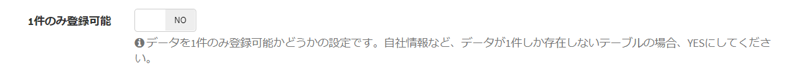
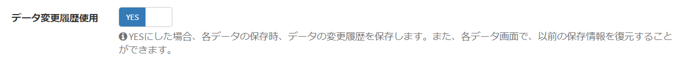
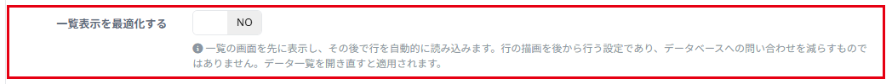
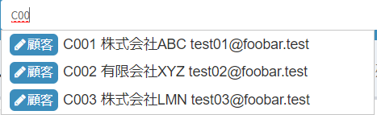
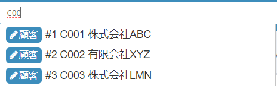
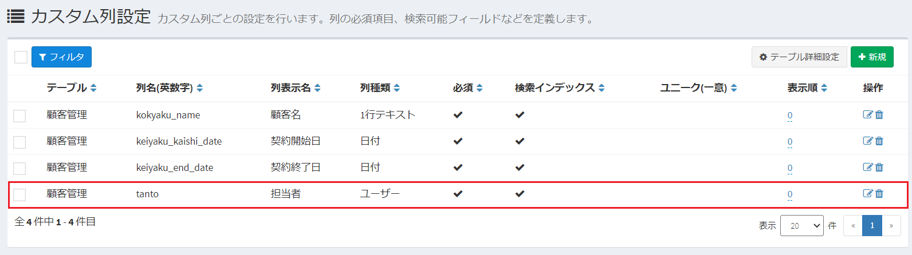
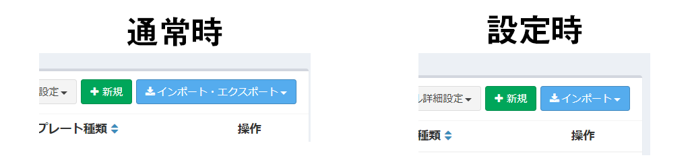

# Bảng tùy chỉnh
Trong Exment, dữ liệu được đưa vào "bảng tùy chỉnh" (bảng) để quản lý. Với mỗi thứ muốn quản lý, như khách hàng, báo giá, công việc, bạn tạo một bảng.  
Trang này giải thích cách tạo, sửa, xóa bảng và các thiết lập của từng bảng (chức năng dùng được với dữ liệu, quyền, v.v.).

- Khi tạo bảng lần đầu: vui lòng xem theo thứ tự "Tạo mới" → "Chi tiết các mục thiết lập" → "Lưu" ở dưới.
- Các thiết lập dùng nhiều cột, như kiểm tra trùng lặp hay câu chữ hiện ở gợi ý tìm kiếm: vui lòng xem "Thiết lập mở rộng" ở dưới.

## Danh sách
Bấm "Bảng tùy chỉnh" trong menu.  
Danh sách các bảng tùy chỉnh đang có hiện ra.  

※"Thông tin cơ bản", "Người dùng", "Tổ chức", "Mẫu thông báo", "Lịch sử gửi email", "Tin tức"  
Các bảng này có sẵn từ lúc cài đặt Exment.  
Các bảng được nhập bằng template cũng hiện trong danh sách này.  

## Tạo mới

- Bấm nút [Tạo mới] ở góc trên bên phải của màn hình danh sách.
  
  
- Màn hình tạo bảng hiện ra, hãy nhập các mục cần thiết. Giải thích về các mục có ở "Chi tiết các mục thiết lập" dưới đây.

## Chi tiết các mục thiết lập

#### Table name (alphanumeric) (Tên bảng - chữ và số) ※Bắt buộc
- Là tên của bảng. (Ví dụ: user , information , estimate )  
- Chữ và số đặt ở đây được dùng cho URL khi mở bảng, v.v. (Ví dụ: http(s)://(URL của Exment)/data/user)  
- Dùng được chữ cái, chữ số half-width và các ký hiệu "-", "_".
- Không dùng được tên bảng đã dùng cho bảng khác.  
- Tên bảng trong vòng 30 ký tự, và ký tự đầu phải là chữ cái.  
- Chỉ đặt được khi tạo bảng mới. Sau khi lưu thì không đổi được.  

> ※URL này là của thiết lập tiêu chuẩn không có "/admin" (trang cài mới từ v7.2.1 trở đi). Nếu `ADMIN_ROUTE_PREFIX` trong `.env` có giá trị (trang cài ở phiên bản trước là "admin"), hãy thêm giá trị đó vào sau URL của trang (ví dụ: `http(s)://(URL của Exment)/admin/oauth/token`). Chi tiết vui lòng xem [Thay đổi hoặc xóa "admin" trong URL](/vi/additional_prefix).

#### Table display name (Tên hiển thị của bảng) ※Bắt buộc
- Tên hiện trên màn hình. Cũng dùng được tiếng Nhật. (Ví dụ: Người dùng, Tin tức, Báo giá)  

  

#### Description (Mô tả)
- Phần mô tả về bảng.

- Như hình dưới đây, phần mô tả đã nhập hiện ở bên phải tên hiển thị của bảng trên màn hình dữ liệu.  

#### Display order (Thứ tự hiển thị)
- Thứ tự hiển thị trên màn hình danh sách thiết lập bảng tùy chỉnh.  
- Hãy nhập số bằng ký tự half-width, hoặc chọn số bằng các nút [-] [+] ở hai bên.

#### Color (Màu)
- Đặt màu của bảng. Màu này được dùng cho gợi ý khi tìm kiếm (suggest), v.v.

- Khi bấm vào màu hiện tại, màn hình chọn màu hiện ra.

#### Icon (Biểu tượng)
- Đặt biểu tượng của bảng. Biểu tượng này hiện ở menu và kết quả tìm kiếm.  

- Khi bấm vào biểu tượng hiện tại, màn hình chọn biểu tượng hiện ra.

#### Searchable (Cho phép tìm kiếm)
- Đặt xem khi [tìm kiếm](/vi/search.md) từ thanh tìm kiếm, bảng này có là đối tượng tìm kiếm hay không. Giá trị mặc định là YES.  
Khi không muốn bảng hiện trong kết quả tìm kiếm, như với bảng muốn ẩn, hãy đặt NO.

#### Use ID for labels (Sử dụng ID trong nhãn)
- Ở các gợi ý tìm kiếm hiện trên thanh tìm kiếm, bạn gắn được ID của dữ liệu vào đầu nhãn. Chi tiết vui lòng xem [Thiết lập cột hiển thị tiêu đề](/vi/table?id=thiết-lập-cột-hiển-thị-tiêu-đề). Giá trị mặc định là NO.  

#### Only one can be registered (Chỉ cho phép đăng ký 1 dữ liệu)
- Khi muốn bảng chỉ đăng ký được 1 dữ liệu, không đăng ký nhiều dữ liệu, hãy đặt YES. Giá trị mặc định là NO.  

#### Use attachments (Sử dụng tệp đính kèm)
- Khi muốn tải lên được [tệp đính kèm](/vi/data_details) cho dữ liệu của bảng, hãy đặt YES. Giá trị mặc định là YES.  

#### Use comments (Sử dụng bình luận)
- Khi muốn viết được [bình luận](/vi/data_details) cho dữ liệu của bảng, hãy đặt YES. Giá trị mặc định là YES.  

#### Use data change history (Sử dụng lịch sử thay đổi dữ liệu)
- Khi muốn lưu lại, dưới dạng revision (lịch sử), việc ai đã cập nhật dữ liệu với nội dung thế nào, hãy đặt YES. Giá trị mặc định là YES.  

#### Change history version number (Số phiên bản lịch sử thay đổi)
- Khi "Sử dụng lịch sử thay đổi dữ liệu" là YES, hãy nhập bằng số nguyên xem lưu lịch sử thay đổi đến bao nhiêu bản (số phiên bản).  
Nếu nhập "200", ở lần cập nhật thứ 201, lịch sử thay đổi của lần thứ 1 bị xóa. Giá trị mặc định là 100.  

#### Optimize list display (Tối ưu hiển thị danh sách)
- Đặt thành YES thì màn hình danh sách dữ liệu hiện ra trước, sau đó các dòng được tải tự động. Với bảng có nhiều dữ liệu hoặc nhiều cột, thời gian cho đến khi màn hình danh sách hiện ra ngắn lại. Giá trị mặc định là NO.
- Đây là thiết lập cho vẽ các dòng sau. Nó không làm giảm số truy vấn đến cơ sở dữ liệu.
- Thiết lập được áp dụng khi mở lại danh sách dữ liệu.

※Dùng được từ v7.1.0.

#### Editable by all users (Tất cả người dùng đều có thể chỉnh sửa)

> Về tổng quan quyền của bảng, trước tiên vui lòng xem trang [Tổng quan về vai trò và quyền trong Exment](/vi/permission).

- Đặt thành YES thì mọi người dùng đều chỉnh sửa được tất cả dữ liệu của bảng này. Không cần cấp quyền cho từng người dùng nữa. Giá trị mặc định là NO.  

#### Visible to all users (Tất cả người dùng đều có thể xem)

> Về tổng quan quyền của bảng, trước tiên vui lòng xem trang [Tổng quan về vai trò và quyền trong Exment](/vi/permission).

- Đặt thành YES thì mọi người dùng đều xem được tất cả dữ liệu của bảng này. Không cần cấp quyền cho từng người dùng nữa. Giá trị mặc định là NO.  

※Khi cài đặt Exment, chỉ bảng "Tin tức" được đặt sẵn "Tất cả người dùng có thể xem" là YES. Đó là để mọi người dùng đều xem được tin tức.  
Mặt khác, chỉ quản trị viên mới chỉnh sửa được tin tức.

#### Available to all users (Tất cả người dùng đều có thể tham chiếu)

> Về tổng quan quyền của bảng, trước tiên vui lòng xem trang [Tổng quan về vai trò và quyền trong Exment](/vi/permission).

- Đặt thành YES thì mọi người dùng đều tham chiếu được tất cả dữ liệu của bảng này. Không cần cấp quyền cho từng người dùng nữa. Giá trị mặc định là NO.  

※Nếu chỉ đặt "Tất cả người dùng có thể tham chiếu" là YES, bảng đó không hiện được trên menu hay màn hình danh sách, nhưng tham chiếu được từ các bảng khác.  

Ví dụ: với bảng "Thuế tiêu dùng", không cần cho người dùng thông thường xem màn hình danh sách, nhưng cần cho họ chọn "Thuế tiêu dùng" làm lựa chọn. Với những bảng như vậy, hãy đặt "Tất cả người dùng có thể tham chiếu" là YES.  

#### Viewable with permissions of parent data (Có thể xem bằng quyền của dữ liệu cha)

> Về tổng quan quyền của bảng, trước tiên vui lòng xem trang [Tổng quan về vai trò và quyền trong Exment](/vi/permission).

- Đặt thành YES thì xem được dữ liệu bằng quyền của dữ liệu cha (1:n). Tuy nhiên, người dùng phải có quyền với chính bảng này, như quyền xem của người phụ trách. Giá trị mặc định là NO.  

※Tùy chọn này chỉ hiện ở bảng con của quan hệ 1:n.  

※Dù có quyền chỉnh sửa dữ liệu cha, bạn cũng không chỉnh sửa được dữ liệu con. Chỉ xem được.  

#### Need Edit permission for parent data (Cần có quyền chỉnh sửa dữ liệu cha)

> Về tổng quan quyền của bảng, trước tiên vui lòng xem trang [Tổng quan về vai trò và quyền trong Exment](/vi/permission).

- Đặt thành YES thì để chỉnh sửa dữ liệu của bảng này, cần có quyền chỉnh sửa dữ liệu cha (1:n). Giá trị mặc định là YES.  

※Tùy chọn này chỉ hiện ở bảng con của quan hệ 1:n.  

#### Add to menu (Thêm vào menu)
- Đặt thành YES thì cùng lúc lưu bảng, bảng đó được thêm vào menu. Giá trị mặc định là NO.  

※Mục này chỉ hiện khi tạo bảng mới. Sau khi đã thêm vào menu, khi muốn đổi thiết lập của menu, hãy làm ở màn hình [Menu](/vi/menu.md).  

#### Parent menu to add to (Menu cha để thêm vào)
- Mục này hiện ra khi đặt "Thêm vào menu" là YES. Hãy chọn tên menu sẽ là menu cha của menu được thêm.  

Ví dụ: khi tạo bảng mới "Hướng dẫn sử dụng", nếu chọn "Cài đặt quản trị" làm menu cha thì, như trong hình, menu của bảng "Hướng dẫn sử dụng" được tạo ở dưới cùng trong "Cài đặt quản trị".

#### Add to notification (Thêm vào thông báo)
- Đặt thành YES thì cùng lúc lưu bảng, thiết lập thông báo được thêm vào. Đó là thiết lập gửi thông báo trong hệ thống cho những người dùng có quyền khi dữ liệu được tạo mới, cập nhật, chia sẻ và khi có bình luận.  

※Mục này chỉ hiện khi tạo bảng mới. Sau khi đã thêm vào thông báo, khi muốn đổi thiết lập của thông báo, hãy làm ở màn hình [Thông báo](/vi/notify.md).  

## Lưu
- Khi bấm nút [Gửi], thiết lập được lưu và bảng được tạo theo nội dung đó.

- Khi tạo bảng mới, sau khi lưu, màn hình chuyển sang [màn hình danh sách cột tùy chỉnh](/vi/column.md).  
Hãy đăng ký tiếp các cột tùy chỉnh.

## Chỉnh sửa
- Ở danh sách bảng tùy chỉnh, hãy bấm nút [Chỉnh sửa] của bảng muốn sửa.  
Màn hình chuyển sang màn hình chỉnh sửa, và bạn đổi được thiết lập.  

## Xóa
- Khi muốn xóa bảng, trước tiên hãy mở màn hình chỉnh sửa theo cùng các bước như mục "Chỉnh sửa" ở trên.

- Tiếp theo, hãy bấm nút [Xóa] ở góc trên bên phải của màn hình chỉnh sửa.  

  

- Màn hình xác nhận như hình dưới đây hiện ra. Nhập delete me vào ô văn bản rồi bấm nút [Xác nhận] thì bảng bị xóa.  
**※Tuy nhiên, không xóa được các loại bảng sau. ・Bảng được hệ thống cài đặt sẵn ・Bảng đang được đặt làm bảng con trong quan hệ (relation)**

## Thiết lập mở rộng
Bạn làm được các thiết lập dùng nhiều cột trong bảng (kiểm tra trùng lặp, so sánh giữa các cột, tiêu đề, tự động chia sẻ dữ liệu, v.v.).

- Ở danh sách bảng tùy chỉnh, hãy bấm nút [Cài đặt mở rộng] của bảng muốn thiết lập.  

- Màn hình chuyển sang màn hình thiết lập.

  

### Thiết lập khóa duy nhất kết hợp
Khi gộp nhiều cột làm khóa duy nhất (tổ hợp không cho phép trùng), lúc đăng ký mới dữ liệu, bạn ngăn được việc cùng một tổ hợp giá trị bị đăng ký hai lần.  

- Hãy chọn 2 đến 3 cột muốn ngăn trùng lặp theo tổ hợp.
- Khi đăng ký mới dữ liệu, nếu ở tất cả các cột đã chọn, giá trị định đăng ký đều giống giá trị đã đăng ký thì sẽ có lỗi.  

Ví dụ: như hình dưới đây, khi đặt "Ngày dự kiến tiếp theo" và "Tên" làm khóa duy nhất, bạn ngăn được việc cùng một tên bị đăng ký nhiều lần cho cùng một ngày dự kiến tiếp theo.  

※Khi muốn ngăn trùng lặp chỉ với 1 cột, hãy đặt "Duy nhất" của cột đó là YES trong [thiết lập cột tùy chỉnh](/vi/column.md).

※Với quan hệ 1:N ([xem thiết lập quan hệ của Exment](/vi/relation.md)), khi đặt khóa duy nhất kết hợp cho bảng con, bạn cũng chọn được bảng cha làm 1 trong các khóa duy nhất.  
Làm vậy thì kiểm tra được trùng lặp chỉ trong cùng một dữ liệu cha.

### So sánh 2 cột
Khi tạo mới và cập nhật dữ liệu, hệ thống so sánh 2 cột. Chỉ khi giá trị của các cột hợp với điều kiện đã đặt thì mới lưu được. Khi không hợp, thông báo lỗi hiện ra.  
Dùng được trong các trường hợp như sau.  

- Chỉ lưu được khi "Ngày bắt đầu" bằng hoặc trước "Ngày kết thúc".
-  Chỉ lưu được khi giá trị của "X" lớn hơn hoặc bằng giá trị của "Y".
- Chỉ lưu được khi "Người phụ trách" và "Người xác nhận" khác nhau.

    

#### Cách xử lý khi chưa nhập
Khi một hoặc cả hai mục chưa nhập, kết quả thay đổi theo điều kiện đã chọn.  
Ở đây, trường hợp lưu được ghi là "true", trường hợp có lỗi ghi là "false".

- **A và B khớp nhau** : true nếu cả hai giá trị đều chưa nhập. false nếu chỉ một trong hai chưa nhập.
- **A và B không khớp nhau** : true nếu chỉ một trong hai giá trị chưa nhập. false nếu cả hai đều chưa nhập.
- **Các điều kiện khác** : Luôn là true. Vì với ngày tháng và số, khi giá trị trống thì thông thường không so sánh được.  
Khi không muốn cho để trống, hãy đặt bắt buộc ở thiết lập cột tùy chỉnh hoặc thiết lập form tùy chỉnh.

#### Cách xử lý theo từng loại cột
- Việc so sánh lớn nhỏ (A lớn hơn B, A nhỏ hơn B, A lớn hơn hoặc bằng B, A nhỏ hơn hoặc bằng B) chỉ làm được với các loại cột sau.
    - Số nguyên
    - Số thập phân
    - Tiền tệ
    - Ngày
    - Giờ
    - Ngày và giờ

- Khi so sánh lớn nhỏ với các loại cột khác, kết quả luôn là true.

- Khi loại của hai cột không giống nhau thì không so sánh lớn nhỏ được (ví dụ "Số nguyên" và "Ngày và giờ"). Đúng ra, đây là điều phải báo lỗi khi lưu thiết lập này.  
Tuy nhiên, hiện nay việc kiểm tra này không được làm khi lưu. Hãy chọn 2 cột có loại hợp nhau.

#### Khác
- Khi muốn so sánh giá trị của từ 3 cột trở lên, so sánh bằng điều kiện đặc biệt, so sánh dùng giá trị của bảng khác, v.v., hãy tạo [plugin validation](/vi/plugin_quickstart_validate).

### Thiết lập cột hiển thị tiêu đề
Đây là thiết lập quyết định câu chữ (tiêu đề) hiện ở gợi ý của thanh tìm kiếm và ở danh sách lựa chọn được tạo từ giá trị của cột nào.  
  
Ví dụ, giả sử có bảng "Thông tin khách hàng" như dưới đây.  
Bảng thông tin khách hàng có các cột như "Mã khách hàng", "Tên khách hàng", "Số điện thoại", "Địa chỉ email".  
    

Khi nhập từ khóa vào thanh tìm kiếm, các gợi ý tìm kiếm hiện ra.  
Giả sử bạn muốn gợi ý này hiện như sau.  
"(Mã khách hàng) (Tên khách hàng)"  
    
  
Khi đó, trên màn hình thiết lập mở rộng của bảng tùy chỉnh, bạn đăng ký các cột muốn hiện làm tiêu đề như sau.  
  
  
Đăng ký như vậy thì khi nhập chữ vào thanh tìm kiếm ở phía trên trang, gợi ý hiện ra như sau.  
Chuỗi gợi ý được xếp theo thứ tự các cột đã đăng ký từ trên xuống trên màn hình thiết lập mở rộng.  
  
  
Khi muốn hiện cả "Địa chỉ email", hãy thêm cột "Địa chỉ email".  
  
  
  
Ngoài ra, trong thiết lập bảng tùy chỉnh có mục "Dùng ID làm nhãn".
  
Khi đặt thiết lập này là YES, chuỗi "#(id)" được thêm vào đầu nhãn.  
  

#### Khác
- Khi chưa đăng ký thiết lập cột hiển thị tiêu đề này, giá trị của cột thứ 1 trong thiết lập cột tùy chỉnh được hiện.
- Khi giá trị của cột thứ 1 trong thiết lập cột tùy chỉnh trống, ID được hiện.
- ID chỉ thêm được ở đầu nhãn. Không thêm được vào chỗ khác.  

### Thiết lập tự động chia sẻ dữ liệu

> Về thiết lập chia sẻ dữ liệu, trước tiên vui lòng xem trang [Tổng quan về vai trò và quyền trong Exment](/vi/permission).

Khi lưu dữ liệu, bạn tự động chia sẻ được dữ liệu cho tổ chức và người dùng nằm trong giá trị của cột.  
Dùng được trong các trường hợp như sau.  

- Khi tạo mới dữ liệu "Thông tin hợp đồng", tự động thêm quyền chỉnh sửa cho người dùng được gán ở cột "Người phụ trách chính".  
- Khi cập nhật dữ liệu "Thông tin hợp đồng", tự động thêm quyền xem cho tổ chức được gán ở cột "Tổ chức liên quan".  
- Khi tạo mới dữ liệu "Quản lý công việc", tự động thêm quyền chỉnh sửa cho người dùng được gán ở cột "Người phụ trách".  

※Trước đó, bảng tùy chỉnh cần có cột có loại cột là "Người dùng" hoặc "Tổ chức".

#### Ví dụ  
Khi bảng "Quản lý khách hàng" có các thiết lập cột như sau,

bạn đặt thiết lập: "Khi tạo mới", thêm quyền "Chỉnh sửa" cho người dùng được gán ở cột "Người phụ trách".

Sau đó, khi tạo mới dữ liệu có người phụ trách là người dùng "user1",

dữ liệu này được chia sẻ cho người dùng "user1" với quyền chỉnh sửa.

#### Cách thiết lập

- ##### Trigger (Thời điểm kích hoạt)
Thời điểm chia sẻ dữ liệu.  
Chọn được "Khi tạo mới" hoặc "Khi cập nhật".  

- ##### Target column (Cột đối tượng)
Người dùng hoặc tổ chức là đối tượng được chia sẻ dữ liệu.

- ##### Target authority (Quyền áp dụng)
Chọn chia sẻ với quyền chỉnh sửa hay quyền xem.

#### Thiết lập đồng bộ chia sẻ
Với thiết lập lúc đầu, khi thời điểm kích hoạt là "Khi cập nhật", dù đổi người dùng, tổ chức ở cột đối tượng, việc chia sẻ cho người dùng, tổ chức có ở đó trước đây không bị xóa và vẫn được chia sẻ.  

Khi đổi thiết lập, lúc cập nhật dữ liệu, bạn bỏ được khỏi phần chia sẻ những người dùng, tổ chức không phải là "người dùng, tổ chức đang có ở cột" và "người dùng đã cập nhật".

Để làm vậy, hãy đặt "Đồng bộ cài đặt tự động chia sẻ dữ liệu khi cập nhật" ở phần thiết lập tùy chọn là YES.

### Thiết lập không cho phép thực hiện từ màn hình

Đặt khi không muốn cho làm từ màn hình các việc tạo mới, chỉnh sửa, xóa dữ liệu và nhập, xuất.  
Khi đặt, nút đó không hiện trên màn hình nữa.  

- Mục "Không cho thay đổi từ màn hình" hiện ra.

  

- Ví dụ thiết lập: khi ẩn "Xuất"

  

  

### Vị trí hiển thị các mục hệ thống trên màn hình dữ liệu

Đặt vị trí hiện các mục hệ thống trên màn hình chỉnh sửa dữ liệu và màn hình chi tiết dữ liệu.  
Chọn được từ "Theo cài đặt hệ thống", "Hiển thị ở trên", "Hiển thị ở dưới", "Ẩn". (Giá trị ban đầu là "Theo cài đặt hệ thống")  
※Vị trí hiển thị của toàn hệ thống đổi được ở thiết lập hệ thống.  

  

### Chuyển màn hình khi nhấp vào dòng

Đặt xem khi bấm vào một dòng trên màn hình danh sách dữ liệu thì mở màn hình nào.  
Chọn được từ "Theo giá trị mặc định", "Màn hình chỉnh sửa dữ liệu", "Màn hình chi tiết dữ liệu", "Không chuyển màn hình". (Giá trị ban đầu là "Theo giá trị mặc định")  
※Giá trị mặc định của toàn hệ thống là "Màn hình chi tiết dữ liệu", nhưng đổi được bằng giá trị thiết lập trong .env (`EXMENT_GRIDROW_SELECT_EDIT`, `EXMENT_GRIDROW_SELECT_DISABLED`. [Giá trị thiết lập](/vi/config)).  

  

### Thiết lập định dạng tiêu đề
> Thiết lập này chỉ hiện khi đã bật [chế độ chuyên gia (expert mode)](/vi/additional_expert).

Dùng biến tham số, bạn đặt được giá trị hiện ở tiêu đề theo dạng tự do.  

- Bật chế độ chuyên gia và mở màn hình thiết lập mở rộng.

- Mục nhập "Chuỗi định dạng" hiện ra.  

  

- Khi hiện giá trị đã lưu trong dữ liệu làm tiêu đề, bạn dùng [biến tham số](/vi/params).  
Ví dụ: với thông tin người dùng, khi hiện "Tên người dùng&lt;admin@admin.admin&gt;"  
${value:user_name}&lt;${value:email}&gt;  
  

- Nhập như vậy thì bạn đặt được mục hiện ở tiêu đề.  
  

#### Khác
- Khi đã đặt thiết lập định dạng hiển thị tiêu đề này, "Thiết lập cột hiển thị tiêu đề" không còn hiệu lực.
