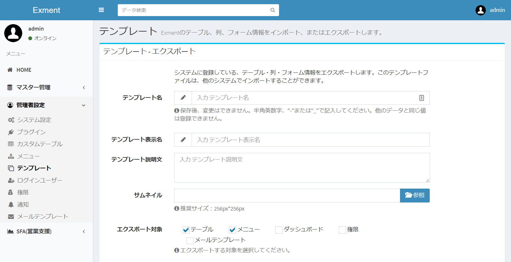

# Mẫu
"Mẫu" (template) là thứ gom các thiết lập như bảng, cột, biểu mẫu, menu, bảng điều khiển vào 1 tệp. Trang này giải thích cách đưa mẫu vào (nhập) và ghi mẫu ra (xuất).

| Việc muốn làm | Xem ở đâu |
|---|---|
| Cho người dùng khác dùng được các bảng, v.v. đã tạo trong hệ thống này | Xuất |
| Đưa vào mẫu do người khác tạo, hoặc mẫu do Exment chuẩn bị sẵn | Nhập |
| Đưa vào cả bộ cơ chế yêu cầu, phê duyệt | Mẫu đi kèm "Gói yêu cầu" |
| Viết vào Excel rồi tạo nhiều bảng cùng lúc | Nhập - Mẫu Excel |

Khi đưa mẫu vào, bạn đỡ công tạo bảng tùy chỉnh, v.v. từ đầu.

## Hiển thị trang
- Chọn "Mẫu" từ menu bên trái.  
Hoặc truy cập URL dưới đây.  
http(s)://(URL của Exment)/template  
Khi đó, màn hình mẫu sẽ được hiển thị.  
  

> ※ URL là theo thiết lập chuẩn không có "/admin" (site cài mới từ v7.2.1 trở đi). Nếu `ADMIN_ROUTE_PREFIX` trong `.env` có giá trị (site cài từ phiên bản trước là "admin"), hãy thêm giá trị đó sau URL của site (ví dụ: `http(s)://(URL của Exment)/admin/template`). Chi tiết vui lòng xem [Thay đổi hoặc xóa "admin" trong URL](/vi/additional_prefix).

## Xuất
Điền các mục cần thiết vào phần "Xuất" ở phía trên trang rồi nhấp "Gửi". Tệp zip chứa các thiết lập sẽ được xuất ra.  
  

##### Tên mẫu  
Là tên dùng bên trong hệ thống. Điền bằng chữ và số nửa cỡ (half-width), "-" hoặc "_".  
Hãy đặt tên không trùng với các tệp mẫu khác.  

##### Tên hiển thị mẫu  
Điền tên mẫu hiển thị trên màn hình mẫu.

##### Mô tả mẫu  
Điền câu mô tả hiển thị trên màn hình mẫu.

##### Hình thu nhỏ  
Tải lên hình thu nhỏ hiển thị trên màn hình mẫu. Kích thước khuyến nghị là 256px*256px.  
Nếu không tải lên, màn hình mẫu sẽ hiển thị ảnh "No Image".

##### Đối tượng xuất  
Chọn những thứ đưa vào mẫu này. Khi nhập mẫu, các mục đã chọn ở đây sẽ được đưa vào hệ thống.  
Các đối tượng chọn được là "Bảng", "Menu", "Bảng điều khiển", "Nhóm vai trò", "Quy trình làm việc".  
※ "Quy trình làm việc" chọn được từ v7.0.0 trở đi.  
  

##### Bảng cần xuất
Khi đã chọn "Bảng", "Menu", "Nhóm vai trò", "Quy trình làm việc" ở "Đối tượng xuất", chỉ những nội dung liên quan đến các bảng chọn ở đây được xuất.  
Hãy chọn khi muốn tạo mẫu chỉ gồm các nội dung liên quan đến bảng do mình tạo.  
※ Nếu không chọn, tất cả các mục đều được xuất.
  

##### Lưu
Khi nhập xong, nhấp [Gửi]. Tệp mẫu được xuất với nội dung đã nhập. Định dạng dữ liệu là tệp zip.

## Nhập
Hiện có 3 loại mẫu nhập được như sau.  
- Mẫu do Exment chuẩn bị sẵn
- Mẫu tải lên từ màn hình
- Mẫu đã từng tải lên hệ thống đó (có thể nhập lại)
  

Hãy thực hiện nhập bằng một trong các cách sau.

- ##### Cài đặt mẫu:
Danh sách các mẫu do Exment chuẩn bị sẵn và các mẫu đã từng tải lên được hiển thị.  
Hãy chọn mẫu muốn nhập trong số đó.

- ##### Tải mẫu lên (zip):
Hãy tải tệp mẫu Exment bạn đang có lên từ màn hình.  
Định dạng tệp là zip.

- ##### Tải mẫu lên (Excel):
Hãy tải tệp mẫu Excel đã tạo lên từ màn hình.   
Định dạng tệp là xlsx.  
※ Chi tiết vui lòng xem ["Mẫu Excel"](/vi/template?id=import-excel).

##### Lưu  
Sau khi làm một trong các cách trên, nhấp "Gửi". Mẫu đã chọn, hoặc mẫu đã tải lên, sẽ được nhập vào hệ thống.  
Thông tin về bảng, biểu mẫu, view, bảng điều khiển, v.v. định nghĩa trong mẫu được cài vào hệ thống.

### Mẫu đi kèm "Gói yêu cầu"
(Từ v7.2.1) Đây là mẫu đưa vào tờ trình phê duyệt, thanh toán chi phí, yêu cầu công tác, yêu cầu thanh toán, đơn xin nghỉ phép, cùng với quy trình làm việc phê duyệt. Chọn "Gói yêu cầu" từ "Cài đặt mẫu" rồi nhập.

| Thứ được đưa vào | Nội dung |
|---|---|
| Bảng | Tờ trình phê duyệt, Thanh toán chi phí (chi tiết: ngày, khoản mục, trả cho, số tiền, hóa đơn), Yêu cầu công tác, Yêu cầu thanh toán, Đơn xin nghỉ phép |
| Quy trình làm việc "Yêu cầu và phê duyệt (tiêu chuẩn)" | Dùng chung cho 5 loại yêu cầu. Bản nháp → [Gửi yêu cầu] → Đang yêu cầu → [Phê duyệt] → Đã phê duyệt (không chỉnh sửa được nữa) / [Trả lại] (bắt buộc bình luận) → Trả lại → [Gửi lại yêu cầu] → Đang yêu cầu |
| Nhóm vai trò | Người yêu cầu (tạo, sửa yêu cầu của mình), Người phê duyệt (xem tất cả yêu cầu) |
| Menu | Yêu cầu & phê duyệt ▸ Công việc chờ xử lý, Tờ trình phê duyệt, Thanh toán chi phí, Yêu cầu công tác, Yêu cầu thanh toán, Đơn xin nghỉ phép |

#### Việc cần làm sau khi đưa vào
1. Ở "Nhóm vai trò", đưa nhân viên sẽ gửi yêu cầu vào **Người yêu cầu**, người sẽ phê duyệt vào **Người phê duyệt**.
2. Menu "Yêu cầu & phê duyệt" chỉ hiển thị cho người yêu cầu và người phê duyệt (và quản trị viên hệ thống) ([Nhóm vai trò được xem](/vi/menu?id=nhóm-vai-trò-được-xem)). Ngay sau khi đưa vào chưa có người yêu cầu nào, nên chỉ quản trị viên hệ thống thấy.

#### Từ yêu cầu đến phê duyệt
1. Người yêu cầu tạo "Tờ trình phê duyệt", v.v. rồi lưu và bấm [Gửi yêu cầu]. Lúc này, **chọn người phê duyệt**.
2. Yêu cầu vào "Công việc chờ xử lý" của người được chọn. Người đó xem nội dung rồi bấm [Phê duyệt] hoặc [Trả lại].
3. Nếu bị trả lại, người yêu cầu sửa rồi bấm [Gửi lại yêu cầu].

※ Người phê duyệt được chọn lúc gửi yêu cầu. Không phải kiểu quyết định bằng nhóm vai trò (vì quyền của quy trình làm việc được quyết định bằng người dùng, tổ chức, người tạo, cột). Khi muốn để người cố định phê duyệt, hãy đổi người thực hiện của các hành động "Phê duyệt", "Trả lại" ở "[Quy trình làm việc](/vi/workflow_setting)".
※ Bảng, biểu mẫu, quy trình làm việc sửa được giống như bảng tùy chỉnh, quy trình làm việc thông thường.

<h3 id="import-excel"><a href="#/vi/template?id=import-excel" data-id="import-excel" class="anchor">Nhập - Mẫu Excel</a></h3>

Có thể điền các mục cần thiết vào tệp mẫu Excel rồi nhập thiết lập bảng, v.v.  
Khác với việc tạo từng cái một trên màn hình, có thể tạo nhiều bảng, v.v. cùng lúc.

  

#### Cách thực hiện
- Tải [tệp mẫu Excel](https://exment.net/downloads/template/exment_template.xlsx) xuống rồi mở tệp.  

- Nhập các giá trị thiết lập vào tệp mẫu. Thiết lập và tên sheet tương ứng như sau.
    - Bảng tùy chỉnh　:　custom_tables
    - Cột tùy chỉnh　:　custom_columns
    - Bảng tùy chỉnh (cài đặt mở rộng)　:　custom_column_multisettings
    - Cài đặt quan hệ　:　custom_relations
    - Menu　:　admin_menu

- Sau khi điền, ở mục "Tải lên (Excel)" của màn hình mẫu, hãy chọn tệp Excel đã tạo rồi tải lên.

  

#### Lưu ý
- Hiện tại, những thiết lập nhập được bằng tệp mẫu Excel là các thiết lập sau. Các thiết lập khác (biểu mẫu, view, v.v.) hãy thiết lập từ màn hình.
    - Bảng tùy chỉnh
    - Cột tùy chỉnh
    - Bảng tùy chỉnh (cài đặt mở rộng)
    - Cài đặt quan hệ
    - Menu

- Trong các cột tùy chỉnh, không hỗ trợ thiết lập "Công thức tính".  
Thiết lập này hãy làm từ màn hình.

- Khi thêm cột "Người dùng", "Tổ chức" trong cột tùy chỉnh, hãy điền "user", "organization" vào cột D "column_type: loại cột" của sheet "custom_columns".  
Nếu đặt cột D "column_type: loại cột" là "select_table" và cột AD "options.select_target_table_name: lựa chọn (nhập tên bảng đối tượng)" là "user", "organization" thì sẽ không hoạt động đúng.  
Nếu đã lỡ nhập vào, hãy cập nhật theo [trang các bước xử lý](/ja/patch/select_table_user_org) (tiếng Nhật).

- Xin đừng đổi tên các sheet của tệp Excel. Cũng đừng thêm cột Excel.  
(Thêm sheet thì không sao.)

- Hiện tại, việc xử lý nhập không thực hiện validation (kiểm tra nội dung nhập).  
Khuyến nghị thử trước ở môi trường thử nghiệm, v.v. rồi mới đưa vào môi trường chính thức.  

#### Mẫu, ví dụ
- [Tệp mẫu Excel](https://exment.net/downloads/template/exment_template.xlsx)

- [Tệp mẫu Excel - ví dụ](https://exment.net/downloads/sample/template/exment_template_sample.xlsx)
