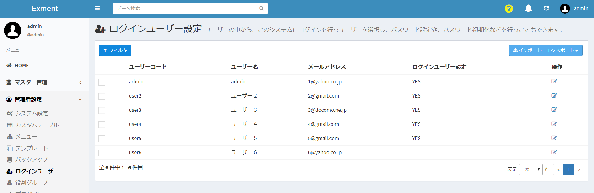

# Người dùng / Người dùng đăng nhập
Trang này giải thích các màn hình quản lý người dùng và người dùng đăng nhập.

| Việc muốn làm | Nơi xem |
|---|---|
| Thêm, chỉnh sửa, xóa người dùng | "Quản lý người dùng" |
| Cho người dùng đăng nhập được, quyết định mật khẩu | "Quản lý người dùng đăng nhập" |
| Thiết lập đăng nhập cùng lúc cho nhiều người dùng | "Nhập (import) hàng loạt thông tin người dùng đăng nhập" |
| Cho người dùng xem và đổi được thông tin của chính mình | "Người dùng đăng nhập xem và chỉnh sửa thông tin của chính mình" |

## Định nghĩa tên gọi
### Người dùng
Là người, ví dụ nhân viên thuộc công ty hoặc tổ chức của bạn.  
Người không dùng hệ thống này cũng có thể thêm làm người dùng.  
Mã người dùng và địa chỉ email là bắt buộc.  
Người dùng có thể được gắn với dữ liệu của bảng khác khi đăng ký. Tuy nhiên, chỉ là người dùng thì chưa đăng nhập được vào hệ thống.

### Người dùng đăng nhập
Là người, trong số các người dùng, đăng nhập được vào Exment.  
Vì thông tin người dùng có mật khẩu, người này có thể đăng nhập từ màn hình đăng nhập của Exment và đăng ký, tham chiếu dữ liệu, v.v.  

#### Trình tự thiết lập người dùng và người dùng đăng nhập

Các bước cho đến khi đăng nhập được vào Exment như hình trên.  
① Trên màn hình quản lý người dùng, đăng ký mã người dùng, tên người dùng và địa chỉ email của người dùng.  
② Trên màn hình quản lý người dùng đăng nhập, thiết lập mật khẩu cho người dùng đã đăng ký ở ①.  
Như vậy, người dùng đã đăng ký đăng nhập được vào Exment.  

> Khi đăng nhập, nếu nhập sai mật khẩu một số lần nhất định, người dùng đó sẽ không đăng nhập được trong một khoảng thời gian.  

## Quản lý người dùng
Phần này ghi cách quản lý thông tin của tất cả người dùng.  

### Hiển thị màn hình danh sách
Nhấp vào "Người dùng" ở menu bên trái.  
Hoặc mở URL sau.  
Khi đó, màn hình danh sách người dùng sẽ hiển thị.
http(s)://(URL của Exment)/data/user  
Danh sách người dùng hiện đang đăng ký trong hệ thống sẽ hiển thị.

> ※URL này là của thiết lập chuẩn không có "/admin" (site cài mới từ v7.2.1 trở đi). Nếu `ADMIN_ROUTE_PREFIX` trong `.env` có giá trị (site cài từ phiên bản trước là "admin"), hãy thêm giá trị đó sau URL của site (ví dụ: `http(s)://(URL của Exment)/admin/data/user`). Chi tiết vui lòng xem [Thay đổi hoặc xóa "admin" trong URL](/vi/additional_prefix).

### Thêm mới người dùng
- Trên màn hình danh sách "Người dùng", nhấp vào nút [Mới] ở phía trên bên phải của trang.

- Màn hình thêm mới hiển thị. Nhập các thông tin cần thiết.

#### Thiết lập tổ chức trực thuộc
Khi có tổ chức để người dùng trực thuộc, hãy chọn từ "Danh sách dữ liệu ứng viên" và chuyển sang "Danh sách dữ liệu đã chọn".  
※Khi chưa tạo tổ chức, mục này không hiển thị.

#### Thiết lập nhóm vai trò
Khi có nhóm vai trò cần gán cho người dùng, hãy chọn từ "Danh sách dữ liệu ứng viên" và chuyển sang "Danh sách dữ liệu đã chọn".

#### Thiết lập đăng nhập
Khi đặt "Cấp quyền đăng nhập" là YES, có thể tạo người dùng làm người dùng đăng nhập.  
Về cách thiết lập, vui lòng xem [Quản lý người dùng đăng nhập](/vi/user?id=quản-lý-người-dùng-đăng-nhập) ở dưới.

### Lưu
Sau khi nhập các thiết lập, vui lòng nhấp vào [Gửi].

### Chỉnh sửa
Để chỉnh sửa người dùng, vui lòng nhấp vào liên kết [Chỉnh sửa] ở dòng tương ứng.  

### Xóa
Để xóa người dùng, vui lòng nhấp vào liên kết [Xóa] ở dòng tương ứng.  

## Quản lý người dùng đăng nhập
Quản lý người dùng đăng nhập đối với các người dùng đã tạo ở màn hình trên.  
Có thể thêm mật khẩu, cấp lại mật khẩu, xóa quyền đăng nhập, v.v.  

### Hiển thị màn hình
Nhấp vào "Người dùng đăng nhập" ở menu bên trái.  
Hoặc mở URL sau.  
Khi đó, màn hình cài đặt người dùng đăng nhập sẽ hiển thị.
http(s)://(URL của Exment)/loginuser  
Các người dùng hiện đang đăng ký trong hệ thống và thông tin đăng nhập của họ sẽ hiển thị.  

### Thêm thông tin đăng nhập
Vui lòng nhấp vào liên kết [Chỉnh sửa] ở dòng của người dùng cần thêm thông tin đăng nhập.  

- Màn hình chỉnh sửa thông tin đăng nhập hiển thị.  
  
Khi thêm quyền đăng nhập, đặt "Cấp quyền đăng nhập" là YES.  
Khi đặt là YES, mục "Tự động tạo mật khẩu" hiển thị.

#### Automatically generate password (Tự động tạo mật khẩu)
Khi là YES, mật khẩu được tự động tạo khi thêm quyền đăng nhập.  
Sau khi tạo, email mật khẩu được tự động gửi đến địa chỉ email của người dùng đó.  
**※Để dùng chức năng này, cần có [thiết lập email](/vi/system_setting?id=thiết-lập-email-hệ-thống).**  
  
Khi là NO, ô nhập mật khẩu và mục "Gửi thông tin người dùng qua email" hiển thị.

#### Password input (Nhập mật khẩu)
Hiển thị khi "Tự động tạo mật khẩu" là NO.  
Hãy nhập mật khẩu của người dùng đăng nhập.  

#### Send User Information by Email (Gửi thông tin người dùng qua email)
Hiển thị khi "Tự động tạo mật khẩu" là NO.  
Khi mục này là YES, email mật khẩu được gửi đến địa chỉ email của người dùng đó.  
**※Để dùng chức năng này, cần có [thiết lập email](/vi/system_setting?id=thiết-lập-email-hệ-thống).**

#### Require password change at first login (Yêu cầu đổi mật khẩu khi đăng nhập lần đầu)
Khi đặt là YES, màn hình đổi mật khẩu hiển thị khi người dùng đăng nhập lần đầu.  
Thiết lập này có hiệu lực với người dùng mới đăng ký và người dùng đã được đặt lại mật khẩu.

### Xóa quyền đăng nhập
Xóa quyền đăng nhập.  
Trên màn hình danh sách, vui lòng nhấp vào liên kết [Chỉnh sửa] của người dùng có cột "Cài đặt người dùng đăng nhập" là "YES".  
  

Đổi "Cấp quyền đăng nhập" thành NO.  
  
Sau đó, vui lòng nhấp vào [Gửi].  

### Nhập (import) hàng loạt thông tin người dùng đăng nhập
Có thể nhập cùng lúc thông tin người dùng đăng nhập.  
Có thể thiết lập đăng nhập cùng lúc, không cần thiết lập đăng nhập từng người một từ màn hình người dùng.

Các bước như sau.

1. Đăng ký người dùng ("Đăng ký thông tin người dùng")  
2. Xuất thông tin người dùng đăng nhập ("Xuất thông tin người dùng đăng nhập")  
3. Chỉnh sửa tệp đã xuất ("Tạo tệp nhập (import)")  
4. Nhập ("Nhập (import)")

#### Đăng ký thông tin người dùng
Trước tiên, hãy thêm các người dùng cần cấp thông tin đăng nhập ở màn hình [Quản lý người dùng](/vi/user?id=quản-lý-người-dùng).

#### Xuất thông tin người dùng đăng nhập
- Nhấp vào "Người dùng đăng nhập" ở menu bên trái.  
Hoặc mở URL sau.  
Khi đó, màn hình cài đặt người dùng đăng nhập sẽ hiển thị.
http(s)://(URL của Exment)/loginuser  
Các người dùng hiện đang đăng ký trong hệ thống và thông tin đăng nhập của họ sẽ hiển thị.  

- Nhấp vào nút "Nhập/Xuất" ở phía trên bên phải màn hình.  
Sau đó, nhấp vào "Xuất".

  

- Thông tin người dùng đã đăng ký và thông tin người dùng đăng nhập của các người dùng đó được xuất ra.

  

#### Nội dung của từng cột
- id  
Là id của người dùng. Khi nhập về sau, vui lòng không đổi giá trị này.  

- Tên người dùng, Mã người dùng, Email  
Là thông tin người dùng.  
※Khi nhập về sau, dù có đổi các giá trị này, thông tin người dùng cũng không được phản ánh. Thông tin người dùng hãy đổi ở màn hình "Người dùng".

- Cấp quyền đăng nhập  
Cho biết người dùng đó có được cấp thông tin đăng nhập chuẩn của Exment hay không. Khi là 1, thông tin đăng nhập đã được cấp.

- Tự động tạo mật khẩu, Mật khẩu, Gửi thông tin người dùng qua email  
Khi xuất, các giá trị này để trống. Chúng được dùng khi nhập.

#### Tạo tệp nhập (import)
Chỉnh sửa tệp đã xuất ở trên để tạo tệp nhập.  
Ở từng cột, hãy nhập như sau.

- Cấp quyền đăng nhập  
    - Khi muốn cấp quyền đăng nhập chuẩn của Exment cho người dùng đó, hãy đặt là 1.  
    - Khi quyền đăng nhập đã được cấp và muốn giữ nguyên, hãy để nguyên là 1.  
    - Khi muốn xóa quyền đăng nhập của người dùng đã được cấp quyền đăng nhập, hãy đặt là 0.

- Tự động tạo mật khẩu  
Khi muốn tự động tạo mật khẩu của người dùng đó, hãy nhập 1.  
Khi thiết lập cho người dùng đã được cấp quyền đăng nhập, mật khẩu sẽ được đặt lại.

- Mật khẩu  
Khi muốn tự quyết định mật khẩu của người dùng, hãy nhập chuỗi mật khẩu.  
Khi thiết lập cho người dùng đã được cấp quyền đăng nhập, mật khẩu sẽ được đặt lại.

- Gửi thông tin người dùng qua email  
Khi mới cấp thông tin đăng nhập hoặc khi đổi mật khẩu, nếu muốn gửi mật khẩu qua email, hãy nhập 1.

#### Nhập (import)
- Trên màn hình cài đặt người dùng đăng nhập, nhấp vào nút "Nhập/Xuất" ở phía trên bên phải màn hình.  
Sau đó, nhấp vào "Nhập".

  

- Tải lên tệp nhập đã tạo.

- Thông tin đăng nhập được cấp.

## Người dùng đăng nhập xem và chỉnh sửa thông tin của chính mình
Người dùng được đăng ký các thông tin như "Mã người dùng", "Tên người dùng", "Email", "Ảnh đại diện", "Mật khẩu".

- "Ảnh đại diện" và "Mật khẩu" thì ngay từ đầu, chính người dùng đăng nhập hiển thị và đổi được.  
- "Mã người dùng", "Tên người dùng", "Email" và "các cột khác được tạo mới" thì chính người dùng đăng nhập xem và chỉnh sửa được sau khi thực hiện thiết lập sau.  

#### Thiết lập cột tùy chỉnh: xem và chỉnh sửa thông tin của chính mình

Ở cài đặt cột tùy chỉnh của bảng người dùng, có thể thiết lập "Xem / chỉnh sửa thông tin cá nhân".  
Chọn được 3 loại: "Không hiển thị", "Chỉ xem", "Có thể chỉnh sửa".  
Với mỗi loại, những gì người dùng đăng nhập làm được như sau.

##### Hide (Không hiển thị)
Người dùng đăng nhập không hiển thị được thông tin đăng ký.  

##### View only (Chỉ tham chiếu)
Người dùng đăng nhập hiển thị được thông tin đăng ký nhưng không chỉnh sửa được.  

##### Editable (Có thể chỉnh sửa)
Người dùng đăng nhập hiển thị và chỉnh sửa được thông tin đăng ký.
> Khi có thiết lập các tùy chọn như "chỉ cho phép nhập một lần", các tùy chọn đó được ưu tiên.

#### Xem và chỉnh sửa trên màn hình người dùng đăng nhập

Nhấp vào tên người dùng đăng nhập ở phía trên bên phải màn hình Exment, rồi nhấp vào [Thiết lập].  

Các thông tin mà người dùng đăng nhập hiển thị được sẽ hiện ra.  
Các cột nhập được thì chính người dùng có thể chỉnh sửa và lưu.    

※Trong ví dụ ở hình, "Mã người dùng" được đặt là chỉ xem, còn "Tên người dùng" và "Email" được đặt là có thể chỉnh sửa.  

