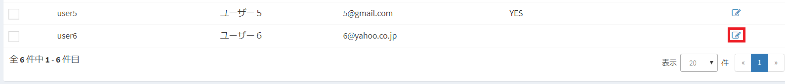
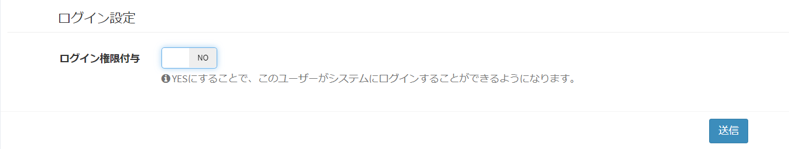

# Người dùng / Người dùng đăng nhập
Quản lý người dùng sử dụng hệ thống này và người dùng đăng nhập.

## Định nghĩa tên gọi
### Người dùng
Là nhân viên hoặc cá nhân thuộc công ty hay tổ chức của bạn.  
Những người không sử dụng hệ thống này cũng có thể được thêm làm người dùng.  
Mã người dùng (user code) và địa chỉ email là bắt buộc.  
Có thể gắn người dùng khi đăng ký dữ liệu, chẳng hạn để liên kết với các bảng khác, nhưng người dùng không thể đăng nhập vào hệ thống.

### Người dùng đăng nhập
Là nhân viên hoặc cá nhân, trong số các người dùng, có thể đăng nhập vào Exment.  
Vì thông tin người dùng được gán mật khẩu, người này có thể đăng nhập từ màn hình đăng nhập của Exment và thực hiện đăng ký, tham chiếu dữ liệu, v.v.  

#### Trình tự thiết lập người dùng và người dùng đăng nhập

Quy trình cho đến khi có thể đăng nhập vào Exment gồm các bước như trên.  
① Trên màn hình quản lý người dùng, đăng ký mã người dùng, tên người dùng và địa chỉ email của người dùng.  
Sau đó, trên màn hình quản lý người dùng đăng nhập ở bước ②, thiết lập mật khẩu cho người dùng đã đăng ký ở bước ①.  
Như vậy, người dùng đã đăng ký có thể đăng nhập vào Exment.  

> Khi đăng nhập, nếu nhập sai mật khẩu đã thiết lập cho người dùng quá một số lần nhất định, người dùng đó sẽ không thể đăng nhập trong một khoảng thời gian nhất định.  

## Quản lý người dùng
Phần này mô tả cách quản lý thông tin của tất cả người dùng.  

### Hiển thị màn hình danh sách
Nhấp vào "Users" (Người dùng) trên menu bên trái.  
Hoặc truy cập URL dưới đây.  
Khi đó, màn hình thiết lập người dùng đăng nhập sẽ được hiển thị.
http(s)://(URL của Exment)/admin/data/user  
Danh sách người dùng hiện đang được đăng ký trong hệ thống sẽ được hiển thị.

### Thêm mới người dùng
- Trên màn hình danh sách "Users", nhấp vào nút [New] ở góc trên bên phải của trang.

- Màn hình thêm mới sẽ được hiển thị, hãy nhập các mục cần thiết.

#### Thiết lập tổ chức trực thuộc
Nếu có tổ chức mà người dùng sẽ trực thuộc, hãy chọn từ danh sách dữ liệu ứng viên và chuyển sang danh sách dữ liệu đã chọn.  
※ Nếu chưa tạo tổ chức, mục này sẽ không được hiển thị.

#### Thiết lập nhóm vai trò
Nếu có nhóm vai trò cần gán cho người dùng, hãy chọn từ danh sách dữ liệu ứng viên và chuyển sang danh sách dữ liệu đã chọn.

#### Thiết lập đăng nhập
Bằng cách đặt "Login authority" (cấp quyền đăng nhập) là YES, bạn có thể tạo người dùng dưới dạng người dùng đăng nhập.
Về cách thiết lập, vui lòng tham khảo phần [Quản lý người dùng đăng nhập](/vi/user?id=quản-lý-người-dùng-đăng-nhập) bên dưới.

### Lưu
Sau khi nhập xong các thiết lập, hãy nhấp vào [Submit].

### Chỉnh sửa
Nếu muốn chỉnh sửa người dùng, hãy nhấp vào liên kết [Edit] ở hàng tương ứng.  

### Xóa
Nếu muốn xóa người dùng, hãy nhấp vào liên kết [Delete] ở hàng tương ứng.  

## Quản lý người dùng đăng nhập
Quản lý người dùng đăng nhập dựa trên người dùng đã tạo ở màn hình trên.  
Bạn có thể thêm thông tin mật khẩu, cấp lại mật khẩu, xóa quyền đăng nhập, v.v.  

### Hiển thị màn hình
Nhấp vào "Login User" (Người dùng đăng nhập) trên menu bên trái.  
Hoặc truy cập URL dưới đây.  
Khi đó, màn hình thiết lập người dùng sẽ được hiển thị.
http(s)://(URL của Exment)/loginuser  
Các người dùng hiện đang được đăng ký trong hệ thống và thông tin đăng nhập của họ sẽ được hiển thị.

### Thêm thông tin đăng nhập
Nhấp vào liên kết [Edit] ở hàng của người dùng cần thêm thông tin đăng nhập.  

- Màn hình chỉnh sửa thông tin đăng nhập sẽ được hiển thị.  

Để thêm quyền đăng nhập, hãy đặt "Login authority" là YES.  
Khi đặt là YES, mục "Automatically generate password" (tự động tạo mật khẩu) sẽ được hiển thị.

#### Automatically generate password (Tự động tạo mật khẩu)
Nếu là YES, mật khẩu sẽ được tự động tạo khi thêm quyền đăng nhập.    
Sau khi tự động tạo, email mật khẩu sẽ được tự động gửi đến địa chỉ email tương ứng.  
**※ Để sử dụng chức năng này, cần thực hiện [thiết lập email](/vi/system_setting).**

Nếu là NO, ô nhập mật khẩu và mục "Send User Information by Email" (gửi thông tin người dùng qua email) sẽ được hiển thị.

#### Password input (Nhập mật khẩu)
Được hiển thị khi "Automatically generate password" là NO.  
Hãy nhập mật khẩu của người dùng đăng nhập.  

#### Send User Information by Email (Gửi thông tin người dùng qua email)
Được hiển thị khi "Automatically generate password" là NO.  
Nếu mục này là YES, email mật khẩu sẽ được gửi đến địa chỉ email tương ứng.  
**※ Để sử dụng chức năng này, cần thực hiện [thiết lập email](/vi/system_setting).**

#### Require password change at first login (Yêu cầu đổi mật khẩu khi đăng nhập lần đầu)
Nếu đặt là YES, màn hình yêu cầu đổi mật khẩu sẽ được hiển thị khi người dùng đăng nhập lần đầu tiên.  
Thiết lập này có hiệu lực với người dùng được đăng ký mới hoặc người dùng đã được đặt lại mật khẩu.

### Xóa quyền đăng nhập
Thực hiện xóa quyền đăng nhập.  
Trên màn hình danh sách, nhấp vào liên kết [Edit] của người dùng có cột "Login user setting" là "YES".  
  

Đổi "Login authority" thành NO.  
  
Sau đó, nhấp vào [Submit].  

### Nhập (import) hàng loạt thông tin người dùng đăng nhập
Có thể nhập (import) hàng loạt thông tin người dùng đăng nhập.  
Nhờ đó, bạn có thể thiết lập đăng nhập hàng loạt mà không cần thiết lập đăng nhập từng người một trên màn hình người dùng.

#### Đăng ký thông tin người dùng
Trước tiên, hãy thêm thông tin của những người dùng cần cấp thông tin đăng nhập trên màn hình [Quản lý người dùng](/vi/user?id=quản-lý-người-dùng).

#### Xuất thông tin người dùng đăng nhập
- Nhấp vào "Login User" trên menu bên trái.  
Hoặc truy cập URL dưới đây.  
Khi đó, màn hình thiết lập người dùng đăng nhập sẽ được hiển thị.
http(s)://(URL của Exment)/loginuser  
Các người dùng hiện đang được đăng ký trong hệ thống và thông tin đăng nhập của họ sẽ được hiển thị.

- Nhấp vào nút "Import/Export" ở góc trên bên phải màn hình.  
Sau đó, nhấp vào "Export".

  

- Thông tin người dùng đã đăng ký và thông tin người dùng đăng nhập của những người dùng đó sẽ được xuất ra.

  

#### Nội dung của từng cột
- id  
Là id của người dùng. Khi nhập (import) như mô tả ở phần sau, vui lòng không thay đổi giá trị này.  

- Tên người dùng, mã người dùng, địa chỉ email  
Là thông tin người dùng.  
※ Khi nhập (import) như mô tả ở phần sau, dù có thay đổi các giá trị này thì thông tin người dùng cũng không được cập nhật. Vui lòng thiết lập trên màn hình "Users".

- Login authority (cấp quyền đăng nhập)  
Cho biết người dùng đó có được cấp thông tin đăng nhập tiêu chuẩn của Exment hay không. Nếu là 1, thông tin đăng nhập đã được cấp.

- Automatically generate password (tự động tạo mật khẩu), Password (mật khẩu), Send User Information by Email (gửi thông tin người dùng qua email)  
Khi xuất (export), các giá trị này để trống. Chúng được sử dụng khi nhập (import).

#### Tạo tệp nhập (import)
Chỉnh sửa thông tin đã xuất ở trên để tạo tệp nhập.  
Vui lòng nhập nội dung thiết lập của từng cột như sau.

- Login authority (cấp quyền đăng nhập)  
    - Nếu muốn cấp quyền đăng nhập tiêu chuẩn của Exment cho người dùng đó, hãy đặt là 1.  
    - Nếu đã cấp quyền đăng nhập và muốn tiếp tục cấp quyền đăng nhập cho người dùng đó, hãy giữ nguyên là 1.
    - Nếu muốn xóa quyền đăng nhập của người dùng đã được cấp quyền đăng nhập, hãy đặt là 0.

- Automatically generate password (tự động tạo mật khẩu)  
Nếu muốn tự động tạo mật khẩu cho người dùng đó, hãy nhập 1.  
Nếu thiết lập cho người dùng đã được cấp quyền đăng nhập, mật khẩu sẽ được đặt lại.

- Password (mật khẩu)  
Nếu muốn chỉ định rõ mật khẩu của người dùng, hãy nhập chuỗi mật khẩu.  
Nếu thiết lập cho người dùng đã được cấp quyền đăng nhập, mật khẩu sẽ được đặt lại.

- Send User Information by Email (gửi thông tin người dùng qua email)  
Hãy nhập 1 nếu muốn gửi thông tin mật khẩu qua email trong trường hợp cấp mới thông tin đăng nhập hoặc đã thay đổi mật khẩu.

#### Nhập (import)
- Trên màn hình thiết lập người dùng đăng nhập, nhấp vào nút "Import/Export" ở góc trên bên phải màn hình.  
Sau đó, nhấp vào "Import".

  

- Tải lên tệp nhập đã tạo.

- Thông tin đăng nhập sẽ được cấp.

## Người dùng đăng nhập xem và chỉnh sửa thông tin của chính mình
Mỗi người dùng được đăng ký các thông tin như "mã người dùng", "tên người dùng", "địa chỉ email", "ảnh đại diện (avatar)", "mật khẩu".  
Đối với "ảnh đại diện" và "mật khẩu", theo mặc định, chính người dùng đăng nhập có thể hiển thị và thay đổi.  
Đối với các thông tin đăng ký "mã người dùng", "tên người dùng", "địa chỉ email" và "các cột khác được tạo mới", chính người dùng đăng nhập có thể xem và chỉnh sửa sau khi thực hiện các thiết lập dưới đây.  

#### Thiết lập cột tùy chỉnh: xem và chỉnh sửa thông tin của chính mình

Trong thiết lập cột tùy chỉnh của bảng người dùng, có thể thiết lập mục "View/edit own information" (xem và chỉnh sửa thông tin của chính mình).  
Có 3 thiết lập có thể chọn: "Hide" (không hiển thị), "View only" (chỉ tham chiếu), "Editable" (có thể chỉnh sửa).  
Thao tác của người dùng đăng nhập đối với cột tùy chỉnh như sau.

##### Hide (Không hiển thị)
Người dùng đăng nhập không thể hiển thị thông tin đăng ký.  

##### View only (Chỉ tham chiếu)
Người dùng đăng nhập có thể hiển thị thông tin đăng ký nhưng không thể chỉnh sửa.  

##### Editable (Có thể chỉnh sửa)
Người dùng đăng nhập có thể vừa hiển thị vừa chỉnh sửa thông tin đăng ký.
> Nếu đã thiết lập các tùy chọn như "chỉ cho phép nhập một lần" thì các tùy chọn đó được ưu tiên.

#### Xem và chỉnh sửa trên màn hình người dùng đăng nhập

Nhấp vào tên người dùng đăng nhập hiển thị ở góc trên bên phải màn hình Exment, sau đó nhấp vào [Setting].  

Các thông tin mà người dùng đăng nhập được phép hiển thị sẽ được hiển thị.   
Với các cột được phép nhập, chính người dùng có thể chỉnh sửa và lưu.    

※ Trong ví dụ ở hình trên, "mã người dùng" được đặt là chỉ tham chiếu, còn "tên người dùng" và "địa chỉ email" được đặt là có thể chỉnh sửa.  
