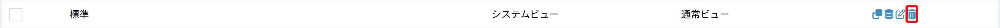
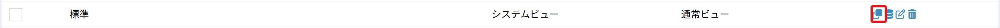

# View tùy chỉnh
Thiết lập view cho [màn hình danh sách dữ liệu](/vi/data_grid) của Exment, chẳng hạn như các cột hiển thị và điều kiện lọc.  

## Các loại view
Hiện tại có các loại view sau đây.  

### View (view thông thường)

Đây là view thông thường, hiển thị danh sách dữ liệu.  
View này liệt kê các dữ liệu đã đăng ký.

### View tổng hợp

Nhóm các dữ liệu đã đăng ký và hiển thị các giá trị tổng hợp như tổng, số lượng, giá trị lớn nhất.  
Trên dashboard, có thể hiển thị dưới dạng biểu đồ.

### View lịch

Có thể hiển thị các dữ liệu đã đăng ký dưới dạng lịch.

### View Kanban

Hiển thị các dữ liệu đã đăng ký dưới dạng thẻ, xếp vào các cột theo từng trạng thái.  
Khi kéo một thẻ sang cột khác, giá trị của mục tương ứng sẽ được thay đổi.  
Vui lòng tham khảo [View Kanban](/view_kanban) để biết chi tiết.

### View biểu đồ Gantt
Hiển thị các dữ liệu đã đăng ký theo trục thời gian, mỗi dữ liệu là một thanh ngang kéo dài từ ngày bắt đầu đến ngày hết hạn (ngày kết thúc).  
Vui lòng tham khảo [View biểu đồ Gantt](/view_gantt) để biết chi tiết.

### View toàn bộ dữ liệu
Về cơ bản giống với view thông thường, nhưng có các đặc điểm sau.  
- Được hệ thống tạo tự động.    
- Chỉ có duy nhất một view được tạo. Người dùng không thể tạo mới hoặc xóa view này.
- Được sử dụng khi hiển thị danh sách trên màn hình [tìm kiếm](/search).
- Được sử dụng khi hiển thị dữ liệu chi tiết từ view tổng hợp.

### View điều kiện
Được sử dụng để lọc dữ liệu trong điều kiện thông báo của [thông báo](/notify), hoặc khi loại cột của cột tùy chỉnh là "Choice (select from a list of values in another table)" (lựa chọn từ danh sách giá trị của bảng khác).
- Không thiết lập cột hiển thị.
- Không được hiển thị trên màn hình danh sách dữ liệu.
- Chỉ quản trị viên mới có thể thiết lập. Người dùng thông thường không thể thiết lập.

## Hiển thị trang
- Trên danh sách bảng tùy chỉnh, hãy đánh dấu chọn một bảng muốn thiết lập, rồi nhấp vào "Table Detail Setting" (thiết lập chi tiết bảng) ở phía trên bên phải.  

- Hoặc, sau khi chọn bảng muốn thiết lập từ menu, hãy nhấp vào "Table Detail Setting" ở phía trên bên phải theo cách tương tự.  
※Cần thiết lập trước để bảng đó được hiển thị trên menu.  

- Trên màn hình thiết lập chi tiết bảng vừa hiển thị, nhấp vào biểu tượng thiết lập view.

- Danh sách các view đã thiết lập cho bảng tùy chỉnh sẽ được hiển thị.  

## Thêm mới view
- Trên màn hình "Custom View Settings" (thiết lập view tùy chỉnh), nhấp vào nút [New] ở phía trên bên phải của trang.

Trong hộp thoại hiển thị, nhấp vào nút tương ứng với loại view muốn tạo.

- Màn hình thêm mới view sẽ hiển thị, vui lòng nhập các thông tin cần thiết.

## Các mục thiết lập của view
#### View display name (Tên hiển thị của view)
Nhập tên của view.  

#### View permissions (Quyền của view)
Thiết lập quyền sử dụng view là System view hoặc User view.

- System view (view hệ thống)  
Chỉ quản trị viên hệ thống mới có thể thiết lập.  
Đây là view mà tất cả người dùng có quyền truy cập bảng đều sử dụng được.  

- User view (view người dùng)  
Đây là view mà cả những người không phải quản trị viên hệ thống cũng có thể thiết lập.  
Chỉ người dùng đã tạo view mới sử dụng được view này.

※Không thể đổi System view thành User view về sau.  
Đối với **User view do quản trị viên hệ thống tạo**, có thể đổi thành System view về sau.  
※Khi bật thiết lập [vô hiệu hóa User view](/config?id=user-view-disabled), người dùng thông thường sẽ không thể tạo view.

#### Displayed results (Số dữ liệu hiển thị)
Chọn số dữ liệu hiển thị trên mỗi trang của danh sách dữ liệu.

#### Default (Mặc định)
Khi tạo nhiều view, view được hiển thị khi người dùng mở danh sách dữ liệu là view được đặt là "YES".  
※Các view được đặt là "NO" cũng có thể hiển thị bằng cách chọn từ danh sách view.  
※Trong một bảng tùy chỉnh, chỉ có một view có thể đặt mục "Default" là "YES".  
Nếu đặt "Default" là "YES" cho từ hai view trở lên, các view khác ngoài view được đặt "YES" sau cùng sẽ bị đổi thành "NO".

#### Use the view information box (Sử dụng hộp thông tin của view)
Khi đặt là [YES], có thể thêm một hộp thông tin ở phía trên của view.  
Có thể nhập tiêu đề và nội dung để hiển thị nội dung công việc hoặc lời nhắn gửi đến người dùng.

#### Display column selection (Chọn cột hiển thị)
Thiết lập các cột hiển thị trên view.  
Danh sách các cột đã thiết lập sẽ được hiển thị trên màn hình danh sách dữ liệu, v.v.

##### Target column (Cột đối tượng)  
Cột sẽ hiển thị trên view.  
  
##### Display as (Tên hiển thị khác)  
Cột được hiển thị trên view với tên đã thiết lập.  

##### Cell appearance preset (Preset hiển thị của ô)  
Chọn kiểu hiển thị của cột này trong view này.  
※Thiết lập này được ưu tiên hơn nội dung thiết lập của cột tùy chỉnh. Vui lòng tham khảo [Preset hiển thị](/cell_style_preset) để biết chi tiết.  

##### Nút [↓]  
Di chuyển mục hiển thị trên view sang phải.  

##### Nút [↑]  
Di chuyển mục hiển thị trên view sang trái.  

##### Nút [Delete]  
Xóa mục hiển thị khỏi view.

##### Nút [New]  
Thêm mới một cột hiển thị cho view.

#### Data display conditions (Điều kiện hiển thị dữ liệu)
Thiết lập điều kiện hiển thị trên view.  
Hãy thêm điều kiện khi muốn thu hẹp nội dung hiển thị, chẳng hạn như chỉ hiển thị các mục trong một khoảng thời gian, hoặc chỉ hiển thị nội dung có trạng thái nhất định.  
※Ngoài thiết lập này, dữ liệu còn được lọc để chỉ hiển thị những dữ liệu mà người dùng đăng nhập có quyền. Dữ liệu không có quyền sẽ không được hiển thị, bất kể thiết lập này.

>Khi loại cột của mục điều kiện là "Choice (select from a list of values in another table)", nội dung hiển thị ở giá trị điều kiện có thể thay đổi tại [thiết lập cột hiển thị tiêu đề](/vi/table).

##### Target column (Cột đối tượng)
Cột dùng cho điều kiện lọc.  
  
##### Condition (Điều kiện)
Chọn nội dung của điều kiện.  
Vui lòng xem [Về điều kiện tìm kiếm](/vi/view?id=về-điều-kiện-tìm-kiếm) để biết chi tiết.  

##### Search value (Giá trị tìm kiếm)
Nhập giá trị cần khớp với nội dung của điều kiện tìm kiếm.  
  
##### Nút [Delete]
Xóa điều kiện hiển thị của view.
  
##### Nút [New]
Thêm mới một điều kiện hiển thị cho view.

#####   Condition Join (Kết hợp điều kiện)
Khi chọn "Match All Condition" (khớp tất cả điều kiện), các dữ liệu khớp với tất cả điều kiện sẽ được hiển thị.  
Khi chọn "Match Any Condition" (khớp một trong các điều kiện), các dữ liệu khớp với bất kỳ điều kiện nào sẽ được hiển thị.

#####   Condition Reverse (Đảo ngược điều kiện)
Khi đánh dấu chọn "Reverse condition" (đảo ngược điều kiện), các dữ liệu không khớp với điều kiện sẽ được hiển thị.    
※View tổng hợp không thuộc đối tượng của chức năng đảo ngược điều kiện hiển thị.

#### Về điều kiện tìm kiếm
Các lựa chọn sẽ thay đổi tùy theo loại nội dung đã chọn ở "Target column" (ví dụ "Date" (ngày), "User" (người dùng)).  
Mục này của tài liệu mô tả những điều kiện tìm kiếm cần lưu ý đặc biệt.

##### Khi loại của cột đối tượng là "Date" (ngày)
- Từ ngày của X ngày trước trở về sau  
- Từ ngày của X ngày sau trở về sau  
- Từ ngày của X ngày trước trở về trước  
- Từ ngày của X ngày sau trở về trước  
Dữ liệu sẽ được hiển thị trên view khi ngày đã đăng ký của dữ liệu nằm trong phạm vi tương ứng.  

Ví dụ: khi ngày hiện tại là 15/1 và giá trị tìm kiếm được đăng ký là "8"  

##### Khi loại của cột đối tượng là "User" (người dùng)
- Khớp với người dùng đăng nhập  
Dữ liệu sẽ được hiển thị trên view khi giá trị đã đăng ký trùng với người dùng đang đăng nhập.  

- Không khớp với người dùng đăng nhập    
Dữ liệu sẽ được hiển thị trên view khi giá trị đã đăng ký không trùng với người dùng đang đăng nhập.  

#### Data Sorting (Sắp xếp dữ liệu)
Thiết lập cách sắp xếp (thứ tự hiển thị) của dữ liệu hiển thị trên view.

 
##### Target column (Cột đối tượng)  
Cột dùng để sắp xếp dữ liệu.  

##### Sorting (Sắp xếp)  
Chỉ định kiểu sắp xếp sẽ thực hiện.  

##### Nút [↓]  
Hạ mức ưu tiên của mục trong thứ tự sắp xếp.  

##### Nút [↑]  
Nâng mức ưu tiên của mục trong thứ tự sắp xếp.  

##### Nút [Delete]  
Xóa thiết lập sắp xếp dữ liệu của view.  

##### Nút [New]
Thêm mới một thiết lập sắp xếp dữ liệu.

#### Chỉ định các mục "Filter" của view

Chỉ định các cột sẽ hiển thị dưới dạng lựa chọn trong phần "Filter" (bộ lọc) ở phía trên của view.
  

##### Target column (Cột đối tượng)  
Cột sẽ hiển thị trong "Filter".  

##### Nút [↓]  
Di chuyển mục hiển thị trong "Filter" lên trên.  

##### Nút [↑]  
Di chuyển mục hiển thị trong "Filter" xuống dưới.  

##### Nút [Delete]  
Xóa mục hiển thị trong "Filter" của view.  

##### Nút [New]
Thêm mới một cột hiển thị trong "Filter" của view.  

## Thêm mới view tổng hợp
- Trên màn hình "Custom View Settings", nhấp vào "New Summary View" (tạo mới view tổng hợp) trong [New] ở phía trên bên phải của trang.

- Màn hình thêm mới view tổng hợp sẽ hiển thị, vui lòng nhập các thông tin cần thiết.

## Các mục thiết lập của view tổng hợp

#### View display name, View permissions, Default
Đây là các mục thiết lập giống với [Các mục thiết lập của view](/vi/view?id=các-mục-thiết-lập-của-view) ở trên.

#### Group column selection (Chọn cột nhóm)
Việc nhóm dữ liệu khi tổng hợp được thực hiện dựa trên cột đã chọn làm đối tượng.  
Khi thiết lập nhiều cột, dữ liệu sẽ được tổng hợp phân theo nhiều mục.

##### Target column (Cột đối tượng)  
Cột dùng làm cơ sở để nhóm dữ liệu.  

- Ví dụ 1: Khi thiết lập hai cột đối tượng, dữ liệu sẽ được nhóm theo hai cột rồi tổng hợp như trong hình.  
※"Doanh số" không phải là cột nhóm mà là cột được thiết lập làm cột tổng hợp.

  

- Ví dụ 2: Khi chỉ thiết lập cột "Tháng bán hàng" làm cột nhóm, các dữ liệu vốn được nhóm bao gồm cả cột "Tên nhân viên" ở Ví dụ 1 sẽ được gộp lại thành nhóm theo một cột rồi tổng hợp.  

  

##### Display as (Tên hiển thị khác)
Cột được hiển thị trên view với tên đã thiết lập.  

##### Column type (Kiểu cột)
Chỉ có thể chọn một trong các giá trị dưới đây khi loại cột tùy chỉnh của cột đối tượng là "Date" (ngày) hoặc "Date and time" (ngày và giờ).  
"Yearly" (theo năm), "Year/Month" (theo năm-tháng), "Year/Month/Day" (theo năm-tháng-ngày), "Monthly" (theo tháng), "Daily" (theo ngày), "Day of week" (theo thứ trong tuần)  
Việc nhóm theo cột đối tượng sẽ được thực hiện theo điều kiện ngày tháng đã thiết lập.  
※Các hình ở Ví dụ 1 đến 3 là kết quả hiển thị khi kiểu cột của "Tháng bán hàng" được đặt là "Year/Month".

##### Sort order (Thứ tự sắp xếp)
Thiết lập thứ tự hiển thị dữ liệu trên view tổng hợp.  
Thiết lập thứ tự ưu tiên của các cột được tham chiếu, tức là ưu tiên sắp xếp dữ liệu theo độ lớn của giá trị ở cột nào.  
Thứ tự được thiết lập chung cho cả các cột ở phần chọn cột nhóm lẫn phần chọn cột tổng hợp.  

- Ví dụ 3: Ví dụ 2 ở trên là kết quả hiển thị khi thứ tự sắp xếp của cột "Tháng bán hàng" là 1 và của "Doanh số" là 2. Nếu đặt thứ tự sắp xếp của "Tháng bán hàng" là 2 và của "Doanh số" là 1, dữ liệu sẽ được hiển thị theo thứ tự ưu tiên giá trị ở cột "Doanh số" như hình dưới đây.  

  

##### Sorting (Sắp xếp)  
Thiết lập việc sắp xếp theo cột đối tượng ưu tiên giá trị nhỏ hay giá trị lớn.  
Chọn "Ascending" (tăng dần, từ nhỏ đến lớn) hoặc "Descending" (giảm dần, từ lớn đến nhỏ).  

- Ví dụ 4: Ví dụ 3 ở trên là kết quả hiển thị khi "Doanh số" được sắp xếp giảm dần. Nếu chọn tăng dần, dữ liệu sẽ được hiển thị như hình dưới đây.  

  

##### Nút [mũi tên]
Thiết lập thứ tự các cột trên view tổng hợp.  
Mục nằm phía trên trong phần chọn cột nhóm sẽ được hiển thị ở bên trái trên view tổng hợp.  

##### Nút [Delete]  
Xóa cột nhóm của view.

##### Nút [New]  
Thêm mới một cột nhóm cho view.

#### Summary column selection (Chọn cột tổng hợp)
Thực hiện tổng hợp theo giá trị của cột đối tượng.  

##### Target column (Cột đối tượng)  
Cột có giá trị được tổng hợp.  

##### Aggregation type (Kiểu tổng hợp)  
"Total" (tổng), "Number" (số lượng), "Minimum value" (giá trị nhỏ nhất), "Maximum value" (giá trị lớn nhất)  
Trong bốn kiểu tổng hợp này, kết quả tổng hợp theo kiểu đã thiết lập sẽ được hiển thị ở cột đối tượng trên view.

##### Display as (Tên hiển thị khác)  
Cột được hiển thị trên view với tên đã thiết lập.  

##### Nút [Delete]  
Xóa cột tổng hợp của view.
  
##### Nút [New]  
Thêm mới một cột tổng hợp cho view.

#### Display condition (Điều kiện hiển thị)
Thiết lập điều kiện hiển thị trên view.  
Hãy thêm điều kiện khi muốn thu hẹp nội dung hiển thị, chẳng hạn như chỉ hiển thị các mục trong một khoảng thời gian, hoặc chỉ hiển thị nội dung có trạng thái nhất định.  
※Ngoài thiết lập này, dữ liệu còn được lọc để chỉ hiển thị những dữ liệu mà người dùng đăng nhập có quyền. Dữ liệu không có quyền sẽ không được hiển thị, bất kể thiết lập này.

>Khi loại cột của mục điều kiện là "Choice (select from a list of values in another table)", nội dung hiển thị ở giá trị điều kiện có thể thay đổi tại [thiết lập cột hiển thị tiêu đề](/vi/table).

##### Target column (Cột đối tượng)  
Cột dùng cho điều kiện lọc.  
  
##### Search condition (Điều kiện tìm kiếm)  
Chọn nội dung của điều kiện.  
Vui lòng xem [Về điều kiện tìm kiếm](/vi/view?id=về-điều-kiện-tìm-kiếm) để biết chi tiết.  
  
##### Search value (Giá trị tìm kiếm)  
Nhập giá trị cần khớp với nội dung của điều kiện tìm kiếm.  
  
##### Nút [Delete]  
Xóa điều kiện hiển thị của view.
  
##### Nút [New]  
Thêm mới một điều kiện hiển thị cho view.

## Thêm mới view lịch

- Trên màn hình "Custom View Settings", nhấp vào "New Calendar View" (tạo mới view lịch) trong [New] ở phía trên bên phải của trang.

- Màn hình thêm mới view lịch sẽ hiển thị, vui lòng nhập các thông tin cần thiết.

## Các mục thiết lập của view lịch

#### View display name, View permissions, Default
Đây là các mục thiết lập giống với [Các mục thiết lập của view](/vi/view?id=các-mục-thiết-lập-của-view) ở trên.

#### Display column selection (Chọn cột hiển thị)
Thiết lập các cột hiển thị trên view.  
Trên view lịch, khi thiết lập ngày bắt đầu và ngày kết thúc, có thể hiển thị dữ liệu của các cột ngày tháng dưới dạng một khoảng thời gian.  
※Đối với dữ liệu cột muốn hiển thị trong một ngày duy nhất, vui lòng chỉ chỉ định ngày bắt đầu.

##### Start date (Ngày bắt đầu)  
Vui lòng thiết lập cột dùng làm ngày bắt đầu của khoảng thời gian.  
※Nếu không thiết lập ngày kết thúc, cột được thiết lập làm ngày bắt đầu sẽ được hiển thị trong một ngày duy nhất.

##### End date (Ngày kết thúc)  
Vui lòng thiết lập cột dùng làm ngày kết thúc của khoảng thời gian.

##### Display color (Màu hiển thị)  
Thiết lập màu nền của dữ liệu hiển thị trên view.

##### Text color (Màu chữ)  
Thiết lập màu chữ của dữ liệu hiển thị trên view.

##### Nút [Delete]  
Xóa mục hiển thị khỏi view.

##### Nút [New]  
Thêm mới một cột hiển thị cho view.

#### Display condition (Điều kiện hiển thị)
Thiết lập điều kiện hiển thị trên view.  
Hãy thêm điều kiện khi muốn thu hẹp nội dung hiển thị, chẳng hạn như chỉ hiển thị các mục trong một khoảng thời gian, hoặc chỉ hiển thị nội dung có trạng thái nhất định.  
※Ngoài thiết lập này, dữ liệu còn được lọc để chỉ hiển thị những dữ liệu mà người dùng đăng nhập có quyền. Dữ liệu không có quyền sẽ không được hiển thị, bất kể thiết lập này.

>Khi loại cột của mục điều kiện là "Choice (select from a list of values in another table)", nội dung hiển thị ở giá trị điều kiện có thể thay đổi tại [thiết lập cột hiển thị tiêu đề](/vi/table).

##### Target column (Cột đối tượng)  
Cột dùng cho điều kiện lọc.  
  
##### Search condition (Điều kiện tìm kiếm)  
Chọn nội dung của điều kiện.  
Vui lòng xem [Về điều kiện tìm kiếm](/vi/view?id=về-điều-kiện-tìm-kiếm) để biết chi tiết.  
  
##### Search value (Giá trị tìm kiếm)  
Nhập giá trị cần khớp với nội dung của điều kiện tìm kiếm.  
  
##### Nút [Delete]  
Xóa điều kiện hiển thị của view.
  
##### Nút [New]  
Thêm mới một điều kiện hiển thị cho view.

#### Tiêu đề trên view lịch
Như trong hình ví dụ, trên view lịch có thể hiển thị tiêu đề tại ngày tương ứng của dữ liệu.  

- Tiêu đề được hiển thị là phần đã thiết lập tại [thiết lập cột hiển thị tiêu đề](/vi/table).

- Ngoài ra, khi cột có loại cột tùy chỉnh là "Date and time" (ngày và giờ) được thiết lập làm ngày bắt đầu trong phần chọn cột hiển thị, giờ của dữ liệu đã đăng ký sẽ được hiển thị ở đầu tiêu đề.  

## Lưu
Sau khi nhập các thiết lập, vui lòng nhấp vào [Submit].

## Xem trước
Trên màn hình tạo mới hoặc chỉnh sửa view, khi nhấp vào nút [Preview] ở phía trên bên phải của trang, kết quả hiển thị dữ liệu (danh sách dữ liệu, Kanban, biểu đồ Gantt) theo nội dung thiết lập đang nhập sẽ được hiển thị trong một cửa sổ khác.  
Có thể kiểm tra nội dung hiển thị trước khi lưu thiết lập.

※Nút [Preview] được hiển thị đối với view thông thường, view toàn bộ dữ liệu, view Kanban và view biểu đồ Gantt. Nút này không được hiển thị đối với view tổng hợp, view lịch, view điều kiện, v.v.  
※Thao tác xem trước không lưu thiết lập. Để cập nhật nội dung hiển thị sau khi thay đổi thiết lập, vui lòng nhấp lại vào nút [Preview] trên màn hình ban đầu.  
※Trong "Display column selection", "Data display conditions" và "Data Sorting", những dòng chưa chọn cột đối tượng hoặc điều kiện sẽ không được phản ánh trong bản xem trước. Khi đó, màn hình xem trước sẽ hiển thị thông báo "N row(s) are left out of this preview: their column or condition is not chosen yet." (N dòng không được hiển thị trong bản xem trước này vì chưa chọn cột đối tượng hoặc điều kiện).

## Chỉnh sửa
Khi muốn chỉnh sửa view, vui lòng nhấp vào liên kết [Edit] ở dòng tương ứng.  

## Xóa
Khi muốn xóa view, vui lòng nhấp vào liên kết [Delete] ở dòng tương ứng.  

## Sao chép view tùy chỉnh
Khi nhấp vào liên kết [Duplicate this view], một view có cùng nội dung thiết lập, chỉ để trống tên hiển thị của view, sẽ được sao chép.

## Hiển thị danh sách dữ liệu
Khi nhấp vào nút [Display data list in this view], danh sách dữ liệu theo thiết lập của view đó sẽ được hiển thị.

## Chia sẻ view tùy chỉnh
Chia sẻ view tùy chỉnh đã tạo với người dùng hoặc tổ chức khác.  
※Chỉ có "User view" là đối tượng chia sẻ. ("System view" ngay từ đầu đã được công khai cho tất cả người dùng có quyền.)  
※Chỉ có thể chọn chia sẻ với những người dùng hoặc tổ chức có quyền truy cập bảng.  

#### Cách chia sẻ
- Trên màn hình chỉnh sửa view tùy chỉnh có hiển thị nút "Share" (chia sẻ), hãy nhấp vào nút này.  
※Nút này không được hiển thị khi tạo mới.
  

- Hộp thoại chia sẻ view tùy chỉnh sẽ hiển thị.
  

- Thêm người dùng hoặc tổ chức muốn chia sẻ, rồi nhấp vào "Submit" để hoàn tất việc chia sẻ.  

