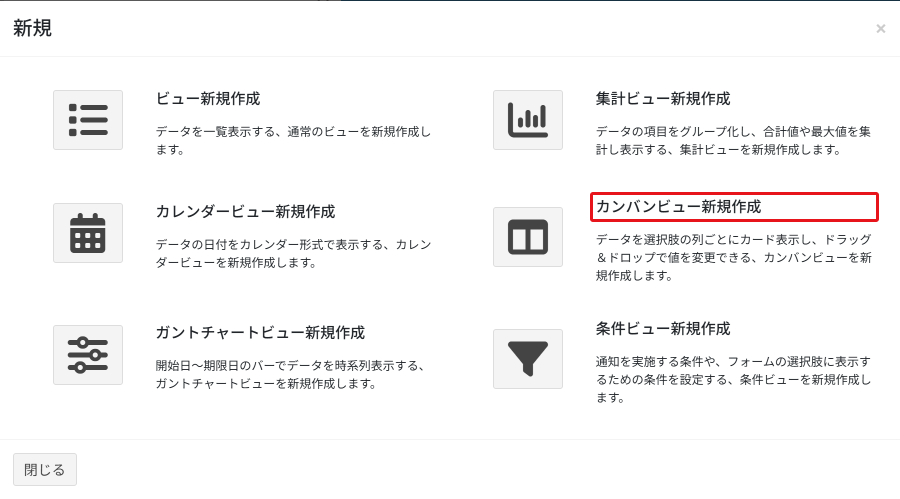
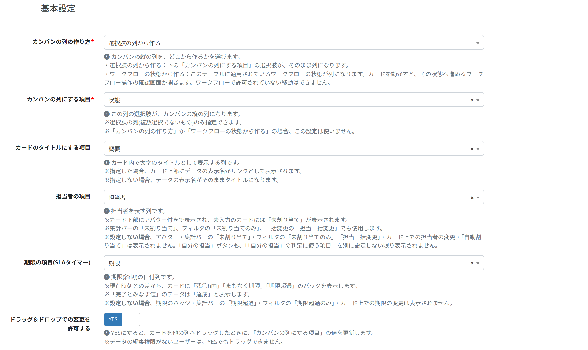
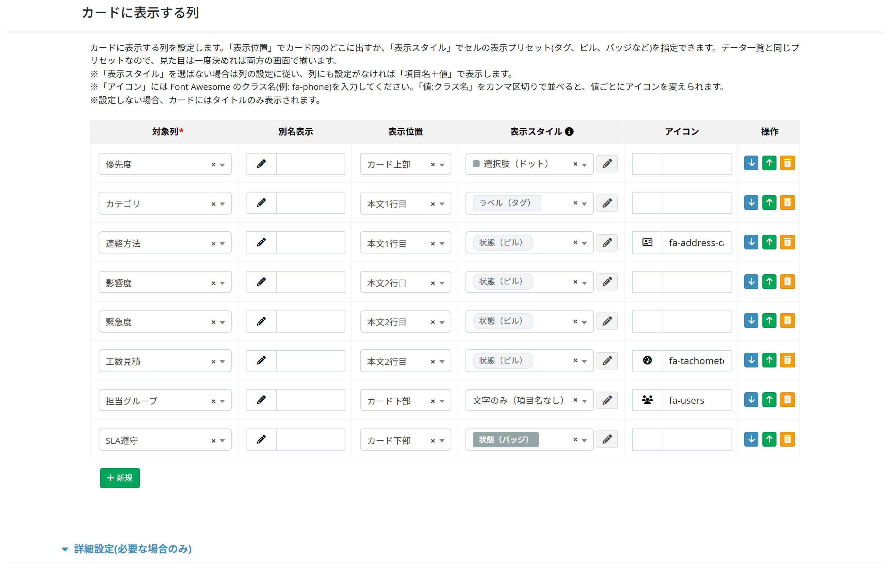
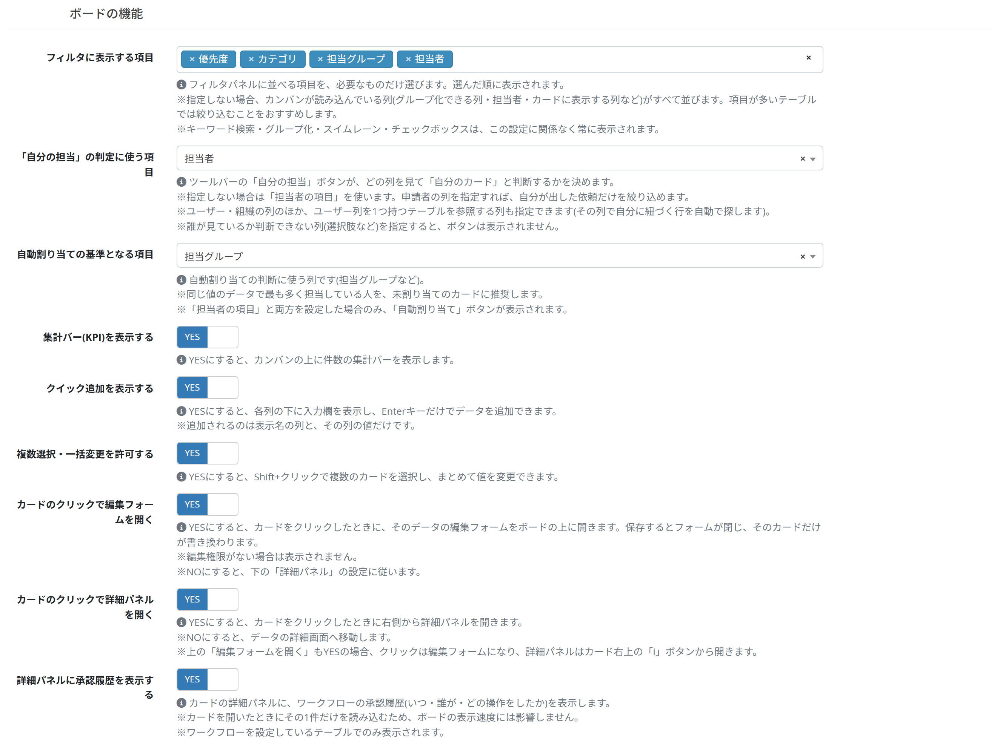
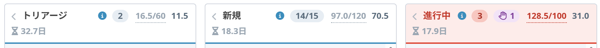
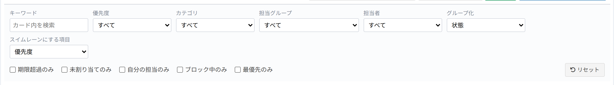
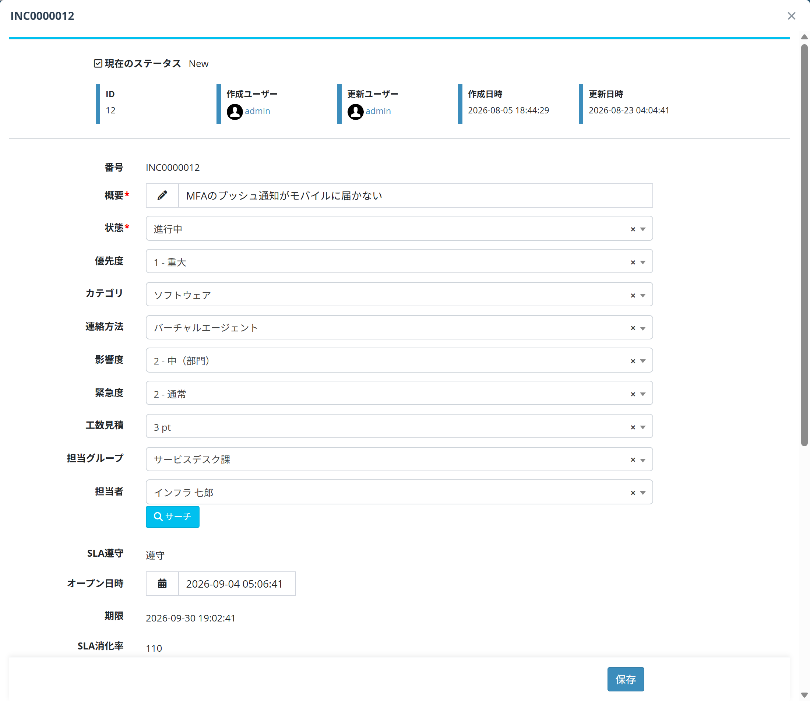
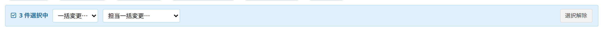
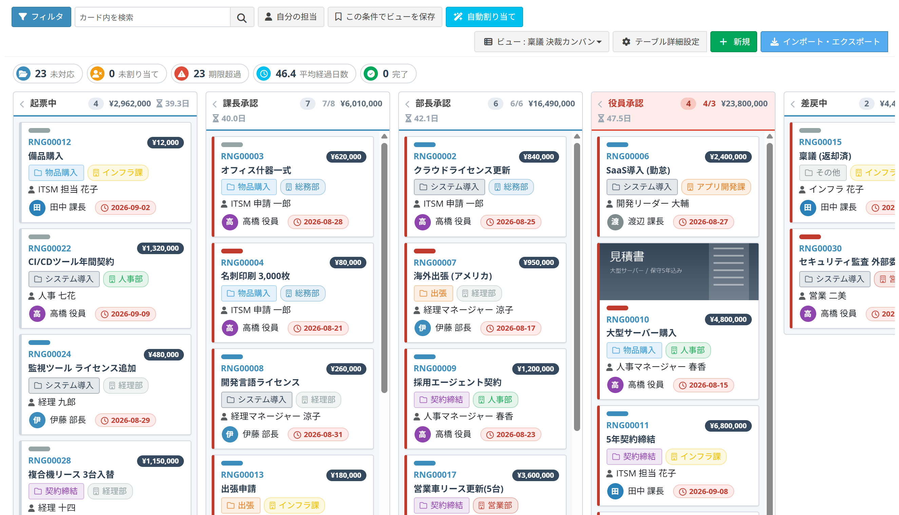

# View Kanban

Đây là view hiển thị dữ liệu dưới dạng thẻ, xếp vào "các cột theo từng trạng thái". Bạn có thể đổi trạng thái bằng cách kéo và thả.

## View Kanban là gì

Kanban là cách quản lý công việc: mỗi công việc là một thẻ, các thẻ được xếp vào các cột công đoạn như "Chưa xử lý", "Đang xử lý", "Hoàn thành".  
Nhìn qua là biết công việc nào đang dừng ở công đoạn nào. Chỉ cần kéo thẻ sang cột kế tiếp là trạng thái được chuyển tiếp.

Với view Kanban của Exment, bạn có thể làm những việc sau.

- Dùng cột lựa chọn (trạng thái, mức ưu tiên, v.v.) hoặc trạng thái của quy trình làm việc làm các cột dọc của bảng
- Kéo thẻ để cập nhật giá trị của mục đó
- Hiển thị người phụ trách, hạn chót, nhãn, thanh tiến độ, v.v. trên thẻ
- Hiển thị số lượng, tổng số tiền, số ngày tồn đọng trung bình của từng cột ở tiêu đề cột
- Nhấp vào thẻ để mở biểu mẫu chỉnh sửa ngay trên bảng

## Thêm mới view

1. Mở màn hình cài đặt chế độ xem tùy chỉnh (xem [View tùy chỉnh](/vi/view)).
2. Nhấp vào nút [Mới] ở phía trên bên phải.
3. Trong hộp thoại hiển thị, chọn "Tạo chế độ xem Kanban mới".

## Thiết lập cơ bản

#### Cách tạo các cột của bảng Kanban
Chọn các cột dọc của bảng Kanban được tạo từ đâu.

| Lựa chọn | Nội dung |
| --- | --- |
| Từ giá trị của cột lựa chọn | Các lựa chọn của "Cột dùng làm làn Kanban" ở dưới sẽ trở thành các cột của bảng. |
| Từ trạng thái của quy trình làm việc | Các trạng thái của quy trình làm việc đang áp dụng cho bảng này sẽ trở thành các cột. Khi di chuyển thẻ, màn hình xác nhận thao tác quy trình làm việc để chuyển sang trạng thái đó sẽ mở ra. Không thể di chuyển theo cách mà quy trình làm việc không cho phép. |

※Mục này không hiển thị với bảng chưa thiết lập quy trình làm việc.

#### Cột dùng làm làn Kanban
Các lựa chọn của cột này sẽ trở thành các cột dọc của bảng Kanban.  
※Chỉ có thể chỉ định cột lựa chọn (không phải loại chọn nhiều).  
※Khi "Cách tạo các cột của bảng Kanban" là "Từ trạng thái của quy trình làm việc", thiết lập này không được dùng.

#### Cột dùng làm tiêu đề thẻ
Cột được hiển thị làm tiêu đề in đậm trong thẻ.  
※Nếu chỉ định, tên hiển thị của dữ liệu sẽ được hiển thị dưới dạng liên kết ở phần trên của thẻ.  
※Nếu không chỉ định, tên hiển thị của dữ liệu sẽ là tiêu đề.

#### Cột người phụ trách
Cột cho biết người phụ trách. Người phụ trách được hiển thị kèm ảnh đại diện ở phần dưới của thẻ. Thẻ chưa nhập sẽ hiển thị "Chưa phân công".  
Cột này cũng được dùng cho "Chưa phân công" của thanh tổng hợp, "Chỉ chưa phân công" của bộ lọc và "Phân công hàng loạt" của thay đổi hàng loạt.

※Nếu không thiết lập, các mục sau sẽ không hiển thị: ảnh đại diện, "Chưa phân công" của thanh tổng hợp, "Chỉ chưa phân công" của bộ lọc, "Phân công hàng loạt", việc đổi người phụ trách trên thẻ và "Tự động phân công".

#### Cột hạn chót (bộ đếm SLA)
Cột ngày của hạn chót. Dựa vào chênh lệch với thời điểm hiện tại, thẻ sẽ hiển thị huy hiệu "Còn ○h", "Sắp đến hạn" hoặc "Quá hạn".  
※Dữ liệu có "Giá trị được coi là hoàn thành" sẽ hiển thị là "Đạt".  
※Nếu không thiết lập, các mục sau sẽ không hiển thị: huy hiệu hạn chót, "Quá hạn" của thanh tổng hợp, "Chỉ quá hạn" của bộ lọc và việc đổi hạn chót trên thẻ.

#### Cho phép thay đổi giá trị bằng kéo và thả
Khi đặt là YES, giá trị của "Cột dùng làm làn Kanban" sẽ được cập nhật khi kéo thẻ sang cột khác.  
※Người dùng không có quyền chỉnh sửa dữ liệu thì không kéo được, kể cả khi đặt là YES.

## Cột hiển thị trên thẻ

Thiết lập các mục xếp bên trong thẻ. Nếu không thiết lập, thẻ chỉ hiển thị tiêu đề.

| Mục | Nội dung |
| --- | --- |
| Cột đích | Cột hiển thị trên thẻ |
| Tên hiển thị thay thế | Nhập khi muốn đổi tên hiển thị trên thẻ |
| Vị trí hiển thị | Hiển thị ở đâu trong thẻ |
| Kiểu hiển thị | Hiển thị với hình thức nào |
| Biểu tượng | Tên class của Font Awesome (ví dụ: fa-phone) |

### Vị trí hiển thị

| Lựa chọn | Nơi hiển thị |
| --- | --- |
| Đầu thẻ | Phía trên tiêu đề |
| Dòng nội dung 1 | Dưới tiêu đề, dòng thứ 1 |
| Dòng nội dung 2 | Dưới tiêu đề, dòng thứ 2 |
| Cuối thẻ | Dưới cùng của thẻ |

### Kiểu hiển thị

Chọn từ "Mẫu hiển thị ô", giống như ở danh sách dữ liệu. Chỉ cần quyết định hình thức một lần, danh sách và Kanban sẽ hiển thị giống nhau.

| Thiết lập | Hiển thị trên thẻ |
| --- | --- |
| Chọn một mẫu | Hiển thị theo hình thức của mẫu đó (thẻ tag, viên thuốc, huy hiệu, chấm, ảnh đại diện, v.v.). **Được ưu tiên hơn thiết lập của cột** |
| Không chọn | Theo "Mẫu hiển thị" ở phía cột, hoặc theo thiết lập hiển thị của cột |
| Cả hai đều chưa thiết lập | Hiển thị theo dạng "Tên mục: giá trị" |

Màu của từng giá trị được lấy nguyên từ thiết lập ở phía cột. Mẫu chỉ quyết định hình dạng, nên cùng một mẫu có thể dùng cho bất kỳ cột nào.

Từ nút hình bút chì, bạn có thể tạo mới và chỉnh sửa mẫu. Chi tiết vui lòng xem [Mẫu hiển thị ô](/vi/cell_style_preset).

> Các "mục không phải là cột" như trạng thái quy trình làm việc hoặc ngày giờ tạo cũng hiển thị được với cùng hình thức nếu chọn mẫu. Tuy nhiên, màu của từng giá trị là thiết lập của cột, nên không áp dụng cho các mục này.

### Biểu tượng
Nhập tên class của Font Awesome (ví dụ: fa-phone). Kể cả khi mẫu có sẵn biểu tượng, giá trị chỉ định ở đây vẫn được ưu tiên.  
Nếu muốn đổi biểu tượng theo từng lựa chọn, hãy nhập "giá trị:tên class", phân cách bằng dấu phẩy.  
Ví dụ: `phone:fa-phone,mail:fa-envelope,chat:fa-comments`

## Cài đặt nâng cao (tùy chọn)

Kanban vẫn hoạt động với giá trị ban đầu. Chỉ thiết lập khi cần.

### Cài đặt thẻ

#### Cột ảnh bìa
Cột hình ảnh được hiển thị làm ảnh bìa ở phần trên của thẻ.  
※Dữ liệu chưa đăng ký hình ảnh sẽ hiển thị không có ảnh bìa. Nếu có nhiều hình ảnh, hình đầu tiên được dùng.

#### Cách hiển thị ảnh bìa
"Lấp đầy (cắt phần thừa)" hiển thị kín khung và cắt phần tràn ra ngoài.  
"Hiển thị toàn bộ ảnh (có khoảng trống)" đặt toàn bộ hình ảnh vào khung và có khoảng trống.

#### Cột nhãn màu
Cột lựa chọn được hiển thị làm nhãn có màu ở phần trên của thẻ. Có thể chỉ định cả cột cho phép chọn nhiều.  
※Khi chưa chỉ định "Các cột hiển thị trong bảng lọc", cột đã chỉ định ở đây cũng được thêm vào bộ lọc.

#### Cách hiển thị nhãn
"Chip có chữ" là nhãn nhỏ có chữ. "Chỉ thanh màu" là thanh mảnh chỉ có màu.

#### Cột huy hiệu ở góc
Cột được hiển thị làm huy hiệu nhỏ ở góc trên bên phải của thẻ (số lượng, điểm, số thứ tự, v.v.). Dữ liệu có giá trị trống sẽ không hiển thị huy hiệu.

#### Cột số hiển thị dưới dạng thanh tiến độ / Giá trị tối đa của thanh tiến độ
Hiển thị thanh tiến độ dưới tiêu đề của thẻ.  
Từ 0% đến 49% là màu xanh dương, từ 50% đến 99% là màu cam, 100% là màu xanh lá.  
"Giá trị tối đa của thanh tiến độ" là giá trị mà tại đó thanh đạt 100% (nếu không nhập thì là 100).

#### Cột làm mốc tính số ngày đã qua / Các mức màu theo số ngày đã qua
Cột ngày làm mốc để tính số ngày đã qua (ví dụ ngày tiếp nhận). Màu ở mép trái của thẻ thay đổi theo số ngày đã qua.  
Ở "Các mức màu theo số ngày đã qua", nhập 3 số ngày mà màu sẽ đổi, theo thứ tự từ nhỏ đến lớn, phân cách bằng dấu phẩy.  
Ví dụ: `1,2,3` → 1 ngày là vàng, 2 ngày là cam, từ 3 ngày trở lên là đỏ.  
Ví dụ: `3,7,14` → dành cho công đoạn dài.  
Nếu không thay đổi thì là `1,2,3`.

#### Cảnh báo trước hạn bao nhiêu giờ
Thẻ còn ít hơn số giờ này đến hạn chót sẽ thành "Sắp đến hạn" (màu vàng).  
Ví dụ: với yêu cầu hỗ trợ thì 2 (giờ), với hạn giao tính theo ngày thì 48 (= 2 ngày). Nếu không nhập thì là 2 giờ.

### Các cột của bảng Kanban

#### Cột dùng làm làn bơi (swimlane)
Bảng Kanban được chia theo chiều ngang theo từng giá trị của cột này. Nếu không chỉ định, bảng hiển thị không chia.

#### Cột tính tổng hiển thị trên tiêu đề làn
Hiển thị tổng của mục số này dưới tiêu đề cột.  
Ví dụ: khi chọn số tiền, tiêu đề hiển thị như "Giám đốc phê duyệt ¥34,700,000", nhìn qua là biết số tiền đang dừng ở cột đó.  
※Chỉ để hiển thị. Không ảnh hưởng đến giới hạn WIP.

#### Hiển thị số ngày tồn đọng trung bình của mỗi làn
Dưới tiêu đề cột, hiển thị trung bình số ngày các thẻ đã nằm ở cột đó. Nhờ đó biết công đoạn nào đang bị ứ đọng (nút thắt cổ chai).  
※Với quy trình làm việc, số ngày được tính từ "ngày giờ chuyển sang trạng thái đó". Các trường hợp khác được tính từ "ngày giờ cập nhật cuối".

#### Giới hạn WIP theo từng cột
Thiết lập cho từng cột "giới hạn số lượng được giữ cùng lúc". Cột vượt giới hạn sẽ có tiêu đề màu đỏ.

| Mục | Nội dung |
| --- | --- |
| Cột áp dụng | Cột cần đặt giới hạn (chọn từ các lựa chọn của bảng) |
| Giới hạn | Số lượng có thể đặt cùng lúc ở cột đó (1–999. Khi thêm dòng thì là 5) |

#### Cách đếm giới hạn WIP (cột số)
Giới hạn WIP được đếm bằng tổng của mục số này, thay vì "số lượng".  
Ví dụ: khi chọn số lượng hàng, tiêu đề cột hiển thị tổng và giới hạn như "1550/1200".  
※Chỉ có thể chỉ định mục số nguyên, số thập phân hoặc tiền tệ.

#### Khi di chuyển vào cột đã đạt giới hạn WIP

| Lựa chọn | Hoạt động |
| --- | --- |
| Cho phép (chỉ tô đỏ tiêu đề) | Như trước đây. Tiêu đề chỉ chuyển sang màu đỏ, vẫn di chuyển được. |
| Hỏi xác nhận trước | Hiển thị thông báo xác nhận, nếu bấm OK thì di chuyển. |
| Không cho phép | Cột đã đạt giới hạn sẽ chuyển sang màu xám khi đang kéo, và không di chuyển vào được. |

※Thẻ có "Giá trị được coi là khẩn cấp" không bị giới hạn này. Tuy nhiên vẫn được tính vào số lượng.

#### Quy tắc của từng cột
Hiển thị quy định của cột ở tiêu đề cột. Khi đưa chuột lên dấu hiệu, nội dung sẽ hiện ra.  
Ví dụ: ghi "Chuyển tiếp khi mọi mục của bản đặc tả kiểm thử đều OK" ở cột "Đang kiểm thử" thì mọi người đều thấy điều kiện để chuyển tiếp.

#### Giá trị được coi là hoàn thành
Chọn từ các lựa chọn của bảng những cột Kanban được xử lý là "hoàn thành".  
Dữ liệu ở cột đã chọn sẽ dừng đếm hạn chót và được tính vào "Hoàn thành" của thanh tổng hợp.  
※Khi tạo từ quy trình làm việc, trạng thái được thiết lập là "hoàn thành" sẽ tự động được xử lý là hoàn thành, nên không cần chỉ định ở đây.

#### Giá trị được coi là bị chặn
Chọn giá trị cho biết "công việc đang bị dừng". Thẻ có giá trị đã chọn sẽ có khung đỏ và dấu cờ, đồng thời "Bị chặn" được thêm vào thanh tổng hợp và bộ lọc.

#### Giá trị được coi là khẩn cấp
Chọn giá trị cho biết "việc chen ngang cần ưu tiên nhất". Thẻ có giá trị đã chọn sẽ có khung nổi bật. Nếu làn bơi được chia theo giá trị đó thì làn này được cố định ở trên cùng.  
※Nếu đặt nhiều giá trị là khẩn cấp thì sẽ mất ý nghĩa. Hãy giới hạn ở 1 hoặc 2 giá trị.

#### Các cột không hiển thị trên bảng Kanban
Cột của các giá trị đã chọn sẽ không hiển thị trên bảng.  
Ví dụ: khi chọn "Hoàn thành" và "Hủy", các việc đã xong sẽ biến mất và bảng chỉ còn các việc đang tiến hành.  
※Dữ liệu của các cột ẩn không được tải. Với bảng có nhiều dữ liệu, chỉ riêng việc này đã giúp hiển thị nhanh hơn nhiều.

### Tính năng của bảng Kanban

| Mục | Nội dung |
| --- | --- |
| Cột dùng để xác định "Của tôi" | Quyết định nút "Thẻ của tôi" trên thanh công cụ dựa vào cột nào để xác định "thẻ của tôi". Nếu không chỉ định, "Cột người phụ trách" được dùng. |
| Cột dùng cho tự động phân công | Cột dùng để phán đoán khi tự động phân công (ví dụ nhóm phụ trách). Người đang phụ trách nhiều nhất các dữ liệu có cùng giá trị sẽ được đề xuất cho thẻ chưa phân công (xem "Tự động phân công" ở dưới). |
| Các cột hiển thị trong bảng lọc | Các mục xếp trong bảng lọc. Hiển thị theo thứ tự đã chọn. Nếu không chỉ định, tất cả các cột mà bảng Kanban tải sẽ được hiển thị. |
| Hiển thị thanh tổng hợp (KPI) | Hiển thị thanh tổng hợp số lượng ở phía trên bảng Kanban. |
| Hiển thị thêm nhanh | Hiển thị ô nhập ở dưới mỗi cột, chỉ cần phím Enter là thêm được dữ liệu. |
| Cho phép chọn nhiều và thay đổi hàng loạt | Có thể chọn nhiều thẻ bằng Shift + nhấp chuột và đổi giá trị cùng lúc. |
| Mở biểu mẫu chỉnh sửa khi nhấp vào thẻ | Khi nhấp vào thẻ, biểu mẫu chỉnh sửa của dữ liệu đó mở ra ngay trên bảng. |
| Mở bảng chi tiết khi nhấp vào thẻ | Khi nhấp vào thẻ, bảng chi tiết mở ra từ bên phải. |
| Hiển thị lịch sử phê duyệt trong bảng chi tiết | Hiển thị lịch sử phê duyệt của quy trình làm việc trong bảng chi tiết của thẻ. Chỉ chọn được với bảng đã thiết lập quy trình làm việc. |

※Với view mới tạo, thanh tổng hợp, thêm nhanh, chọn nhiều, biểu mẫu chỉnh sửa, bảng chi tiết và lịch sử phê duyệt đều là YES.

※Khi cả "Mở biểu mẫu chỉnh sửa" và "Mở bảng chi tiết" đều là YES, nhấp chuột sẽ mở biểu mẫu chỉnh sửa, còn bảng chi tiết được mở từ nút "i" ở góc trên bên phải của thẻ.  
※Khi cả hai đều là NO, nhấp chuột sẽ chuyển đến màn hình chi tiết của dữ liệu.

### Số lượng tải

#### Số thẻ tải cho mỗi cột
Số thẻ được tải lúc đầu cho mỗi cột (0–500. Với view mới là 0).  
Khi đặt là 0 (không nhập), toàn bộ bảng sẽ tải đến "Số lượng hiển thị tối đa".  
Khi nhập ví dụ 50, mỗi cột tải 50 thẻ mỗi lần, và nút [Tải thêm] xuất hiện ở dưới cột.

※Số lượng, tổng, số ngày tồn đọng trung bình và thanh tổng hợp là giá trị đúng được tính trên toàn bộ cơ sở dữ liệu, không phải trên các thẻ đã tải.  
※Khi chỉ tính trên các thẻ đã tải (do lọc, từ khóa, v.v.), thông báo "Chỉ hiển thị ○ thẻ đã tải (trên tổng số ○). …" sẽ hiển thị.  
※**Khi dữ liệu có vài nghìn bản ghi, nên dùng cách này**. Cách này không bị ràng buộc bởi giới hạn của "Số lượng hiển thị tối đa".

#### Số lượng hiển thị tối đa
Số dữ liệu tối đa hiển thị trên bảng Kanban (1–2000). Số lượng càng nhiều thì hiển thị càng chậm.  
Với view mới là 300, hoặc là giá trị của khóa môi trường `EXMENT_KANBAN_MAX_SIZE_COUNT` nếu đã thiết lập.

## Cách dùng bảng Kanban

### Cách xem màn hình

#### Thanh công cụ

| Nút | Nội dung |
| --- | --- |
| Bộ lọc | Mở bảng lọc |
| Tìm trong thẻ | Lọc thẻ theo từ khóa |
| Thẻ của tôi | Chỉ hiển thị các thẻ do mình phụ trách |
| Lưu điều kiện này thành chế độ xem | Tạo view mới với điều kiện lọc hiện tại |
| Tự động phân công | Phân công người phụ trách cho các thẻ chưa phân công trên màn hình có độ tin cậy cao (xem dưới) |

#### Tự động phân công

[Tự động phân công] không chỉ đề xuất mà còn **ghi** người phụ trách vào dữ liệu.

- Trong các thẻ chưa phân công trên màn hình, thẻ có độ tin cậy từ 85% trở lên sẽ được phân công người phụ trách ngay.
- Các thẻ còn lại vẫn là chưa phân công. Trên thẻ hiển thị người phụ trách được đề xuất kèm tỷ lệ. Trong bảng chi tiết hiển thị "Chỉ đề xuất (vui lòng xác nhận thủ công)" và nút [Áp dụng người phụ trách này].
- Thẻ bị ẩn do lọc hoặc do "Tìm trong thẻ", và thẻ nằm ở cột được coi là hoàn thành, không thuộc đối tượng.
- Kết quả được hiển thị là "N thẻ được phân công tự động (độ tin cậy từ 85 phần trăm trở lên) / M thẻ chỉ đề xuất".

#### Thanh tổng hợp (KPI)

Hiển thị tối đa 6 con số. Mỗi con số chỉ hiển thị khi đã có thiết lập tương ứng.

| Con số | Điều kiện hiển thị |
| --- | --- |
| Chưa xử lý | Luôn hiển thị |
| Chưa phân công | Đã thiết lập "Cột người phụ trách" |
| Quá hạn | Đã thiết lập "Cột hạn chót (bộ đếm SLA)" |
| Số ngày đã qua TB | Đã thiết lập "Cột làm mốc tính số ngày đã qua" |
| Bị chặn | Đã thiết lập "Giá trị được coi là bị chặn" |
| Hoàn thành | Đã thiết lập "Giá trị được coi là hoàn thành" (với bảng Kanban của quy trình làm việc: trạng thái được đặt là hoàn thành) |

※Khi tải theo từng cột, "Bị chặn" có thể hiển thị dạng "từ số đó trở lên", ví dụ "≥8".  
※Nếu muốn lọc, hãy dùng các ô đánh dấu như "Chỉ quá hạn", "Chỉ chưa phân công" trong [Bộ lọc].

#### Tiêu đề cột

Từ trái sang: "‹" để thu gọn cột, tên cột, dấu hiệu quy tắc, số lượng, số lượng bị chặn, WIP, tổng, số ngày tồn đọng trung bình.

- Số lượng là số thẻ đang hiển thị. Khi tải theo từng cột và vẫn còn thẻ chưa tải, số lượng có dạng "đang hiển thị/toàn bộ" (ví dụ: 14/15).
- WIP ("đã tải/giới hạn") là hiển thị riêng với số lượng, chỉ hiển thị ở cột đã đặt giới hạn WIP.
- Số lượng bị chặn chỉ hiển thị ở cột có thẻ bị chặn.
- Tổng và số ngày tồn đọng trung bình chỉ hiển thị ở cột có thẻ, khi đã bật trong thiết lập của view.

#### Thẻ

Tùy theo thiết lập, thẻ hiển thị nhãn, số, mức ưu tiên, số ngày đã qua, tiêu đề, thanh tiến độ, các mục, người phụ trách và hạn chót.

### Di chuyển thẻ

Khi kéo thẻ sang cột khác, giá trị của "Cột dùng làm làn Kanban" được cập nhật.  
Sau khi cập nhật, [Hoàn tác] hiển thị ở phía dưới màn hình, bạn có thể hủy lần di chuyển vừa rồi.

※Nếu không có quyền chỉnh sửa thì không kéo được.  
※Với cột tạo từ quy trình làm việc, màn hình xác nhận thao tác quy trình làm việc sẽ mở ra.

### Bộ lọc

Khi nhấp vào [Bộ lọc], bảng lọc sẽ mở ra.

- Có thể lọc theo giá trị của từng mục
- "Nhóm theo" và "Cột dùng làm làn bơi (swimlane)" có thể đổi tạm thời từ màn hình này
- Có thể dùng các ô đánh dấu để lọc. Mỗi ô chỉ hiển thị khi dùng được
  - "Chỉ quá hạn": đã thiết lập "Cột hạn chót (bộ đếm SLA)"
  - "Chỉ chưa phân công": đã thiết lập "Cột người phụ trách"
  - "Chỉ của tôi": cột dùng để xác định "Của tôi" là cột người dùng, và bảng Kanban xác định được "tôi"
  - "Chỉ bị chặn": đã thiết lập "Giá trị được coi là bị chặn"
  - "Chỉ khẩn cấp": đã thiết lập "Giá trị được coi là khẩn cấp"
- [Đặt lại] xóa nội dung của bảng lọc

Ở trạng thái đã lọc, khi nhấp vào [Lưu điều kiện này thành chế độ xem], bạn có thể tạo view mới với điều kiện đó.

### Biểu mẫu chỉnh sửa

Khi "Mở biểu mẫu chỉnh sửa khi nhấp vào thẻ" là YES, nhấp vào thẻ sẽ mở biểu mẫu chỉnh sửa ngay trên bảng.

- Khi lưu, biểu mẫu đóng lại và **chỉ thẻ đó** được ghi lại. Không tải lại toàn bộ bảng.
- Nếu có lỗi nhập, biểu mẫu vẫn mở và thông báo hiển thị bên cạnh mục.
- Có thể đóng bằng phím Esc.

### Bảng chi tiết

Nút "i" ở góc trên bên phải của thẻ (hoặc nhấp vào thẻ, khi chỉ bật bảng chi tiết) sẽ mở bảng chi tiết từ bên phải.

- Ngoài các mục đã thiết lập ở "Cột hiển thị trên thẻ", có thể xem cột dùng làm làn Kanban, ảnh bìa, tiêu đề, thanh tiến độ, nhãn và huy hiệu ở góc
- Chọn ở [Di chuyển đến] để đổi cột mà không cần kéo
- [Mở bản ghi] chuyển đến màn hình chi tiết thông thường

Với bảng Kanban "Từ trạng thái của quy trình làm việc", các nút thao tác quy trình làm việc có thể thực hiện và lịch sử phê duyệt (khi "Hiển thị lịch sử phê duyệt trong bảng chi tiết" là YES) sẽ được hiển thị. Bảng Kanban này không hiển thị [Di chuyển đến].  
Với bảng Kanban tạo từ cột lựa chọn, thao tác quy trình làm việc và lịch sử phê duyệt không được hiển thị, kể cả khi bảng đã thiết lập quy trình làm việc.

### Chọn nhiều và thay đổi hàng loạt

Khi "Cho phép chọn nhiều và thay đổi hàng loạt" là YES, có thể chọn nhiều thẻ bằng **Shift + nhấp chuột** (hoặc Ctrl + nhấp chuột).

- [Thay đổi hàng loạt...] đổi cột (trạng thái, v.v.) của các thẻ đã chọn cùng lúc
- [Phân công hàng loạt...] đổi người phụ trách cùng lúc
- [Bỏ chọn] bỏ chọn các thẻ

### Thêm nhanh

Khi "Hiển thị thêm nhanh" là YES, ô nhập hiển thị ở dưới cùng của mỗi cột.  
Chỉ cần nhập tiêu đề và nhấn phím Enter là đăng ký được dữ liệu mới có giá trị của cột đó.

※Chỉ có cột tên hiển thị và giá trị của cột đó (trạng thái, v.v.) được đăng ký. Các mục khác vui lòng chỉnh sửa sau.

## Tạo cột từ quy trình làm việc

Khi chọn "Từ trạng thái của quy trình làm việc" ở "Cách tạo các cột của bảng Kanban", các trạng thái của quy trình làm việc đang áp dụng cho bảng sẽ trở thành các cột.

- Khi di chuyển thẻ, màn hình xác nhận thao tác quy trình làm việc để chuyển sang trạng thái đó sẽ mở ra
- Không thể di chuyển theo cách mà quy trình làm việc không cho phép
- Trạng thái được thiết lập là "hoàn thành" tự động được xử lý là hoàn thành

Với công việc gửi yêu cầu và phê duyệt, có thể hiển thị số lượng và số tiền đang chờ phê duyệt theo từng cột, nên biết ngay việc phê duyệt đang dừng ở đâu.

## Khi xử lý lượng dữ liệu lớn

Với bảng có hơn vài nghìn dữ liệu, nên thiết lập như sau.

1. **Đặt "Số thẻ tải cho mỗi cột" khoảng 50**  
   Mỗi cột tải từng ít một, khi cần thì tải thêm bằng [Tải thêm]. Số lượng và tổng hiển thị giá trị đúng của toàn bộ cơ sở dữ liệu, không phải của các thẻ đã tải.
2. **Loại các cột thuộc nhóm hoàn thành bằng "Các cột không hiển thị trên bảng Kanban"**  
   Chỉ cần không tải các việc đã xong, tốc độ hiển thị đã cải thiện nhiều.
3. **Thu hẹp đối tượng bằng "Điều kiện hiển thị dữ liệu" của view**  
   Thu hẹp phạm vi tải ngay từ đầu, theo khoảng thời gian, bộ phận phụ trách, v.v.

## Mục liên quan

- [View tùy chỉnh](/vi/view)
- [Công cụ thao tác trên danh sách dữ liệu](/vi/data_grid_tools)
- [Cài đặt quy trình làm việc](/vi/workflow_setting)
- [Flow Designer](/vi/workflow_design)
