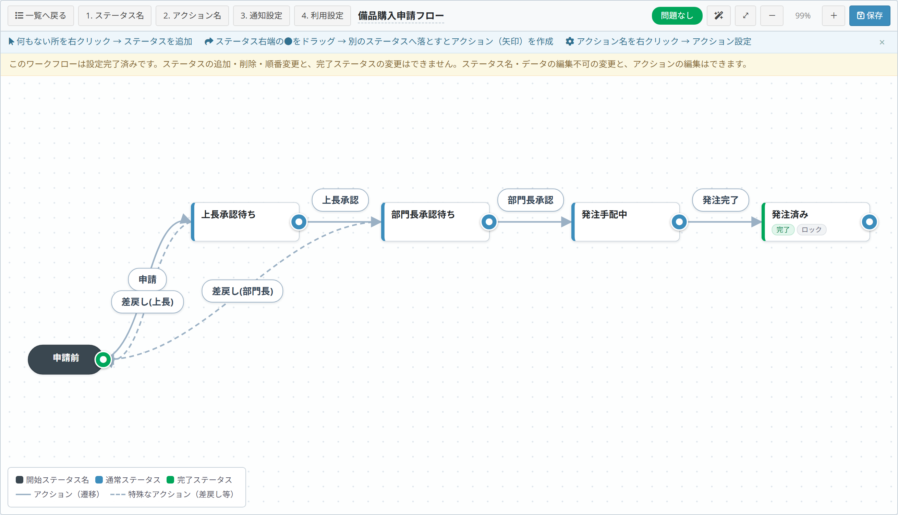
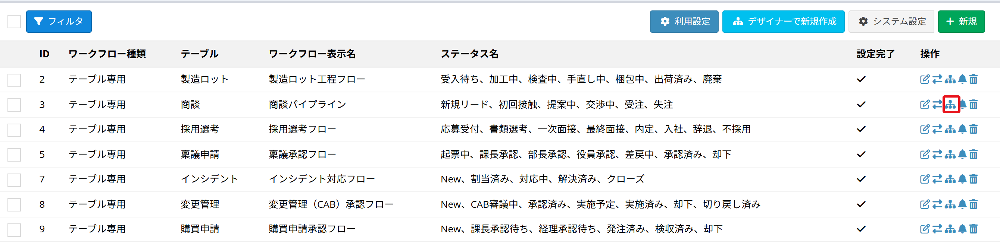
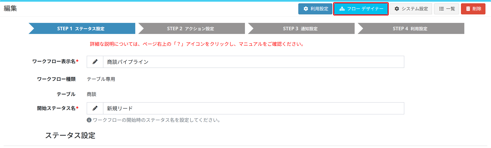
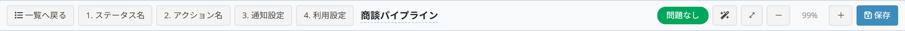
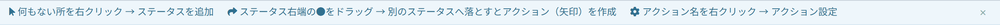
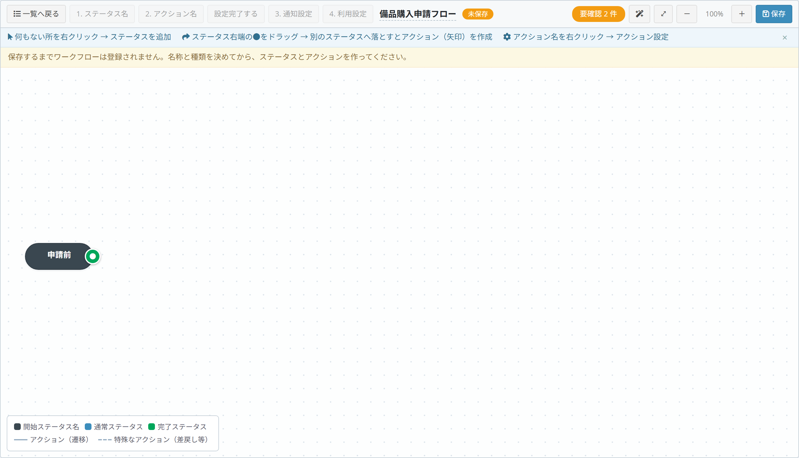
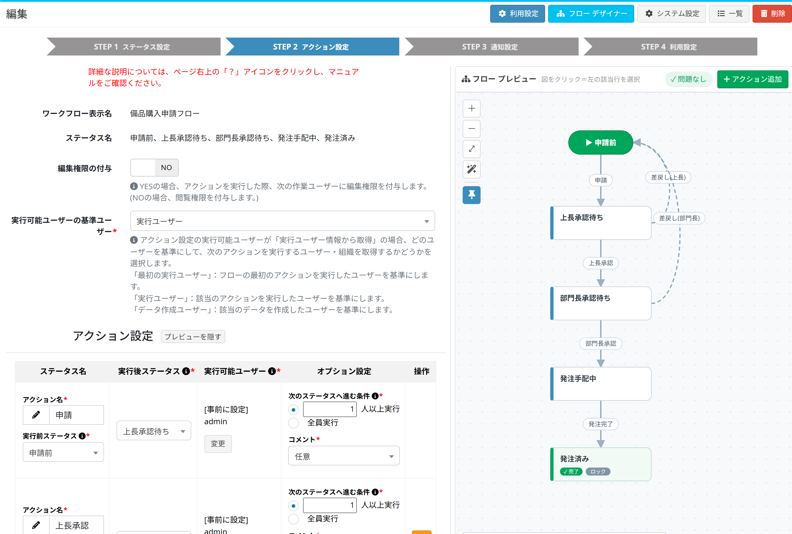

# Trình thiết kế quy trình

Đây là màn hình cho phép tạo và chỉnh sửa trạng thái (tình trạng) và hành động (thao tác) của workflow trực tiếp trên sơ đồ luồng.

## Trình thiết kế quy trình là gì

Trong [thiết lập workflow](/vi/workflow_setting), trạng thái được thiết lập trong bảng của "Bước 1", hành động được thiết lập trong bảng của "Bước 2".  
Nếu chỉ thiết lập bằng bảng, những điểm sau sẽ khó thấy.

- Từ trạng thái nào có thể tiến đến trạng thái nào
- Có trạng thái nào bị cụt đường hay không
- Đường trả lại có được nối đúng hay không

Trình thiết kế quy trình là màn hình để tạo và chỉnh sửa nội dung đó trong khi **nhìn dưới dạng sơ đồ**.

- Nơi lưu giống với Bước 1 và Bước 2. Những gì tạo bằng trình thiết kế được phản ánh nguyên vẹn vào bảng của Bước 1 và 2
- Thiết lập từ màn hình nào cũng được. Cũng có thể tạo bằng sơ đồ rồi chỉnh các điều kiện chi tiết bằng bảng

## Mở màn hình

### 1. Chỉnh sửa workflow có sẵn bằng sơ đồ

Trong danh sách thiết lập workflow, nhấp vào biểu tượng [Trình thiết kế quy trình] ở dòng tương ứng.

Từ màn hình Bước 1 và Bước 2 cũng có thể mở bằng nút [Trình thiết kế quy trình] ở phía trên bên phải.

### 2. Tạo workflow mới từ sơ đồ

Trong danh sách thiết lập workflow, nhấp vào nút [Tạo mới bằng trình thiết kế] ở phía trên bên phải.

## Cách xem màn hình

### Thanh công cụ

| Mục | Nội dung |
| --- | --- |
| Quay lại danh sách | Quay lại danh sách thiết lập workflow |
| 1. Tên trạng thái / 2. Tên hành động | Chuyển đến màn hình thiết lập dạng bảng (Bước 1, Bước 2) |
| Hoàn tất cài đặt | Hoàn tất thiết lập workflow. Nằm bên phải "2. Tên hành động", sau khi hoàn tất thiết lập thì không hiển thị nữa. Chi tiết vui lòng xem [thiết lập workflow](/vi/workflow_setting) |
| 3. Cài đặt thông báo / 4. Cài đặt sử dụng | Dùng được sau khi hoàn tất thiết lập |
| (Tên workflow) | Tên của workflow đang chỉnh sửa |
| Không có vấn đề / ○ mục cần kiểm tra | Kết quả kiểm tra nội dung nhập. Nhấp vào sẽ hiển thị nội dung |
| Tự động sắp xếp | Tự động xếp lại vị trí các nút |
| ⤢ (Hiển thị toàn bộ) | Hiển thị sao cho toàn bộ sơ đồ nằm gọn trong màn hình |
| － / ＋ | Đổi tỷ lệ hiển thị |
| Lưu | Lưu nội dung đã chỉnh sửa |

### Gợi ý thao tác

Ở phía trên màn hình luôn hiển thị các thao tác cơ bản.

### Chú giải

| Hiển thị | Ý nghĩa |
| --- | --- |
| Nút màu đen | Trạng thái bắt đầu |
| Nút màu xanh dương | Trạng thái thông thường |
| Nút màu xanh lá | Trạng thái hoàn thành |
| Mũi tên nét liền | Hành động (thao tác tiến đến trạng thái tiếp theo) |
| Mũi tên nét đứt | Hành động đặc biệt (thao tác không tính vào người xử lý, như trả lại) |

Dấu "Hoàn thành" và "Đã khóa" gắn trên nút lần lượt biểu thị trạng thái hoàn thành và không cho chỉnh sửa dữ liệu.

## Thao tác cơ bản

### Thêm trạng thái

**Nhấp chuột phải vào chỗ trống** của sơ đồ rồi chọn [Thêm trạng thái].

| Mục | Nội dung |
| --- | --- |
| Thêm trạng thái | Tạo trạng thái mới tại vị trí đã nhấp chuột phải |
| Tự động sắp xếp | Tự động xếp lại vị trí các nút |
| Hiển thị toàn bộ | Hiển thị sao cho toàn bộ sơ đồ nằm gọn trong màn hình |

### Tạo hành động (mũi tên)

**Kéo dấu ● ở cạnh phải** của trạng thái rồi thả lên một trạng thái khác.  
Hành động (mũi tên) nối 2 trạng thái sẽ được tạo.

Nếu thả ở chỗ trống, có thể chọn "Tạo trạng thái mới và kết nối". Có thể tạo trạng thái và tạo hành động liền nhau.

### Đổi thiết lập của hành động

**Nhấp chuột phải vào tên hành động** rồi chọn [Cài đặt hành động].

| Mục | Nội dung |
| --- | --- |
| Cài đặt hành động | Thiết lập tên hành động, người dùng có thể thực thi và tùy chọn |
| Xóa hành động | Xóa mũi tên (hành động) này |

### Đổi thiết lập của trạng thái

**Nhấp chuột phải vào trạng thái** để đổi tên trạng thái, chỉ định trạng thái hoàn thành hoặc xóa.

※ Không thể xóa trạng thái đang có dữ liệu. Khi định xóa, sẽ hiển thị "Đang được sử dụng nên không thể xóa".  
※ Không thể xóa trạng thái bắt đầu. Chỉ có thể đổi tên.

### Chỉnh bố cục của sơ đồ

- Có thể kéo các nút để di chuyển tự do
- [Tự động sắp xếp] tự động xếp lại theo dạng chảy từ trái sang phải
- [⤢ (Hiển thị toàn bộ)] đặt tỷ lệ sao cho toàn bộ sơ đồ nằm gọn trong màn hình

### Lưu

Nhấp vào nút [Lưu] ở phía trên bên phải.  
Cho đến khi lưu, nội dung thay đổi chưa được phản ánh vào cơ sở dữ liệu. Khi có thay đổi chưa lưu, thanh công cụ hiển thị "Chưa lưu".

※ Nếu định rời trang mà chưa lưu, thông báo xác nhận sẽ hiển thị.  
※ Nếu người khác đã cập nhật cùng workflow trước, sẽ hiển thị "Quy trình làm việc này đã được cập nhật ở màn hình khác". Hãy tải lại trang rồi lưu lại lần nữa.

## Mục cần kiểm tra (kiểm tra nội dung nhập)

Ở bên phải thanh công cụ luôn hiển thị kết quả kiểm tra nội dung nhập.

- Khi không có vấn đề: "Không có vấn đề" màu xanh lá
- Khi có vấn đề: "○ mục cần kiểm tra" màu cam

Nhấp vào sẽ hiển thị danh sách nội dung, nhấp tiếp sẽ chuyển đến chỗ tương ứng.

Các nội dung kiểm tra chính như sau.

| Thông báo | Ý nghĩa |
| --- | --- |
| Chưa nhập tên quy trình làm việc. Không thể lưu ở trạng thái này. | Không nhập tên thì không lưu được |
| Tên quy trình làm việc vượt quá 30 ký tự. Không thể lưu ở trạng thái này. | Tên tối đa 30 ký tự |
| Vui lòng chọn loại quy trình làm việc. / Vui lòng chọn bảng đích. | Chọn loại workflow và, với "Chỉ dùng cho bảng", chọn bảng đối tượng |
| Chưa nhập tên trạng thái bắt đầu. Không thể lưu ở trạng thái này. | Hãy nhập tên của trạng thái bắt đầu |
| Không có hành động nào bắt đầu từ "○○". | Không có mũi tên đi tiếp từ trạng thái bắt đầu |
| Chưa có trạng thái nào. / Chưa có hành động nào. | Hãy thêm ít nhất 1 trạng thái và 1 hành động |
| Vui lòng thiết lập ít nhất một trạng thái hoàn thành. | Trạng thái hoàn thành phải đúng 1 cái |
| Không có hành động nào dẫn đến "○○". | Có trạng thái không thể đến được từ đâu cả |
| "○○" không có hành động đi ra và cũng không phải trạng thái hoàn thành. | Có trạng thái bị cụt đường |
| Chưa thiết lập trạng thái trước khi thực thi / trạng thái sau khi thực thi cho hành động "○○". | Chọn cả trạng thái trước và sau của hành động |
| Hành động "○○" đang tham chiếu đến một trạng thái đã bị xóa. | Mũi tên đang hướng đến trạng thái không tồn tại |
| Có dòng chưa nhập tên hành động. Không thể lưu ở trạng thái này. | Mọi hành động đều cần có tên |
| Tên hành động của "○○" vượt quá 30 ký tự. | Tên hành động tối đa 30 ký tự |
| Hành động "○○" có trạng thái trước và sau khi thực thi giống nhau. Không thể lưu ở trạng thái này. | Không thể đặt mũi tên quay về cùng trạng thái |
| Chưa thiết lập người dùng có thể thực thi cho hành động "○○". Không thể lưu ở trạng thái này. | Hãy thiết lập ai được thực hiện |
| Số người trong "Điều kiện chuyển sang trạng thái tiếp theo" của hành động "○○" phải là số từ 0 đến 10. | Hãy sửa số người |

Về người dùng có thể thực thi của hành động, thông báo cũng hiển thị trong các trường hợp: kết hợp "Hành động đặc biệt" với "Do người thực thi hành động trước chọn"; ở hành động đầu tiên, chỉ định "Do người thực thi hành động trước chọn" hoặc thứ khác ngoài "Thiết lập trước"; ở cùng trạng thái trước khi thực thi, dùng "Do người thực thi hành động trước chọn" cùng với thiết lập khác.

"Không có hành động nào dẫn đến…" và "…không có hành động đi ra…" là cảnh báo, không chặn việc lưu. Các thông báo còn lại chặn việc lưu.

## Tạo mới bằng trình thiết kế

Khi mở từ [Tạo mới bằng trình thiết kế], trước tiên hộp thoại "Thông tin cơ bản" sẽ hiển thị.

| Mục | Nội dung |
| --- | --- |
| Tên hiển thị quy trình làm việc | Tên của workflow (tối đa 30 ký tự) |
| Loại quy trình làm việc | "Dùng chung" hoặc "Chỉ dùng cho bảng" |
| Bảng | Bảng đối tượng của workflow. Chỉ nhập khi loại là "Chỉ dùng cho bảng" |
| Tên trạng thái bắt đầu | Tên của trạng thái đầu tiên (như "Đang soạn", "Trước khi gửi yêu cầu") |

Nhập rồi [Lưu], trạng thái bắt đầu sẽ hiển thị ở bên trái sơ đồ.

Sau đó, thêm trạng thái bằng chuột phải và kéo dấu ● để nối các hành động.

> **Workflow chưa được đăng ký cho đến khi lưu.**  
> Khi tạo trạng thái và hành động rồi lưu, nút [Hoàn tất cài đặt] trên thanh công cụ sẽ bấm được, và có thể tiến đến Bước 3 (thiết lập thông báo), Bước 4 (thiết lập sử dụng).

## "Xem trước quy trình" của Bước 2

Trên màn hình Bước 2 (thiết lập hành động), sơ đồ luồng cũng được hiển thị ở bên phải.

- Khi chỉnh sửa bảng, sơ đồ được cập nhật ngay
- Khi nhấp vào hành động trong sơ đồ, dòng tương ứng của bảng bên trái được chọn
- [＋Thêm hành động] thêm một dòng vào bảng
- [○ mục cần kiểm tra] là việc kiểm tra nội dung nhập giống như ở trình thiết kế

### Lưu bố cục (nút hình ghim)

Chuyển đổi việc có ghi lại bố cục sau khi di chuyển các nút hay không.

- Nếu lưu màn hình khi ghim đang được bấm, bố cục hiện tại được ghi lại và lần mở sau cũng xếp như vậy
- Nếu không bấm, bố cục không được lưu và mỗi lần đều hiển thị bằng tự động sắp xếp

### Ẩn bản xem trước

Khi không cần sơ đồ, có thể ẩn bằng [Ẩn bản xem trước]. Các ô nhập của bảng sẽ rộng hơn.

## Lưu ý

#### Khi chỉnh sửa workflow đã hoàn tất thiết lập
Với workflow đã thực hiện [Hoàn tất cài đặt], trạng thái được cố định giống như ở Bước 1.

- Không thể thêm, xóa, đổi thứ tự trạng thái và không thể đổi trạng thái hoàn thành. [Thêm trạng thái] và [Xóa trạng thái] của menu chuột phải hiển thị "Đã hoàn tất cài đặt nên không thể thay đổi" và không chọn được.
- Tên trạng thái, "Không cho chỉnh sửa dữ liệu" và mọi hành động vẫn chỉnh sửa được.

Ngoài ra, **trạng thái đang được dùng trong dữ liệu đang gửi yêu cầu hoặc trong lịch sử thì không thể xóa, kể cả trước khi hoàn tất thiết lập.**

#### Trạng thái hoàn thành
Với workflow chưa hoàn tất thiết lập, trạng thái hoàn thành là **đúng 1 cái**.

- Chỉ có thể thiết lập 1 trạng thái hoàn thành. Nếu có nhiều, hãy giữ lại 1 cái, bỏ các cái khác rồi lưu.
- Nếu không có trạng thái hoàn thành nào cũng không lưu được.
- Khi lưu ở màn hình Bước 1 cũng vậy, chỉ 1 cái ở dòng cuối cùng của bảng là trạng thái hoàn thành.

Workflow đã hoàn tất thiết lập có thể có nhiều trạng thái hoàn thành, ví dụ do đến từ mẫu (template). Trường hợp đó, chúng được giữ nguyên và không đổi được bằng trình thiết kế quy trình.

#### Về điều kiện lọc (nhánh)
Điều kiện lọc của hành động được thiết lập ở màn hình Bước 2.  
Dù lưu bằng trình thiết kế quy trình, các điều kiện đã thiết lập không bị mất. Trong sơ đồ, các nhánh được hiển thị là "Điều kiện 1", "Điều kiện 2".

## Mục liên quan

- [Thiết lập workflow](/vi/workflow_setting)
- [Ví dụ thiết lập workflow](/vi/workflow_example)
- [Thực hiện workflow](/vi/workflow_execution)
- [View Kanban](/vi/view_kanban)
