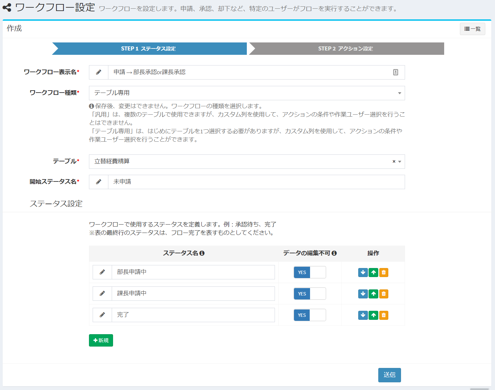
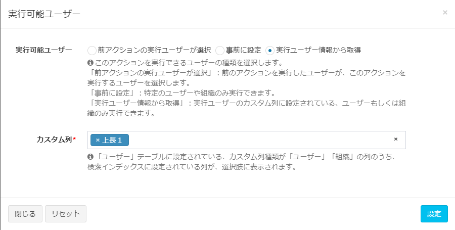
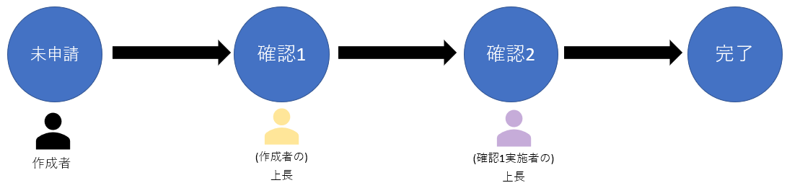
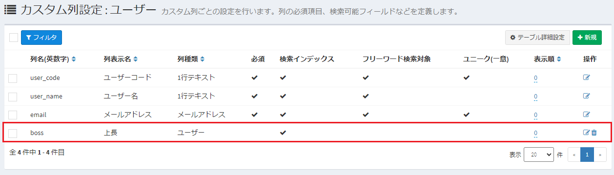
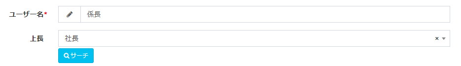
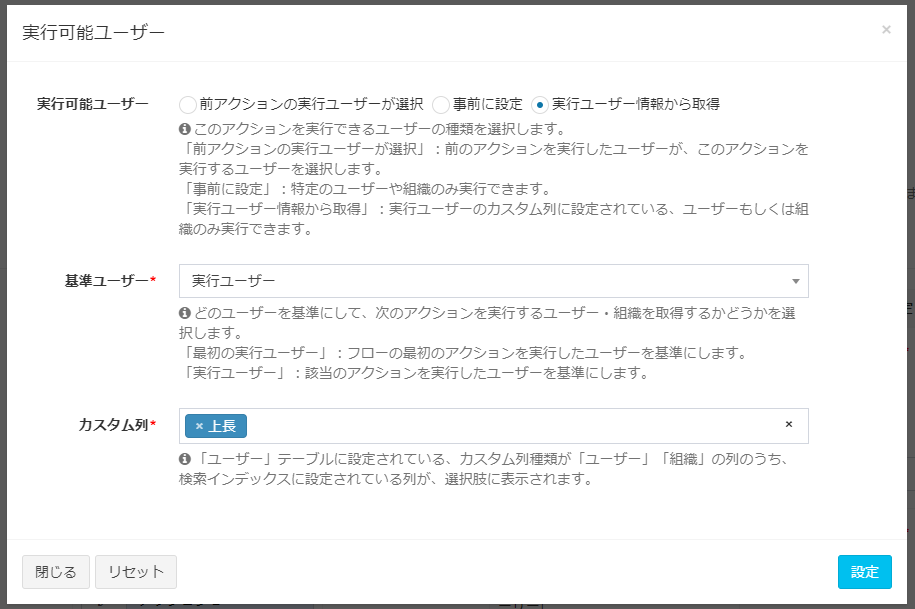
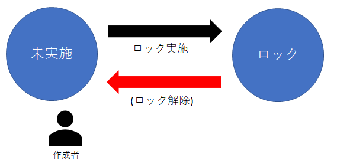

# Ví dụ thiết lập workflow
Đây là các ví dụ thiết lập workflow. Hãy chọn ví dụ gần với luồng bạn muốn tạo và nhập đúng như vậy.  
Về ý nghĩa của từng mục, vui lòng xem [thiết lập workflow](/vi/workflow_setting).

| Luồng muốn tạo | Ví dụ |
|---|---|
| Luồng đơn giản, chỉ gửi yêu cầu rồi phê duyệt hoặc từ chối | [Gửi yêu cầu → Phê duyệt / Từ chối](/vi/workflow_example?id=example1) |
| Chia người phê duyệt (hành động) theo số tiền của dữ liệu đã gửi yêu cầu | [Gửi yêu cầu → Trưởng bộ phận phê duyệt hoặc Trưởng phòng phê duyệt / Từ chối](/vi/workflow_example?id=example2) |
| Xác nhận qua 2 bước. Người xác nhận ở cả 2 bước đều được quyết định từ các cột cấp trên của người gửi yêu cầu | [Chưa gửi yêu cầu → Xác nhận 1 → Xác nhận 2 → Hoàn tất (lấy từ thông tin người thực thi đầu tiên)](/vi/workflow_example?id=example4) |
| Xác nhận qua 2 bước. Người thứ 2 là cấp trên của người đã xác nhận đầu tiên | [Chưa gửi yêu cầu → Xác nhận 1 → Xác nhận 2 → Hoàn tất (lấy từ thông tin người thực thi)](/vi/workflow_example?id=example5) |
| Khóa dữ liệu (không cho chỉnh sửa, xóa) | [Khóa dữ liệu](/vi/workflow_example?id=example3) |

<h2 id="example1"><a href="#/vi/workflow_example?id=example1" data-id="example1" class="anchor">Gửi yêu cầu → Phê duyệt / Từ chối</a></h2>

Cách thiết lập luồng đơn giản: gửi yêu cầu cho dữ liệu rồi phê duyệt hoặc từ chối.  

  
- Người dùng gửi yêu cầu đến bộ phận quản lý
- Bộ phận quản lý phê duyệt yêu cầu, hoặc từ chối
- Dữ liệu đã được phê duyệt thì từ đó không thể sửa

### Step1. Thiết lập trạng thái

  

- **Tên hiển thị quy trình làm việc** : tên tùy ý

- **Loại quy trình làm việc** : "Dùng chung"

- **Tên trạng thái bắt đầu** : "Chưa thực hiện"

- **Trạng thái dòng 1**  
Tên trạng thái: "Đang gửi yêu cầu"  
Không cho chỉnh sửa dữ liệu: "YES"  

- **Trạng thái dòng 2**  
Tên trạng thái: "Hoàn tất"  
Không cho chỉnh sửa dữ liệu: "YES"  

### Step2. Thiết lập hành động

  

- **Cài đặt hành động dòng 1**  
Tên hành động: "Gửi yêu cầu"  
Trạng thái trước khi thực thi: "Chưa thực hiện"  
Cài đặt hành động > Trạng thái sau khi thực thi: "Đang gửi yêu cầu"  
Người dùng có thể thực thi : "Người tạo"  
Cài đặt tùy chọn > Điều kiện chuyển sang trạng thái tiếp theo : "1 người trở lên thực thi"  
Cài đặt tùy chọn > Bình luận : "Tùy chọn"  

- **Cài đặt hành động dòng 2**  
Tên hành động: "Phê duyệt"  
Trạng thái trước khi thực thi: "Đang gửi yêu cầu"  
Cài đặt hành động > Trạng thái sau khi thực thi: "Hoàn tất"  
Người dùng có thể thực thi : "Nhóm quản lý" ※ Hãy tạo trước tổ chức "Nhóm quản lý"  
Cài đặt tùy chọn > Điều kiện chuyển sang trạng thái tiếp theo : "2 người trở lên thực thi"  
Cài đặt tùy chọn > Bình luận : "Tùy chọn"  
Cài đặt tùy chọn > Hành động đặc biệt : không đánh dấu  

- **Cài đặt hành động dòng 3**  
Tên hành động: "Từ chối"  
Trạng thái trước khi thực thi: "Đang gửi yêu cầu"  
Cài đặt hành động > Trạng thái sau khi thực thi: "Chưa thực hiện"  
Người dùng có thể thực thi : "Nhóm quản lý" ※ Hãy tạo trước tổ chức "Nhóm quản lý"  
Cài đặt tùy chọn > Điều kiện chuyển sang trạng thái tiếp theo : "1 người trở lên thực thi"  
Cài đặt tùy chọn > Bình luận : "Bắt buộc"  
Cài đặt tùy chọn > Hành động đặc biệt : có đánh dấu  

<h2 id="example2"><a href="#/vi/workflow_example?id=example2" data-id="example2" class="anchor">Gửi yêu cầu → Trưởng bộ phận phê duyệt hoặc Trưởng phòng phê duyệt / Từ chối</a></h2>

Cách thiết lập khi chia hành động và người phụ trách theo số tiền của dữ liệu đã gửi yêu cầu.    

  
- Người dùng gửi yêu cầu chi phí
- Nếu "Số tiền" của dữ liệu yêu cầu từ 100.000 yên trở lên thì tự động chuyển đến trưởng bộ phận, dưới 100.000 yên thì chuyển đến trưởng phòng
- Trưởng bộ phận hoặc trưởng phòng phê duyệt yêu cầu, hoặc từ chối
- Dữ liệu đã được phê duyệt thì từ đó không thể sửa

### Step1. Thiết lập trạng thái

  

- **Tên hiển thị quy trình làm việc** : tên tùy ý

- **Loại quy trình làm việc** : "Chỉ dùng cho bảng"

- **Bảng** : chọn bảng sẽ thực hiện workflow

- **Tên trạng thái bắt đầu** : "Chưa gửi yêu cầu"

- **Trạng thái dòng 1**  
Tên trạng thái: "Đang gửi trưởng bộ phận"  
Không cho chỉnh sửa dữ liệu: "YES"  

- **Trạng thái dòng 2**  
Tên trạng thái: "Đang gửi trưởng phòng"  
Không cho chỉnh sửa dữ liệu: "YES"  

- **Trạng thái dòng 3**  
Tên trạng thái: "Hoàn tất"  
Không cho chỉnh sửa dữ liệu: "YES"  

### Step2. Thiết lập hành động

  

- **Cài đặt hành động dòng 1**  
Tên hành động: "Gửi yêu cầu"  
Trạng thái trước khi thực thi: "Chưa gửi yêu cầu"  
Cài đặt hành động > Trạng thái sau khi thực thi: xem hình dưới đây  

  
>Khi loại cột của mục điều kiện là "Lựa chọn (từ bảng khác)", nội dung hiển thị ở giá trị điều kiện có thể thay đổi tại [Cài đặt cột hiển thị tiêu đề](/vi/table).

Người dùng có thể thực thi : "Người tạo"  
Cài đặt tùy chọn > Điều kiện chuyển sang trạng thái tiếp theo : "1 người trở lên thực thi"  
Cài đặt tùy chọn > Bình luận : "Tùy chọn"  

- **Cài đặt hành động dòng 2**  
Tên hành động: "Phê duyệt"  
Trạng thái trước khi thực thi: "Đang gửi trưởng bộ phận"  
Cài đặt hành động > Trạng thái sau khi thực thi: "Hoàn tất"  
Người dùng có thể thực thi : "Trưởng bộ phận" ※ Hãy tạo trước tổ chức "Trưởng bộ phận"  
Cài đặt tùy chọn > Điều kiện chuyển sang trạng thái tiếp theo : "1 người trở lên thực thi"  
Cài đặt tùy chọn > Bình luận : "Tùy chọn"  
Cài đặt tùy chọn > Hành động đặc biệt : không đánh dấu  

- **Cài đặt hành động dòng 3**  
Tên hành động: "Phê duyệt"  
Trạng thái trước khi thực thi: "Đang gửi trưởng phòng"  
Cài đặt hành động > Trạng thái sau khi thực thi: "Hoàn tất"  
Người dùng có thể thực thi : "Trưởng phòng" ※ Hãy tạo trước tổ chức "Trưởng phòng"  
Cài đặt tùy chọn > Điều kiện chuyển sang trạng thái tiếp theo : "1 người trở lên thực thi"  
Cài đặt tùy chọn > Bình luận : "Tùy chọn"  
Cài đặt tùy chọn > Hành động đặc biệt : không đánh dấu  

- **Cài đặt hành động dòng 4**  
Tên hành động: "Từ chối"  
Trạng thái trước khi thực thi: "Đang gửi trưởng bộ phận"  
Cài đặt hành động > Trạng thái sau khi thực thi: "Chưa gửi yêu cầu"  
Người dùng có thể thực thi : "Trưởng bộ phận" ※ Hãy tạo trước tổ chức "Trưởng bộ phận"  
Cài đặt tùy chọn > Điều kiện chuyển sang trạng thái tiếp theo : "1 người trở lên thực thi"  
Cài đặt tùy chọn > Bình luận : "Bắt buộc"  
Cài đặt tùy chọn > Hành động đặc biệt : có đánh dấu  

- **Cài đặt hành động dòng 5**  
Tên hành động: "Từ chối"  
Trạng thái trước khi thực thi: "Đang gửi trưởng phòng"  
Cài đặt hành động > Trạng thái sau khi thực thi: "Chưa gửi yêu cầu"  
Người dùng có thể thực thi : "Trưởng phòng" ※ Hãy tạo trước tổ chức "Trưởng phòng"  
Cài đặt tùy chọn > Điều kiện chuyển sang trạng thái tiếp theo : "1 người trở lên thực thi"  
Cài đặt tùy chọn > Bình luận : "Bắt buộc"  
Cài đặt tùy chọn > Hành động đặc biệt : có đánh dấu  

<h2 id="example4"><a href="#/vi/workflow_example?id=example4" data-id="example4" class="anchor">Chưa gửi yêu cầu → Xác nhận 1 → Xác nhận 2 → Hoàn tất (lấy từ thông tin người thực thi đầu tiên)</a></h2>

Cách thiết lập luồng "Chưa gửi yêu cầu → Xác nhận 1 → Xác nhận 2 → Hoàn tất". Người dùng có thể thực thi của hành động là "lấy từ thông tin người thực thi đầu tiên".   

  
- Hành động "Xác nhận 1" do người dùng được đặt ở cột "Cấp trên 1" của người gửi yêu cầu (người thực thi đầu tiên của luồng) thực hiện được
- Hành động "Xác nhận 2" do người dùng được đặt ở cột "Cấp trên 2" của người gửi yêu cầu (người thực thi đầu tiên của luồng) thực hiện được

### Step0. Thiết lập cột của người dùng

Trước tiên, hãy thêm các cột sau trong thiết lập cột tùy chỉnh của bảng "Người dùng".

  

- Cột 1:
    - Tên cột (chữ và số): "boss1"
    - Tên hiển thị cột: "Cấp trên 1"
    - Chỉ mục tìm kiếm: YES
    - Loại cột: Người dùng

- Cột 2:
    - Tên cột (chữ và số): "boss2"
    - Tên hiển thị cột: "Cấp trên 2"
    - Chỉ mục tìm kiếm: YES
    - Loại cột: Người dùng
  
Sau đó, hãy chỉnh sửa thông tin của từng người dùng và đăng ký các mục của cột "Cấp trên 1", "Cấp trên 2".

  

※ Khi dữ liệu của người dùng "Người thực thi" được đăng ký như trên, workflow sẽ được thực hiện như sau.

  

### Step1. Thiết lập trạng thái

- **Tên hiển thị quy trình làm việc** : tên tùy ý

- **Loại quy trình làm việc** : "Dùng chung"

- **Tên trạng thái bắt đầu** : "Chưa gửi yêu cầu"

- **Trạng thái dòng 1**  
Tên trạng thái: "Xác nhận 1"  
Không cho chỉnh sửa dữ liệu: "NO"  

- **Trạng thái dòng 2**  
Tên trạng thái: "Xác nhận 2"  
Không cho chỉnh sửa dữ liệu: "NO"  

- **Trạng thái dòng 3**  
Tên trạng thái: "Hoàn tất"  
Không cho chỉnh sửa dữ liệu: "YES"  

### Step2. Thiết lập hành động

  

- **Thiết lập chung**  
Người dùng cơ sở để xác định người có thể thực thi : "Người thực thi đầu tiên"  

- **Cài đặt hành động dòng 1**  
Tên hành động: "Hành động 1"  
Trạng thái trước khi thực thi: "Chưa gửi yêu cầu"  
Trạng thái sau khi thực thi: Xác nhận 1  
Người dùng có thể thực thi : "Người tạo"  
Cài đặt tùy chọn > Điều kiện chuyển sang trạng thái tiếp theo : "1 người trở lên thực thi"  
Cài đặt tùy chọn > Bình luận : "Tùy chọn"  

- **Cài đặt hành động dòng 2**  
Tên hành động: "Hành động 2"  
Trạng thái trước khi thực thi: "Xác nhận 1"  
Trạng thái sau khi thực thi: "Xác nhận 2"  
Người dùng có thể thực thi : (Lấy từ thông tin người thực thi) Cấp trên 1  
Cài đặt tùy chọn > Điều kiện chuyển sang trạng thái tiếp theo : "1 người trở lên thực thi"  
Cài đặt tùy chọn > Bình luận : "Tùy chọn"  
Cài đặt tùy chọn > Hành động đặc biệt : không đánh dấu  

- **Cài đặt hành động dòng 3**  
Tên hành động: "Hành động 3"  
Trạng thái trước khi thực thi: "Xác nhận 2"  
Trạng thái sau khi thực thi: "Hoàn tất"  
Người dùng có thể thực thi : (Lấy từ thông tin người thực thi) Cấp trên 2  
Cài đặt tùy chọn > Điều kiện chuyển sang trạng thái tiếp theo : "1 người trở lên thực thi"  
Cài đặt tùy chọn > Bình luận : "Tùy chọn"  
Cài đặt tùy chọn > Hành động đặc biệt : không đánh dấu  

#### Tham khảo: hộp thoại khi nhấp nút Thay đổi của "Người dùng có thể thực thi"

  

<h2 id="example5"><a href="#/vi/workflow_example?id=example5" data-id="example5" class="anchor">Chưa gửi yêu cầu → Xác nhận 1 → Xác nhận 2 → Hoàn tất (lấy từ thông tin người thực thi)</a></h2>

Cách thiết lập luồng "Chưa gửi yêu cầu → Xác nhận 1 → Xác nhận 2 → Hoàn tất". Người dùng có thể thực thi của hành động là "Lấy từ thông tin người thực thi".   

  
- Hành động "Xác nhận 1" do người dùng được đặt ở cột "Cấp trên" của người gửi yêu cầu (người thực thi đầu tiên của luồng) thực hiện được
- Hành động "Xác nhận 2" do người dùng được đặt ở cột "Cấp trên" của người đã thực hiện hành động "Xác nhận 1" thực hiện được

### Step0. Thiết lập cột của người dùng

Trước tiên, hãy thêm các cột sau trong thiết lập cột tùy chỉnh của bảng "Người dùng".

  

- Cột:
    - Tên cột (chữ và số): "boss"
    - Tên hiển thị cột: "Cấp trên"
    - Chỉ mục tìm kiếm: YES
    - Loại cột: Người dùng

  
Sau đó, hãy chỉnh sửa thông tin của từng người dùng và đăng ký mục của cột "Cấp trên".  
Trước hết, đặt dữ liệu của người dùng đầu tiên "Người thực thi" như sau.

  

Ngoài ra, đặt dữ liệu của người dùng "Tổ trưởng" như sau.

  

※ Khi dữ liệu được đăng ký như trên, workflow sẽ được thực hiện như sau.

  

### Step1. Thiết lập trạng thái

- **Tên hiển thị quy trình làm việc** : tên tùy ý

- **Loại quy trình làm việc** : "Dùng chung"

- **Tên trạng thái bắt đầu** : "Chưa gửi yêu cầu"

- **Trạng thái dòng 1**  
Tên trạng thái: "Xác nhận 1"  
Không cho chỉnh sửa dữ liệu: "NO"  

- **Trạng thái dòng 2**  
Tên trạng thái: "Xác nhận 2"  
Không cho chỉnh sửa dữ liệu: "NO"  

- **Trạng thái dòng 3**  
Tên trạng thái: "Hoàn tất"  
Không cho chỉnh sửa dữ liệu: "YES"  

### Step2. Thiết lập hành động

  

- **Thiết lập chung**  
Người dùng cơ sở để xác định người có thể thực thi : "Người thực thi"  

- **Cài đặt hành động dòng 1**  
Tên hành động: "Hành động 1"  
Trạng thái trước khi thực thi: "Chưa gửi yêu cầu"  
Trạng thái sau khi thực thi: Xác nhận 1  
Người dùng có thể thực thi : "Người tạo"  
Cài đặt tùy chọn > Điều kiện chuyển sang trạng thái tiếp theo : "1 người trở lên thực thi"  
Cài đặt tùy chọn > Bình luận : "Tùy chọn"  

- **Cài đặt hành động dòng 2**  
Tên hành động: "Hành động 2"  
Trạng thái trước khi thực thi: "Xác nhận 1"  
Trạng thái sau khi thực thi: "Xác nhận 2"  
Người dùng có thể thực thi : (Lấy từ thông tin người thực thi) Cấp trên  
Cài đặt tùy chọn > Điều kiện chuyển sang trạng thái tiếp theo : "1 người trở lên thực thi"  
Cài đặt tùy chọn > Bình luận : "Tùy chọn"  
Cài đặt tùy chọn > Hành động đặc biệt : không đánh dấu  

- **Cài đặt hành động dòng 3**  
Tên hành động: "Hành động 3"  
Trạng thái trước khi thực thi: "Xác nhận 2"  
Trạng thái sau khi thực thi: "Hoàn tất"  
Người dùng có thể thực thi : (Lấy từ thông tin người thực thi) Cấp trên  
Cài đặt tùy chọn > Điều kiện chuyển sang trạng thái tiếp theo : "1 người trở lên thực thi"  
Cài đặt tùy chọn > Bình luận : "Tùy chọn"  
Cài đặt tùy chọn > Hành động đặc biệt : không đánh dấu  

#### Tham khảo: hộp thoại khi nhấp nút Thay đổi của "Người dùng có thể thực thi"

  

<h2 id="example3"><a href="#/vi/workflow_example?id=example3" data-id="example3" class="anchor">Khóa dữ liệu</a></h2>

Cách thiết lập khi muốn khóa (không cho chỉnh sửa, xóa) dữ liệu nhất định.  

  
- Người tạo khóa / mở khóa dữ liệu
- Dữ liệu đã khóa không thể sửa cho đến khi mở khóa

### Step1. Thiết lập trạng thái

  

- **Tên hiển thị quy trình làm việc** : tên tùy ý

- **Loại quy trình làm việc** : "Dùng chung"

- **Tên trạng thái bắt đầu** : "Chưa thực hiện"

- **Trạng thái dòng 1**  
Tên trạng thái: "Khóa"  
Không cho chỉnh sửa dữ liệu: "YES"  

### Step2. Thiết lập hành động

  

- **Cài đặt hành động dòng 1**  
Tên hành động: "Thực hiện khóa"  
Trạng thái trước khi thực thi: "Chưa thực hiện"  
Cài đặt hành động > Trạng thái sau khi thực thi: "Khóa"  
Người dùng có thể thực thi : "Người tạo"  
Cài đặt tùy chọn > Điều kiện chuyển sang trạng thái tiếp theo : "1 người trở lên thực thi"  
Cài đặt tùy chọn > Bình luận : "Tùy chọn"  

- **Cài đặt hành động dòng 2**  
Tên hành động: "Mở khóa"  
Trạng thái trước khi thực thi: "Khóa"  
Cài đặt hành động > Trạng thái sau khi thực thi: "Chưa thực hiện"  
Người dùng có thể thực thi : "Người tạo"  
Cài đặt tùy chọn > Điều kiện chuyển sang trạng thái tiếp theo : "1 người trở lên thực thi"  
Cài đặt tùy chọn > Bình luận : "Tùy chọn"  
Cài đặt tùy chọn > Hành động đặc biệt : có đánh dấu  

