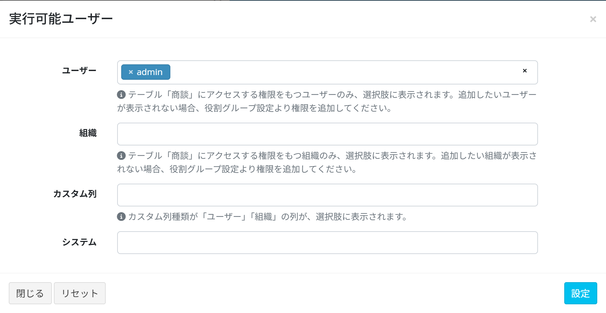
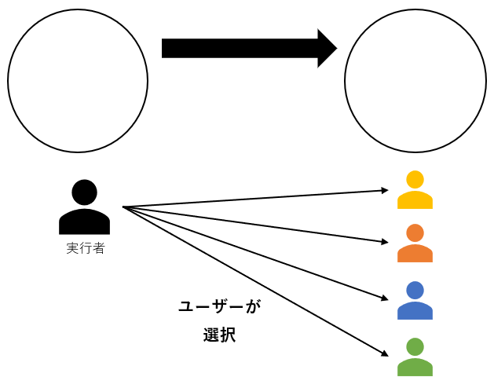

# Thiết lập workflow
Thiết lập workflow được sử dụng trong Exment.

※Cũng có thể tạo và chỉnh sửa trạng thái và hành động (action) trực tiếp trên sơ đồ luồng. Vui lòng tham khảo [Flow designer](/workflow_design) để biết chi tiết.

## Workflow là gì
Workflow là "luồng của một chuỗi trao đổi trong công việc".  
Trong nhiều công việc được thực hiện tại tổ chức, luôn tồn tại một luồng xử lý: "ai bắt đầu và bắt đầu như thế nào, ai quyết định và xử lý, rồi hoàn tất ra sao".  
Bằng cách thiết lập workflow trong Exment, có thể thực hiện các luồng công việc như sau.

  
- Người dùng gửi yêu cầu thanh toán chi phí đến bộ phận quản lý
- Bộ phận quản lý phê duyệt yêu cầu thanh toán chi phí, hoặc từ chối
- Đối với chi phí đã được phê duyệt, không thể sửa dữ liệu kể từ thời điểm đó

## Bảng thuật ngữ
Phần này giải thích các thuật ngữ được sử dụng trong workflow của Exment.

  

##### Workflow  
Chỉ toàn bộ luồng công việc, chẳng hạn như gửi yêu cầu và phê duyệt.  

##### Trạng thái  
Chỉ tình trạng hiện tại của workflow.  
Ví dụ: chưa gửi yêu cầu, chờ phê duyệt, hoàn tất  

##### Hành động (action)  
Là thao tác do từng người dùng thực hiện để chuyển từ một trạng thái nhất định sang một trạng thái khác.  
Ví dụ: gửi yêu cầu, phê duyệt, từ chối, trả lại

##### Người dùng xử lý  
Là người dùng cần thực hiện hành động tiếp theo.

## Hiển thị màn hình danh sách
Quản trị viên hệ thống hãy nhấp vào "Administrator Settings > Workflow" từ menu.  
Danh sách các workflow hiện đang được lưu sẽ hiển thị.

## Tạo mới

- Nhấp vào nút [New] ở phía trên bên phải của màn hình danh sách.
  
- "Step1. Status setting" (thiết lập trạng thái) của màn hình tạo workflow sẽ hiển thị, vui lòng nhập các thông tin cần thiết.

### Step1. Status setting (Thiết lập trạng thái)
Thiết lập các trạng thái của workflow.

  

#### Workflow display name (Tên hiển thị của workflow) ※Bắt buộc
- Tên workflow hiển thị trên màn hình. Có thể sử dụng cả tiếng Nhật. (Ví dụ: Luồng phê duyệt)  

#### Workflow type (Loại workflow) ※Bắt buộc
- Loại workflow sẽ tạo. Vui lòng chọn "General" (dùng chung) hoặc "Table only" (dành riêng cho bảng).  
※Không thể thay đổi sau khi tạo.  
##### General (Dùng chung)  
Có thể sử dụng workflow cho nhiều bảng.  
Hãy chọn loại này khi chỉ muốn sử dụng các trạng thái và hành động tiêu chuẩn như "gửi yêu cầu", "phê duyệt", "từ chối".  
##### Table only (Dành riêng cho bảng)  
Chỉ sử dụng được với bảng đã chọn khi tạo mới, nhưng có thể dùng các cột tùy chỉnh của bảng đó để thay đổi đích đến khi thực hiện hành động.  
Ví dụ: Trong bảng "Thanh toán chi phí", có thể phân nhánh hành động như sau: nếu cột tùy chỉnh "Số tiền" từ 100.000 yên trở lên thì thực hiện hành động "Trưởng bộ phận phê duyệt", nếu cột tùy chỉnh "Số tiền" dưới 100.000 yên thì thực hiện hành động "Trưởng phòng phê duyệt".

#### Start status name (Tên trạng thái bắt đầu) ※Bắt buộc
- Thiết lập tên trạng thái khi workflow chưa được thực hiện.

#### Status settings (Thiết lập trạng thái)
- Định nghĩa các thiết lập của workflow và các trạng thái sẽ sử dụng.  
※Trạng thái ở dòng cuối cùng của bảng phải là trạng thái biểu thị luồng đã hoàn tất.
##### Status Name (Tên trạng thái)  
Tên của trạng thái đó.
##### Data not editable (Không cho chỉnh sửa dữ liệu)  
Thiết lập có khóa chỉnh sửa dữ liệu đối tượng hay không khi workflow đang ở trạng thái này. Nếu không muốn cho chỉnh sửa, vui lòng đặt là YES.  
Ví dụ: Đặt là YES trong trường hợp khi trạng thái là "chưa gửi yêu cầu" thì có thể chỉnh sửa và xóa dữ liệu, nhưng khi là "đang gửi yêu cầu" hoặc "hoàn tất" thì không muốn cho chỉnh sửa và xóa

### Step2. Action setting (Thiết lập hành động)

  
#### Workflow display name (Tên hiển thị của workflow)  
Hiển thị tên hiển thị đã thiết lập ở phần thiết lập trạng thái.
#### Status Name (Tên trạng thái)  
Hiển thị các tên trạng thái đã thiết lập ở phần thiết lập trạng thái.
#### Grant edit permission (Cấp quyền chỉnh sửa)  
Khi thực hiện workflow, có thể cấp quyền chỉnh sửa cho "người dùng xử lý tiếp theo".
#### Base user of executable users (Người dùng cơ sở) ※Bắt buộc  
Thiết lập người dùng làm cơ sở khi người dùng có thể thực hiện của hành động là "lấy từ thông tin người dùng thực hiện". Có thể chọn trong số "First executing user" (người dùng thực hiện đầu tiên), "Executing user" (người dùng thực hiện), "Data creating user" (người dùng tạo dữ liệu).

#### Action settings (Thiết lập hành động)
- Thiết lập các hành động được thực hiện trong workflow.  
##### Action name (Tên hành động)  
Tên của hành động đó.
##### Pre-execution status (Trạng thái trước khi thực hiện)  
Thiết lập trạng thái mà tại đó có thể thực hiện hành động này.  
Ví dụ: Khi trạng thái trước khi thực hiện được đặt là "chưa thực hiện", nếu trạng thái của dữ liệu là "chưa thực hiện" thì có thể thực hiện hành động đó.  
##### Action settings (Thiết lập hành động)  
Thiết lập hành động nào có thể được thực hiện. Nhấp vào nút [Change] để thay đổi thiết lập.  
Nội dung thiết lập khác nhau tùy theo loại workflow.  

  ※Khi loại workflow là "General":  
    Thiết lập trạng thái sau khi thực hiện hành động này. Vui lòng chọn trạng thái khác với "Pre-execution status".

  ※Khi loại workflow là "Table only":  
Thiết lập điều kiện thực hiện hành động và trạng thái sau khi thực hiện. Có thể thiết lập tối đa 3 tổ hợp điều kiện và trạng thái.

> Khi loại cột của mục điều kiện là "Choice (select from a list of values in another table)" (lựa chọn từ danh sách giá trị của bảng khác), nội dung hiển thị ở giá trị điều kiện có thể thay đổi tại [thiết lập cột hiển thị tiêu đề](/vi/table).

#### Executable user (Người dùng có thể thực hiện)  

Chọn người dùng, tổ chức, v.v. có thể thực hiện hành động này. Nhấp vào nút [Change] để thay đổi thiết lập.
  

##### Người dùng có thể thực hiện: do người dùng thực hiện hành động trước chọn
Mỗi lần thực hiện hành động, người dùng thực hiện sẽ chọn gửi đến người dùng hoặc tổ chức nào.  
  

##### Người dùng có thể thực hiện: thiết lập trước
Quản trị viên thiết lập sẵn hành động sẽ được gửi đến người dùng hoặc tổ chức nào. Luồng sẽ được thực hiện theo thiết lập đó.  
  

**■Các mục thiết lập**

- User (Người dùng)  
Người dùng được chỉ định có thể thực hiện hành động.  

- Organization (Tổ chức)  
Người dùng thuộc tổ chức được chỉ định có thể thực hiện hành động.  

- Custom column (Cột tùy chỉnh)  
Người dùng hoặc tổ chức được thiết lập trong cột tùy chỉnh của dữ liệu đối tượng có thể thực hiện hành động. Đây là chức năng chỉ dành cho "Table only".  

- System > Create User (Hệ thống > Người dùng tạo)  
Người dùng đã tạo dữ liệu tùy chỉnh có thể thực hiện hành động.

##### Người dùng có thể thực hiện: lấy từ thông tin người dùng thực hiện
Lấy thông tin của người dùng thực hiện workflow. Hệ thống lấy giá trị của mục người dùng hoặc tổ chức đã được thiết lập, rồi gửi hành động đến người dùng hoặc tổ chức đó.

- Ví dụ 1: Khi cấp trên của người dùng A là "Trưởng bộ phận X", hành động được gửi đến Trưởng bộ phận X
- Ví dụ 2: Khi cấp trên của người dùng B là "Trưởng bộ phận Y" và "Trưởng bộ phận Z", hành động được gửi đến Trưởng bộ phận Y và Trưởng bộ phận Z
  

※Để sử dụng chức năng này, quản trị viên hệ thống cần thêm trước vào bảng "User" (người dùng) các cột có loại cột tùy chỉnh là "User" (người dùng) hoặc "Organization" (tổ chức). Ngoài ra, cần đặt "Search index" của các cột này là YES.

**■Người dùng cơ sở**

Là người dùng làm cơ sở khi lấy người dùng có thể thực hiện. Mục này được [thiết lập theo từng workflow](/vi/workflow_setting?id=base-user-of-executable-users-người-dùng-cơ-sở-bắt-buộc).  

- "First executing user" (người dùng thực hiện đầu tiên): lấy người dùng đã thực hiện hành động đầu tiên của luồng làm cơ sở.  
- "Executing user" (người dùng thực hiện): lấy người dùng đã thực hiện hành động tương ứng làm cơ sở.  
- "Data creating user" (người dùng tạo dữ liệu): lấy người dùng đã tạo dữ liệu làm cơ sở.  

> Vui lòng xem [Ví dụ về workflow](/workflow_example) để biết sự khác biệt về cách hoạt động tùy theo người dùng cơ sở.

**■Cột tùy chỉnh**

Các cột "User" và cột "Organization" của bảng người dùng sẽ được hiển thị làm ứng viên. Khi thực hiện hành động, người dùng hoặc tổ chức được thiết lập ở cột tương ứng của người dùng cơ sở có thể thực hiện hành động tiếp theo.  

#### Option settings > Condition to go to next status (Điều kiện để chuyển sang trạng thái tiếp theo)  
Thiết lập số người cần thực hiện hành động này để chuyển sang trạng thái tiếp theo.  
※Thông thường, luồng sẽ tiến tiếp chỉ cần một người thực hiện. Tuy nhiên, đôi khi có những trường hợp như "chỉ chuyển sang trạng thái tiếp theo khi có từ 3 người trở lên phê duyệt" hoặc "chỉ chuyển sang trạng thái tiếp theo khi tất cả người dùng của tổ chức quản lý phê duyệt".  
Trong những trường hợp đó, vui lòng thay đổi giá trị thiết lập này.  

#### Option settings > Comments (Bình luận)  
Khi thực hiện hành động, từng người dùng có thể nhập bình luận.  
Có thể chọn trong số "Required" (bắt buộc), "Nullable" (tùy chọn), "Not Use" (không sử dụng).  
※Hành động được đặt là "Required" sẽ không có nút trên thẻ thông báo của [LINE](/line?id=executing-workflow-actions-from-line) và không thể thực hiện từ LINE.

#### Option settings > Special actions (Hành động đặc biệt)  
Khi đánh dấu chọn, "người dùng có thể thực hiện" được thiết lập cho hành động sẽ không được tính vào người dùng xử lý hiện tại.  
(Người dùng xử lý hiện tại là người dùng có thể thực hiện một hành động workflow nào đó ở trạng thái tại thời điểm hiện tại.)  
Vui lòng đánh dấu chọn cho các hành động như hành động mà quản trị viên phê duyệt theo trường hợp ngoại lệ.  
※Nếu người dùng xử lý chỉ được phân công vào "hành động đặc biệt", người dùng đó sẽ không nhận được thông báo. Ngoài ra, người dùng đó cũng không được hiển thị ở "người dùng xử lý hiện tại".

※Mục đích sử dụng chủ yếu là làm hành động để đưa workflow đang tiến hành về lại bước đầu bằng quyền quản trị viên, hoặc để đưa luồng đến bước hoàn tất theo trường hợp ngoại lệ.

#### Khác biệt so với hành động thông thường
| Nội dung | Thông thường | Hành động đặc biệt |
| ---- | ---- | ---- |
| Thiết lập người dùng có thể thực hiện | Không giới hạn | Chỉ "thiết lập trước" |
| Thông báo đến người dùng đối tượng | Được thực hiện | Không được thực hiện |
| Hiển thị ở "người dùng xử lý hiện tại" | Được hiển thị | Không được hiển thị |
| Hiển thị ở [tác vụ chưa xử lý](/workflow_task) | Được hiển thị | Không được hiển thị |

### Hoàn tất thiết lập
Khi đã thực hiện cả thiết lập trạng thái lẫn thiết lập hành động, nút "Setting Complete" (hoàn tất thiết lập) sẽ hiển thị ở phía trên bên phải của trang.  

  

Nhấp vào nút này để hoàn tất thiết lập workflow.  
※Sau khi hoàn tất thiết lập, sẽ không thể thực hiện các nội dung sau. 
- Thêm, xóa, thay đổi thứ tự trạng thái

### Step3. Notify setting (Thiết lập thông báo)
Step 3 và Step 4 được hiển thị sau khi đã thực hiện [Setting Complete].  
Thiết lập các thông báo được gửi khi thực hiện workflow. Vui lòng tham khảo [Thiết lập thông báo / gửi email](/notify) để biết các mục thiết lập.

### Step4. Usage settings (Thiết lập sử dụng)
Thiết lập workflow nào sẽ được thực hiện ở bảng nào.  
  

- Các workflow được hiển thị cho từng bảng là những workflow thuộc loại "General" hoặc được tạo dành riêng cho bảng đó, và đang ở tình trạng "đã hoàn tất thiết lập".

- Khi sử dụng workflow, vui lòng đánh dấu chọn vào hộp kiểm "Use" (sử dụng).  

- Khi muốn phân chia workflow theo ngày cụ thể, hãy nhập ngày vào "Start date" (ngày bắt đầu sử dụng) và "End date" (ngày kết thúc sử dụng). Khi đó, vui lòng lưu sao cho các khoảng thời gian không trùng nhau.

Đến đây, việc thiết lập workflow đã hoàn tất.  
Khi thực hiện workflow trên thực tế, vui lòng xem [Thực hiện workflow](/vi/workflow_execution).

### Xóa workflow
Có thể xóa thiết lập workflow đã đăng ký.  
Khi xóa thiết lập workflow đã được thiết lập sử dụng, vui lòng lưu ý các điểm sau.

- Không thể khôi phục thiết lập workflow.
- Các workflow đang tiến hành sẽ bị vô hiệu hóa.
- **Ngay cả khi thiết lập "Data not editable" trong phần thiết lập trạng thái là YES, các dữ liệu đang bị khóa chỉnh sửa sẽ lại có thể chỉnh sửa được.**

  

### Các đặc tả chi tiết khác

- Với "Người dùng có thể thực hiện: lấy từ thông tin người dùng thực hiện" và "Người dùng cơ sở: Executing user", khi đặt "Option settings > Condition to go to next status" từ 2 người trở lên, người dùng xử lý tiếp theo sẽ được lấy dựa trên người dùng thực hiện sau cùng.  
Ví dụ: Khi đặt "Condition to go to next status" là 3 người, người dùng làm cơ sở để lấy "người dùng thực hiện hành động tiếp theo" chỉ là người thứ 3 thực hiện hành động. Thông tin của người dùng thứ 1 và thứ 2 không được lấy.

- Đối với các hành động có cùng "Pre-execution status", không thể thiết lập đồng thời "Người dùng có thể thực hiện: thiết lập trước" và "Người dùng có thể thực hiện: do người dùng thực hiện hành động trước chọn". (Trừ trường hợp đặt "Người dùng có thể thực hiện: thiết lập trước" làm "hành động đặc biệt".)

- Đối với các hành động có cùng "Pre-execution status", không thể thiết lập đồng thời "Người dùng có thể thực hiện: lấy từ thông tin người dùng thực hiện" và "Người dùng có thể thực hiện: do người dùng thực hiện hành động trước chọn". (Trừ trường hợp đặt "Người dùng có thể thực hiện: lấy từ thông tin người dùng thực hiện" làm "hành động đặc biệt".)
