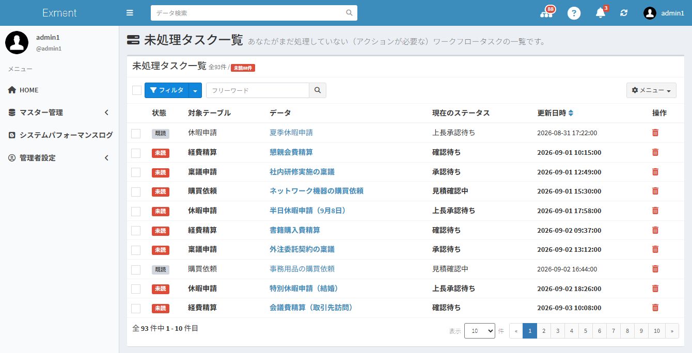
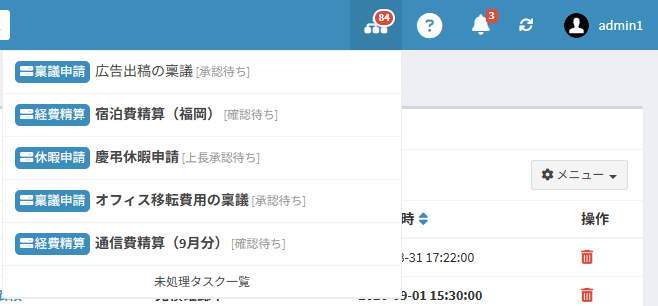
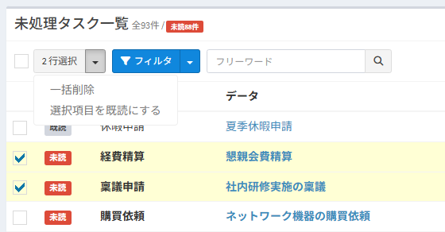
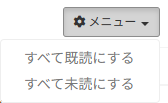
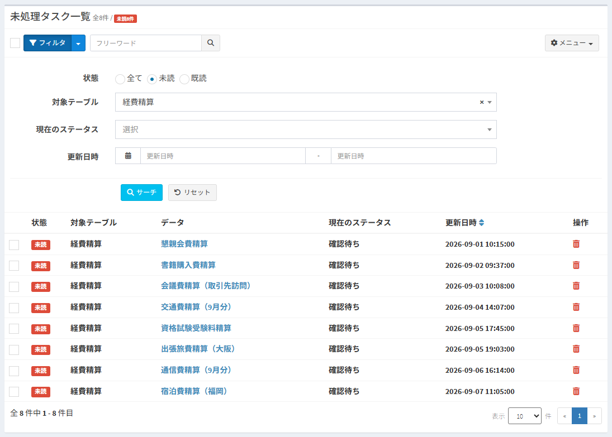
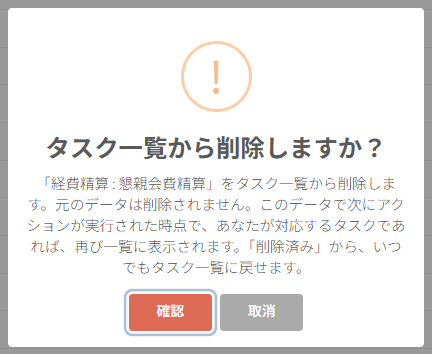
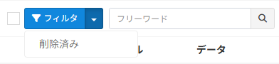
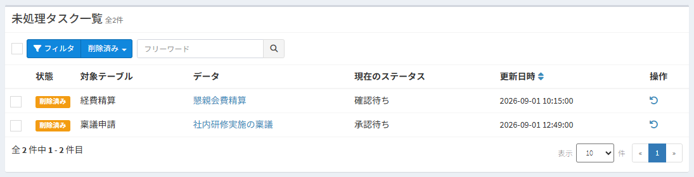

# Công việc chờ xử lý

Đây là màn hình hiển thị gộp, từ tất cả các bảng, những dữ liệu workflow (công việc) mà người dùng đăng nhập cần thực hiện hành động.  
Từ biểu tượng ở phía trên bên phải của trang, cũng có thể xem các công việc chờ xử lý bất cứ lúc nào.

## Công việc chờ xử lý là gì

Khi dùng workflow, những việc sau dễ xảy ra.

- Không biết dữ liệu đang chờ phê duyệt nằm ở bảng nào nếu không mở từng bảng một
- Không nhận ra có yêu cầu gửi đến, nên việc xử lý bị dừng lại

Danh sách công việc chờ xử lý hiển thị trong một danh sách, xuyên qua các bảng, **những dữ liệu mà người dùng đăng nhập có thể thực hiện hành động ngay lúc này**.  
Khi mở từ danh sách, màn hình chuyển đến màn hình chi tiết của dữ liệu đó và có thể thực hiện hành động luôn.

### Dữ liệu được hiển thị trong danh sách

Dữ liệu thỏa mãn tất cả các điều kiện sau được hiển thị là công việc.

- Là dữ liệu của workflow đã hoàn tất thiết lập và được đặt là "Sử dụng"
- Người dùng đăng nhập, hoặc tổ chức mà người dùng đăng nhập trực thuộc, là người xử lý của trạng thái hiện tại
- Trên màn hình chi tiết của dữ liệu có hiển thị nút hành động mà người dùng đăng nhập thực hiện được
  - Dữ liệu không thỏa mãn điều kiện của thiết lập hành động thì không hiển thị
  - Với hành động có "Điều kiện chuyển sang trạng thái tiếp theo" từ 2 người trở lên, nếu người dùng đăng nhập đã thực hiện hành động rồi thì không hiển thị
  - "Hành động đặc biệt" không phải là đối tượng của công việc
- Người dùng đăng nhập có quyền tham chiếu dữ liệu đó

※ Danh sách chỉ hiển thị công việc của chính người dùng đăng nhập. Dù là quản trị viên hệ thống, công việc của người dùng khác cũng không hiển thị.  
※ Dữ liệu ở trạng thái bắt đầu (như dữ liệu chưa gửi yêu cầu) được hiển thị là công việc cho người dùng có thể thực hiện hành động đầu tiên (như gửi yêu cầu).  
※ Dù đã qua "Ngày kết thúc sử dụng" của workflow, dữ liệu đang tiến hành vẫn được hiển thị là công việc cho đến khi hoàn tất.

## Mở màn hình

### Mở từ biểu tượng ở phía trên bên phải của trang

Khi đăng nhập, biểu tượng công việc chờ xử lý hiển thị ở phía trên bên phải của trang.  
Số màu đỏ là số công việc chưa mở (chưa đọc).

Khi nhấp vào biểu tượng, tối đa 5 công việc được hiển thị, bắt đầu từ công việc có ngày giờ cập nhật mới nhất.

- Công việc chưa đọc được hiển thị bằng chữ đậm
- Khi nhấp vào công việc, màn hình chi tiết của dữ liệu đó mở ra. Công việc trở thành đã đọc
- Khi nhấp vào "Công việc chờ xử lý" ở dưới cùng, màn hình danh sách mở ra
- Khi không có công việc, sẽ hiển thị "Không có công việc chờ xử lý."

※ Số trên biểu tượng được tự động cập nhật mỗi 5 phút. Khi thao tác từ danh sách công việc chờ xử lý hoặc từ biểu tượng (mở công việc, đánh dấu đã đọc, xóa khỏi danh sách, v.v.), số được cập nhật ngay. Các thay đổi khác (như khi người dùng khác thực hiện hành động) được phản ánh ở lần tự động cập nhật sau. Khoảng thời gian cập nhật có thể đổi bằng [giá trị thiết lập](/vi/config).  
※ Khi số công việc chưa đọc tăng lên, biểu tượng sẽ rung để báo.

### Mở từ URL

Cũng có thể hiển thị bằng cách truy cập URL sau.

~~~
http(s)://(URL của Exment)/workflow_task
~~~

> ※ URL là theo thiết lập chuẩn không có "/admin" (site cài mới từ v7.2.1 trở đi). Nếu `ADMIN_ROUTE_PREFIX` trong `.env` có giá trị (site cài từ phiên bản trước là "admin"), hãy thêm giá trị đó sau URL của site (ví dụ: `http(s)://(URL của Exment)/admin/workflow_task`). Chi tiết vui lòng xem [Thay đổi hoặc xóa "admin" trong URL](/vi/additional_prefix).

Khi muốn thêm vào menu bên trái, tại [Menu](/vi/menu), hãy đặt loại menu là "URL tùy chỉnh" và URI là "workflow_task".

## Cách xem màn hình

### Số lượng

Bên phải tiêu đề của danh sách có hiển thị số lượng.

| Hiển thị | Nội dung |
| --- | --- |
| Tổng cộng ○ mục | Số công việc được hiển thị trong danh sách. Khi đang lọc, là số công việc khớp với điều kiện |
| ○ chưa đọc | Số công việc chưa mở |
| ○ đã xóa | Số công việc đã xóa khỏi danh sách. Hiển thị khi có từ 1 công việc trở lên. Nhấp vào sẽ hiển thị [danh sách công việc đã xóa](/vi/workflow_task?id=Đưa-công-việc-đã-xóa-trở-lại-danh-sách) |

### Các cột của danh sách

| Cột | Nội dung |
| --- | --- |
| (Hộp kiểm) | Chọn các công việc để thao tác gộp |
| Trạng thái | "Chưa đọc" hoặc "Đã đọc". Công việc chưa đọc có cả dòng được hiển thị bằng chữ đậm |
| Bảng đích | Bảng mà dữ liệu được đăng ký |
| Dữ liệu | Tiêu đề của dữ liệu. Nhấp vào sẽ mở màn hình chi tiết của dữ liệu |
| Trạng thái hiện tại | Trạng thái hiện tại của workflow. Khi dữ liệu không chỉnh sửa được, biểu tượng ổ khóa được hiển thị |
| Ngày cập nhật | Ngày giờ cập nhật của dữ liệu |
| Thao tác | Biểu tượng thùng rác xóa công việc khỏi danh sách. Chi tiết vui lòng xem [Xóa công việc khỏi danh sách](/vi/workflow_task?id=xóa-công-việc-khỏi-danh-sách) |

- Ban đầu, danh sách được xếp theo ngày giờ cập nhật từ cũ đến mới. Công việc bị để chờ càng lâu thì càng ở trên.
- Nhấp vào biểu tượng bên phải "Ngày cập nhật" để đổi giữa mới trước và cũ trước.
- Ở phía dưới màn hình, có thể đổi số mục hiển thị trên 1 trang (10, 20, 30, 50, 100 mục). Ban đầu là 20 mục.

## Xử lý công việc

1. Nhấp vào một dòng của danh sách.
2. Màn hình chi tiết của dữ liệu mở ra, công việc trở thành đã đọc.
3. Thực hiện hành động từ nút hành động ở phía trên bên phải của trang. Về các bước, vui lòng xem [Thực hiện workflow](/vi/workflow_execution).
4. Dữ liệu đã được thực hiện hành động trở thành công việc của người xử lý tiếp theo. Nếu người dùng đăng nhập không phải là người xử lý của trạng thái tiếp theo, dữ liệu sẽ không còn hiển thị trong danh sách.

## Chưa đọc và đã đọc

- Công việc chưa được mở từ danh sách hoặc biểu tượng là "Chưa đọc".
- Khi mở công việc, nó trở thành "Đã đọc".
- Dù là công việc đã đọc, khi hành động tiếp theo được thực hiện trên dữ liệu đó, nó lại trở thành "Chưa đọc". Không chỉ khi trạng thái thay đổi, mà cả khi có ai đó phê duyệt ở bước cần nhiều người phê duyệt cũng vậy.
- Chưa đọc, đã đọc được ghi theo từng người dùng. Không ảnh hưởng đến hiển thị của người dùng khác hay bản thân dữ liệu.

### Đánh dấu đã đọc, chưa đọc hàng loạt

- **Đánh dấu công việc đã chọn là đã đọc**: chọn bằng hộp kiểm, rồi nhấp "Đánh dấu mục đã chọn là đã đọc" từ ▼ bên phải nút [Đã chọn ○ dòng] vừa hiển thị.

- **Đánh dấu tất cả là đã đọc / Đánh dấu tất cả là chưa đọc**: chọn từ [Menu] ở phía trên bên phải. Nhấp [Xác nhận] trong hộp thoại xác nhận để thực hiện.

※ Khi đang lọc, chỉ các công việc khớp với điều kiện là đối tượng.

## Lọc công việc

### Từ khóa tự do

Nhập chữ vào ô nhập bên phải nút [Bộ lọc] rồi nhấp biểu tượng tìm kiếm.  
Các công việc có tiêu đề dữ liệu (cột đã thiết lập ở [Cài đặt cột hiển thị tiêu đề](/vi/table)) chứa chữ đã nhập sẽ được hiển thị.  
Cũng có thể tìm bằng ID của dữ liệu (ví dụ: "#15" hoặc "15").

### Bộ lọc

Nhấp nút [Bộ lọc] để mở các ô nhập điều kiện. Nhập điều kiện rồi nhấp [Tìm kiếm].

| Mục | Nội dung |
| --- | --- |
| Trạng thái | Chọn trong số "Tất cả", "Chưa đọc", "Đã đọc" |
| Bảng đích | Chỉ hiển thị công việc của bảng đã chỉ định |
| Trạng thái hiện tại | Chỉ hiển thị công việc ở trạng thái đã chỉ định. Khi nhiều workflow có trạng thái cùng tên, chúng được gộp thành 1 lựa chọn |
| Ngày cập nhật | Chỉ hiển thị công việc được cập nhật trong khoảng thời gian đã chỉ định |

- Nhấp [Đặt lại] để xóa các điều kiện của bộ lọc. Từ khóa tự do, thứ tự sắp xếp và số mục hiển thị vẫn giữ nguyên.
- Trong khi đang chỉ định điều kiện, các ô nhập của bộ lọc được hiển thị ở trạng thái mở.
- Điều kiện nằm trong URL. Nếu đánh dấu trang (bookmark) màn hình đã lọc, lần sau có thể hiển thị với cùng điều kiện.

## Xóa công việc khỏi danh sách

Những công việc không cần để hiển thị trong danh sách, như đã nhờ người khác phụ trách thay hoặc đã xử lý bằng cách khác, có thể xóa khỏi danh sách của mình.

- **Xóa từng cái**: nhấp biểu tượng thùng rác ở cuối bên phải của dòng, rồi nhấp [Xác nhận] trong hộp thoại xác nhận.
- **Xóa hàng loạt**: chọn bằng hộp kiểm, rồi nhấp "Xóa hàng loạt" từ ▼ bên phải nút [Đã chọn ○ dòng].

- **Bản thân dữ liệu không bị xóa.** Chỉ là không còn hiển thị trong danh sách công việc chờ xử lý của mình. Cũng không ảnh hưởng đến danh sách của người dùng khác.
- Khi hành động tiếp theo được thực hiện trên dữ liệu đó, và lúc đó người dùng đăng nhập là người xử lý, công việc lại được hiển thị trong danh sách là "Chưa đọc".
- Dữ liệu đã được thực hiện hành động sau khi bạn hiển thị danh sách thì không bị xóa. Hãy hiển thị lại danh sách và kiểm tra tình trạng mới nhất. Số công việc không bị xóa được hiển thị trong thông báo.
- Để không lỡ làm mất dấu tất cả công việc, không có chức năng "xóa tất cả".

## Đưa công việc đã xóa trở lại danh sách

Khi chọn "Đã xóa" từ ▼ bên phải nút [Bộ lọc], các công việc đã xóa khỏi danh sách sẽ được hiển thị.  
Cũng có thể hiển thị từ liên kết "○ đã xóa" ở phần số lượng.

- Nhấp biểu tượng đưa trở lại ở cuối bên phải của dòng để đưa công việc đó trở lại danh sách.
- Khi muốn đưa trở lại hàng loạt, chọn bằng hộp kiểm rồi nhấp "Đưa mục đã chọn trở lại danh sách công việc" từ ▼ bên phải nút [Đã chọn ○ dòng].
- Công việc được đưa trở lại danh sách sẽ thành "Chưa đọc".
- Để trở về danh sách thông thường, chọn "Hủy" từ ▼.

※ Dữ liệu đã được xử lý và không còn là công việc của người dùng đăng nhập thì cũng không hiển thị ở "Đã xóa".

## Thông báo đến thành viên cùng tổ chức

Khi một thành viên của tổ chức thực hiện hành động có "Tổ chức" được đặt làm người dùng có thể thực thi và trạng thái thay đổi, các thành viên khác của cùng tổ chức sẽ được thông báo bằng [Cảnh báo trong hệ thống](/vi/notify?id=cảnh-báo-trong-hệ-thống).  
Nhờ biết được đã có người xử lý công việc gửi đến tổ chức, có thể tránh việc kiểm tra trùng cùng một công việc.

- Tiêu đề: Quy trình làm việc do tổ chức của bạn phụ trách đã được xử lý
- Nội dung: (người dùng đã thực hiện) đã thay đổi trạng thái của "(tên bảng): (tiêu đề dữ liệu)" thành "(trạng thái sau khi đổi)".

Điều kiện thông báo như sau.

- Người được thông báo là những người dùng có thể tham chiếu dữ liệu của bảng đó, trong số các thành viên thuộc tổ chức đang là người xử lý của hành động. Chính người dùng đã thực hiện hành động thì không được thông báo.
- Khi người xử lý chỉ là "Người dùng" thì không thông báo.
- Với hành động có "Điều kiện chuyển sang trạng thái tiếp theo" từ 2 người trở lên, chỉ thông báo khi trạng thái thay đổi (khi người cuối cùng thực hiện).
- Khi không dùng chức năng tổ chức thì không thông báo.
- Thông báo này được gửi riêng, không thuộc thiết lập thông báo của workflow. Khi không muốn gửi, hãy đặt "EXMENT_SAME_ORG_WORKFLOW_NOTIFY" trong [giá trị thiết lập](/vi/config) thành false.

## Giá trị thiết lập

Có thể đổi các thiết lập sau trong tệp ".env". Chi tiết vui lòng xem [danh sách giá trị thiết lập](/vi/config).

| Khóa thiết lập | Mặc định | Nội dung |
| --- | --- | --- |
| EXMENT_WORKFLOW_TASK_NAVBAR | true | Khi là false, không hiển thị biểu tượng công việc chờ xử lý ở phía trên bên phải của trang |
| EXMENT_WORKFLOW_TASK_NAVBAR_INTERVAL | 300 | Khoảng thời gian (giây) tự động cập nhật số trên biểu tượng |
| EXMENT_SAME_ORG_WORKFLOW_NOTIFY | true | Khi là false, không gửi thông báo đến thành viên cùng tổ chức |
